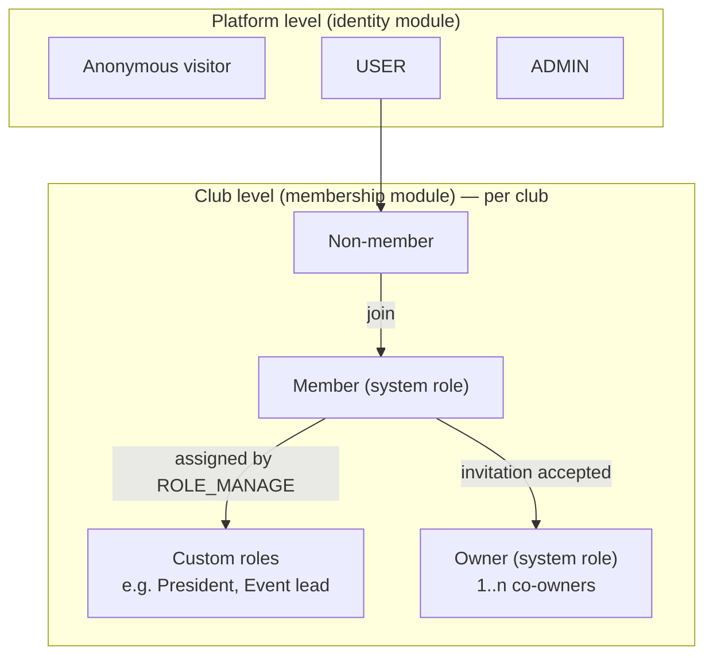
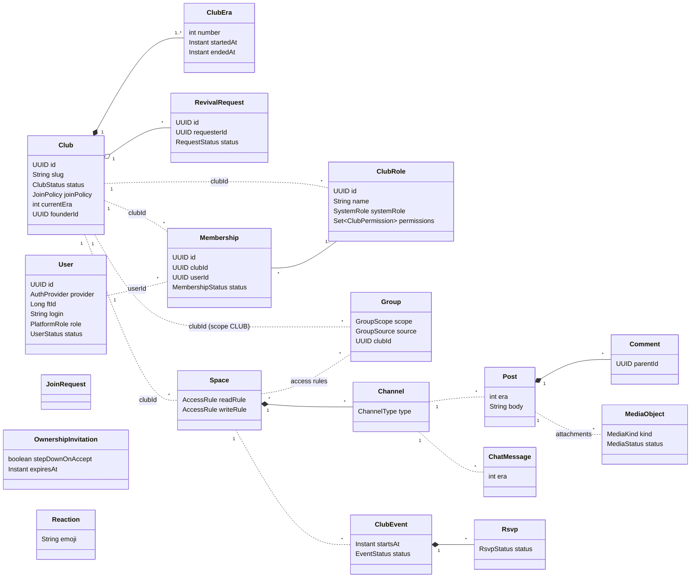
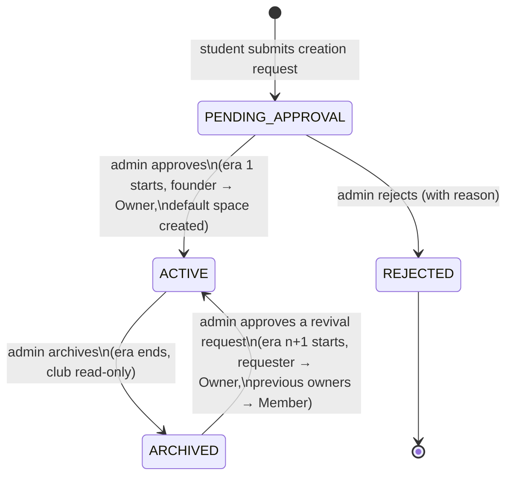
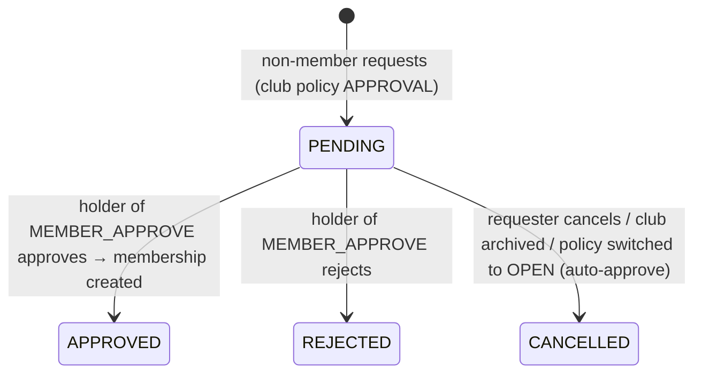
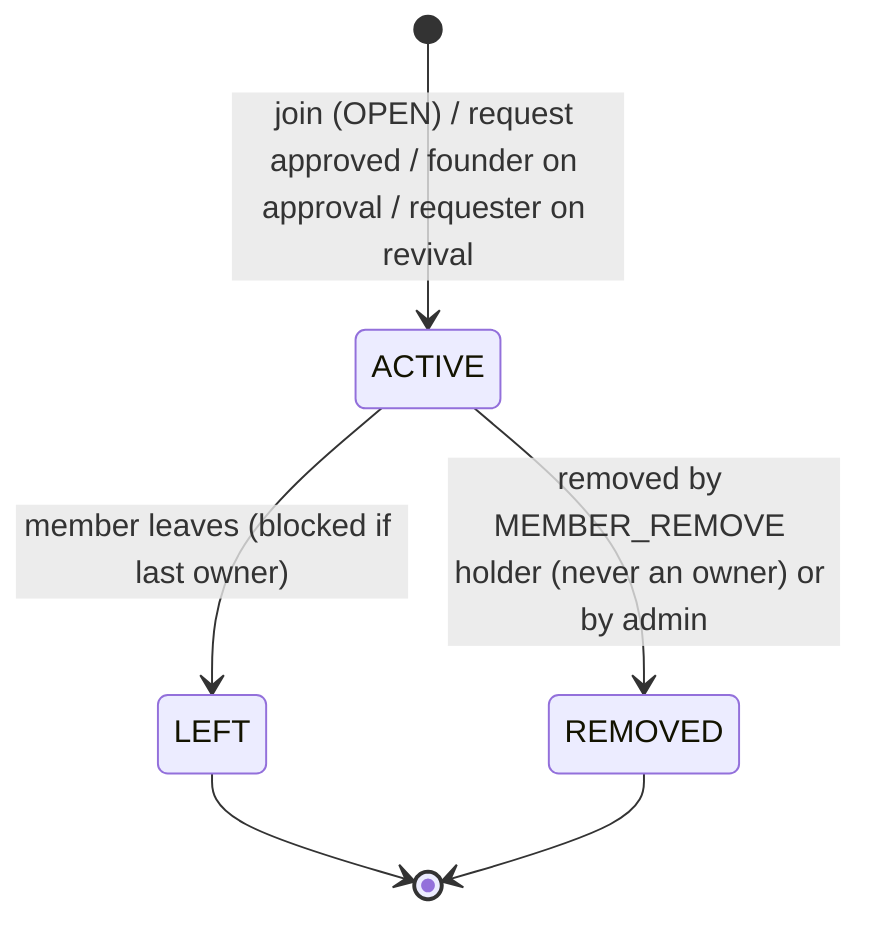
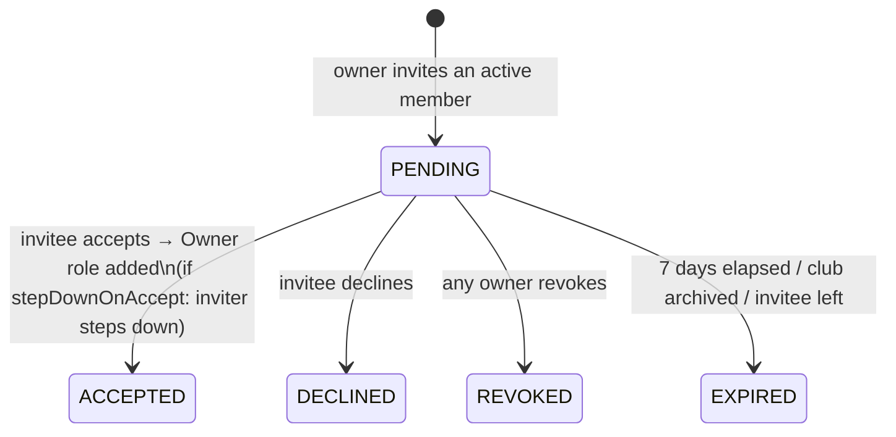
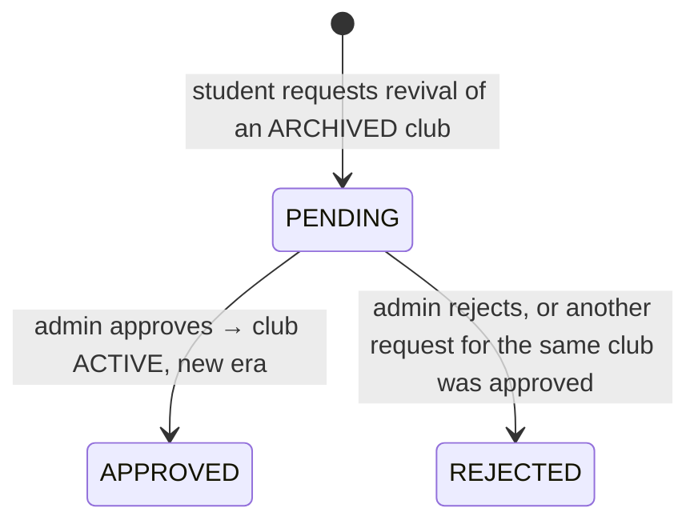
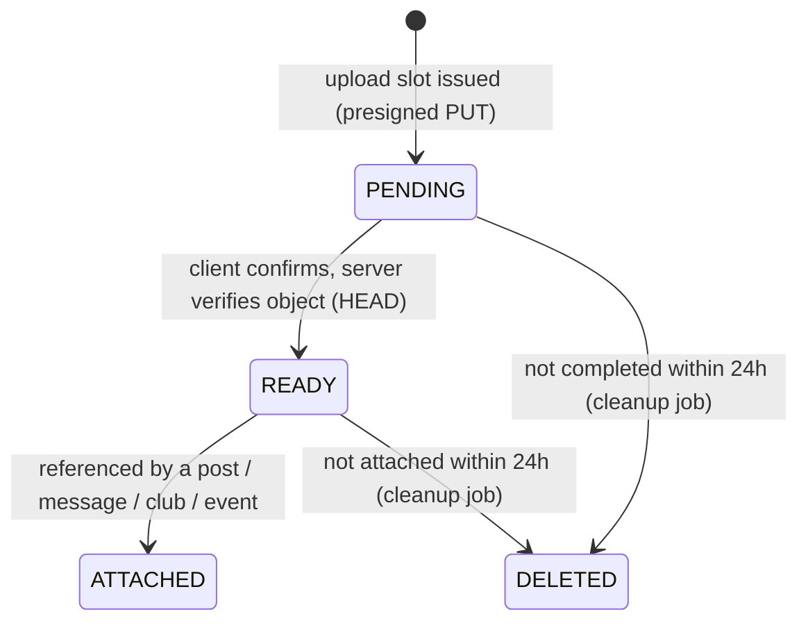
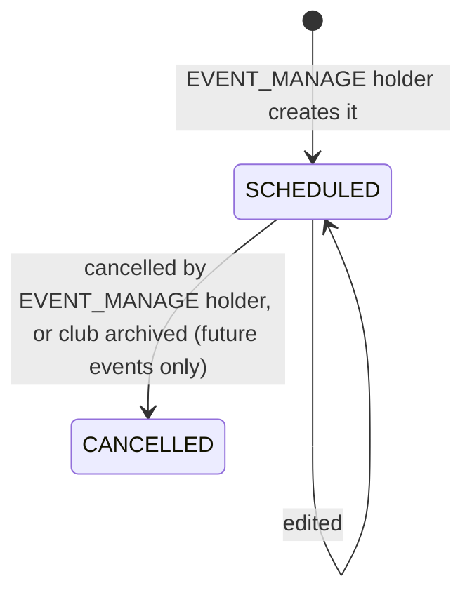

# 01 — Domain Model

This document defines **what** the system is about, independently of technology: vocabulary, roles, permissions, aggregates, lifecycles and business rules. Every module document refers back to the rule IDs (`BR-xx`) defined here.

---

## 1. Requirements traceability

| Subject requirement | How it is satisfied | Module(s) |
|---------------------|---------------------|-----------|
| Roles: Club Owner, Club Member, Non-member, Admin | Platform roles `USER`/`ADMIN`; per-club built-in roles `Owner`/`Member` + custom roles; non-member = no active membership | identity, membership |
| Authentication (42 intra & password) | Login with 42 (OAuth2) + admin-created local password accounts | identity |
| Main landing page | Public landing (stats, featured/active clubs, categories) | discovery, frontend |
| Join clubs through the site | One-click join (`OPEN`) or join request (`APPROVAL`, default) | membership |
| Create pages for clubs | Club profile page + spaces + channels | club, space |
| Create a new club (new page) | Creation request → admin approval → club page with default space | club, space, membership |
| Post image / video / audio | Posts with media attachments uploaded to S3 storage | forum, media |
| Comment / react on posts | Comments with 1-level replies; fixed emoji reactions on posts and comments | forum |
| Event calendar | Per-club and campus calendars, RSVP, reminders, iCal feeds | calendar |
| **Lifecycle:** ownership transfer | Co-owner invitation (accept) + step down; "Transfer" = invite with auto step-down | membership |
| **Lifecycle:** club archival | Admin archives → club read-only, nothing deleted | club (+ listeners everywhere) |
| **Lifecycle:** club history | Soft deletes, eras, archived clubs stay readable, timeline of club events, posts and chat filterable by era | club, history, forum, chat |
| Clubs "rebuilt" (goal statement) | Revival request → admin approval → new era with a new owner | club, membership |
| Communication (team requirement) | Club chat, in-app + email notifications, real-time updates | chat, notification, realtime |

---

## 2. Ubiquitous language (glossary)

| Term | Definition |
|------|-----------|
| **User** | A person who can log in, either via 42 (`FORTY_TWO`) or with a local account (`LOCAL`). Has a platform role `USER` or `ADMIN`. |
| **Admin** | Platform role. Approves club creation, archives clubs, approves revivals, manages campus groups and local accounts, can rescue any club. |
| **Club** | A student organisation. Has a profile, a status (`PENDING_APPROVAL`, `ACTIVE`, `REJECTED`, `ARCHIVED`), a join policy, and a sequence of eras. |
| **Era** | A continuous period of activity of a club. Era 1 starts at approval. Each archival ends an era, each revival starts a new one. Content is stamped with the era it was created in. |
| **Founder** | The user who submitted the creation request. Becomes the first owner on approval. |
| **Membership** | The relation between a user and a club. Active or ended (`LEFT`, `REMOVED`). Carries one or more club roles. |
| **Non-member** | A logged-in user without an active membership in a given club. |
| **Club role** | A named bundle of permissions **defined by the club**. Two built-in system roles always exist: **Owner** (all permissions, cannot be edited or deleted) and **Member** (assigned to every member; its permissions are editable). |
| **Owner** | Holder of the Owner system role. A club can have several (co-owners). An active club always has at least one. |
| **Permission** | A platform-defined capability inside a club (e.g. `EVENT_MANAGE`). Clubs combine permissions into roles; they cannot invent new ones because code enforces them. |
| **Club group** | A named list of club members defined by the club (e.g. "Board", "Robotics team"), used to restrict spaces. Not a role and grants no permissions. |
| **Campus group** | A campus-wide named list of users, managed by admins (`MANUAL`) or derived from 42 data (`SYNCED`, e.g. `pool-2025-september`, `campus-lisboa`). Usable in any club's space rules. |
| **Space** | A community space inside a club: the **unit of access control**. Has a read rule and a write rule, and contains channels. |
| **Access rule** | `PUBLIC` (any logged-in user), `CLUB_MEMBERS` (active members of the club), or `GROUPS` (members of at least one listed club or campus group). |
| **Channel** | A content container inside a space: `FORUM` (posts + comments) or `CHAT` (messages). It inherits the space's access rules. |
| **Post** | A forum thread starter: Markdown text + optional media attachments (image, video, audio). |
| **Comment** | A reply to a post; may itself have replies, which cannot be replied to (one level of nesting). |
| **Reaction** | An emoji from the fixed platform set, placed by a user on a post or comment. A user can place each emoji once per target. |
| **Chat message** | A message in a chat channel. Persisted forever and part of club history. |
| **Join request** | A request to join a club with `APPROVAL` policy. |
| **Ownership invitation** | An owner's invitation to an active member to become co-owner. The member must accept it. It may include `stepDownOnAccept` (transfer). |
| **Revival request** | A student's request to bring an archived club back. The admin approves or rejects it. |
| **Club event** | A calendar event organised by a club, published in a space (inherits its read access), with RSVPs. |
| **RSVP** | A user's answer to an event: `GOING`, `INTERESTED`, `NOT_GOING`. |
| **Notification** | A message to one user about something relevant (in-app and/or email according to preferences). |
| **Timeline** | The chronological history of a club's lifecycle facts (founded, owners changed, archived, revived, events held). |

---

## 3. Actors and roles

### 3.1 Role layers

A user's capabilities in a club come from the **union of the permissions of all roles they hold** in that club. `ADMIN` passes every club permission check, but no one can write into an archived club (R-08).

### 3.2 Capability matrix (defaults)

| Capability | Anonymous | Non-member | Member | Owner | Admin |
|-----------|:--:|:--:|:--:|:--:|:--:|
| See landing page and club directory / public club profile | ✓ | ✓ | ✓ | ✓ | ✓ |
| Request creation of a new club | | ✓ | ✓ | ✓ | ✓ |
| Join (`OPEN`) / request to join (`APPROVAL`) | | ✓ | | | |
| Read a space | | if read rule passes | if read rule passes | ✓ (`SPACE_ACCESS_ALL`) | ✓ |
| Post, comment, react, chat in a space | | if write rule passes | if write rule passes | ✓ | ✓ |
| RSVP to an event | | if the event's space is readable | ✓ | ✓ | ✓ |
| Create events, manage spaces, approve members… | | | if a held role grants it | ✓ | ✓ |
| Invite co-owners, step down | | | | ✓ | |
| Remove an owner, assign an owner | | | | | ✓ |
| Approve/reject club creation, archive, approve revival | | | | | ✓ |
| Request revival of an archived club | | ✓ | ✓ | ✓ | ✓ |
| Manage campus groups, create local accounts | | | | | ✓ |

---

## 4. Permission catalogue

Permissions are a Java enum (`pt.vclubroom.membership.api.ClubPermission`). Adding a capability means adding a constant and enforcing it in the owning module.

| Permission | Allows | Owner | Member (default) |
|-----------|--------|:----:|:----:|
| `CLUB_SETTINGS_MANAGE` | Edit club profile (name, tagline, description, avatar, banner, category, tags) and join policy | ✓ | |
| `MEMBER_APPROVE` | Approve/reject join requests | ✓ | |
| `MEMBER_REMOVE` | Remove non-owner members | ✓ | |
| `ROLE_MANAGE` | Create/edit/delete custom roles; assign/unassign custom roles. Anti-escalation: a role can only be granted permissions the actor holds (BR-14). | ✓ | |
| `GROUP_MANAGE` | Create/edit/delete club groups and their members | ✓ | |
| `SPACE_MANAGE` | Create/edit/delete spaces and channels, including access rules | ✓ | |
| `SPACE_ACCESS_ALL` | Read and write every space of the club regardless of its rules | ✓ | |
| `CONTENT_MODERATE` | Pin posts; soft-delete others' posts, comments and chat messages in spaces they can read | ✓ | |
| `EVENT_MANAGE` | Create, edit and cancel club events | ✓ | |

Owner-only actions that are **not** grantable permissions: invite co-owners, revoke invitations, step down.

> **Flexibility example.** A club that wants "members can create events" grants `EVENT_MANAGE` to its *Member* role. A club with a board creates a role "Board" with `MEMBER_APPROVE`, `EVENT_MANAGE`, `CONTENT_MODERATE`, plus a *club group* "Board" used to restrict a private "Board room" space.

---

## 5. Aggregates and entities

Solid composition (`*--`) means the same aggregate and module. Dotted links (`..`) are **references by ID across modules** (no shared objects, no foreign keys; see R-04).

| Aggregate root | Module | Contains |
|----------------|--------|----------|
| `User` | identity | — |
| `Club` | club | `ClubEra` (list) |
| `RevivalRequest` | club | — |
| `Membership` | membership | role assignments |
| `ClubRole` | membership | permissions |
| `JoinRequest` | membership | — |
| `OwnershipInvitation` | membership | — |
| `Group` | group | members |
| `Space` | space | `Channel` (list), access rules |
| `Post` | forum | attachment references |
| `Comment` | forum | — |
| `Reaction` | forum | — |
| `ChatMessage` | chat | attachment references |
| `MediaObject` | media | — |
| `ClubEvent` | calendar | reminders |
| `Rsvp` | calendar | — |
| `Notification`, `NotificationPreference` | notification | — |
| `ClubCard` (read model) | discovery | — |
| `TimelineEntry` (read model) | history | — |

---

## 6. Lifecycles

### 6.1 Club

### 6.2 Join request

When a club switches from `APPROVAL` to `OPEN`, pending requests are **auto-approved** (the club wants open membership).

### 6.3 Membership

A user can join again later. That creates a **new** membership row, so periods of membership are preserved for history.

### 6.4 Ownership invitation (co-ownership and transfer)

### 6.5 Revival request

### 6.6 Media object

### 6.7 Club event

---

## 7. Business rules and invariants

| ID | Rule | Enforced in |
|----|------|------------|
| BR-01 | A club slug is unique, lowercase, `[a-z0-9-]{3,40}`, derived from the name and editable only while `PENDING_APPROVAL`. | `club.domain.Club` |
| BR-02 | Only `ACTIVE` clubs accept writes (posts, comments, reactions, chat, events, joins, role changes). `ARCHIVED` clubs are read-only for everyone, admins included. | `membership` `ClubAuthorizationService`, `space` `SpaceAccessEvaluator`, club status checks |
| BR-03 | A club in `PENDING_APPROVAL` is visible only to its founder and admins. | `club.application.ClubQueryService` |
| BR-04 | An `ACTIVE` club always has **≥ 1** active owner. An owner cannot leave or step down if they are the last owner. | `membership.domain.ClubOwnership` (domain service) |
| BR-05 | Only admins can remove an owner. `MEMBER_REMOVE` never applies to owners. | `membership.application.MemberService` |
| BR-06 | An ownership invitation targets an **active member**, is unique per (club, invitee) while pending, and expires after 7 days. | `membership.domain.OwnershipInvitation` |
| BR-07 | A user has at most one **active** membership and at most one **pending** join request per club. | DB partial unique indexes + `membership.application.JoinService` |
| BR-08 | Join policy `OPEN` creates the membership immediately. `APPROVAL` creates a join request. The default for new clubs is `APPROVAL`. | `membership.application.JoinService` |
| BR-09 | Every membership holds the Member system role. Owners hold Owner + Member. | `membership.domain.Membership` |
| BR-10 | The Owner role's permissions are always *all* permissions and cannot be changed. System roles cannot be deleted or renamed. | `membership.domain.ClubRole` |
| BR-11 | **Writing always requires reading:** effective write access = read rule passes **AND** write rule passes. Because of this intersection, no combination of rules can produce "can post but can't read". The UI shows the effective audience. A write rule broader than the read rule is accepted and normalised to the read rule. | `space.domain.Space`, `space.application.SpaceAccessEvaluator` |
| BR-12 | A `GROUPS` rule may reference only groups of the same club or campus groups. An empty `GROUPS` rule fails closed. | `space.application.SpaceService` + `group.api.GroupCatalog` |
| BR-13 | Club groups contain only active members of their club. | `group.application.ClubGroupService` + membership-ended listener |
| BR-14 | Anti-escalation: an actor with `ROLE_MANAGE` can create or assign only roles whose permissions are a subset of their own effective permissions. Nobody can assign the Owner role through role management (only through invitations). | `membership.application.RoleService` |
| BR-15 | Content created in era *n* becomes read-only (no edits, comments or reactions) once the club's current era is greater than *n*. | `forum`, `chat` via `ChannelAccess.currentEra()` |
| BR-16 | User content is never hard-deleted. Deletion sets a tombstone (`deleted_at`, `deleted_by`). Moderated items show "removed by a moderator". | `forum`, `chat` |
| BR-17 | A comment's parent must be a top-level comment of the same post (one level of replies). | `forum.domain.Comment` |
| BR-18 | Reactions use only emojis of the configured set. One reaction per (target, user, emoji). | `forum.application.ReactionService` + DB unique index |
| BR-19 | A media object can be attached only by its uploader, only once, only when `READY`, and only for its declared purpose. | `media.application.MediaAttachmentService` |
| BR-20 | Only one revival request can be approved per archival; approving one rejects the other pending requests for that club. | `club.application.RevivalService` |
| BR-21 | An event's `endsAt` is after `startsAt`. Events can be created only in spaces of the same club. | `calendar.domain.ClubEvent` |
| BR-22 | RSVP is allowed only to users who can read the event's space, and only for `SCHEDULED` events that have not ended. | `calendar.application.RsvpService` |
| BR-23 | Local accounts are created only by admins. 42 accounts are created automatically on first login. The `login` is unique (case-insensitive) across both providers. | `identity` |
| BR-24 | Disabled users cannot log in, and their active sessions are invalidated. | `identity` + Spring Session |
