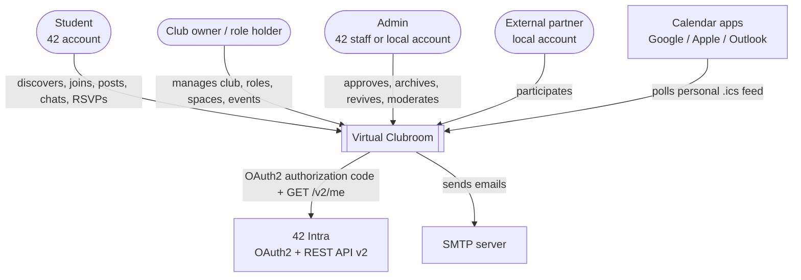
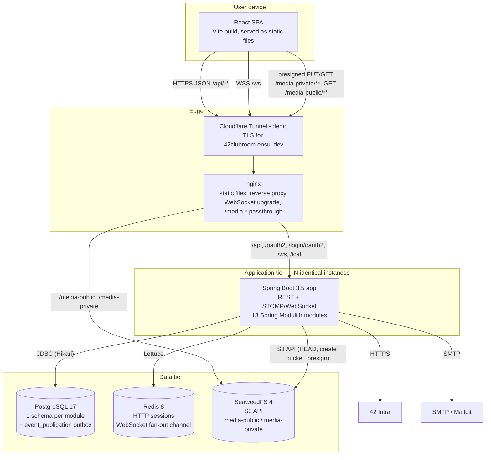
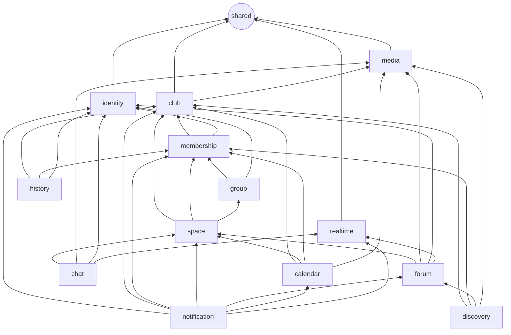
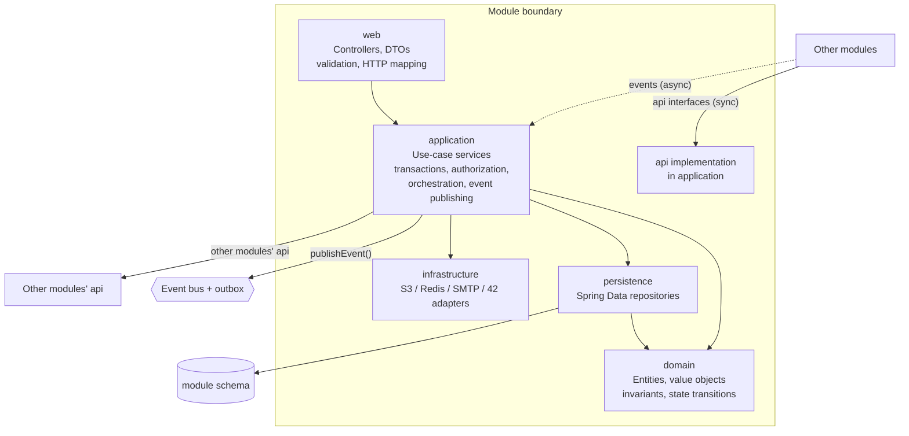
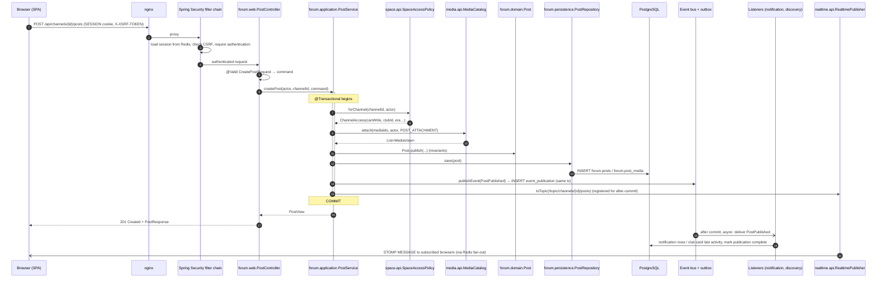
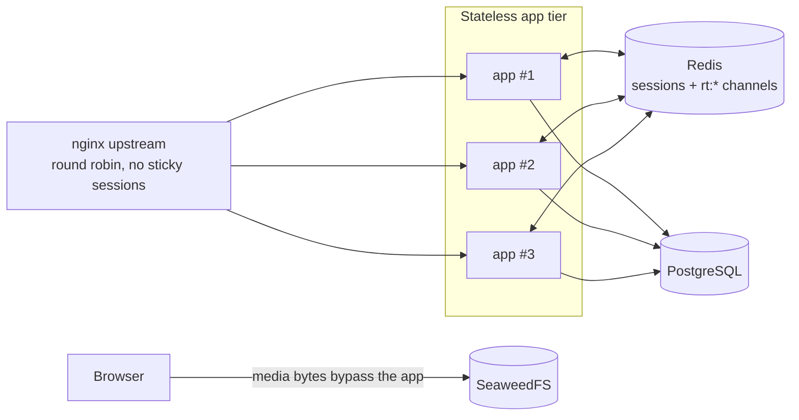

# 02 — Architecture

## 1. Architectural drivers

| Driver | What it means here | Main tactics |
|--------|-------------------|--------------|
| **Loose coupling / modularity** (team priority, 25% of grade) | A feature can change without rippling through others; features are replaceable. | Modular monolith with *verified* boundaries; public APIs per module; domain events; dependency inversion (SPI); schema per module. |
| **Maintainability** (team priority) | 3 developers, 2 days, then possibly other students. | One module template; the same layering everywhere; generated module documentation; OpenAPI contract shared with the frontend. |
| **Scalability** (team priority) | More clubs, members and messages over time; clubs come and go. | Stateless app instances; Redis sessions; Redis WebSocket fan-out; direct-to-storage media; keyset pagination; read models; jobs safe across multiple instances. |
| **Reliability of communication** | Notifications and side effects must not be lost if something fails. | Transactional outbox (Spring Modulith event publication registry), at-least-once delivery, idempotent listeners. |
| **Security** | 42 accounts, private spaces, media. | Session cookies (HttpOnly), CSRF, 4 authorization layers, presigned URLs, sanitised Markdown. |
| **Time-to-deliver** | 2 days. | No microservices, no Kafka cluster, Spring Boot defaults, minimal infrastructure (Postgres, Redis, SeaweedFS). |

---

## 2. System context (C4 level 1)



---

## 3. Containers (C4 level 2)



| Container | Technology | Responsibility | Scales by |
|-----------|-----------|----------------|-----------|
| SPA | React 19, TypeScript, Vite | All UI; calls REST; subscribes to STOMP topics | CDN/static caching |
| Edge (demo) | Cloudflare Tunnel (D-34) | Public hostname `42clubroom.ensui.dev`, TLS, no inbound ports | Managed by Cloudflare |
| nginx | nginx 1.30 | Single origin for SPA, API, WS and media (no CORS); load balancing; real client IP from Cloudflare | Rarely the bottleneck |
| Spring Boot app | Java 21, Spring Boot 3.5, Spring Modulith 1.4 | All business logic | **Horizontal**: `docker compose up --scale backend=N` |
| PostgreSQL | 17 | System of record + outbox | Vertical; read replicas later |
| Redis | 8 | Sessions; cross-instance WebSocket fan-out | Vertical; Redis Cluster later |
| SeaweedFS | 4.x | Media blobs | Add volume servers |

---

## 4. Architectural style: modular monolith

**Why not microservices?** With 3 people and 2 days, microservices would cost the deadline: N deployables, N databases, network failures between services, distributed transactions, service discovery. A modular monolith gives you the *design* benefits (boundaries, ownership, events) with one deployable. Spring Modulith **verifies** the boundaries in a test, so the modularity can be proven to judges, and any module can be extracted later because:

- it owns its own schema (no shared tables, no cross-schema foreign keys);
- other modules reach it only through its `api` interfaces (which become REST/gRPC clients) or its `events` (which become Kafka topics).

### 4.1 Modules

Each module is a direct sub-package of `pt.vclubroom` (Spring Modulith's convention).

| Module | Owns (schema) | Public API (`api` named interface) | Publishes (`events` named interface) | Consumes events from |
|--------|---------------|-----------------------------------|--------------------------------------|---------------------|
| `shared` (open) | — | `Actor`, `AuthenticatedUser`, exceptions, `CursorPage` | — | — |
| `identity` | `identity` | `UserDirectory`, `UserSummary`, `UserContact` | `UserRegistered`, `UserProfileSynced` | — |
| `club` | `club` | `ClubCatalog`, `ClubSnapshot`, `ClubStatus`, `JoinPolicy` (+ `spi.ClubManagementGuard`) | `ClubCreationRequested`, `ClubApproved`, `ClubRejected`, `ClubProfileUpdated`, `ClubArchived`, `ClubRevivalRequested`, `ClubRevived` | — |
| `membership` | `membership` | `ClubAuthorization`, `ClubPermission` | `MemberJoined`, `MemberLeft`, `JoinRequested`, `JoinRequestDecided`, `OwnershipInvitationSent`, `OwnerAdded`, `OwnerSteppedDown`, `OwnerRemoved` | club |
| `group` | `groups` | `GroupMembershipQuery`, `GroupCatalog` | `GroupDeleted` | identity, membership |
| `space` | `space` | `SpaceAccessPolicy`, `ChannelAccess`, `SpaceAudience` | — | club, group |
| `media` | `media` | `MediaCatalog`, `MediaView`, `MediaPurpose` | — | — |
| `forum` | `forum` | — | `PostPublished`, `CommentAdded` | — |
| `chat` | `chat` | — | — | — |
| `calendar` | `calendar` | `RsvpQuery` | `EventScheduled`, `EventUpdated`, `EventCancelled`, `EventReminderDue` | club |
| `notification` | `notification` | — | — | club, membership, forum, calendar |
| `realtime` | — | `RealtimePublisher` (+ `spi.SubscriptionAuthorizer`) | — | — |
| `discovery` | `discovery` | — | — | club, membership, forum |
| `history` | `history` | — | — | club, membership |

> Calendar events are deliberately **not** projected into `discovery` (public, anonymous) or `history` (visible to every logged-in user). An event inherits its space's read rule (R-06), so copying it into a broader-audience read model would leak restricted events.

### 4.2 Dependency graph (allowed compile-time dependencies)



**Rules (verified by `ModularityTests`):**

1. **No cycles** between modules.
2. A module may use **only** another module's `api`, `events` or `spi` packages, never `domain`, `application`, `persistence`, `web` or `infrastructure`.
3. Each module declares its allowed dependencies in its `package-info.java` (`@ApplicationModule(allowedDependencies = …)`).
4. **Upstream modules never know downstream ones.** When an upstream module needs a decision only a downstream module can make, it declares an **SPI** interface that the downstream module implements (dependency inversion):
   - `club.spi.ClubManagementGuard` ← implemented by `membership` (club must not depend on membership, because membership depends on club).
   - `realtime.spi.SubscriptionAuthorizer` ← implemented by `chat` and `forum` (realtime stays generic infrastructure; per-user `/user/queue/**` destinations are private by construction).

---

## 5. Inside a module: layers

Every module uses the same internal structure, so moving between modules costs nothing.

```text
pt.vclubroom.<module>
├── package-info.java        @ApplicationModule(allowedDependencies = {...})
├── api/                     PUBLIC  — interfaces + DTO records other modules may call synchronously
├── events/                  PUBLIC  — immutable event records other modules may listen to
├── spi/                     PUBLIC  — (optional) interfaces this module needs others to implement
├── web/                     internal — @RestController + request/response DTOs (+ mappers)
├── application/             internal — use-case services (@Transactional), event listeners, API implementations
├── domain/                  internal — entities/aggregates, value objects, domain services, invariants
├── persistence/             internal — Spring Data JPA repositories, projections
└── infrastructure/          internal — adapters to the outside world (S3, Redis, SMTP, 42 API, config)
```



| Layer | May call | Must not | Typical types |
|-------|---------|----------|---------------|
| `web` | own `application`, `shared` | repositories, entities in responses, other modules | `ClubController`, `CreateClubRequest`, `ClubResponse` |
| `application` | own `domain`, `persistence`, `infrastructure`; other modules' `api`; `ApplicationEventPublisher` | HTTP types (`HttpServletRequest`, `ResponseEntity`) | `ClubService`, `ClubLifecycleListener` |
| `domain` | itself, `shared` | Spring beans, repositories, other modules | `Club`, `ClubEra`, `AccessRule` |
| `persistence` | `domain` | business logic | `ClubRepository extends JpaRepository<Club, UUID>` |
| `infrastructure` | external SDKs | business decisions | `S3ObjectStorage`, `SmtpEmailSender` |

**DTO boundaries.** Entities never leave the module. Controllers return `web` DTOs. Cross-module calls return `api` records (e.g. `ClubSnapshot`). Events carry IDs plus the few facts consumers need, never entities.

---

## 6. Communication patterns

| # | Pattern | Use when | Guarantees | Example |
|---|---------|---------|-----------|---------|
| P1 | **In-module call** | Same module | Same transaction | `ClubController` → `ClubService` → `ClubRepository` |
| P2 | **Synchronous cross-module query** via `api` interface | You need an answer **now** to continue (authorization, validation) | Same thread and transaction; read-only by convention | `forum` asks `space.api.SpaceAccessPolicy.forChannel(...)` |
| P3 | **Asynchronous domain event** (reliable, outbox) | Something happened and *others* react (side effects, projections, notifications) | Published in the same DB transaction as the state change; delivered **at-least-once** after commit; retried after failures or restarts | `ClubApproved` → membership creates the owner, space creates the default space, discovery adds the card, notification emails the founder |
| P4 | **Real-time push** (best effort) | Update open browsers | After commit; fan-out to all instances via Redis; can be lost (the client refetches on reconnect) | New chat message → `/topic/channels/{id}/messages` |
| P5 | **SPI (dependency inversion)** | An upstream module needs a decision owned downstream | Compile-time decoupling | `club.spi.ClubManagementGuard` implemented by `membership` |
| P6 | **Scheduled trigger** | Time-based behaviour | `FOR UPDATE SKIP LOCKED`, so only one instance picks each row | Event reminders, orphan media cleanup |

**Rule of thumb.** If the caller needs the result to decide what to do, use P2. If the caller just announces a fact, use P3. Never make a synchronous call that *changes* another module's state; publish an event instead. That keeps write ownership in exactly one module.

---

## 7. Request lifecycle (generic write request)

The path every write request takes, using "create a post" as the example. Each module document zooms into its own flows.



---

## 8. Cross-cutting concerns

| Concern | Decision |
|---------|----------|
| **Authentication** | Spring Security: OAuth2 login (42) + JSON local login; session in Redis (Spring Session); principal implements `shared.security.AuthenticatedUser`. See [07-security.md](07-security.md). |
| **Authorization** | 4 layers: URL rules (filter chain), platform role (`ADMIN`), club permissions (`ClubAuthorization`), space access (`SpaceAccessPolicy`). Checks are made **in application services**, not with SpEL annotations, so they are explicit, unit-testable and visible to module verification. |
| **Validation** | Bean Validation on request DTOs (syntax); domain methods enforce invariants (semantics). |
| **Errors** | Typed exceptions in `shared.error` → `GlobalExceptionHandler` → RFC 9457 `ProblemDetail` with a stable `code`. |
| **Transactions** | One transaction per use case, opened at the application service. Listeners run in their own new transaction (`@ApplicationModuleListener`). |
| **IDs** | UUID v4 generated in Java (domain factory methods), so events can reference IDs before the insert. Chat messages use `bigint` identity for cheap ordering. |
| **Time** | Store `timestamptz` in UTC; inject `java.time.Clock`; display in `Europe/Lisbon` on the frontend. |
| **Concurrency** | Optimistic locking (`@Version`) on aggregates edited concurrently (club, space, roles, events); unique indexes for races (double join, double reaction). |
| **Pagination** | Keyset (cursor) pagination for feeds, chat, notifications and timeline. Offset pagination for admin lists and the directory. |
| **Soft deletes** | All user content (BR-16). |
| **Observability** | Spring Boot Actuator (`/actuator/health`, `/actuator/info`, `/actuator/metrics`), structured JSON logs (`logging.structured.format.console=ecs`), Spring Modulith's `/actuator/modulith` endpoint. |
| **API contract** | springdoc-openapi generates `/v3/api-docs`; the frontend generates TypeScript types from it. |
| **Configuration** | `application.yml` + environment variables (12-factor); typed `@ConfigurationProperties` records per module (`app.media.*`, `app.forum.*`, …). |

---

## 9. Scalability strategy



| Pressure | Tactic |
|---------|--------|
| More concurrent users | Add app instances. No sticky sessions needed: sessions are in Redis and WebSocket messages reach every instance through Redis pub/sub. Java 21 **virtual threads** (`spring.threads.virtual.enabled=true`) keep blocking I/O cheap. |
| Large media | Browsers upload and download **directly** to and from object storage with presigned URLs. App instances never stream video. |
| Growing feeds / chat history | Keyset pagination on `(created_at, id)` indexes, so a page costs the same at message 10 and at message 10 million. |
| Directory / landing traffic | Served from the `discovery.club_cards` **read model** maintained by events: one indexed table, no cross-module joins, full-text search via `tsvector` + GIN. |
| Notification fan-out | Async listeners off the request path; batch inserts. |
| Scheduled jobs on N instances | Each job claims rows with `SELECT … FOR UPDATE SKIP LOCKED`, so no double sends and no external lock service. |
| Clubs coming and going | Archival is a status flip (no data movement); eras partition content logically; archived clubs leave the hot paths through status filters and partial indexes. |
| Hot permission checks | `ClubAuthorization` is the single entry point, so a cache (Caffeine or Redis) can be added there later and evicted on `MemberJoined`/`MemberLeft`/role events without touching callers. |
| Beyond one database / team growth | Extract a module into a service: its `api` becomes an HTTP client, its `events` go through Kafka (`@Externalized`). See [06-messaging-and-realtime.md](06-messaging-and-realtime.md#9-migration-path-to-kafka). |

---

## 10. Maintainability practices

1. **Module verification test.** `ApplicationModules.of(ClubroomApplication.class).verify()` fails the build on cycles or boundary violations.
2. **Generated architecture docs.** Spring Modulith's `Documenter` writes C4/PlantUML component diagrams and module canvases on every test run, so the documentation can't drift.
3. **One template.** Every module has the same packages and naming (`XController`, `XService`, `XRepository`, `XListener`).
4. **Contract-first frontend.** OpenAPI → TypeScript types; a renamed DTO field breaks the frontend build, not production.
5. **Small public surfaces.** A module's `api` exposes a handful of methods; everything else is package-internal by Modulith's rules.
6. **Configuration over code for club dynamics.** Roles, groups, spaces, join policy and event permissions are data, so new club structures need no deployment.
