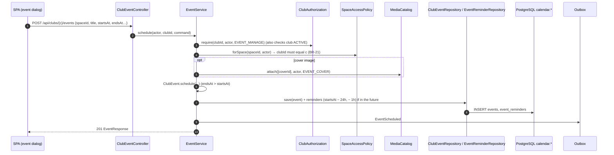
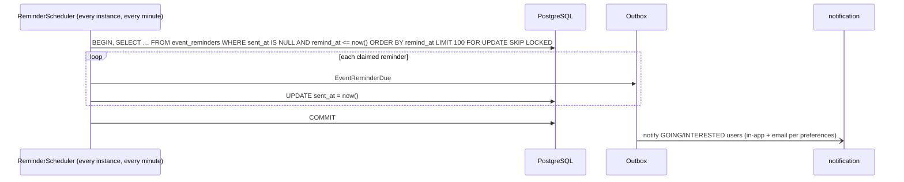

# Module `calendar`

## 1. Responsibility

- **Club events** (D-17): created by holders of `EVENT_MANAGE` (D-25), published **in a space** whose read rule decides who sees them (R-06).
- **Per-club calendar** and **campus-wide calendar** (filter "all I can see" or "my clubs").
- **RSVP / attendance** (`GOING`, `INTERESTED`, `NOT_GOING`) with counts (BR-22).
- **Reminders** (24 h and 1 h before, configurable) via a scheduled job that is safe with N instances.
- **iCal export**: a personal secret-token feed (R-16).
- On club archival, **future events are cancelled** (R-10).

## 2. Dependencies

| Direction | Modules |
|-----------|---------|
| Depends on | `shared`, `club::api`, `club::events`, `space::api`, `membership::api`, `media::api` |
| Used by (API) | notification (`RsvpQuery`) |
| Listened to (events) | notification (only: events inherit restricted space rules, so they are never copied into broader-audience read models) |

```java
@ApplicationModule(
        displayName = "Calendar",
        allowedDependencies = {"shared", "club::api", "club::events", "space::api", "membership::api", "media::api"}
)
package pt.vclubroom.calendar;

import org.springframework.modulith.ApplicationModule;
```

## 3. Packages

```text
calendar/
├── api/            RsvpQuery, RsvpStatus
├── events/         EventScheduled, EventUpdated, EventCancelled, EventReminderDue
├── web/            ClubEventController, CalendarController, RsvpController, FeedTokenController, IcalFeedController
├── application/    EventService, CalendarQueryService, RsvpService, ReminderScheduler, FeedTokenService,
│                   IcalFeedService, ClubArchivedListener, CalendarProperties, ScheduleEventCommand, CalendarItem
├── domain/         ClubEvent, EventStatus, Rsvp, EventReminder, ReminderKind, CalendarFeedToken
└── persistence/    ClubEventRepository, RsvpRepository, EventReminderRepository, FeedTokenRepository
```

## 4. Domain model

| Entity | Fields | Rules |
|--------|--------|-------|
| `ClubEvent` | `id`, `clubId`, `spaceId`, `era`, `createdBy`, `title`, `description`, `location`, `onlineUrl`, `startsAt`, `endsAt`, `status` (`SCHEDULED`/`CANCELLED`), `coverMediaId`, `createdAt`, `updatedAt`, `version` | `endsAt > startsAt` (BR-21); the space must belong to the club; edit/cancel only while `SCHEDULED`. |
| `Rsvp` | `eventId`, `userId`, `status`, `updatedAt` | One per (event, user); only readers of the space; only before `endsAt` (BR-22). |
| `EventReminder` | `id`, `eventId`, `kind` (`DAY_BEFORE`, `HOUR_BEFORE`), `remindAt`, `sentAt` | Regenerated when times change; deleted when cancelled. |
| `CalendarFeedToken` | `userId`, `tokenHash` (SHA-256), `createdAt` | The raw token is shown once; rotate = replace. |

## 5. Public API

```java
package pt.vclubroom.calendar.api;

public enum RsvpStatus {
    GOING,
    INTERESTED,
    NOT_GOING
}
```

```java
package pt.vclubroom.calendar.api;

import java.util.Set;
import java.util.UUID;

public interface RsvpQuery {

    Set<UUID> attendees(UUID eventId, Set<RsvpStatus> statuses);
}
```

## 6. Events

```java
package pt.vclubroom.calendar.events;

import java.time.Instant;
import java.util.UUID;

public record EventScheduled(UUID eventId, UUID clubId, UUID spaceId, String title, Instant startsAt, Instant endsAt,
                             UUID createdBy, Instant occurredAt) {
}
```

```java
package pt.vclubroom.calendar.events;

import java.time.Instant;
import java.util.UUID;

public record EventUpdated(UUID eventId, UUID clubId, UUID spaceId, String title, Instant startsAt, Instant endsAt,
                           Instant occurredAt) {
}
```

```java
package pt.vclubroom.calendar.events;

import java.time.Instant;
import java.util.UUID;

public record EventCancelled(UUID eventId, UUID clubId, String title, Instant startsAt, String reason,
                             Instant occurredAt) {
}
```

```java
package pt.vclubroom.calendar.events;

import java.time.Instant;
import java.util.UUID;

public record EventReminderDue(UUID eventId, UUID clubId, UUID spaceId, String title, Instant startsAt, String kind,
                               Instant occurredAt) {
}
```

| Event | Consumers |
|-------|-----------|
| `EventScheduled` | notification (club members who can read the space) |
| `EventUpdated` | notification (people who RSVPed GOING/INTERESTED) |
| `EventCancelled` | notification (RSVPed users) |
| `EventReminderDue` | notification (GOING/INTERESTED) |

**Consumed:** `ClubArchived` → `ClubArchivedListener` cancels `SCHEDULED` events with `startsAt > now`.

## 7. REST endpoints

| Method | Path | Authorization | Description |
|--------|------|---------------|-------------|
| `GET` | `/api/calendar?from=&to=&scope=all\|mine&clubIds=` | user | Campus calendar: events in readable spaces; range ≤ 62 days |
| `GET` | `/api/clubs/{clubId}/events?from=&to=` | user | Club calendar (readable events only) |
| `POST` | `/api/clubs/{clubId}/events` | `EVENT_MANAGE` | `{spaceId, title, description, location, onlineUrl, startsAt, endsAt, coverMediaId?}` |
| `GET` | `/api/events/{eventId}` | space read | Event + counts + my RSVP |
| `PATCH` | `/api/events/{eventId}` | `EVENT_MANAGE` | Edit (reminders regenerated) |
| `POST` | `/api/events/{eventId}/cancel` | `EVENT_MANAGE` | `{reason}` |
| `PUT` | `/api/events/{eventId}/rsvp` | space read | `{status}` |
| `DELETE` | `/api/events/{eventId}/rsvp` | self | Remove RSVP |
| `GET` | `/api/events/{eventId}/attendees?status=GOING` | space read | Attendee list with user summaries |
| `POST` | `/api/me/calendar-feed` | user | Creates/rotates the token → `{url}` (shown once) |
| `DELETE` | `/api/me/calendar-feed` | user | Revokes the feed |
| `GET` | `/ical/feeds/{token}.ics` | token | `text/calendar`: my clubs' readable events + my RSVPs (−30 d … +180 d) |

## 8. Request flows

### 8.1 Schedule an event



### 8.2 Campus calendar

`GET /api/calendar?from=2026-10-01T00:00Z&to=2026-11-01T00:00Z&scope=mine` → `CalendarQueryService.campus`:

1. Validate the range (≤ 62 days).
2. `scope=mine` → `ClubAuthorization.clubIdsOf(user)`; `all` → no club filter.
3. `ClubEventRepository.findInRange(from, to, clubIds?)` (index `(starts_at)`, `(club_id, starts_at)`).
4. `SpaceAccessPolicy.filterReadableSpaces(actor, distinct spaceIds)`, then drop the events of unreadable spaces.
5. Batch: `ClubCatalog.findByIds` (club name/slug), `RsvpRepository.countByEvents`, `RsvpRepository.mineByEvents`.
6. Return `CalendarItem[]` (FullCalendar-friendly: `id, title, start, end, clubSlug, clubName, status, going, interested, myRsvp`).

### 8.3 Reminders (multi-instance safe)



Two instances never claim the same row (`SKIP LOCKED`), and the event and the `sent_at` update commit atomically.

## 9. Key implementation

```java
package pt.vclubroom.calendar.domain;

public enum EventStatus {
    SCHEDULED,
    CANCELLED
}
```

```java
package pt.vclubroom.calendar.domain;

import jakarta.persistence.Column;
import jakarta.persistence.Entity;
import jakarta.persistence.EnumType;
import jakarta.persistence.Enumerated;
import jakarta.persistence.Id;
import jakarta.persistence.Table;
import jakarta.persistence.Version;
import java.time.Instant;
import java.time.temporal.ChronoUnit;
import java.util.UUID;
import pt.vclubroom.shared.error.BusinessRuleException;
import pt.vclubroom.shared.error.InvalidRequestException;

@Entity
@Table(name = "events", schema = "calendar")
public class ClubEvent {

    @Id
    private UUID id;

    @Column(name = "club_id", nullable = false)
    private UUID clubId;

    @Column(name = "space_id", nullable = false)
    private UUID spaceId;

    @Column(nullable = false)
    private int era;

    @Column(name = "created_by", nullable = false)
    private UUID createdBy;

    @Column(nullable = false)
    private String title;

    private String description;

    private String location;

    @Column(name = "online_url")
    private String onlineUrl;

    @Column(name = "starts_at", nullable = false)
    private Instant startsAt;

    @Column(name = "ends_at", nullable = false)
    private Instant endsAt;

    @Enumerated(EnumType.STRING)
    @Column(nullable = false)
    private EventStatus status;

    @Column(name = "cover_media_id")
    private UUID coverMediaId;

    @Column(name = "cancel_reason")
    private String cancelReason;

    @Column(name = "created_at", nullable = false)
    private Instant createdAt;

    @Column(name = "updated_at", nullable = false)
    private Instant updatedAt;

    @Version
    private Long version;

    protected ClubEvent() {
        // JPA
    }

    public static ClubEvent schedule(UUID clubId, UUID spaceId, int era, UUID createdBy, String title,
                                     String description, String location, String onlineUrl,
                                     Instant startsAt, Instant endsAt, UUID coverMediaId, Instant now) {
        validateTimes(startsAt, endsAt);
        ClubEvent e = new ClubEvent();
        e.id = UUID.randomUUID();
        e.clubId = clubId;
        e.spaceId = spaceId;
        e.era = era;
        e.createdBy = createdBy;
        e.title = title.strip();
        e.description = description;
        e.location = location;
        e.onlineUrl = onlineUrl;
        e.startsAt = startsAt.truncatedTo(ChronoUnit.MICROS);
        e.endsAt = endsAt.truncatedTo(ChronoUnit.MICROS);
        e.coverMediaId = coverMediaId;
        e.status = EventStatus.SCHEDULED;
        e.createdAt = now.truncatedTo(ChronoUnit.MICROS);
        e.updatedAt = e.createdAt;
        return e;
    }

    public void reschedule(String newTitle, String newDescription, String newLocation, String newOnlineUrl,
                           Instant newStartsAt, Instant newEndsAt, Instant now) {
        requireScheduled();
        validateTimes(newStartsAt, newEndsAt);
        this.title = newTitle.strip();
        this.description = newDescription;
        this.location = newLocation;
        this.onlineUrl = newOnlineUrl;
        this.startsAt = newStartsAt.truncatedTo(ChronoUnit.MICROS);
        this.endsAt = newEndsAt.truncatedTo(ChronoUnit.MICROS);
        this.updatedAt = now.truncatedTo(ChronoUnit.MICROS);
    }

    public void cancel(String reason, Instant now) {
        requireScheduled();
        this.status = EventStatus.CANCELLED;
        this.cancelReason = reason;
        this.updatedAt = now.truncatedTo(ChronoUnit.MICROS);
    }

    public boolean acceptsRsvp(Instant now) {
        return status == EventStatus.SCHEDULED && now.isBefore(endsAt);
    }

    private static void validateTimes(Instant startsAt, Instant endsAt) {
        if (startsAt == null || endsAt == null || !endsAt.isAfter(startsAt)) {                 // BR-21
            throw new InvalidRequestException("INVALID_EVENT_TIMES", "The event must end after it starts.");
        }
    }

    private void requireScheduled() {
        if (status != EventStatus.SCHEDULED) {
            throw new BusinessRuleException("EVENT_CANCELLED", "This event was cancelled.");
        }
    }

    public UUID id() { return id; }
    public UUID clubId() { return clubId; }
    public UUID spaceId() { return spaceId; }
    public String title() { return title; }
    public String description() { return description; }
    public String location() { return location; }
    public String onlineUrl() { return onlineUrl; }
    public Instant startsAt() { return startsAt; }
    public Instant endsAt() { return endsAt; }
    public EventStatus status() { return status; }
}
```

```java
package pt.vclubroom.calendar.persistence;

import java.time.Instant;
import java.util.Collection;
import java.util.List;
import java.util.UUID;
import org.springframework.data.jpa.repository.JpaRepository;
import org.springframework.data.jpa.repository.Query;
import org.springframework.data.repository.query.Param;
import pt.vclubroom.calendar.domain.ClubEvent;

public interface ClubEventRepository extends JpaRepository<ClubEvent, UUID> {

    /** Events overlapping [from, to). */
    @Query("""
           select e from ClubEvent e
           where e.startsAt < :to and e.endsAt > :from
           order by e.startsAt
           """)
    List<ClubEvent> findInRange(@Param("from") Instant from, @Param("to") Instant to);

    @Query("""
           select e from ClubEvent e
           where e.clubId in :clubIds and e.startsAt < :to and e.endsAt > :from
           order by e.startsAt
           """)
    List<ClubEvent> findInRangeForClubs(@Param("clubIds") Collection<UUID> clubIds,
                                        @Param("from") Instant from, @Param("to") Instant to);

    @Query("""
           select e from ClubEvent e
           where e.clubId = :clubId and e.status = pt.vclubroom.calendar.domain.EventStatus.SCHEDULED
             and e.startsAt > :now
           """)
    List<ClubEvent> findFutureScheduled(@Param("clubId") UUID clubId, @Param("now") Instant now);
}
```

```java
package pt.vclubroom.calendar.persistence;

import java.time.Instant;
import java.util.List;
import java.util.UUID;
import org.springframework.data.jpa.repository.JpaRepository;
import org.springframework.data.jpa.repository.Modifying;
import org.springframework.data.jpa.repository.Query;
import org.springframework.data.repository.query.Param;
import pt.vclubroom.calendar.domain.EventReminder;

public interface EventReminderRepository extends JpaRepository<EventReminder, UUID> {

    @Query(value = """
           select * from calendar.event_reminders
           where sent_at is null and remind_at <= :now
           order by remind_at
           limit :batch
           for update skip locked
           """, nativeQuery = true)
    List<EventReminder> claimDue(@Param("now") Instant now, @Param("batch") int batch);

    @Modifying
    @Query("delete from EventReminder r where r.eventId = :eventId and r.sentAt is null")
    void deleteUnsent(@Param("eventId") UUID eventId);
}
```

```java
package pt.vclubroom.calendar.application;

import java.time.Clock;
import java.time.Instant;
import org.springframework.context.ApplicationEventPublisher;
import org.springframework.scheduling.annotation.Scheduled;
import org.springframework.stereotype.Component;
import org.springframework.transaction.annotation.Transactional;
import pt.vclubroom.calendar.domain.ClubEvent;
import pt.vclubroom.calendar.domain.EventReminder;
import pt.vclubroom.calendar.events.EventReminderDue;
import pt.vclubroom.calendar.persistence.ClubEventRepository;
import pt.vclubroom.calendar.persistence.EventReminderRepository;

@Component
class ReminderScheduler {

    private static final int BATCH = 100;

    private final EventReminderRepository reminders;
    private final ClubEventRepository events;
    private final ApplicationEventPublisher publisher;
    private final Clock clock;

    ReminderScheduler(EventReminderRepository reminders, ClubEventRepository events,
                      ApplicationEventPublisher publisher, Clock clock) {
        this.reminders = reminders;
        this.events = events;
        this.publisher = publisher;
        this.clock = clock;
    }

    @Scheduled(fixedDelayString = "PT1M", initialDelayString = "PT30S")
    @Transactional
    public void sendDueReminders() {
        Instant now = clock.instant();
        for (EventReminder reminder : reminders.claimDue(now, BATCH)) {           // FOR UPDATE SKIP LOCKED
            events.findById(reminder.eventId())
                    .filter(e -> e.acceptsRsvp(now))
                    .ifPresent((ClubEvent e) -> publisher.publishEvent(new EventReminderDue(
                            e.id(), e.clubId(), e.spaceId(), e.title(), e.startsAt(), reminder.kind().name(), now)));
            reminder.markSent(now);
        }
    }
}
```

```java
package pt.vclubroom.calendar.application;

import biweekly.Biweekly;
import biweekly.ICalendar;
import biweekly.component.VEvent;
import biweekly.property.Status;
import java.time.Clock;
import java.time.Duration;
import java.time.Instant;
import java.util.Date;
import java.util.List;
import java.util.Map;
import java.util.Set;
import java.util.UUID;
import java.util.stream.Collectors;
import org.springframework.beans.factory.annotation.Value;
import org.springframework.stereotype.Service;
import org.springframework.transaction.annotation.Transactional;
import pt.vclubroom.calendar.domain.ClubEvent;
import pt.vclubroom.calendar.domain.EventStatus;
import pt.vclubroom.calendar.persistence.ClubEventRepository;
import pt.vclubroom.club.api.ClubCatalog;
import pt.vclubroom.club.api.ClubSnapshot;
import pt.vclubroom.membership.api.ClubAuthorization;
import pt.vclubroom.shared.security.Actor;
import pt.vclubroom.space.api.SpaceAccessPolicy;

/** Builds the personal .ics feed. The caller has already resolved the token to a user. */
@Service
@Transactional(readOnly = true)
public class IcalFeedService {

    private final ClubEventRepository events;
    private final ClubAuthorization clubAuthorization;
    private final SpaceAccessPolicy spaceAccess;
    private final ClubCatalog clubs;
    private final Clock clock;
    private final String publicUrl;

    public IcalFeedService(ClubEventRepository events, ClubAuthorization clubAuthorization,
                           SpaceAccessPolicy spaceAccess, ClubCatalog clubs, Clock clock,
                           @Value("${app.public-url}") String publicUrl) {
        this.events = events;
        this.clubAuthorization = clubAuthorization;
        this.spaceAccess = spaceAccess;
        this.clubs = clubs;
        this.clock = clock;
        this.publicUrl = publicUrl;
    }

    /** Evaluated as a regular user (never with admin bypass): the feed shows what the user sees as a member. */
    public String feedFor(UUID userId) {
        Actor actor = new Actor(userId, false);
        Instant now = clock.instant();
        Set<UUID> clubIds = clubAuthorization.clubIdsOf(userId);
        List<ClubEvent> candidates = clubIds.isEmpty() ? List.of()
                : events.findInRangeForClubs(clubIds, now.minus(Duration.ofDays(30)), now.plus(Duration.ofDays(180)));
        Set<UUID> readable = spaceAccess.filterReadableSpaces(actor,
                candidates.stream().map(ClubEvent::spaceId).collect(Collectors.toSet()));
        Map<UUID, ClubSnapshot> clubById = clubs.findByIds(clubIds);

        ICalendar ical = new ICalendar();
        ical.setProductId("-//Virtual Clubroom//vclubroom//EN");
        for (ClubEvent e : candidates) {
            if (!readable.contains(e.spaceId())) {
                continue;
            }
            ClubSnapshot club = clubById.get(e.clubId());
            VEvent v = new VEvent();
            v.setUid(e.id() + "@vclubroom");
            v.setSummary((club != null ? "[" + club.name() + "] " : "") + e.title());
            v.setDescription(e.description());
            v.setLocation(e.location() != null ? e.location() : e.onlineUrl());
            v.setDateStart(Date.from(e.startsAt()));
            v.setDateEnd(Date.from(e.endsAt()));
            if (club != null) {
                v.setUrl(publicUrl + "/c/" + club.slug() + "/events/" + e.id());
            }
            if (e.status() == EventStatus.CANCELLED) {
                v.setStatus(Status.cancelled());
            }
            ical.addEvent(v);
        }
        return Biweekly.write(ical).go();
    }
}
```

```java
package pt.vclubroom.calendar.web;

import org.springframework.http.HttpHeaders;
import org.springframework.http.MediaType;
import org.springframework.http.ResponseEntity;
import org.springframework.web.bind.annotation.GetMapping;
import org.springframework.web.bind.annotation.PathVariable;
import org.springframework.web.bind.annotation.RestController;
import pt.vclubroom.calendar.application.FeedTokenService;
import pt.vclubroom.calendar.application.IcalFeedService;

/** /ical/** is permitAll in SecurityConfig: the secret token in the path is the credential (R-16). */
@RestController
class IcalFeedController {

    private final FeedTokenService tokens;
    private final IcalFeedService feeds;

    IcalFeedController(FeedTokenService tokens, IcalFeedService feeds) {
        this.tokens = tokens;
        this.feeds = feeds;
    }

    @GetMapping("/ical/feeds/{token}.ics")
    ResponseEntity<String> feed(@PathVariable String token) {
        return tokens.resolve(token)
                .map(userId -> ResponseEntity.ok()
                        .contentType(MediaType.parseMediaType("text/calendar; charset=utf-8"))
                        .header(HttpHeaders.CACHE_CONTROL, "private, max-age=900")
                        .body(feeds.feedFor(userId)))
                .orElseGet(() -> ResponseEntity.notFound().build());
    }
}
```

`FeedTokenService` generates 32 random bytes (`java.security.SecureRandom`), returns them base64url-encoded **once**, and stores only `SHA-256(token)` (`java.security.MessageDigest`). `resolve(token)` hashes the presented token and returns `Optional<UUID>` (the owner) via an indexed lookup on the hash. A leaked feed URL exposes only event titles and times the user could already read, and rotating the token invalidates it.

## 10. Data

Schema `calendar`: `events`, `rsvps`, `event_reminders`, `feed_tokens`. See [04-database.md § calendar](../04-database.md#49-calendar).

## 11. Extension points

- **Recurring events**: store an `RRULE` and expand occurrences in queries (biweekly can parse RRULEs).
- **Capacity / waitlist**: a `capacity` column and a `WAITLISTED` RSVP status.
- **Check-in** at the event (QR code), giving real attendance history for the timeline.
