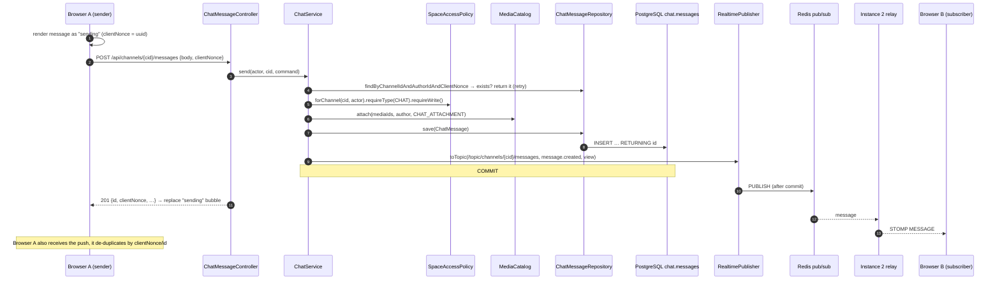

# Module `chat`

## 1. Responsibility

- **Chat messages** in `CHAT` channels of community spaces (D-03, D-28).
- Sending through **REST** (R-03), with **idempotent retries** (`clientNonce`) for optimistic UIs.
- **History** with keyset pagination and an era filter. Chat is **kept forever and is part of club history** (D-23).
- Edit and soft delete (BR-16). Messages from previous eras are read-only (BR-15).
- **Real-time delivery** to channel subscribers, and authorization of its topic via the realtime SPI.

Access is decided by `SpaceAccessPolicy`, as for the forum.

## 2. Dependencies

| Direction | Modules |
|-----------|---------|
| Depends on | `shared`, `space::api`, `media::api`, `identity::api`, `realtime::api`, `realtime::spi` |
| Used by | — (leaf module) |

```java
@ApplicationModule(
        displayName = "Chat",
        allowedDependencies = {"shared", "space::api", "media::api", "identity::api", "realtime::api", "realtime::spi"}
)
package pt.vclubroom.chat;

import org.springframework.modulith.ApplicationModule;
```

## 3. Packages

```text
chat/
├── web/            ChatMessageController (+ dto/)
├── application/    ChatService, ChatQueryService, ChatTopicAuthorizer, ChatMessageView, SendMessageCommand
├── domain/         ChatMessage
└── persistence/    ChatMessageRepository
```

## 4. Domain model

| Field | Notes |
|-------|-------|
| `id` | `bigint` identity: monotonic, cheap keyset ordering (`id < :before`) |
| `channelId`, `spaceId`, `clubId` | Denormalised at creation |
| `authorId`, `era` | Era stamped from `ChannelAccess.currentEra()` |
| `body` | Markdown, ≤ 4000 chars |
| `mediaIds` | `uuid[]` of `CHAT_ATTACHMENT` media (optional) |
| `clientNonce` | UUID generated by the browser; unique per `(channel, author)`, so retries never duplicate |
| `createdAt`, `editedAt`, `deletedAt`, `deletedBy` | Soft delete |

## 5. Public API / events

No API, and **no domain events**. Chat messages are high-volume and nothing else needs to react durably (mentions/notifications are an extension). Real-time pushes:

| Destination | Types |
|-------------|-------|
| `/topic/channels/{channelId}/messages` | `message.created`, `message.updated`, `message.deleted` |

## 6. REST endpoints

| Method | Path | Authorization | Description |
|--------|------|---------------|-------------|
| `GET` | `/api/channels/{channelId}/messages?before=&era=&limit=50` | channel read | Newest first; `before` = message ID cursor |
| `POST` | `/api/channels/{channelId}/messages` | channel write | `{body, mediaIds?, clientNonce}` → `201 ChatMessageResponse` (same response on retry) |
| `PATCH` | `/api/messages/{messageId}` | author, current era, writable | `{body}` |
| `DELETE` | `/api/messages/{messageId}` | author or moderator | Soft delete |

## 7. Request flows

### 7.1 Send a message (optimistic UI + idempotency + fan-out)



### 7.2 Load history / scroll up

`GET /api/channels/{cid}/messages?before=18342&limit=50` → `ChatQueryService.history`:

1. `requireRead()` on the channel.
2. `ChatMessageRepository.findPage(cid, before, limit + 1)` on index `(channel_id, id desc)`.
3. Batch-resolve authors (`UserDirectory.findByIds`) and media (`MediaCatalog.resolve`).
4. Return messages in **ascending** order for display, plus `nextBefore` (smallest ID) when more exist.

## 8. Key implementation

```java
package pt.vclubroom.chat.domain;

import jakarta.persistence.Column;
import jakarta.persistence.Entity;
import jakarta.persistence.GeneratedValue;
import jakarta.persistence.GenerationType;
import jakarta.persistence.Id;
import jakarta.persistence.Table;
import java.time.Instant;
import java.time.temporal.ChronoUnit;
import java.util.ArrayList;
import java.util.List;
import java.util.UUID;
import org.hibernate.annotations.JdbcTypeCode;
import org.hibernate.type.SqlTypes;
import pt.vclubroom.shared.error.BusinessRuleException;
import pt.vclubroom.shared.error.InvalidRequestException;

@Entity
@Table(name = "messages", schema = "chat")
public class ChatMessage {

    @Id
    @GeneratedValue(strategy = GenerationType.IDENTITY)
    private Long id;

    @Column(name = "channel_id", nullable = false)
    private UUID channelId;

    @Column(name = "space_id", nullable = false)
    private UUID spaceId;

    @Column(name = "club_id", nullable = false)
    private UUID clubId;

    @Column(name = "author_id", nullable = false)
    private UUID authorId;

    @Column(nullable = false)
    private int era;

    @Column(nullable = false)
    private String body;

    @JdbcTypeCode(SqlTypes.ARRAY)
    @Column(name = "media_ids", nullable = false, columnDefinition = "uuid[]")
    private List<UUID> mediaIds = new ArrayList<>();

    @Column(name = "client_nonce", nullable = false)
    private UUID clientNonce;

    @Column(name = "created_at", nullable = false)
    private Instant createdAt;

    @Column(name = "edited_at")
    private Instant editedAt;

    @Column(name = "deleted_at")
    private Instant deletedAt;

    @Column(name = "deleted_by")
    private UUID deletedBy;

    protected ChatMessage() {
        // JPA
    }

    public static ChatMessage post(UUID channelId, UUID spaceId, UUID clubId, int era, UUID authorId,
                                   String body, List<UUID> mediaIds, UUID clientNonce, Instant now) {
        String text = body == null ? "" : body.strip();
        if (text.isEmpty() && (mediaIds == null || mediaIds.isEmpty())) {
            throw new InvalidRequestException("EMPTY_MESSAGE", "A message needs text or an attachment.");
        }
        ChatMessage m = new ChatMessage();
        m.channelId = channelId;
        m.spaceId = spaceId;
        m.clubId = clubId;
        m.era = era;
        m.authorId = authorId;
        m.body = text;
        m.mediaIds = new ArrayList<>(mediaIds == null ? List.of() : mediaIds);
        m.clientNonce = clientNonce;
        m.createdAt = now.truncatedTo(ChronoUnit.MICROS);
        return m;
    }

    public void edit(UUID editor, String newBody, Instant now) {
        if (!authorId.equals(editor) || deletedAt != null) {
            throw new BusinessRuleException("CANNOT_EDIT", "You cannot edit this message.");
        }
        this.body = newBody.strip();
        this.editedAt = now.truncatedTo(ChronoUnit.MICROS);
    }

    public void softDelete(UUID by, Instant now) {
        this.deletedBy = by;
        this.deletedAt = now.truncatedTo(ChronoUnit.MICROS);
    }

    public boolean isDeleted() { return deletedAt != null; }
    public Long id() { return id; }
    public UUID channelId() { return channelId; }
    public UUID authorId() { return authorId; }
    public int era() { return era; }
    public String body() { return body; }
    public List<UUID> mediaIds() { return List.copyOf(mediaIds); }
    public UUID clientNonce() { return clientNonce; }
    public Instant createdAt() { return createdAt; }
    public Instant editedAt() { return editedAt; }
}
```

```java
package pt.vclubroom.chat.persistence;

import java.util.List;
import java.util.Optional;
import java.util.UUID;
import org.springframework.data.domain.Limit;
import org.springframework.data.jpa.repository.JpaRepository;
import org.springframework.data.jpa.repository.Query;
import org.springframework.data.repository.query.Param;
import pt.vclubroom.chat.domain.ChatMessage;

public interface ChatMessageRepository extends JpaRepository<ChatMessage, Long> {

    Optional<ChatMessage> findByChannelIdAndAuthorIdAndClientNonce(UUID channelId, UUID authorId, UUID clientNonce);

    /** First page: before = Long.MAX_VALUE. */
    @Query("select m from ChatMessage m where m.channelId = :channelId and m.id < :before order by m.id desc")
    List<ChatMessage> findPage(@Param("channelId") UUID channelId, @Param("before") long before, Limit limit);

    @Query("""
           select m from ChatMessage m
           where m.channelId = :channelId and m.era = :era and m.id < :before
           order by m.id desc
           """)
    List<ChatMessage> findPageInEra(@Param("channelId") UUID channelId, @Param("era") int era,
                                    @Param("before") long before, Limit limit);
}
```

```java
package pt.vclubroom.chat.application;

import java.util.List;
import java.util.UUID;

public record SendMessageCommand(String body, List<UUID> mediaIds, UUID clientNonce) {
}
```

```java
package pt.vclubroom.chat.application;

import java.time.Instant;
import java.util.List;
import java.util.UUID;
import pt.vclubroom.identity.api.UserSummary;
import pt.vclubroom.media.api.MediaView;

public record ChatMessageView(long id, UUID channelId, int era, UserSummary author, String body, List<MediaView> media,
                              UUID clientNonce, boolean deleted, Instant createdAt, Instant editedAt) {
}
```

```java
package pt.vclubroom.chat.application;

import java.time.Clock;
import java.util.List;
import java.util.Map;
import java.util.Objects;
import java.util.UUID;
import java.util.stream.Collectors;
import org.springframework.stereotype.Service;
import org.springframework.transaction.annotation.Transactional;
import pt.vclubroom.chat.domain.ChatMessage;
import pt.vclubroom.chat.persistence.ChatMessageRepository;
import pt.vclubroom.identity.api.UserDirectory;
import pt.vclubroom.media.api.MediaCatalog;
import pt.vclubroom.media.api.MediaPurpose;
import pt.vclubroom.media.api.MediaView;
import pt.vclubroom.realtime.api.RealtimePublisher;
import pt.vclubroom.shared.security.Actor;
import pt.vclubroom.space.api.ChannelAccess;
import pt.vclubroom.space.api.ChannelType;
import pt.vclubroom.space.api.SpaceAccessPolicy;

@Service
public class ChatService {

    private final ChatMessageRepository messages;
    private final SpaceAccessPolicy spaceAccess;
    private final MediaCatalog mediaCatalog;
    private final UserDirectory users;
    private final RealtimePublisher realtime;
    private final Clock clock;

    public ChatService(ChatMessageRepository messages, SpaceAccessPolicy spaceAccess, MediaCatalog mediaCatalog,
                       UserDirectory users, RealtimePublisher realtime, Clock clock) {
        this.messages = messages;
        this.spaceAccess = spaceAccess;
        this.mediaCatalog = mediaCatalog;
        this.users = users;
        this.realtime = realtime;
        this.clock = clock;
    }

    @Transactional
    public ChatMessageView send(Actor actor, UUID channelId, SendMessageCommand cmd) {
        ChannelAccess access = spaceAccess.forChannel(channelId, actor)
                .requireType(ChannelType.CHAT)
                .requireWrite();

        var existing = messages.findByChannelIdAndAuthorIdAndClientNonce(channelId, actor.userId(), cmd.clientNonce());
        if (existing.isPresent()) {
            return view(existing.get(), mediaCatalog.resolve(existing.get().mediaIds()));   // idempotent retry
        }

        List<UUID> mediaIds = cmd.mediaIds() == null ? List.of() : cmd.mediaIds();
        List<MediaView> media = mediaCatalog.attach(mediaIds, actor.userId(), MediaPurpose.CHAT_ATTACHMENT);
        ChatMessage message = ChatMessage.post(channelId, access.spaceId(), access.clubId(), access.currentEra(),
                actor.userId(), cmd.body(), mediaIds, cmd.clientNonce(), clock.instant());
        messages.save(message);                               // IDENTITY → INSERT happens now, id assigned

        ChatMessageView view = view(message, media.stream().collect(Collectors.toMap(MediaView::id, m -> m)));
        realtime.toTopic("/topic/channels/" + channelId + "/messages", "message.created", view);
        return view;
    }

    private ChatMessageView view(ChatMessage m, Map<UUID, MediaView> media) {
        return new ChatMessageView(m.id(), m.channelId(), m.era(), users.findById(m.authorId()).orElse(null),
                m.isDeleted() ? null : m.body(),
                m.mediaIds().stream().map(media::get).filter(Objects::nonNull).toList(),
                m.clientNonce(), m.isDeleted(), m.createdAt(), m.editedAt());
    }
}
```

```java
package pt.vclubroom.chat.application;

import java.util.UUID;
import java.util.regex.Matcher;
import java.util.regex.Pattern;
import org.springframework.stereotype.Component;
import pt.vclubroom.realtime.spi.SubscriptionAuthorizer;
import pt.vclubroom.shared.security.Actor;
import pt.vclubroom.space.api.ChannelType;
import pt.vclubroom.space.api.SpaceAccessPolicy;

@Component
class ChatTopicAuthorizer implements SubscriptionAuthorizer {

    private static final Pattern MESSAGES = Pattern.compile("^/topic/channels/([0-9a-f-]{36})/messages$");

    private final SpaceAccessPolicy spaceAccess;

    ChatTopicAuthorizer(SpaceAccessPolicy spaceAccess) {
        this.spaceAccess = spaceAccess;
    }

    @Override
    public boolean supports(String destination) {
        return MESSAGES.matcher(destination).matches();
    }

    @Override
    public boolean canSubscribe(Actor actor, String destination) {
        Matcher m = MESSAGES.matcher(destination);
        if (!m.matches()) {
            return false;
        }
        var access = spaceAccess.forChannel(UUID.fromString(m.group(1)), actor);
        return access.type() == ChannelType.CHAT && access.canRead();
    }
}
```

```java
package pt.vclubroom.chat.web;

import jakarta.validation.Valid;
import jakarta.validation.constraints.NotNull;
import jakarta.validation.constraints.Size;
import java.util.List;
import java.util.UUID;
import org.springframework.http.HttpStatus;
import org.springframework.security.core.annotation.AuthenticationPrincipal;
import org.springframework.web.bind.annotation.PathVariable;
import org.springframework.web.bind.annotation.PostMapping;
import org.springframework.web.bind.annotation.RequestBody;
import org.springframework.web.bind.annotation.ResponseStatus;
import org.springframework.web.bind.annotation.RestController;
import pt.vclubroom.chat.application.ChatMessageView;
import pt.vclubroom.chat.application.ChatService;
import pt.vclubroom.chat.application.SendMessageCommand;
import pt.vclubroom.shared.security.AuthenticatedUser;

@RestController
class ChatMessageController {

    record SendMessageRequest(@Size(max = 4000) String body,
                              @Size(max = 5) List<UUID> mediaIds,
                              @NotNull UUID clientNonce) { }

    private final ChatService chat;

    ChatMessageController(ChatService chat) {
        this.chat = chat;
    }

    @PostMapping("/api/channels/{channelId}/messages")
    @ResponseStatus(HttpStatus.CREATED)
    ChatMessageView send(@AuthenticationPrincipal AuthenticatedUser me, @PathVariable UUID channelId,
                         @Valid @RequestBody SendMessageRequest request) {
        return chat.send(me.actor(), channelId,
                new SendMessageCommand(request.body(), request.mediaIds(), request.clientNonce()));
    }
}
```

## 9. Data

Schema `chat`: `messages`. See [04-database.md § chat](../04-database.md#48-chat).

## 10. Extension points

- **Typing indicators / presence**: ephemeral, Redis-only (`SETEX presence:{channel}:{user}`) pushed on a `/topic/channels/{id}/presence` topic. Never persisted.
- **Unread counters**: `chat.read_markers(user_id, channel_id, last_read_id)`; unread = `count(id > last_read_id)`.
- **Mentions → notifications**: parse `@login`, publish `ChatMentioned` (then this module gets an `events` package).
- **Partitioning**: if `chat.messages` grows very large, use PostgreSQL declarative partitioning by `created_at` (monthly). The keyset queries stay the same.
