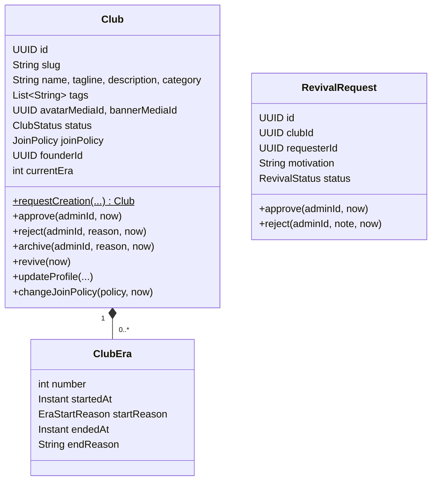
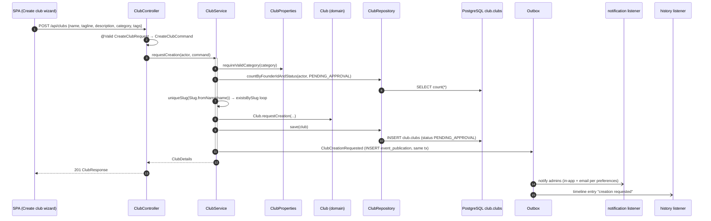
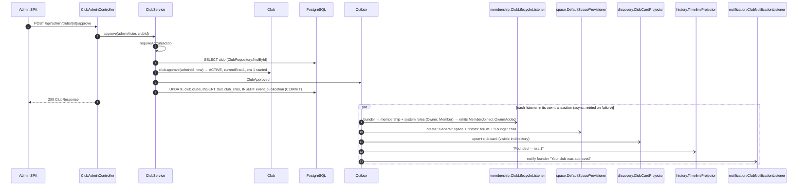
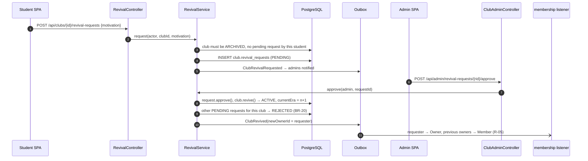

# Module `club` — reference slice

This module is documented **completely, layer by layer**, so it can serve as the model for every other module.

## 1. Responsibility

- The **Club aggregate**: profile (name, slug, tagline, description, category, tags, avatar, banner), **join policy** (D-10) and **lifecycle status**.
- **Creation requests** and **admin approval or rejection** (D-11).
- **Archival** by admins (D-13) and **revival requests** approved by admins (D-14).
- **Eras**: era 1 starts at approval; every archival ends an era and every revival starts a new one.

**Not** responsible for: who is a member or owner (membership), what a club contains (space, forum, chat, calendar), directory search (discovery), the timeline view (history). It only **announces** lifecycle facts, and those modules react.

## 2. Dependencies

| Direction | Modules |
|-----------|---------|
| Depends on | `shared`, `media::api` (avatar/banner) |
| SPI implemented by | membership (`ClubManagementGuard`) |
| Used by (API) | membership, space, calendar, notification, discovery, history |
| Listened to (events) | membership, space, calendar, notification, discovery, history |

```java
@ApplicationModule(displayName = "Club", allowedDependencies = {"shared", "media::api"})
package pt.vclubroom.club;

import org.springframework.modulith.ApplicationModule;
```

```java
@NamedInterface("spi")
package pt.vclubroom.club.spi;

import org.springframework.modulith.NamedInterface;
```

(`api` and `events` have the same kind of `package-info.java` with `@NamedInterface("api")` / `@NamedInterface("events")`.)

## 3. Packages

```text
club/
├── api/            ClubCatalog, ClubSnapshot, ClubStatus, JoinPolicy
├── events/         ClubCreationRequested, ClubApproved, ClubRejected, ClubProfileUpdated,
│                   ClubArchived, ClubRevivalRequested, ClubRevived
├── spi/            ClubManagementGuard
├── web/            ClubController, ClubAdminController, RevivalController
│   └── dto/        CreateClubRequest, UpdateClubRequest, ReasonRequest, RevivalRequestBody,
│                   ClubResponse, ClubEraResponse, RevivalRequestResponse
├── application/    ClubService, ClubQueryService, ClubCatalogService, RevivalService,
│                   ClubDetailsAssembler, ClubProperties, CreateClubCommand, UpdateClubCommand,
│                   ClubDetails, RevivalRequestView
├── domain/         Club, ClubEra, EraStartReason, RevivalRequest, RevivalStatus, Slug
└── persistence/    ClubRepository, RevivalRequestRepository
```

## 4. Domain model



Invariants: BR-01 (slug), BR-02 (only `ACTIVE` accepts writes), BR-03 (pending visibility), BR-18 (rejection final), BR-20 (one approved revival per archival).

## 5. Public API

```java
package pt.vclubroom.club.api;

public enum ClubStatus {
    PENDING_APPROVAL,
    ACTIVE,
    REJECTED,
    ARCHIVED
}
```

```java
package pt.vclubroom.club.api;

public enum JoinPolicy {
    OPEN,
    APPROVAL
}
```

```java
package pt.vclubroom.club.api;

import java.util.UUID;

/** Immutable, cross-module view of a club. */
public record ClubSnapshot(UUID id, String slug, String name, ClubStatus status, JoinPolicy joinPolicy, int currentEra) {

    public boolean isActive() {
        return status == ClubStatus.ACTIVE;
    }
}
```

```java
package pt.vclubroom.club.api;

import java.util.Collection;
import java.util.Map;
import java.util.Optional;
import java.util.UUID;

public interface ClubCatalog {

    Optional<ClubSnapshot> findById(UUID clubId);

    Optional<ClubSnapshot> findBySlug(String slug);

    Map<UUID, ClubSnapshot> findByIds(Collection<UUID> clubIds);

    /** @throws pt.vclubroom.shared.error.NotFoundException when the club does not exist */
    ClubSnapshot require(UUID clubId);
}
```

### SPI: decided by the membership module

```java
package pt.vclubroom.club.spi;

import java.util.UUID;
import pt.vclubroom.shared.security.Actor;

/**
 * Dependency inversion: the club module needs to know whether someone may manage a club's settings,
 * but permissions live in the membership module, which itself depends on club.
 * Membership implements this interface; club never references membership.
 */
public interface ClubManagementGuard {

    boolean canManageSettings(UUID clubId, Actor actor);
}
```

## 6. Events

```java
package pt.vclubroom.club.events;

import java.time.Instant;
import java.util.UUID;

public record ClubCreationRequested(UUID clubId, String slug, String name, UUID founderId, Instant occurredAt) {
}
```

```java
package pt.vclubroom.club.events;

import java.time.Instant;
import java.util.UUID;

public record ClubApproved(UUID clubId, String slug, String name, UUID founderId, UUID approvedBy,
                           int era, Instant occurredAt) {
}
```

```java
package pt.vclubroom.club.events;

import java.time.Instant;
import java.util.UUID;

public record ClubRejected(UUID clubId, String name, UUID founderId, UUID rejectedBy, String reason,
                           Instant occurredAt) {
}
```

```java
package pt.vclubroom.club.events;

import java.time.Instant;
import java.util.List;
import java.util.UUID;
import pt.vclubroom.club.api.ClubStatus;
import pt.vclubroom.club.api.JoinPolicy;

/** Carries the full public profile so read models (discovery) never need to call back. */
public record ClubProfileUpdated(UUID clubId, String slug, String name, String tagline, String description,
                                 String category, List<String> tags, UUID avatarMediaId, UUID bannerMediaId,
                                 JoinPolicy joinPolicy, ClubStatus status, int currentEra, Instant occurredAt) {
}
```

```java
package pt.vclubroom.club.events;

import java.time.Instant;
import java.util.UUID;

public record ClubArchived(UUID clubId, String name, int endedEra, UUID archivedBy, String reason, Instant occurredAt) {
}
```

```java
package pt.vclubroom.club.events;

import java.time.Instant;
import java.util.UUID;

public record ClubRevivalRequested(UUID requestId, UUID clubId, String clubName, UUID requesterId, Instant occurredAt) {
}
```

```java
package pt.vclubroom.club.events;

import java.time.Instant;
import java.util.UUID;

public record ClubRevived(UUID clubId, String name, int newEra, UUID newOwnerId, UUID approvedBy,
                          UUID requestId, Instant occurredAt) {
}
```

| Event | Consumers and their reaction |
|-------|------------------------------|
| `ClubCreationRequested` | notification → admins ("new club to review"); history → timeline entry |
| `ClubApproved` | membership → founder membership + Owner/Member system roles; space → default space (R-07); discovery → club card; history → "Founded (era 1)"; notification → founder |
| `ClubRejected` | notification → founder (with reason) |
| `ClubProfileUpdated` | discovery → refresh card |
| `ClubArchived` | membership → cancel join requests/invitations (R-10); calendar → cancel future events; discovery → status badge; history → "Archived"; notification → members |
| `ClubRevivalRequested` | notification → admins |
| `ClubRevived` | membership → requester becomes Owner, previous owners demoted (R-05); discovery; history → "Revived (era n)"; notification → members + requester |

## 7. REST endpoints

| Method | Path | Authorization | Body → Response |
|--------|------|---------------|-----------------|
| `POST` | `/api/clubs` | user | `CreateClubRequest` → `201 ClubResponse` (status `PENDING_APPROVAL`) |
| `GET` | `/api/clubs/{idOrSlug}` | user; pending/rejected only for founder or admin (BR-03) | → `ClubResponse` |
| `PATCH` | `/api/clubs/{clubId}` | `CLUB_SETTINGS_MANAGE` (ACTIVE) or founder (PENDING) | `UpdateClubRequest` → `ClubResponse` |
| `GET` | `/api/clubs/{clubId}/eras` | user | → `ClubEraResponse[]` |
| `GET` | `/api/me/club-requests` | user | → `ClubResponse[]` (own pending/rejected requests) |
| `POST` | `/api/clubs/{clubId}/revival-requests` | user; club `ARCHIVED` | `RevivalRequestBody` → `201 RevivalRequestResponse` |
| `GET` | `/api/admin/clubs?status=&page=&size=` | admin | → `PageResponse<ClubResponse>` |
| `POST` | `/api/admin/clubs/{clubId}/approve` | admin | → `ClubResponse` |
| `POST` | `/api/admin/clubs/{clubId}/reject` | admin | `ReasonRequest` → `ClubResponse` |
| `POST` | `/api/admin/clubs/{clubId}/archive` | admin | `ReasonRequest` → `ClubResponse` |
| `GET` | `/api/admin/revival-requests?status=PENDING&page=&size=` | admin | → `PageResponse<RevivalRequestResponse>` |
| `POST` | `/api/admin/revival-requests/{requestId}/approve` | admin | → `ClubResponse` |
| `POST` | `/api/admin/revival-requests/{requestId}/reject` | admin | `ReasonRequest` → `RevivalRequestResponse` |

## 8. Request flows

### 8.1 Request creation of a club



### 8.2 Admin approves: one transaction, five independent reactions



If, for example, the notification listener fails (SMTP down), the approval and the other four reactions are **not** affected. The failed publication stays incomplete in `event_publication` and is retried (see [06-messaging-and-realtime.md](../06-messaging-and-realtime.md#3-reliable-domain-events-the-outbox)).

### 8.3 Archive

`POST /api/admin/clubs/{id}/archive {reason}` → `ClubAdminController.archive` → `ClubService.archive` (`club.archive(...)`: status `ARCHIVED`, current era ended) → `ClubArchived` → membership cancels pending requests and invitations; calendar cancels future events; discovery shows the "Archived" badge; history adds an entry; notification informs members. From then on, every write path is rejected by `ClubAuthorization` / `SpaceAccessPolicy` because the club is no longer `ACTIVE` (BR-02), and all content remains readable.

### 8.4 Revival



### 8.5 Update profile: authorization through the SPI

`PATCH /api/clubs/{id}` → `ClubController.update` → `ClubService.updateProfile`:

1. Load the club.
2. If `PENDING_APPROVAL`, the actor must be the founder or an admin. If `ACTIVE`, call `ClubManagementGuard.canManageSettings(clubId, actor)`, which `membership` implements by checking `CLUB_SETTINGS_MANAGE`. Otherwise → 403 `CLUB_NOT_EDITABLE` / `PERMISSION_DENIED`.
3. If avatar/banner IDs changed → `MediaCatalog.attach(...)` (validates uploader, purpose and state).
4. `club.updateProfile(...)`, `club.changeJoinPolicy(...)`.
5. Publish `ClubProfileUpdated` (discovery refreshes the card). If the policy switched from `APPROVAL` to `OPEN`, membership auto-approves pending requests by listening to this event.

## 9. Implementation (all layers)

### 9.1 Domain

```java
package pt.vclubroom.club.domain;

import java.text.Normalizer;
import java.util.Locale;
import pt.vclubroom.shared.error.InvalidRequestException;

/** URL-safe club identifier (BR-01). */
public record Slug(String value) {

    private static final String PATTERN = "[a-z0-9](?:[a-z0-9-]{1,38})[a-z0-9]";

    public Slug {
        if (value == null || !value.matches(PATTERN)) {
            throw new InvalidRequestException("INVALID_SLUG", "Slug must match " + PATTERN);
        }
    }

    public static Slug fromName(String name) {
        String ascii = Normalizer.normalize(name, Normalizer.Form.NFD).replaceAll("\\p{M}", "");
        String slug = ascii.toLowerCase(Locale.ROOT)
                .replaceAll("[^a-z0-9]+", "-")
                .replaceAll("(^-+|-+$)", "");
        if (slug.length() > 40) {
            slug = slug.substring(0, 40).replaceAll("-+$", "");
        }
        if (slug.length() < 3) {
            slug = (slug + "-club").replaceAll("^-+", "");
        }
        return new Slug(slug);
    }

    public Slug withSuffix(int n) {
        String base = value.length() > 36 ? value.substring(0, 36).replaceAll("-+$", "") : value;
        return new Slug(base + "-" + n);
    }
}
```

```java
package pt.vclubroom.club.domain;

public enum EraStartReason {
    FOUNDED,
    REVIVED
}
```

```java
package pt.vclubroom.club.domain;

import jakarta.persistence.Column;
import jakarta.persistence.Embeddable;
import jakarta.persistence.EnumType;
import jakarta.persistence.Enumerated;
import java.time.Instant;

@Embeddable
public class ClubEra {

    @Column(name = "era_number", nullable = false)
    private int number;

    @Column(name = "started_at", nullable = false)
    private Instant startedAt;

    @Enumerated(EnumType.STRING)
    @Column(name = "start_reason", nullable = false)
    private EraStartReason startReason;

    @Column(name = "ended_at")
    private Instant endedAt;

    @Column(name = "end_reason")
    private String endReason;

    protected ClubEra() {
        // JPA
    }

    static ClubEra start(int number, EraStartReason reason, Instant at) {
        ClubEra era = new ClubEra();
        era.number = number;
        era.startReason = reason;
        era.startedAt = at;
        return era;
    }

    void end(Instant at, String reason) {
        this.endedAt = at;
        this.endReason = reason;
    }

    public int number() { return number; }
    public Instant startedAt() { return startedAt; }
    public EraStartReason startReason() { return startReason; }
    public Instant endedAt() { return endedAt; }
    public String endReason() { return endReason; }
}
```

```java
package pt.vclubroom.club.domain;

import jakarta.persistence.CollectionTable;
import jakarta.persistence.Column;
import jakarta.persistence.ElementCollection;
import jakarta.persistence.Entity;
import jakarta.persistence.EnumType;
import jakarta.persistence.Enumerated;
import jakarta.persistence.FetchType;
import jakarta.persistence.Id;
import jakarta.persistence.JoinColumn;
import jakarta.persistence.OrderBy;
import jakarta.persistence.Table;
import jakarta.persistence.Version;
import java.time.Instant;
import java.time.temporal.ChronoUnit;
import java.util.ArrayList;
import java.util.Collections;
import java.util.List;
import java.util.Objects;
import java.util.UUID;
import org.hibernate.annotations.JdbcTypeCode;
import org.hibernate.type.SqlTypes;
import pt.vclubroom.club.api.ClubStatus;
import pt.vclubroom.club.api.JoinPolicy;
import pt.vclubroom.shared.error.BusinessRuleException;

@Entity
@Table(name = "clubs", schema = "club")
public class Club {

    @Id
    private UUID id;

    @Column(nullable = false, unique = true)
    private String slug;

    @Column(nullable = false)
    private String name;

    private String tagline;

    private String description;

    @Column(nullable = false)
    private String category;

    @JdbcTypeCode(SqlTypes.ARRAY)
    @Column(name = "tags", nullable = false, columnDefinition = "text[]")
    private List<String> tags = new ArrayList<>();

    @Column(name = "avatar_media_id")
    private UUID avatarMediaId;

    @Column(name = "banner_media_id")
    private UUID bannerMediaId;

    @Enumerated(EnumType.STRING)
    @Column(nullable = false)
    private ClubStatus status;

    @Enumerated(EnumType.STRING)
    @Column(name = "join_policy", nullable = false)
    private JoinPolicy joinPolicy;

    @Column(name = "founder_id", nullable = false)
    private UUID founderId;

    @Column(name = "current_era", nullable = false)
    private int currentEra;

    @Column(name = "review_note")
    private String reviewNote;

    @Column(name = "reviewed_by")
    private UUID reviewedBy;

    @Column(name = "reviewed_at")
    private Instant reviewedAt;

    @Column(name = "created_at", nullable = false)
    private Instant createdAt;

    @Column(name = "updated_at", nullable = false)
    private Instant updatedAt;

    @ElementCollection(fetch = FetchType.LAZY)
    @CollectionTable(name = "club_eras", schema = "club", joinColumns = @JoinColumn(name = "club_id"))
    @OrderBy("number ASC")
    private List<ClubEra> eras = new ArrayList<>();

    @Version
    private Long version;

    protected Club() {
        // JPA
    }

    public static Club requestCreation(Slug slug, String name, String tagline, String description,
                                       String category, List<String> tags, UUID founderId, Instant now) {
        Club c = new Club();
        c.id = UUID.randomUUID();
        c.slug = slug.value();
        c.name = name.trim();
        c.tagline = tagline;
        c.description = description;
        c.category = category;
        c.tags = new ArrayList<>(tags == null ? List.of() : tags);
        c.founderId = Objects.requireNonNull(founderId);
        c.status = ClubStatus.PENDING_APPROVAL;
        c.joinPolicy = JoinPolicy.APPROVAL;                   // D-10 default
        c.currentEra = 0;                                     // no era until approved
        c.createdAt = now.truncatedTo(ChronoUnit.MICROS);
        c.updatedAt = c.createdAt;
        return c;
    }

    public void approve(UUID adminId, Instant now) {
        requireStatus(ClubStatus.PENDING_APPROVAL, "CLUB_NOT_PENDING");
        Instant at = now.truncatedTo(ChronoUnit.MICROS);
        this.status = ClubStatus.ACTIVE;
        this.currentEra = 1;
        this.eras.add(ClubEra.start(1, EraStartReason.FOUNDED, at));
        review(adminId, null, at);
    }

    public void reject(UUID adminId, String reason, Instant now) {
        requireStatus(ClubStatus.PENDING_APPROVAL, "CLUB_NOT_PENDING");
        this.status = ClubStatus.REJECTED;                     // final (R-18)
        review(adminId, reason, now.truncatedTo(ChronoUnit.MICROS));
    }

    public void archive(UUID adminId, String reason, Instant now) {
        requireStatus(ClubStatus.ACTIVE, "CLUB_NOT_ACTIVE");
        Instant at = now.truncatedTo(ChronoUnit.MICROS);
        this.status = ClubStatus.ARCHIVED;
        currentEraRecord().end(at, reason);
        review(adminId, reason, at);
    }

    public void revive(Instant now) {
        requireStatus(ClubStatus.ARCHIVED, "CLUB_NOT_ARCHIVED");
        Instant at = now.truncatedTo(ChronoUnit.MICROS);
        this.status = ClubStatus.ACTIVE;
        this.currentEra = this.currentEra + 1;
        this.eras.add(ClubEra.start(this.currentEra, EraStartReason.REVIVED, at));
        this.updatedAt = at;
    }

    public void updateProfile(String name, String tagline, String description, String category,
                              List<String> tags, UUID avatarMediaId, UUID bannerMediaId, Instant now) {
        if (status != ClubStatus.ACTIVE && status != ClubStatus.PENDING_APPROVAL) {
            throw new BusinessRuleException("CLUB_NOT_EDITABLE", "Only pending or active clubs can be edited.");
        }
        if (name != null) this.name = name.trim();
        if (tagline != null) this.tagline = tagline;
        if (description != null) this.description = description;
        if (category != null) this.category = category;
        if (tags != null) this.tags = new ArrayList<>(tags);
        if (avatarMediaId != null) this.avatarMediaId = avatarMediaId;
        if (bannerMediaId != null) this.bannerMediaId = bannerMediaId;
        this.updatedAt = now.truncatedTo(ChronoUnit.MICROS);
    }

    public void changeJoinPolicy(JoinPolicy policy, Instant now) {
        requireStatus(ClubStatus.ACTIVE, "CLUB_NOT_ACTIVE");
        this.joinPolicy = Objects.requireNonNull(policy);
        this.updatedAt = now.truncatedTo(ChronoUnit.MICROS);
    }

    public boolean isVisibleTo(UUID userId, boolean admin) {
        return admin || status == ClubStatus.ACTIVE || status == ClubStatus.ARCHIVED || founderId.equals(userId);
    }

    private ClubEra currentEraRecord() {
        return eras.stream().filter(e -> e.number() == currentEra).findFirst()
                .orElseThrow(() -> new IllegalStateException("Missing era " + currentEra));
    }

    private void review(UUID adminId, String note, Instant at) {
        this.reviewedBy = adminId;
        this.reviewNote = note;
        this.reviewedAt = at;
        this.updatedAt = at;
    }

    private void requireStatus(ClubStatus expected, String code) {
        if (status != expected) {
            throw new BusinessRuleException(code, "Club is " + status + ", expected " + expected + ".");
        }
    }

    public UUID id() { return id; }
    public String slug() { return slug; }
    public String name() { return name; }
    public String tagline() { return tagline; }
    public String description() { return description; }
    public String category() { return category; }
    public List<String> tags() { return Collections.unmodifiableList(tags); }
    public UUID avatarMediaId() { return avatarMediaId; }
    public UUID bannerMediaId() { return bannerMediaId; }
    public ClubStatus status() { return status; }
    public JoinPolicy joinPolicy() { return joinPolicy; }
    public UUID founderId() { return founderId; }
    public int currentEra() { return currentEra; }
    public String reviewNote() { return reviewNote; }
    public Instant createdAt() { return createdAt; }
    public Instant updatedAt() { return updatedAt; }
    public List<ClubEra> eras() { return Collections.unmodifiableList(eras); }
}
```

```java
package pt.vclubroom.club.domain;

public enum RevivalStatus {
    PENDING,
    APPROVED,
    REJECTED
}
```

```java
package pt.vclubroom.club.domain;

import jakarta.persistence.Column;
import jakarta.persistence.Entity;
import jakarta.persistence.EnumType;
import jakarta.persistence.Enumerated;
import jakarta.persistence.Id;
import jakarta.persistence.Table;
import jakarta.persistence.Version;
import java.time.Instant;
import java.time.temporal.ChronoUnit;
import java.util.UUID;
import pt.vclubroom.shared.error.BusinessRuleException;

@Entity
@Table(name = "revival_requests", schema = "club")
public class RevivalRequest {

    @Id
    private UUID id;

    @Column(name = "club_id", nullable = false)
    private UUID clubId;

    @Column(name = "requester_id", nullable = false)
    private UUID requesterId;

    @Column(nullable = false)
    private String motivation;

    @Enumerated(EnumType.STRING)
    @Column(nullable = false)
    private RevivalStatus status;

    @Column(name = "reviewed_by")
    private UUID reviewedBy;

    @Column(name = "review_note")
    private String reviewNote;

    @Column(name = "reviewed_at")
    private Instant reviewedAt;

    @Column(name = "created_at", nullable = false)
    private Instant createdAt;

    @Version
    private Long version;

    protected RevivalRequest() {
        // JPA
    }

    public static RevivalRequest submit(UUID clubId, UUID requesterId, String motivation, Instant now) {
        RevivalRequest r = new RevivalRequest();
        r.id = UUID.randomUUID();
        r.clubId = clubId;
        r.requesterId = requesterId;
        r.motivation = motivation;
        r.status = RevivalStatus.PENDING;
        r.createdAt = now.truncatedTo(ChronoUnit.MICROS);
        return r;
    }

    public void approve(UUID adminId, Instant now) {
        decide(RevivalStatus.APPROVED, adminId, null, now);
    }

    public void reject(UUID adminId, String note, Instant now) {
        decide(RevivalStatus.REJECTED, adminId, note, now);
    }

    private void decide(RevivalStatus outcome, UUID adminId, String note, Instant now) {
        if (status != RevivalStatus.PENDING) {
            throw new BusinessRuleException("REVIVAL_NOT_PENDING", "This revival request was already decided.");
        }
        this.status = outcome;
        this.reviewedBy = adminId;
        this.reviewNote = note;
        this.reviewedAt = now.truncatedTo(ChronoUnit.MICROS);
    }

    public UUID id() { return id; }
    public UUID clubId() { return clubId; }
    public UUID requesterId() { return requesterId; }
    public String motivation() { return motivation; }
    public RevivalStatus status() { return status; }
    public String reviewNote() { return reviewNote; }
    public Instant createdAt() { return createdAt; }
}
```

### 9.2 Persistence

```java
package pt.vclubroom.club.persistence;

import java.util.Collection;
import java.util.List;
import java.util.Optional;
import java.util.UUID;
import org.springframework.data.domain.Page;
import org.springframework.data.domain.Pageable;
import org.springframework.data.jpa.repository.EntityGraph;
import org.springframework.data.jpa.repository.JpaRepository;
import pt.vclubroom.club.api.ClubStatus;
import pt.vclubroom.club.domain.Club;

public interface ClubRepository extends JpaRepository<Club, UUID> {

    @EntityGraph(attributePaths = "eras")
    Optional<Club> findWithErasById(UUID id);

    @EntityGraph(attributePaths = "eras")
    Optional<Club> findWithErasBySlug(String slug);

    Optional<Club> findBySlug(String slug);

    boolean existsBySlug(String slug);

    long countByFounderIdAndStatus(UUID founderId, ClubStatus status);

    Page<Club> findByStatus(ClubStatus status, Pageable pageable);

    List<Club> findByFounderIdAndStatusInOrderByCreatedAtDesc(UUID founderId, Collection<ClubStatus> statuses);

    List<Club> findByIdIn(Collection<UUID> ids);
}
```

```java
package pt.vclubroom.club.persistence;

import java.util.List;
import java.util.UUID;
import org.springframework.data.domain.Page;
import org.springframework.data.domain.Pageable;
import org.springframework.data.jpa.repository.JpaRepository;
import pt.vclubroom.club.domain.RevivalRequest;
import pt.vclubroom.club.domain.RevivalStatus;

public interface RevivalRequestRepository extends JpaRepository<RevivalRequest, UUID> {

    boolean existsByClubIdAndRequesterIdAndStatus(UUID clubId, UUID requesterId, RevivalStatus status);

    List<RevivalRequest> findByClubIdAndStatus(UUID clubId, RevivalStatus status);

    Page<RevivalRequest> findByStatus(RevivalStatus status, Pageable pageable);
}
```

### 9.3 Application

```java
package pt.vclubroom.club.application;

import java.util.List;
import org.springframework.boot.context.properties.ConfigurationProperties;
import org.springframework.boot.context.properties.bind.DefaultValue;
import pt.vclubroom.shared.error.InvalidRequestException;

@ConfigurationProperties("app.clubs")
public record ClubProperties(List<String> categories,
                             @DefaultValue("3") int maxPendingRequestsPerUser) {

    public void requireValidCategory(String category) {
        if (category != null && !categories.contains(category)) {
            throw new InvalidRequestException("INVALID_CATEGORY", "Unknown category: " + category);
        }
    }
}
```

```java
package pt.vclubroom.club.application;

import java.util.List;

public record CreateClubCommand(String name, String tagline, String description, String category, List<String> tags) {
}
```

```java
package pt.vclubroom.club.application;

import java.util.List;
import java.util.UUID;
import pt.vclubroom.club.api.JoinPolicy;

/** Partial update: null means "unchanged". */
public record UpdateClubCommand(String name, String tagline, String description, String category,
                                List<String> tags, UUID avatarMediaId, UUID bannerMediaId, JoinPolicy joinPolicy) {
}
```

```java
package pt.vclubroom.club.application;

import java.time.Instant;
import java.util.List;
import java.util.UUID;
import pt.vclubroom.club.api.ClubStatus;
import pt.vclubroom.club.api.JoinPolicy;

public record ClubDetails(UUID id, String slug, String name, String tagline, String description, String category,
                          List<String> tags, String avatarUrl, String bannerUrl, ClubStatus status,
                          JoinPolicy joinPolicy, UUID founderId, int currentEra, String reviewNote,
                          Instant createdAt, List<Era> eras) {

    public record Era(int number, Instant startedAt, String startReason, Instant endedAt, String endReason) {
    }
}
```

```java
package pt.vclubroom.club.application;

import java.time.Instant;
import java.util.UUID;

public record RevivalRequestView(UUID id, UUID clubId, UUID requesterId, String motivation, String status,
                                 String reviewNote, Instant createdAt) {
}
```

```java
package pt.vclubroom.club.application;

import java.util.ArrayList;
import java.util.List;
import java.util.Map;
import java.util.UUID;
import org.springframework.stereotype.Component;
import pt.vclubroom.club.domain.Club;
import pt.vclubroom.media.api.MediaCatalog;
import pt.vclubroom.media.api.MediaView;

/** Builds the application-level view of a club, resolving media IDs to URLs through the media API. */
@Component
class ClubDetailsAssembler {

    private final MediaCatalog mediaCatalog;

    ClubDetailsAssembler(MediaCatalog mediaCatalog) {
        this.mediaCatalog = mediaCatalog;
    }

    ClubDetails toDetails(Club club) {
        List<UUID> mediaIds = new ArrayList<>();
        if (club.avatarMediaId() != null) mediaIds.add(club.avatarMediaId());
        if (club.bannerMediaId() != null) mediaIds.add(club.bannerMediaId());
        Map<UUID, MediaView> media = mediaIds.isEmpty() ? Map.of() : mediaCatalog.resolve(mediaIds);

        return new ClubDetails(club.id(), club.slug(), club.name(), club.tagline(), club.description(),
                club.category(), club.tags(), url(media, club.avatarMediaId()), url(media, club.bannerMediaId()),
                club.status(), club.joinPolicy(), club.founderId(), club.currentEra(), club.reviewNote(),
                club.createdAt(),
                club.eras().stream()
                        .map(e -> new ClubDetails.Era(e.number(), e.startedAt(), e.startReason().name(),
                                e.endedAt(), e.endReason()))
                        .toList());
    }

    private static String url(Map<UUID, MediaView> media, UUID id) {
        MediaView view = id == null ? null : media.get(id);
        return view == null ? null : view.url();
    }
}
```

```java
package pt.vclubroom.club.application;

import java.time.Clock;
import java.time.Instant;
import java.util.List;
import java.util.UUID;
import org.springframework.context.ApplicationEventPublisher;
import org.springframework.stereotype.Service;
import org.springframework.transaction.annotation.Transactional;
import pt.vclubroom.club.api.ClubStatus;
import pt.vclubroom.club.domain.Club;
import pt.vclubroom.club.domain.Slug;
import pt.vclubroom.club.events.ClubApproved;
import pt.vclubroom.club.events.ClubArchived;
import pt.vclubroom.club.events.ClubCreationRequested;
import pt.vclubroom.club.events.ClubProfileUpdated;
import pt.vclubroom.club.events.ClubRejected;
import pt.vclubroom.club.persistence.ClubRepository;
import pt.vclubroom.club.spi.ClubManagementGuard;
import pt.vclubroom.media.api.MediaCatalog;
import pt.vclubroom.media.api.MediaPurpose;
import pt.vclubroom.shared.error.BusinessRuleException;
import pt.vclubroom.shared.error.ForbiddenException;
import pt.vclubroom.shared.error.NotFoundException;
import pt.vclubroom.shared.security.Actor;

@Service
public class ClubService {

    private final ClubRepository clubs;
    private final ClubManagementGuard managementGuard;
    private final MediaCatalog mediaCatalog;
    private final ClubDetailsAssembler assembler;
    private final ClubProperties properties;
    private final ApplicationEventPublisher events;
    private final Clock clock;

    public ClubService(ClubRepository clubs, ClubManagementGuard managementGuard, MediaCatalog mediaCatalog,
                       ClubDetailsAssembler assembler, ClubProperties properties,
                       ApplicationEventPublisher events, Clock clock) {
        this.clubs = clubs;
        this.managementGuard = managementGuard;
        this.mediaCatalog = mediaCatalog;
        this.assembler = assembler;
        this.properties = properties;
        this.events = events;
        this.clock = clock;
    }

    @Transactional
    public ClubDetails requestCreation(Actor actor, CreateClubCommand cmd) {
        properties.requireValidCategory(cmd.category());
        long pending = clubs.countByFounderIdAndStatus(actor.userId(), ClubStatus.PENDING_APPROVAL);
        if (pending >= properties.maxPendingRequestsPerUser()) {
            throw new BusinessRuleException("TOO_MANY_PENDING_REQUESTS",
                    "You already have " + pending + " club requests waiting for review.");
        }
        Instant now = clock.instant();
        Club club = Club.requestCreation(uniqueSlug(Slug.fromName(cmd.name())), cmd.name(), cmd.tagline(),
                cmd.description(), cmd.category(), cmd.tags(), actor.userId(), now);
        clubs.save(club);
        events.publishEvent(new ClubCreationRequested(club.id(), club.slug(), club.name(), actor.userId(), now));
        return assembler.toDetails(club);
    }

    @Transactional
    public ClubDetails approve(Actor actor, UUID clubId) {
        requireAdmin(actor);
        Club club = load(clubId);
        Instant now = clock.instant();
        club.approve(actor.userId(), now);
        events.publishEvent(new ClubApproved(club.id(), club.slug(), club.name(), club.founderId(),
                actor.userId(), club.currentEra(), now));
        events.publishEvent(profileUpdated(club, now));
        return assembler.toDetails(club);
    }

    @Transactional
    public ClubDetails reject(Actor actor, UUID clubId, String reason) {
        requireAdmin(actor);
        Club club = load(clubId);
        Instant now = clock.instant();
        club.reject(actor.userId(), reason, now);
        events.publishEvent(new ClubRejected(club.id(), club.name(), club.founderId(), actor.userId(), reason, now));
        return assembler.toDetails(club);
    }

    @Transactional
    public ClubDetails archive(Actor actor, UUID clubId, String reason) {
        requireAdmin(actor);
        Club club = load(clubId);
        Instant now = clock.instant();
        int endedEra = club.currentEra();
        club.archive(actor.userId(), reason, now);
        events.publishEvent(new ClubArchived(club.id(), club.name(), endedEra, actor.userId(), reason, now));
        events.publishEvent(profileUpdated(club, now));
        return assembler.toDetails(club);
    }

    @Transactional
    public ClubDetails updateProfile(Actor actor, UUID clubId, UpdateClubCommand cmd) {
        Club club = load(clubId);
        boolean allowed = switch (club.status()) {
            case PENDING_APPROVAL -> actor.admin() || club.founderId().equals(actor.userId());
            case ACTIVE -> managementGuard.canManageSettings(clubId, actor);   // SPI → membership
            default -> false;
        };
        if (!allowed) {
            throw new ForbiddenException("PERMISSION_DENIED", "You cannot edit this club.");
        }
        properties.requireValidCategory(cmd.category());

        if (cmd.avatarMediaId() != null && !cmd.avatarMediaId().equals(club.avatarMediaId())) {
            mediaCatalog.attach(List.of(cmd.avatarMediaId()), actor.userId(), MediaPurpose.CLUB_AVATAR);
        }
        if (cmd.bannerMediaId() != null && !cmd.bannerMediaId().equals(club.bannerMediaId())) {
            mediaCatalog.attach(List.of(cmd.bannerMediaId()), actor.userId(), MediaPurpose.CLUB_BANNER);
        }

        Instant now = clock.instant();
        club.updateProfile(cmd.name(), cmd.tagline(), cmd.description(), cmd.category(), cmd.tags(),
                cmd.avatarMediaId(), cmd.bannerMediaId(), now);
        if (cmd.joinPolicy() != null && cmd.joinPolicy() != club.joinPolicy()) {
            club.changeJoinPolicy(cmd.joinPolicy(), now);
        }
        events.publishEvent(profileUpdated(club, now));
        return assembler.toDetails(club);
    }

    private ClubProfileUpdated profileUpdated(Club club, Instant now) {
        return new ClubProfileUpdated(club.id(), club.slug(), club.name(), club.tagline(), club.description(),
                club.category(), club.tags(), club.avatarMediaId(), club.bannerMediaId(), club.joinPolicy(),
                club.status(), club.currentEra(), now);
    }

    private Slug uniqueSlug(Slug base) {
        Slug candidate = base;
        int n = 2;
        while (clubs.existsBySlug(candidate.value())) {
            candidate = base.withSuffix(n++);
        }
        return candidate;
    }

    private Club load(UUID clubId) {
        return clubs.findWithErasById(clubId)
                .orElseThrow(() -> new NotFoundException("CLUB_NOT_FOUND", "Club not found"));
    }

    private static void requireAdmin(Actor actor) {
        if (!actor.admin()) {
            throw new ForbiddenException("ADMIN_ONLY", "Only admins can do this.");
        }
    }
}
```

```java
package pt.vclubroom.club.application;

import java.util.List;
import java.util.Optional;
import java.util.UUID;
import org.springframework.data.domain.Page;
import org.springframework.data.domain.PageRequest;
import org.springframework.data.domain.Sort;
import org.springframework.stereotype.Service;
import org.springframework.transaction.annotation.Transactional;
import pt.vclubroom.club.api.ClubStatus;
import pt.vclubroom.club.domain.Club;
import pt.vclubroom.club.persistence.ClubRepository;
import pt.vclubroom.shared.error.NotFoundException;
import pt.vclubroom.shared.security.Actor;
import pt.vclubroom.shared.web.PageResponse;

@Service
@Transactional(readOnly = true)
public class ClubQueryService {

    private final ClubRepository clubs;
    private final ClubDetailsAssembler assembler;

    public ClubQueryService(ClubRepository clubs, ClubDetailsAssembler assembler) {
        this.clubs = clubs;
        this.assembler = assembler;
    }

    public ClubDetails get(Actor actor, String idOrSlug) {
        Club club = parseUuid(idOrSlug)
                .map(clubs::findWithErasById)
                .orElseGet(() -> clubs.findWithErasBySlug(idOrSlug))
                .filter(c -> c.isVisibleTo(actor.userId(), actor.admin()))      // BR-03: hide, don't reveal
                .orElseThrow(() -> new NotFoundException("CLUB_NOT_FOUND", "Club not found"));
        return assembler.toDetails(club);
    }

    public List<ClubDetails> myRequests(Actor actor) {
        return clubs.findByFounderIdAndStatusInOrderByCreatedAtDesc(actor.userId(),
                        List.of(ClubStatus.PENDING_APPROVAL, ClubStatus.REJECTED))
                .stream().map(assembler::toDetails).toList();
    }

    public PageResponse<ClubDetails> byStatus(ClubStatus status, int page, int size) {
        Page<Club> result = clubs.findByStatus(status,
                PageRequest.of(page, Math.min(size, 100), Sort.by(Sort.Direction.ASC, "createdAt")));
        return new PageResponse<>(result.map(assembler::toDetails).getContent(), page, size, result.getTotalElements());
    }

    private static Optional<UUID> parseUuid(String value) {
        try {
            return Optional.of(UUID.fromString(value));
        } catch (IllegalArgumentException e) {
            return Optional.empty();
        }
    }
}
```

```java
package pt.vclubroom.club.application;

import java.util.Collection;
import java.util.Map;
import java.util.Optional;
import java.util.UUID;
import java.util.function.Function;
import java.util.stream.Collectors;
import org.springframework.stereotype.Service;
import org.springframework.transaction.annotation.Transactional;
import pt.vclubroom.club.api.ClubCatalog;
import pt.vclubroom.club.api.ClubSnapshot;
import pt.vclubroom.club.domain.Club;
import pt.vclubroom.club.persistence.ClubRepository;
import pt.vclubroom.shared.error.NotFoundException;

/** Implementation of the public API. Returns snapshots, never entities. */
@Service
@Transactional(readOnly = true)
class ClubCatalogService implements ClubCatalog {

    private final ClubRepository clubs;

    ClubCatalogService(ClubRepository clubs) {
        this.clubs = clubs;
    }

    @Override
    public Optional<ClubSnapshot> findById(UUID clubId) {
        return clubs.findById(clubId).map(ClubCatalogService::snapshot);
    }

    @Override
    public Optional<ClubSnapshot> findBySlug(String slug) {
        return clubs.findBySlug(slug).map(ClubCatalogService::snapshot);
    }

    @Override
    public Map<UUID, ClubSnapshot> findByIds(Collection<UUID> clubIds) {
        if (clubIds.isEmpty()) {
            return Map.of();
        }
        return clubs.findByIdIn(clubIds).stream()
                .map(ClubCatalogService::snapshot)
                .collect(Collectors.toMap(ClubSnapshot::id, Function.identity()));
    }

    @Override
    public ClubSnapshot require(UUID clubId) {
        return findById(clubId).orElseThrow(() -> new NotFoundException("CLUB_NOT_FOUND", "Club not found"));
    }

    private static ClubSnapshot snapshot(Club c) {
        return new ClubSnapshot(c.id(), c.slug(), c.name(), c.status(), c.joinPolicy(), c.currentEra());
    }
}
```

```java
package pt.vclubroom.club.application;

import java.time.Clock;
import java.time.Instant;
import java.util.UUID;
import org.springframework.context.ApplicationEventPublisher;
import org.springframework.data.domain.Page;
import org.springframework.data.domain.PageRequest;
import org.springframework.data.domain.Sort;
import org.springframework.stereotype.Service;
import org.springframework.transaction.annotation.Transactional;
import pt.vclubroom.club.api.ClubStatus;
import pt.vclubroom.club.domain.Club;
import pt.vclubroom.club.domain.RevivalRequest;
import pt.vclubroom.club.domain.RevivalStatus;
import pt.vclubroom.club.events.ClubProfileUpdated;
import pt.vclubroom.club.events.ClubRevivalRequested;
import pt.vclubroom.club.events.ClubRevived;
import pt.vclubroom.club.persistence.ClubRepository;
import pt.vclubroom.club.persistence.RevivalRequestRepository;
import pt.vclubroom.shared.error.BusinessRuleException;
import pt.vclubroom.shared.error.ConflictException;
import pt.vclubroom.shared.error.ForbiddenException;
import pt.vclubroom.shared.error.NotFoundException;
import pt.vclubroom.shared.security.Actor;
import pt.vclubroom.shared.web.PageResponse;

@Service
public class RevivalService {

    private final RevivalRequestRepository requests;
    private final ClubRepository clubs;
    private final ClubDetailsAssembler assembler;
    private final ApplicationEventPublisher events;
    private final Clock clock;

    public RevivalService(RevivalRequestRepository requests, ClubRepository clubs, ClubDetailsAssembler assembler,
                          ApplicationEventPublisher events, Clock clock) {
        this.requests = requests;
        this.clubs = clubs;
        this.assembler = assembler;
        this.events = events;
        this.clock = clock;
    }

    @Transactional
    public RevivalRequestView request(Actor actor, UUID clubId, String motivation) {
        Club club = clubs.findById(clubId)
                .orElseThrow(() -> new NotFoundException("CLUB_NOT_FOUND", "Club not found"));
        if (club.status() != ClubStatus.ARCHIVED) {
            throw new BusinessRuleException("CLUB_NOT_ARCHIVED", "Only archived clubs can be revived.");
        }
        if (requests.existsByClubIdAndRequesterIdAndStatus(clubId, actor.userId(), RevivalStatus.PENDING)) {
            throw new ConflictException("REVIVAL_ALREADY_REQUESTED", "You already asked to revive this club.");
        }
        Instant now = clock.instant();
        RevivalRequest request = RevivalRequest.submit(clubId, actor.userId(), motivation, now);
        requests.save(request);
        events.publishEvent(new ClubRevivalRequested(request.id(), clubId, club.name(), actor.userId(), now));
        return view(request);
    }

    @Transactional
    public ClubDetails approve(Actor actor, UUID requestId) {
        requireAdmin(actor);
        RevivalRequest request = requests.findById(requestId)
                .orElseThrow(() -> new NotFoundException("REVIVAL_NOT_FOUND", "Revival request not found"));
        Club club = clubs.findWithErasById(request.clubId())
                .orElseThrow(() -> new NotFoundException("CLUB_NOT_FOUND", "Club not found"));
        Instant now = clock.instant();

        request.approve(actor.userId(), now);
        club.revive(now);
        requests.findByClubIdAndStatus(club.id(), RevivalStatus.PENDING).stream()       // BR-20
                .filter(other -> !other.id().equals(requestId))
                .forEach(other -> other.reject(actor.userId(), "Another revival request was approved.", now));

        events.publishEvent(new ClubRevived(club.id(), club.name(), club.currentEra(), request.requesterId(),
                actor.userId(), request.id(), now));
        events.publishEvent(new ClubProfileUpdated(club.id(), club.slug(), club.name(), club.tagline(),
                club.description(), club.category(), club.tags(), club.avatarMediaId(), club.bannerMediaId(),
                club.joinPolicy(), club.status(), club.currentEra(), now));
        return assembler.toDetails(club);
    }

    @Transactional
    public RevivalRequestView reject(Actor actor, UUID requestId, String reason) {
        requireAdmin(actor);
        RevivalRequest request = requests.findById(requestId)
                .orElseThrow(() -> new NotFoundException("REVIVAL_NOT_FOUND", "Revival request not found"));
        request.reject(actor.userId(), reason, clock.instant());
        return view(request);
    }

    @Transactional(readOnly = true)
    public PageResponse<RevivalRequestView> byStatus(RevivalStatus status, int page, int size) {
        Page<RevivalRequest> result = requests.findByStatus(status,
                PageRequest.of(page, Math.min(size, 100), Sort.by("createdAt")));
        return new PageResponse<>(result.map(RevivalService::view).getContent(), page, size, result.getTotalElements());
    }

    private static RevivalRequestView view(RevivalRequest r) {
        return new RevivalRequestView(r.id(), r.clubId(), r.requesterId(), r.motivation(), r.status().name(),
                r.reviewNote(), r.createdAt());
    }

    private static void requireAdmin(Actor actor) {
        if (!actor.admin()) {
            throw new ForbiddenException("ADMIN_ONLY", "Only admins can do this.");
        }
    }
}
```

### 9.4 Web

```java
package pt.vclubroom.club.web.dto;

import jakarta.validation.constraints.NotBlank;
import jakarta.validation.constraints.Pattern;
import jakarta.validation.constraints.Size;
import java.util.List;
import pt.vclubroom.club.application.CreateClubCommand;

public record CreateClubRequest(
        @NotBlank @Size(min = 3, max = 60) String name,
        @Size(max = 140) String tagline,
        @Size(max = 5000) String description,
        @NotBlank String category,
        @Size(max = 10) List<@Pattern(regexp = "[a-z0-9-]{2,24}") String> tags) {

    public CreateClubCommand toCommand() {
        return new CreateClubCommand(name, tagline, description, category, tags == null ? List.of() : tags);
    }
}
```

```java
package pt.vclubroom.club.web.dto;

import jakarta.validation.constraints.Pattern;
import jakarta.validation.constraints.Size;
import java.util.List;
import java.util.UUID;
import pt.vclubroom.club.api.JoinPolicy;
import pt.vclubroom.club.application.UpdateClubCommand;

public record UpdateClubRequest(
        @Size(min = 3, max = 60) String name,
        @Size(max = 140) String tagline,
        @Size(max = 5000) String description,
        String category,
        @Size(max = 10) List<@Pattern(regexp = "[a-z0-9-]{2,24}") String> tags,
        UUID avatarMediaId,
        UUID bannerMediaId,
        JoinPolicy joinPolicy) {

    public UpdateClubCommand toCommand() {
        return new UpdateClubCommand(name, tagline, description, category, tags, avatarMediaId, bannerMediaId, joinPolicy);
    }
}
```

```java
package pt.vclubroom.club.web.dto;

import jakarta.validation.constraints.NotBlank;
import jakarta.validation.constraints.Size;

public record ReasonRequest(@NotBlank @Size(max = 1000) String reason) {
}
```

```java
package pt.vclubroom.club.web.dto;

import jakarta.validation.constraints.NotBlank;
import jakarta.validation.constraints.Size;

public record RevivalRequestBody(@NotBlank @Size(min = 20, max = 2000) String motivation) {
}
```

```java
package pt.vclubroom.club.web.dto;

import java.time.Instant;
import java.util.List;
import java.util.UUID;
import pt.vclubroom.club.application.ClubDetails;

public record ClubResponse(UUID id, String slug, String name, String tagline, String description, String category,
                           List<String> tags, String avatarUrl, String bannerUrl, String status, String joinPolicy,
                           UUID founderId, int currentEra, String reviewNote, Instant createdAt,
                           List<ClubEraResponse> eras) {

    public static ClubResponse from(ClubDetails d) {
        return new ClubResponse(d.id(), d.slug(), d.name(), d.tagline(), d.description(), d.category(), d.tags(),
                d.avatarUrl(), d.bannerUrl(), d.status().name(), d.joinPolicy().name(), d.founderId(),
                d.currentEra(), d.reviewNote(), d.createdAt(),
                d.eras().stream().map(ClubEraResponse::from).toList());
    }
}
```

```java
package pt.vclubroom.club.web.dto;

import java.time.Instant;
import pt.vclubroom.club.application.ClubDetails;

public record ClubEraResponse(int number, Instant startedAt, String startReason, Instant endedAt, String endReason) {

    public static ClubEraResponse from(ClubDetails.Era e) {
        return new ClubEraResponse(e.number(), e.startedAt(), e.startReason(), e.endedAt(), e.endReason());
    }
}
```

```java
package pt.vclubroom.club.web.dto;

import java.time.Instant;
import java.util.UUID;
import pt.vclubroom.club.application.RevivalRequestView;

public record RevivalRequestResponse(UUID id, UUID clubId, UUID requesterId, String motivation, String status,
                                     String reviewNote, Instant createdAt) {

    public static RevivalRequestResponse from(RevivalRequestView v) {
        return new RevivalRequestResponse(v.id(), v.clubId(), v.requesterId(), v.motivation(), v.status(),
                v.reviewNote(), v.createdAt());
    }
}
```

```java
package pt.vclubroom.club.web;

import jakarta.validation.Valid;
import java.util.List;
import java.util.UUID;
import org.springframework.http.HttpStatus;
import org.springframework.security.core.annotation.AuthenticationPrincipal;
import org.springframework.web.bind.annotation.GetMapping;
import org.springframework.web.bind.annotation.PatchMapping;
import org.springframework.web.bind.annotation.PathVariable;
import org.springframework.web.bind.annotation.PostMapping;
import org.springframework.web.bind.annotation.RequestBody;
import org.springframework.web.bind.annotation.ResponseStatus;
import org.springframework.web.bind.annotation.RestController;
import pt.vclubroom.club.application.ClubQueryService;
import pt.vclubroom.club.application.ClubService;
import pt.vclubroom.club.web.dto.ClubEraResponse;
import pt.vclubroom.club.web.dto.ClubResponse;
import pt.vclubroom.club.web.dto.CreateClubRequest;
import pt.vclubroom.club.web.dto.UpdateClubRequest;
import pt.vclubroom.shared.security.AuthenticatedUser;

@RestController
class ClubController {

    private final ClubService clubs;
    private final ClubQueryService queries;

    ClubController(ClubService clubs, ClubQueryService queries) {
        this.clubs = clubs;
        this.queries = queries;
    }

    @PostMapping("/api/clubs")
    @ResponseStatus(HttpStatus.CREATED)
    ClubResponse requestCreation(@AuthenticationPrincipal AuthenticatedUser me,
                                 @Valid @RequestBody CreateClubRequest request) {
        return ClubResponse.from(clubs.requestCreation(me.actor(), request.toCommand()));
    }

    @GetMapping("/api/clubs/{idOrSlug}")
    ClubResponse get(@AuthenticationPrincipal AuthenticatedUser me, @PathVariable String idOrSlug) {
        return ClubResponse.from(queries.get(me.actor(), idOrSlug));
    }

    @PatchMapping("/api/clubs/{clubId}")
    ClubResponse update(@AuthenticationPrincipal AuthenticatedUser me, @PathVariable UUID clubId,
                        @Valid @RequestBody UpdateClubRequest request) {
        return ClubResponse.from(clubs.updateProfile(me.actor(), clubId, request.toCommand()));
    }

    @GetMapping("/api/clubs/{clubId}/eras")
    List<ClubEraResponse> eras(@AuthenticationPrincipal AuthenticatedUser me, @PathVariable UUID clubId) {
        return ClubResponse.from(queries.get(me.actor(), clubId.toString())).eras();
    }

    @GetMapping("/api/me/club-requests")
    List<ClubResponse> myRequests(@AuthenticationPrincipal AuthenticatedUser me) {
        return queries.myRequests(me.actor()).stream().map(ClubResponse::from).toList();
    }
}
```

```java
package pt.vclubroom.club.web;

import jakarta.validation.Valid;
import java.util.UUID;
import org.springframework.security.core.annotation.AuthenticationPrincipal;
import org.springframework.web.bind.annotation.GetMapping;
import org.springframework.web.bind.annotation.PathVariable;
import org.springframework.web.bind.annotation.PostMapping;
import org.springframework.web.bind.annotation.RequestBody;
import org.springframework.web.bind.annotation.RequestMapping;
import org.springframework.web.bind.annotation.RequestParam;
import org.springframework.web.bind.annotation.RestController;
import pt.vclubroom.club.api.ClubStatus;
import pt.vclubroom.club.application.ClubQueryService;
import pt.vclubroom.club.application.ClubService;
import pt.vclubroom.club.application.RevivalService;
import pt.vclubroom.club.domain.RevivalStatus;
import pt.vclubroom.club.web.dto.ClubResponse;
import pt.vclubroom.club.web.dto.ReasonRequest;
import pt.vclubroom.club.web.dto.RevivalRequestResponse;
import pt.vclubroom.shared.security.AuthenticatedUser;
import pt.vclubroom.shared.web.PageResponse;

/** All routes under /api/admin/** additionally require ROLE_ADMIN in the security filter chain. */
@RestController
@RequestMapping("/api/admin")
class ClubAdminController {

    private final ClubService clubs;
    private final ClubQueryService queries;
    private final RevivalService revivals;

    ClubAdminController(ClubService clubs, ClubQueryService queries, RevivalService revivals) {
        this.clubs = clubs;
        this.queries = queries;
        this.revivals = revivals;
    }

    @GetMapping("/clubs")
    PageResponse<ClubResponse> list(@RequestParam(defaultValue = "PENDING_APPROVAL") ClubStatus status,
                                    @RequestParam(defaultValue = "0") int page,
                                    @RequestParam(defaultValue = "20") int size) {
        var result = queries.byStatus(status, page, size);
        return new PageResponse<>(result.items().stream().map(ClubResponse::from).toList(),
                result.page(), result.size(), result.totalElements());
    }

    @PostMapping("/clubs/{clubId}/approve")
    ClubResponse approve(@AuthenticationPrincipal AuthenticatedUser me, @PathVariable UUID clubId) {
        return ClubResponse.from(clubs.approve(me.actor(), clubId));
    }

    @PostMapping("/clubs/{clubId}/reject")
    ClubResponse reject(@AuthenticationPrincipal AuthenticatedUser me, @PathVariable UUID clubId,
                        @Valid @RequestBody ReasonRequest body) {
        return ClubResponse.from(clubs.reject(me.actor(), clubId, body.reason()));
    }

    @PostMapping("/clubs/{clubId}/archive")
    ClubResponse archive(@AuthenticationPrincipal AuthenticatedUser me, @PathVariable UUID clubId,
                         @Valid @RequestBody ReasonRequest body) {
        return ClubResponse.from(clubs.archive(me.actor(), clubId, body.reason()));
    }

    @GetMapping("/revival-requests")
    PageResponse<RevivalRequestResponse> revivalRequests(@RequestParam(defaultValue = "PENDING") RevivalStatus status,
                                                         @RequestParam(defaultValue = "0") int page,
                                                         @RequestParam(defaultValue = "20") int size) {
        var result = revivals.byStatus(status, page, size);
        return new PageResponse<>(result.items().stream().map(RevivalRequestResponse::from).toList(),
                result.page(), result.size(), result.totalElements());
    }

    @PostMapping("/revival-requests/{requestId}/approve")
    ClubResponse approveRevival(@AuthenticationPrincipal AuthenticatedUser me, @PathVariable UUID requestId) {
        return ClubResponse.from(revivals.approve(me.actor(), requestId));
    }

    @PostMapping("/revival-requests/{requestId}/reject")
    RevivalRequestResponse rejectRevival(@AuthenticationPrincipal AuthenticatedUser me, @PathVariable UUID requestId,
                                         @Valid @RequestBody ReasonRequest body) {
        return RevivalRequestResponse.from(revivals.reject(me.actor(), requestId, body.reason()));
    }
}
```

```java
package pt.vclubroom.club.web;

import jakarta.validation.Valid;
import java.util.UUID;
import org.springframework.http.HttpStatus;
import org.springframework.security.core.annotation.AuthenticationPrincipal;
import org.springframework.web.bind.annotation.PathVariable;
import org.springframework.web.bind.annotation.PostMapping;
import org.springframework.web.bind.annotation.RequestBody;
import org.springframework.web.bind.annotation.ResponseStatus;
import org.springframework.web.bind.annotation.RestController;
import pt.vclubroom.club.application.RevivalService;
import pt.vclubroom.club.web.dto.RevivalRequestBody;
import pt.vclubroom.club.web.dto.RevivalRequestResponse;
import pt.vclubroom.shared.security.AuthenticatedUser;

@RestController
class RevivalController {

    private final RevivalService revivals;

    RevivalController(RevivalService revivals) {
        this.revivals = revivals;
    }

    @PostMapping("/api/clubs/{clubId}/revival-requests")
    @ResponseStatus(HttpStatus.CREATED)
    RevivalRequestResponse request(@AuthenticationPrincipal AuthenticatedUser me, @PathVariable UUID clubId,
                                   @Valid @RequestBody RevivalRequestBody body) {
        return RevivalRequestResponse.from(revivals.request(me.actor(), clubId, body.motivation()));
    }
}
```

## 10. Data

Schema `club`: `clubs`, `club_eras`, `revival_requests`. See [04-database.md § club](../04-database.md#42-club).

## 11. Extension points

- **Club verification badges, featured clubs**: new columns plus an admin action and a `ClubProfileUpdated` re-publish, with no change elsewhere.
- **Archival suggestions**: a scheduled job could flag clubs whose owners are all 42 alumni or which have been inactive for N months on an admin dashboard. It would only *suggest*: archival stays manual (D-13).
- **Fork-style rebuild**: a `predecessorClubId` column would allow "start a new club inspired by an archived one" without touching the revival flow.
