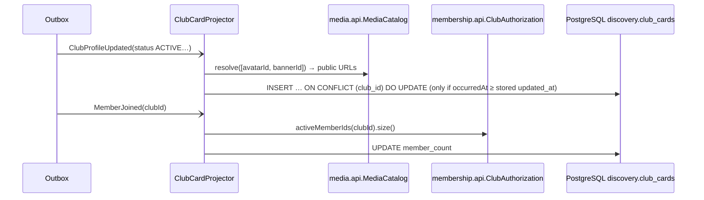

# Module `discovery`

## 1. Responsibility

- The **public landing page** data (stats, active and new clubs, categories).
- The **public club directory**: search, filter by category/tag/status, sort (D-24).
- The **public club profile** (R-24): name, tagline, description, category, tags, avatar, banner, member count, status, founding date.
- All of it is served from a **read model** (`discovery.club_cards`) maintained by domain events. One indexed table, no cross-module joins, anonymous-safe content only.

This is the textbook **CQRS read side**. It owns no business rules and could be rebuilt from scratch by replaying `ClubProfileUpdated` for every club.

## 2. Dependencies

| Direction | Modules |
|-----------|---------|
| Depends on | `shared`, `club::api` (enum types carried by club events), `club::events`, `membership::api`, `membership::events`, `forum::events`, `media::api` |
| Used by | — |

```java
@ApplicationModule(
        displayName = "Discovery",
        allowedDependencies = {"shared", "club::api", "club::events", "membership::api", "membership::events",
                "forum::events", "media::api"}
)
package pt.vclubroom.discovery;

import org.springframework.modulith.ApplicationModule;
```

## 3. Packages

```text
discovery/
├── web/            PublicDirectoryController (+ dto/)
├── application/    ClubCardProjector, DirectoryQueryService, DirectoryQuery
├── domain/         ClubCard
└── persistence/    ClubCardRepository, DirectorySearchRepository (JdbcClient)
```

## 4. Read model

| Column | Source event |
|--------|--------------|
| `club_id`, `slug`, `name`, `tagline`, `description`, `category`, `tags`, `status`, `join_policy`, `current_era` | `ClubProfileUpdated` (published on approval, edits, archival and revival) |
| `avatar_url`, `banner_url` | `ClubProfileUpdated` → `MediaCatalog.resolve` (public bucket, stable URL) |
| `founded_at` | `ClubApproved` |
| `member_count` | `MemberJoined` / `MemberLeft` → **recomputed** via `ClubAuthorization.activeMemberIds(clubId).size()` (idempotent, no drift) |
| `last_activity_at` | `PostPublished` (max) |
| `search_document` → `search` (`tsvector`, generated) | name + tagline + tags + description |

Only `ACTIVE` and `ARCHIVED` clubs get a card. Pending and rejected clubs never appear (BR-03).

## 5. Public API / events

None.

## 6. REST endpoints (all anonymous, `permitAll`)

| Method | Path | Description |
|--------|------|-------------|
| `GET` | `/api/public/landing` | `{stats: {activeClubs, archivedClubs, memberships}, mostActive[6], newest[6], categories[{name, count}]}` |
| `GET` | `/api/public/clubs?q=&category=&tag=&status=ACTIVE\|ARCHIVED\|ALL&sort=active\|new\|members\|name&page=&size=` | Directory (`PageResponse<ClubCardResponse>`); default `status=ACTIVE` (R-21) |
| `GET` | `/api/public/clubs/{slug}` | Public profile |
| `GET` | `/api/public/categories` | Configured categories (R-20) |

## 7. Request flows

### 7.1 Projection



**Out-of-order safety.** Async listeners can run out of order, so the upsert only applies a profile when `event.occurredAt >= updated_at`. Member counts are recomputed rather than incremented.

### 7.2 Directory search

`GET /api/public/clubs?q=robot&category=Tech&sort=active` → `PublicDirectoryController` → `DirectoryQueryService.search(query)` → `DirectorySearchRepository` builds SQL with only the filters present → single indexed query on `club_cards` (GIN on `search`, trigram on `name`, btree on `(status, last_activity_at)`) + count query → `PageResponse`.

## 8. Key implementation

```java
package pt.vclubroom.discovery.application;

import java.util.ArrayList;
import java.util.List;
import java.util.Map;
import java.util.UUID;
import org.springframework.modulith.events.ApplicationModuleListener;
import org.springframework.stereotype.Component;
import pt.vclubroom.club.api.ClubStatus;
import pt.vclubroom.club.events.ClubApproved;
import pt.vclubroom.club.events.ClubProfileUpdated;
import pt.vclubroom.discovery.persistence.ClubCardRepository;
import pt.vclubroom.forum.events.PostPublished;
import pt.vclubroom.media.api.MediaCatalog;
import pt.vclubroom.media.api.MediaView;
import pt.vclubroom.membership.api.ClubAuthorization;
import pt.vclubroom.membership.events.MemberJoined;
import pt.vclubroom.membership.events.MemberLeft;

@Component
class ClubCardProjector {

    private final ClubCardRepository cards;
    private final MediaCatalog mediaCatalog;
    private final ClubAuthorization clubAuthorization;

    ClubCardProjector(ClubCardRepository cards, MediaCatalog mediaCatalog, ClubAuthorization clubAuthorization) {
        this.cards = cards;
        this.mediaCatalog = mediaCatalog;
        this.clubAuthorization = clubAuthorization;
    }

    @ApplicationModuleListener
    void on(ClubProfileUpdated e) {
        if (e.status() != ClubStatus.ACTIVE && e.status() != ClubStatus.ARCHIVED) {
            return;                                                              // BR-03
        }
        List<UUID> ids = new ArrayList<>();
        if (e.avatarMediaId() != null) ids.add(e.avatarMediaId());
        if (e.bannerMediaId() != null) ids.add(e.bannerMediaId());
        Map<UUID, MediaView> media = mediaCatalog.resolve(ids);
        String avatar = e.avatarMediaId() != null && media.containsKey(e.avatarMediaId()) ? media.get(e.avatarMediaId()).url() : null;
        String banner = e.bannerMediaId() != null && media.containsKey(e.bannerMediaId()) ? media.get(e.bannerMediaId()).url() : null;
        String searchDocument = String.join(" ", e.name(), nullToEmpty(e.tagline()),
                String.join(" ", e.tags()), nullToEmpty(e.description()));

        cards.upsertProfile(e.clubId(), e.slug(), e.name(), e.tagline(), e.description(), e.category(),
                e.tags().toArray(String[]::new), avatar, banner, e.status().name(), e.joinPolicy().name(),
                e.currentEra(), searchDocument, e.occurredAt());
        // Listeners may run out of order: recount here too, in case MemberJoined arrived before the card existed.
        cards.setMemberCount(e.clubId(), clubAuthorization.activeMemberIds(e.clubId()).size());
    }

    @ApplicationModuleListener
    void on(ClubApproved e) {
        cards.upsertFoundedAt(e.clubId(), e.slug(), e.name(), e.occurredAt());
    }

    @ApplicationModuleListener
    void on(MemberJoined e) {
        cards.setMemberCount(e.clubId(), clubAuthorization.activeMemberIds(e.clubId()).size());
    }

    @ApplicationModuleListener
    void on(MemberLeft e) {
        cards.setMemberCount(e.clubId(), clubAuthorization.activeMemberIds(e.clubId()).size());
    }

    @ApplicationModuleListener
    void on(PostPublished e) {
        cards.bumpLastActivity(e.clubId(), e.occurredAt());
    }

    private static String nullToEmpty(String s) {
        return s == null ? "" : s;
    }
}
```

```java
package pt.vclubroom.discovery.persistence;

import java.time.Instant;
import java.util.UUID;
import org.springframework.data.jpa.repository.JpaRepository;
import org.springframework.data.jpa.repository.Modifying;
import org.springframework.data.jpa.repository.Query;
import org.springframework.data.repository.query.Param;
import pt.vclubroom.discovery.domain.ClubCard;

public interface ClubCardRepository extends JpaRepository<ClubCard, UUID> {

    @Modifying
    @Query(value = """
           insert into discovery.club_cards (club_id, slug, name, tagline, description, category, tags, avatar_url,
                  banner_url, status, join_policy, current_era, search_document, member_count, updated_at)
           values (:clubId, :slug, :name, :tagline, :description, :category, :tags, :avatarUrl,
                  :bannerUrl, :status, :joinPolicy, :currentEra, :searchDocument, 0, :occurredAt)
           on conflict (club_id) do update set
                  slug = excluded.slug, name = excluded.name, tagline = excluded.tagline,
                  description = excluded.description, category = excluded.category, tags = excluded.tags,
                  avatar_url = excluded.avatar_url, banner_url = excluded.banner_url, status = excluded.status,
                  join_policy = excluded.join_policy, current_era = excluded.current_era,
                  search_document = excluded.search_document, updated_at = excluded.updated_at
           where discovery.club_cards.updated_at <= excluded.updated_at
           """, nativeQuery = true)
    void upsertProfile(@Param("clubId") UUID clubId, @Param("slug") String slug, @Param("name") String name,
                       @Param("tagline") String tagline, @Param("description") String description,
                       @Param("category") String category, @Param("tags") String[] tags,
                       @Param("avatarUrl") String avatarUrl, @Param("bannerUrl") String bannerUrl,
                       @Param("status") String status, @Param("joinPolicy") String joinPolicy,
                       @Param("currentEra") int currentEra, @Param("searchDocument") String searchDocument,
                       @Param("occurredAt") Instant occurredAt);

    /** Creates a placeholder card if needed (updated_at = -infinity so the next profile upsert always wins). */
    @Modifying
    @Query(value = """
           insert into discovery.club_cards (club_id, slug, name, status, member_count, founded_at, updated_at)
           values (:clubId, :slug, :name, 'ACTIVE', 0, :at, '-infinity')
           on conflict (club_id) do update set founded_at = coalesce(discovery.club_cards.founded_at, excluded.founded_at)
           """, nativeQuery = true)
    void upsertFoundedAt(@Param("clubId") UUID clubId, @Param("slug") String slug, @Param("name") String name,
                         @Param("at") Instant at);

    @Modifying
    @Query(value = "update discovery.club_cards set member_count = :count where club_id = :clubId", nativeQuery = true)
    void setMemberCount(@Param("clubId") UUID clubId, @Param("count") int count);

    @Modifying
    @Query(value = """
           update discovery.club_cards set last_activity_at = greatest(coalesce(last_activity_at, :at), :at)
           where club_id = :clubId
           """, nativeQuery = true)
    void bumpLastActivity(@Param("clubId") UUID clubId, @Param("at") Instant at);
}
```

> **Ordering caveat.** `MemberJoined` for the founder may be processed before the first `ClubProfileUpdated` has created the card, in which case its `UPDATE` touches 0 rows. That is why `on(ClubProfileUpdated)` recounts members after its upsert, and `on(ClubApproved)` upserts a placeholder card instead of updating. Every handler converges to the same final state whatever the order.

```java
package pt.vclubroom.discovery.persistence;

import java.time.Instant;
import java.util.ArrayList;
import java.util.List;
import java.util.UUID;
import org.springframework.jdbc.core.simple.JdbcClient;
import org.springframework.stereotype.Repository;
import pt.vclubroom.shared.web.PageResponse;

/** Dynamic directory search: only the filters present end up in the SQL. */
@Repository
public class DirectorySearchRepository {

    public record ClubCardRow(UUID clubId, String slug, String name, String tagline, String category,
                              String avatarUrl, String status, String joinPolicy, int memberCount,
                              Instant lastActivityAt, Instant foundedAt) { }

    public record Criteria(String q, String category, String tag, List<String> statuses, String sort,
                           int page, int size) { }

    private final JdbcClient jdbc;

    public DirectorySearchRepository(JdbcClient jdbc) {
        this.jdbc = jdbc;
    }

    public PageResponse<ClubCardRow> search(Criteria c) {
        StringBuilder where = new StringBuilder(" where status in (:statuses)");
        List<String> extra = new ArrayList<>();
        if (c.q() != null && !c.q().isBlank()) {
            where.append(" and (search @@ plainto_tsquery('simple', :q) or name ilike '%' || :q || '%')");
            extra.add("q");
        }
        if (c.category() != null) {
            where.append(" and category = :category");
            extra.add("category");
        }
        if (c.tag() != null) {
            where.append(" and tags @> array[cast(:tag as text)]");   // GIN-indexable
            extra.add("tag");
        }
        String orderBy = switch (c.sort() == null ? "active" : c.sort()) {
            case "new" -> " order by founded_at desc nulls last";
            case "members" -> " order by member_count desc, name";
            case "name" -> " order by name";
            default -> " order by last_activity_at desc nulls last, member_count desc";
        };

        var itemsQuery = jdbc.sql("""
                select club_id, slug, name, tagline, category, avatar_url, status, join_policy, member_count,
                       last_activity_at, founded_at
                from discovery.club_cards""" + where + orderBy + " limit :limit offset :offset")
                .param("statuses", c.statuses())
                .param("limit", c.size())
                .param("offset", c.page() * c.size());
        var countQuery = jdbc.sql("select count(*) from discovery.club_cards" + where)
                .param("statuses", c.statuses());
        if (extra.contains("q")) { itemsQuery = itemsQuery.param("q", c.q()); countQuery = countQuery.param("q", c.q()); }
        if (extra.contains("category")) { itemsQuery = itemsQuery.param("category", c.category()); countQuery = countQuery.param("category", c.category()); }
        if (extra.contains("tag")) { itemsQuery = itemsQuery.param("tag", c.tag()); countQuery = countQuery.param("tag", c.tag()); }

        List<ClubCardRow> items = itemsQuery.query(ClubCardRow.class).list();
        long total = countQuery.query(Long.class).single();
        return new PageResponse<>(items, c.page(), c.size(), total);
    }
}
```

(`ClubCard` is a read-only JPA entity on `discovery.club_cards`, used for `GET /api/public/clubs/{slug}`.)

## 9. Data

Schema `discovery`: `club_cards`. See [04-database.md § discovery](../04-database.md#411-discovery).

## 10. Extension points

- **Rebuild command**: an admin endpoint that truncates `club_cards` and republishes `ClubProfileUpdated` for all clubs. This proves the read model is disposable.
- **Recommendations** ("clubs your pool-mates joined") from campus groups: a new projection, no change to other modules.
- **Caching**: `/api/public/**` responses can be cached by nginx for 30–60 s (`Cache-Control: public, max-age=30`).
