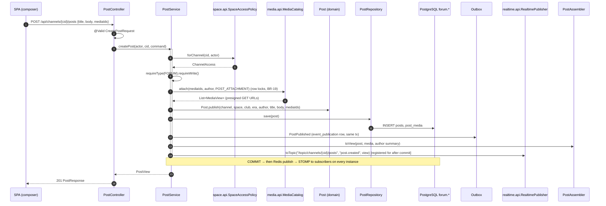

# Module `forum`

## 1. Responsibility

- **Posts** in `FORUM` channels: optional title, Markdown body, image/video/audio attachments. **A post is a thread** (D-05).
- **Comments** with **one level of replies** (D-26, BR-17).
- **Reactions** from the fixed emoji set on posts and comments (D-26, BR-18).
- Pinning, editing, soft deletion and moderation (BR-16).
- **Era rules** (BR-15): content from previous eras is read-only.
- **Club feed**: posts across all forum channels of a club that the viewer can read.
- Real-time pushes for new posts, comments and reaction counts. It implements the realtime SPI to authorize its topics.

Access decisions are **not** made here. The forum asks `SpaceAccessPolicy` and obeys the answer.

## 2. Dependencies

| Direction | Modules |
|-----------|---------|
| Depends on | `shared`, `space::api`, `media::api`, `identity::api`, `realtime::api`, `realtime::spi` |
| Listened to (events) | notification, discovery |

```java
@ApplicationModule(
        displayName = "Forum",
        allowedDependencies = {"shared", "space::api", "media::api", "identity::api", "realtime::api", "realtime::spi"}
)
package pt.vclubroom.forum;

import org.springframework.modulith.ApplicationModule;
```

## 3. Packages

```text
forum/
├── events/         PostPublished, CommentAdded
├── web/            PostController, CommentController, ReactionController, FeedController (+ dto/)
├── application/    PostService, PostQueryService, CommentService, ReactionService, PostAssembler,
│                   ForumProperties, ForumTopicAuthorizer, CreatePostCommand, PostView
├── domain/         Post, PostStatus, Comment, Reaction, ReactionTarget
└── persistence/    PostRepository, CommentRepository, ReactionRepository
```

## 4. Domain model

| Entity | Key fields | Rules |
|--------|-----------|-------|
| `Post` | `id`, `channelId`, `spaceId`, `clubId` (denormalised, never change), `authorId`, `era`, `title?`, `body`, `mediaIds[]` (ordered), `pinned`, `status` (`PUBLISHED`/`DELETED`), `commentCount`, `lastActivityAt`, `createdAt`, `editedAt`, `deletedAt`, `deletedBy` | Body or media required. Edit/delete by author (current era, writable channel) or moderator. |
| `Comment` | `id`, `postId`, `parentId?`, `authorId`, `body`, `status`, timestamps | Parent must be a top-level comment of the same post (BR-17). Allowed only if the post is in the current era. |
| `Reaction` | `id`, `targetType` (`POST`/`COMMENT`), `targetId`, `userId`, `emoji` (code), `createdAt` | Unique `(targetType, targetId, userId, emoji)`; emoji ∈ configured set (BR-18). |

Deleted posts and comments keep their row. Responses replace the body with `null` and set `deleted: true` and `deletedByModerator`.

## 5. Public API

None. No other module needs to call the forum synchronously. Its outputs are events and real-time pushes.

## 6. Events

```java
package pt.vclubroom.forum.events;

import java.time.Instant;
import java.util.UUID;

public record PostPublished(UUID postId, UUID channelId, UUID spaceId, UUID clubId, UUID authorId, int era,
                            String title, String excerpt, Instant occurredAt) {
}
```

```java
package pt.vclubroom.forum.events;

import java.time.Instant;
import java.util.UUID;

public record CommentAdded(UUID commentId, UUID postId, UUID parentId, UUID clubId, UUID spaceId, UUID authorId,
                           UUID postAuthorId, UUID parentAuthorId, String excerpt, Instant occurredAt) {
}
```

| Event | Consumers |
|-------|-----------|
| `PostPublished` | notification (club members who can read the space, except the author); discovery (club `lastActivityAt`) |
| `CommentAdded` | notification (post author; parent comment author for replies) |

### Real-time pushes (best effort, after commit)

| Destination | Type | Payload |
|-------------|------|---------|
| `/topic/channels/{channelId}/posts` | `post.created`, `post.updated`, `post.deleted` | `PostResponse` (viewer-neutral) |
| `/topic/posts/{postId}` | `comment.created`, `comment.deleted`, `reactions.changed` | `CommentResponse` / `{targetType, targetId, counts}` |

## 7. REST endpoints

| Method | Path | Authorization | Description |
|--------|------|---------------|-------------|
| `GET` | `/api/channels/{channelId}/posts?era=&cursor=&limit=20` | channel read | Newest first, keyset pagination; `era` filters history |
| `GET` | `/api/channels/{channelId}/posts/pinned` | channel read | Pinned posts |
| `POST` | `/api/channels/{channelId}/posts` | channel write | `{title?, body, mediaIds[]}` → `201 PostResponse` |
| `GET` | `/api/posts/{postId}` | channel read | Post with reaction counts and my reactions |
| `PATCH` | `/api/posts/{postId}` | author (current era, writable) | `{title?, body}` |
| `DELETE` | `/api/posts/{postId}` | author or moderator | Soft delete |
| `POST` / `DELETE` | `/api/posts/{postId}/pin` | moderator | Pin / unpin |
| `GET` | `/api/posts/{postId}/comments?cursor=&limit=50` | channel read | Oldest first; replies carry `parentId` |
| `POST` | `/api/posts/{postId}/comments` | channel write + current era | `{body, parentId?}` |
| `PATCH` / `DELETE` | `/api/comments/{commentId}` | author / moderator | |
| `PUT` | `/api/posts/{postId}/reactions/{emoji}` | channel write + current era | Idempotent add |
| `DELETE` | `/api/posts/{postId}/reactions/{emoji}` | own reaction | Idempotent remove |
| `PUT` / `DELETE` | `/api/comments/{commentId}/reactions/{emoji}` | same | |
| `GET` | `/api/reactions` | user | `[{code, emoji}]` (fixed set) |
| `GET` | `/api/clubs/{clubId}/feed?cursor=` | user | Posts from all readable forum channels of the club |

## 8. Request flows

### 8.1 Create a post (all layers)



### 8.2 Read a channel (history-aware)

`GET /api/channels/{cid}/posts?era=1&cursor=…` → `PostQueryService.list`:

1. `forChannel(cid, actor).requireType(FORUM).requireRead()`.
2. `PostRepository.findPage(cid, era, cursorAt, cursorId, limit + 1)`: keyset on `(created_at, id)` using index `ix_posts_channel_created`.
3. Batch-decorate: `UserDirectory.findByIds(authorIds)`, `MediaCatalog.resolve(allMediaIds)`, `ReactionRepository.countByTargets(POST, postIds)`, `ReactionRepository.mineByTargets(POST, postIds, me)`.
4. Map to `PostView` with `readOnly = !access.canWrite() || !access.isCurrentEra(post.era())`.
5. `nextCursor` from the extra row.

Each page costs a constant **5 queries** regardless of page size (no N+1).

### 8.3 Toggle a reaction

`PUT /api/posts/{pid}/reactions/party` → `ReactionService.add`:

1. Load the post.
2. Check channel access `requireWrite()`.
3. Check `isCurrentEra(post.era)`.
4. Check the emoji is in the configured set.
5. `INSERT … ON CONFLICT DO NOTHING` (idempotent).
6. Recount the target and push `reactions.changed` to `/topic/posts/{pid}`.

## 9. Key implementation

```java
package pt.vclubroom.forum.application;

import java.util.Map;
import org.springframework.boot.context.properties.ConfigurationProperties;

/** app.forum.reactions: code → emoji (fixed platform set, D-26). */
@ConfigurationProperties("app.forum")
public record ForumProperties(Map<String, String> reactions) {

    public boolean isAllowedReaction(String code) {
        return reactions.containsKey(code);
    }
}
```

```java
package pt.vclubroom.forum.domain;

public enum PostStatus {
    PUBLISHED,
    DELETED
}
```

```java
package pt.vclubroom.forum.domain;

import jakarta.persistence.CollectionTable;
import jakarta.persistence.Column;
import jakarta.persistence.ElementCollection;
import jakarta.persistence.Entity;
import jakarta.persistence.EnumType;
import jakarta.persistence.Enumerated;
import jakarta.persistence.Id;
import jakarta.persistence.JoinColumn;
import jakarta.persistence.OrderColumn;
import jakarta.persistence.Table;
import jakarta.persistence.Version;
import java.time.Instant;
import java.time.temporal.ChronoUnit;
import java.util.ArrayList;
import java.util.Collections;
import java.util.List;
import java.util.UUID;
import pt.vclubroom.shared.error.BusinessRuleException;
import pt.vclubroom.shared.error.InvalidRequestException;

@Entity
@Table(name = "posts", schema = "forum")
public class Post {

    @Id
    private UUID id;

    @Column(name = "channel_id", nullable = false)
    private UUID channelId;

    @Column(name = "space_id", nullable = false)
    private UUID spaceId;

    @Column(name = "club_id", nullable = false)
    private UUID clubId;

    @Column(name = "author_id", nullable = false)
    private UUID authorId;

    @Column(nullable = false)
    private int era;

    private String title;

    @Column(nullable = false)
    private String body;

    @ElementCollection
    @CollectionTable(name = "post_media", schema = "forum", joinColumns = @JoinColumn(name = "post_id"))
    @OrderColumn(name = "position")
    @Column(name = "media_id", nullable = false)
    private List<UUID> mediaIds = new ArrayList<>();

    @Column(nullable = false)
    private boolean pinned;

    @Enumerated(EnumType.STRING)
    @Column(nullable = false)
    private PostStatus status;

    @Column(name = "comment_count", nullable = false)
    private int commentCount;

    @Column(name = "created_at", nullable = false)
    private Instant createdAt;

    @Column(name = "last_activity_at", nullable = false)
    private Instant lastActivityAt;

    @Column(name = "edited_at")
    private Instant editedAt;

    @Column(name = "deleted_at")
    private Instant deletedAt;

    @Column(name = "deleted_by")
    private UUID deletedBy;

    @Version
    private Long version;

    protected Post() {
        // JPA
    }

    public static Post publish(UUID channelId, UUID spaceId, UUID clubId, int era, UUID authorId,
                               String title, String body, List<UUID> mediaIds, Instant now) {
        String text = body == null ? "" : body.strip();
        if (text.isEmpty() && (mediaIds == null || mediaIds.isEmpty())) {
            throw new InvalidRequestException("EMPTY_POST", "A post needs text or at least one attachment.");
        }
        Post p = new Post();
        p.id = UUID.randomUUID();
        p.channelId = channelId;
        p.spaceId = spaceId;
        p.clubId = clubId;
        p.era = era;
        p.authorId = authorId;
        p.title = title;
        p.body = text;
        p.mediaIds = new ArrayList<>(mediaIds == null ? List.of() : mediaIds);
        p.status = PostStatus.PUBLISHED;
        p.createdAt = now.truncatedTo(ChronoUnit.MICROS);
        p.lastActivityAt = p.createdAt;
        return p;
    }

    public void edit(UUID editor, String newTitle, String newBody, Instant now) {
        requirePublished();
        if (!authorId.equals(editor)) {
            throw new BusinessRuleException("NOT_AUTHOR", "Only the author can edit this post.");
        }
        this.title = newTitle;
        this.body = newBody.strip();
        this.editedAt = now.truncatedTo(ChronoUnit.MICROS);
    }

    /** BR-16: tombstone, never a hard delete. */
    public void softDelete(UUID by, Instant now) {
        requirePublished();
        this.status = PostStatus.DELETED;
        this.deletedBy = by;
        this.deletedAt = now.truncatedTo(ChronoUnit.MICROS);
        this.pinned = false;
    }

    public void pin(boolean value) {
        requirePublished();
        this.pinned = value;
    }

    public void commentAdded(Instant now) {
        this.commentCount++;
        this.lastActivityAt = now.truncatedTo(ChronoUnit.MICROS);
    }

    public String excerpt() {
        return body.length() <= 140 ? body : body.substring(0, 137) + "...";
    }

    private void requirePublished() {
        if (status != PostStatus.PUBLISHED) {
            throw new BusinessRuleException("POST_DELETED", "This post was deleted.");
        }
    }

    public boolean isDeleted() { return status == PostStatus.DELETED; }
    public boolean deletedByModerator() { return isDeleted() && !authorId.equals(deletedBy); }
    public UUID id() { return id; }
    public UUID channelId() { return channelId; }
    public UUID spaceId() { return spaceId; }
    public UUID clubId() { return clubId; }
    public UUID authorId() { return authorId; }
    public int era() { return era; }
    public String title() { return title; }
    public String body() { return body; }
    public List<UUID> mediaIds() { return Collections.unmodifiableList(mediaIds); }
    public boolean pinned() { return pinned; }
    public int commentCount() { return commentCount; }
    public Instant createdAt() { return createdAt; }
    public Instant editedAt() { return editedAt; }
}
```

```java
package pt.vclubroom.forum.domain;

import jakarta.persistence.Column;
import jakarta.persistence.Entity;
import jakarta.persistence.Id;
import jakarta.persistence.Table;
import java.time.Instant;
import java.time.temporal.ChronoUnit;
import java.util.UUID;
import pt.vclubroom.shared.error.BusinessRuleException;

@Entity
@Table(name = "comments", schema = "forum")
public class Comment {

    @Id
    private UUID id;

    @Column(name = "post_id", nullable = false)
    private UUID postId;

    @Column(name = "parent_id")
    private UUID parentId;

    @Column(name = "author_id", nullable = false)
    private UUID authorId;

    @Column(nullable = false)
    private String body;

    @Column(name = "created_at", nullable = false)
    private Instant createdAt;

    @Column(name = "edited_at")
    private Instant editedAt;

    @Column(name = "deleted_at")
    private Instant deletedAt;

    @Column(name = "deleted_by")
    private UUID deletedBy;

    protected Comment() {
        // JPA
    }

    /** BR-17: replies only to top-level comments of the same post. */
    public static Comment reply(Post post, Comment parent, UUID authorId, String body, Instant now) {
        if (parent != null && (!parent.postId.equals(post.id()) || parent.parentId != null)) {
            throw new BusinessRuleException("INVALID_PARENT", "You can only reply to a top-level comment of this post.");
        }
        Comment c = new Comment();
        c.id = UUID.randomUUID();
        c.postId = post.id();
        c.parentId = parent == null ? null : parent.id;
        c.authorId = authorId;
        c.body = body.strip();
        c.createdAt = now.truncatedTo(ChronoUnit.MICROS);
        return c;
    }

    public void softDelete(UUID by, Instant now) {
        this.deletedBy = by;
        this.deletedAt = now.truncatedTo(ChronoUnit.MICROS);
    }

    public boolean isDeleted() { return deletedAt != null; }
    public UUID id() { return id; }
    public UUID postId() { return postId; }
    public UUID parentId() { return parentId; }
    public UUID authorId() { return authorId; }
    public String body() { return body; }
    public Instant createdAt() { return createdAt; }
}
```

```java
package pt.vclubroom.forum.persistence;

import java.time.Instant;
import java.util.Collection;
import java.util.List;
import java.util.UUID;
import org.springframework.data.domain.Limit;
import org.springframework.data.jpa.repository.JpaRepository;
import org.springframework.data.jpa.repository.Query;
import org.springframework.data.repository.query.Param;
import pt.vclubroom.forum.domain.Post;

public interface PostRepository extends JpaRepository<Post, UUID> {

    /** Keyset page, newest first. First page: cursorAt = +infinity sentinel, cursorId = max UUID. */
    @Query("""
           select p from Post p
           where p.channelId = :channelId
             and (p.createdAt < :cursorAt or (p.createdAt = :cursorAt and p.id < :cursorId))
           order by p.createdAt desc, p.id desc
           """)
    List<Post> findPage(@Param("channelId") UUID channelId, @Param("cursorAt") Instant cursorAt,
                        @Param("cursorId") UUID cursorId, Limit limit);

    @Query("""
           select p from Post p
           where p.channelId = :channelId and p.era = :era
             and (p.createdAt < :cursorAt or (p.createdAt = :cursorAt and p.id < :cursorId))
           order by p.createdAt desc, p.id desc
           """)
    List<Post> findPageInEra(@Param("channelId") UUID channelId, @Param("era") int era,
                             @Param("cursorAt") Instant cursorAt, @Param("cursorId") UUID cursorId, Limit limit);

    /** Club feed across the readable forum channels. */
    @Query("""
           select p from Post p
           where p.channelId in :channelIds and p.status = pt.vclubroom.forum.domain.PostStatus.PUBLISHED
             and (p.createdAt < :cursorAt or (p.createdAt = :cursorAt and p.id < :cursorId))
           order by p.createdAt desc, p.id desc
           """)
    List<Post> findFeedPage(@Param("channelIds") Collection<UUID> channelIds, @Param("cursorAt") Instant cursorAt,
                            @Param("cursorId") UUID cursorId, Limit limit);

    List<Post> findByChannelIdAndPinnedTrueOrderByCreatedAtDesc(UUID channelId);
}
```

```java
package pt.vclubroom.forum.persistence;

import java.util.Collection;
import java.util.List;
import java.util.UUID;
import org.springframework.data.jpa.repository.JpaRepository;
import org.springframework.data.jpa.repository.Modifying;
import org.springframework.data.jpa.repository.Query;
import org.springframework.data.repository.query.Param;
import pt.vclubroom.forum.domain.Reaction;

public interface ReactionRepository extends JpaRepository<Reaction, UUID> {

    /** Projection: one row per (target, emoji) with its count. */
    interface ReactionCount {
        UUID getTargetId();
        String getEmoji();
        long getTotal();
    }

    @Query("""
           select r.targetId as targetId, r.emoji as emoji, count(r) as total
           from Reaction r
           where r.targetType = :targetType and r.targetId in :targetIds
           group by r.targetId, r.emoji
           """)
    List<ReactionCount> countByTargets(@Param("targetType") String targetType,
                                       @Param("targetIds") Collection<UUID> targetIds);

    @Query("""
           select r from Reaction r
           where r.targetType = :targetType and r.targetId in :targetIds and r.userId = :userId
           """)
    List<Reaction> mineByTargets(@Param("targetType") String targetType,
                                 @Param("targetIds") Collection<UUID> targetIds, @Param("userId") UUID userId);

    @Modifying
    @Query(value = """
           insert into forum.reactions (id, target_type, target_id, user_id, emoji, created_at)
           values (gen_random_uuid(), :targetType, :targetId, :userId, :emoji, now())
           on conflict (target_type, target_id, user_id, emoji) do nothing
           """, nativeQuery = true)
    void addIfAbsent(@Param("targetType") String targetType, @Param("targetId") UUID targetId,
                     @Param("userId") UUID userId, @Param("emoji") String emoji);

    @Modifying
    @Query("""
           delete from Reaction r
           where r.targetType = :targetType and r.targetId = :targetId and r.userId = :userId and r.emoji = :emoji
           """)
    void remove(@Param("targetType") String targetType, @Param("targetId") UUID targetId,
                @Param("userId") UUID userId, @Param("emoji") String emoji);
}
```

(`Reaction` is a plain entity mapped to `forum.reactions` with the fields listed in §4, and `targetType` stored as a string `POST`/`COMMENT`.)

```java
package pt.vclubroom.forum.application;

import java.util.List;
import java.util.UUID;

public record CreatePostCommand(String title, String body, List<UUID> mediaIds) {
}
```

```java
package pt.vclubroom.forum.application;

import java.time.Instant;
import java.util.List;
import java.util.Map;
import java.util.Set;
import java.util.UUID;
import pt.vclubroom.identity.api.UserSummary;
import pt.vclubroom.media.api.MediaView;

public record PostView(UUID id, UUID channelId, UUID clubId, int era, UserSummary author, String title, String body,
                       List<MediaView> media, boolean pinned, int commentCount, Map<String, Long> reactionCounts,
                       Set<String> myReactions, boolean deleted, boolean deletedByModerator, boolean readOnly,
                       Instant createdAt, Instant editedAt) {
}
```

```java
package pt.vclubroom.forum.application;

import java.time.Clock;
import java.time.Instant;
import java.util.List;
import java.util.Map;
import java.util.Set;
import java.util.UUID;
import org.springframework.context.ApplicationEventPublisher;
import org.springframework.stereotype.Service;
import org.springframework.transaction.annotation.Transactional;
import pt.vclubroom.forum.domain.Post;
import pt.vclubroom.forum.events.PostPublished;
import pt.vclubroom.forum.persistence.PostRepository;
import pt.vclubroom.identity.api.UserDirectory;
import pt.vclubroom.identity.api.UserSummary;
import pt.vclubroom.media.api.MediaCatalog;
import pt.vclubroom.media.api.MediaPurpose;
import pt.vclubroom.media.api.MediaView;
import pt.vclubroom.realtime.api.RealtimePublisher;
import pt.vclubroom.shared.error.ForbiddenException;
import pt.vclubroom.shared.error.NotFoundException;
import pt.vclubroom.shared.security.Actor;
import pt.vclubroom.space.api.ChannelAccess;
import pt.vclubroom.space.api.ChannelType;
import pt.vclubroom.space.api.SpaceAccessPolicy;

@Service
public class PostService {

    private final PostRepository posts;
    private final SpaceAccessPolicy spaceAccess;
    private final MediaCatalog mediaCatalog;
    private final UserDirectory users;
    private final RealtimePublisher realtime;
    private final ApplicationEventPublisher events;
    private final Clock clock;

    public PostService(PostRepository posts, SpaceAccessPolicy spaceAccess, MediaCatalog mediaCatalog,
                       UserDirectory users, RealtimePublisher realtime, ApplicationEventPublisher events, Clock clock) {
        this.posts = posts;
        this.spaceAccess = spaceAccess;
        this.mediaCatalog = mediaCatalog;
        this.users = users;
        this.realtime = realtime;
        this.events = events;
        this.clock = clock;
    }

    @Transactional
    public PostView createPost(Actor actor, UUID channelId, CreatePostCommand cmd) {
        ChannelAccess access = spaceAccess.forChannel(channelId, actor)
                .requireType(ChannelType.FORUM)
                .requireWrite();
        List<UUID> mediaIds = cmd.mediaIds() == null ? List.of() : cmd.mediaIds();
        List<MediaView> media = mediaCatalog.attach(mediaIds, actor.userId(), MediaPurpose.POST_ATTACHMENT);

        Instant now = clock.instant();
        Post post = Post.publish(access.channelId(), access.spaceId(), access.clubId(), access.currentEra(),
                actor.userId(), cmd.title(), cmd.body(), mediaIds, now);
        posts.save(post);

        events.publishEvent(new PostPublished(post.id(), channelId, access.spaceId(), access.clubId(),
                actor.userId(), post.era(), post.title(), post.excerpt(), now));

        UserSummary author = users.findById(actor.userId()).orElse(null);
        PostView view = new PostView(post.id(), channelId, access.clubId(), post.era(), author, post.title(),
                post.body(), media, false, 0, Map.of(), Set.of(), false, false, false, post.createdAt(), null);
        realtime.toTopic("/topic/channels/" + channelId + "/posts", "post.created", view);   // after commit
        return view;
    }

    @Transactional
    public void delete(Actor actor, UUID postId) {
        Post post = posts.findById(postId)
                .orElseThrow(() -> new NotFoundException("POST_NOT_FOUND", "Post not found"));
        ChannelAccess access = spaceAccess.forChannel(post.channelId(), actor).requireRead();
        boolean author = post.authorId().equals(actor.userId()) && access.canWrite() && access.isCurrentEra(post.era());
        // Admins may moderate history even in archived clubs (exception to R-08, for abuse removal).
        if (!(author || access.canModerate() || actor.admin())) {
            throw new ForbiddenException("CANNOT_DELETE", "You cannot delete this post.");
        }
        post.softDelete(actor.userId(), clock.instant());
        realtime.toTopic("/topic/channels/" + post.channelId() + "/posts", "post.deleted", Map.of("id", postId));
    }
}
```

```java
package pt.vclubroom.forum.application;

import java.util.List;
import java.util.Map;
import java.util.UUID;
import java.util.stream.Collectors;
import org.springframework.stereotype.Service;
import org.springframework.transaction.annotation.Transactional;
import pt.vclubroom.forum.domain.Post;
import pt.vclubroom.forum.persistence.PostRepository;
import pt.vclubroom.forum.persistence.ReactionRepository;
import pt.vclubroom.realtime.api.RealtimePublisher;
import pt.vclubroom.shared.error.BusinessRuleException;
import pt.vclubroom.shared.error.InvalidRequestException;
import pt.vclubroom.shared.error.NotFoundException;
import pt.vclubroom.shared.security.Actor;
import pt.vclubroom.space.api.ChannelAccess;
import pt.vclubroom.space.api.SpaceAccessPolicy;

@Service
public class ReactionService {

    private final PostRepository posts;
    private final ReactionRepository reactions;
    private final SpaceAccessPolicy spaceAccess;
    private final ForumProperties properties;
    private final RealtimePublisher realtime;

    public ReactionService(PostRepository posts, ReactionRepository reactions, SpaceAccessPolicy spaceAccess,
                           ForumProperties properties, RealtimePublisher realtime) {
        this.posts = posts;
        this.reactions = reactions;
        this.spaceAccess = spaceAccess;
        this.properties = properties;
        this.realtime = realtime;
    }

    @Transactional
    public Map<String, Long> reactToPost(Actor actor, UUID postId, String emoji, boolean add) {
        if (!properties.isAllowedReaction(emoji)) {                                       // BR-18
            throw new InvalidRequestException("UNKNOWN_REACTION", "Unknown reaction " + emoji);
        }
        Post post = posts.findById(postId)
                .filter(p -> !p.isDeleted())
                .orElseThrow(() -> new NotFoundException("POST_NOT_FOUND", "Post not found"));
        ChannelAccess access = spaceAccess.forChannel(post.channelId(), actor).requireWrite();
        if (!access.isCurrentEra(post.era())) {                                           // BR-15
            throw new BusinessRuleException("HISTORY_READ_ONLY", "Posts from previous eras are read-only.");
        }
        if (add) {
            reactions.addIfAbsent("POST", postId, actor.userId(), emoji);
        } else {
            reactions.remove("POST", postId, actor.userId(), emoji);
        }
        Map<String, Long> counts = reactions.countByTargets("POST", List.of(postId)).stream()
                .collect(Collectors.toMap(ReactionRepository.ReactionCount::getEmoji,
                        ReactionRepository.ReactionCount::getTotal));
        realtime.toTopic("/topic/posts/" + postId, "reactions.changed",
                Map.of("targetType", "POST", "targetId", postId, "counts", counts));
        return counts;
    }
}
```

```java
package pt.vclubroom.forum.application;

import java.util.UUID;
import java.util.regex.Matcher;
import java.util.regex.Pattern;
import org.springframework.stereotype.Component;
import pt.vclubroom.forum.persistence.PostRepository;
import pt.vclubroom.realtime.spi.SubscriptionAuthorizer;
import pt.vclubroom.shared.security.Actor;
import pt.vclubroom.space.api.SpaceAccessPolicy;

/** Realtime SPI: only readers of a channel may subscribe to its forum topics. */
@Component
class ForumTopicAuthorizer implements SubscriptionAuthorizer {

    private static final Pattern CHANNEL_POSTS = Pattern.compile("^/topic/channels/([0-9a-f-]{36})/posts$");
    private static final Pattern POST = Pattern.compile("^/topic/posts/([0-9a-f-]{36})$");

    private final SpaceAccessPolicy spaceAccess;
    private final PostRepository posts;

    ForumTopicAuthorizer(SpaceAccessPolicy spaceAccess, PostRepository posts) {
        this.spaceAccess = spaceAccess;
        this.posts = posts;
    }

    @Override
    public boolean supports(String destination) {
        return CHANNEL_POSTS.matcher(destination).matches() || POST.matcher(destination).matches();
    }

    @Override
    public boolean canSubscribe(Actor actor, String destination) {
        Matcher channel = CHANNEL_POSTS.matcher(destination);
        if (channel.matches()) {
            return spaceAccess.forChannel(UUID.fromString(channel.group(1)), actor).canRead();
        }
        Matcher post = POST.matcher(destination);
        if (post.matches()) {
            return posts.findById(UUID.fromString(post.group(1)))
                    .map(p -> spaceAccess.forChannel(p.channelId(), actor).canRead())
                    .orElse(false);
        }
        return false;
    }
}
```

```java
package pt.vclubroom.forum.web;

import jakarta.validation.Valid;
import jakarta.validation.constraints.Size;
import java.util.List;
import java.util.UUID;
import org.springframework.http.HttpStatus;
import org.springframework.http.ResponseEntity;
import org.springframework.security.core.annotation.AuthenticationPrincipal;
import org.springframework.web.bind.annotation.DeleteMapping;
import org.springframework.web.bind.annotation.GetMapping;
import org.springframework.web.bind.annotation.PathVariable;
import org.springframework.web.bind.annotation.PostMapping;
import org.springframework.web.bind.annotation.RequestBody;
import org.springframework.web.bind.annotation.RequestParam;
import org.springframework.web.bind.annotation.ResponseStatus;
import org.springframework.web.bind.annotation.RestController;
import pt.vclubroom.forum.application.CreatePostCommand;
import pt.vclubroom.forum.application.PostQueryService;
import pt.vclubroom.forum.application.PostService;
import pt.vclubroom.forum.application.PostView;
import pt.vclubroom.shared.security.AuthenticatedUser;
import pt.vclubroom.shared.web.CursorPage;

@RestController
class PostController {

    record CreatePostRequest(@Size(max = 140) String title,
                             @Size(max = 20000) String body,
                             @Size(max = 10) List<UUID> mediaIds) {
        CreatePostCommand toCommand() {
            return new CreatePostCommand(title, body, mediaIds == null ? List.of() : mediaIds);
        }
    }

    private final PostService posts;
    private final PostQueryService queries;

    PostController(PostService posts, PostQueryService queries) {
        this.posts = posts;
        this.queries = queries;
    }

    @GetMapping("/api/channels/{channelId}/posts")
    CursorPage<PostView> list(@AuthenticationPrincipal AuthenticatedUser me, @PathVariable UUID channelId,
                              @RequestParam(required = false) Integer era,
                              @RequestParam(required = false) String cursor,
                              @RequestParam(defaultValue = "20") int limit) {
        return queries.list(me.actor(), channelId, era, cursor, Math.min(limit, 50));
    }

    @PostMapping("/api/channels/{channelId}/posts")
    @ResponseStatus(HttpStatus.CREATED)
    PostView create(@AuthenticationPrincipal AuthenticatedUser me, @PathVariable UUID channelId,
                    @Valid @RequestBody CreatePostRequest request) {
        return posts.createPost(me.actor(), channelId, request.toCommand());
    }

    @DeleteMapping("/api/posts/{postId}")
    ResponseEntity<Void> delete(@AuthenticationPrincipal AuthenticatedUser me, @PathVariable UUID postId) {
        posts.delete(me.actor(), postId);
        return ResponseEntity.noContent().build();
    }
}
```

> For brevity `PostView` is returned directly by the controller here. In the real code, map it to a `PostResponse` record in `web.dto` as the club module does, so the HTTP contract can evolve independently of the application view.

## 10. Data

Schema `forum`: `posts`, `post_media`, `comments`, `reactions`. See [04-database.md § forum](../04-database.md#47-forum).

## 11. Extension points

- **Mentions** (`@login`): parse on publish, emit `UserMentioned`, notify. No access change needed, because mentions only notify users who can read the space.
- **Polls**: a new `POLL` channel type or a post attachment kind, owned by a new module.
- **Full-text search** within a club: a `tsvector` column on posts, with results filtered through `readableForumChannels`.
