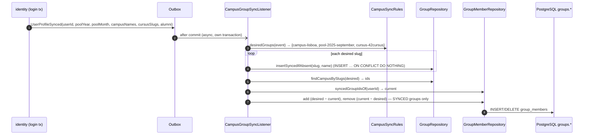

# Module `group`

## 1. Responsibility

- **Club groups**: named subsets of a club's members, managed by holders of `GROUP_MANAGE` (D-06, D-19). Examples: "Board", "Robotics team".
- **Campus groups**: campus-wide groups that are either **admin-managed** (`MANUAL`) or **auto-synced from 42 data** at every login (`SYNCED`, D-21). Examples: `campus-lisboa`, `pool-2025-september`, `cursus-42cursus`, `alumni`.
- Answering **"is user U in any of groups G?"** for space access rules, and validating which groups a club may reference (BR-12).

Groups grant **no permissions**. They are used only as audiences of space read and write rules.

## 2. Dependencies

| Direction | Modules |
|-----------|---------|
| Depends on | `shared`, `membership::api`, `membership::events`, `identity::api`, `identity::events` |
| Used by (API) | space |
| Listened to (events) | space (`GroupDeleted`) |

```java
@ApplicationModule(
        displayName = "Group",
        allowedDependencies = {"shared", "membership::api", "membership::events", "identity::api", "identity::events"}
)
package pt.vclubroom.group;

import org.springframework.modulith.ApplicationModule;
```

## 3. Packages

```text
group/
├── api/            GroupMembershipQuery, GroupCatalog, GroupSummary, GroupScope
├── events/         GroupDeleted
├── web/            ClubGroupController, CampusGroupController, AdminCampusGroupController (+ dto/)
├── application/    ClubGroupService, CampusGroupService, GroupQueryService,
│                   CampusGroupSyncListener, MembershipEndedListener, CampusSyncRules
├── domain/         Group, GroupSource, GroupMember
└── persistence/    GroupRepository, GroupMemberRepository
```

## 4. Domain model

| Entity | Fields | Rules |
|--------|--------|-------|
| `Group` | `id`, `scope` (`CLUB`/`CAMPUS`), `clubId` (CLUB only), `name`, `slug`, `description`, `source` (`MANUAL`/`SYNCED`), `createdBy`, `createdAt`, `version` | Unique `(scope, club_id, slug)`. `SYNCED` groups are read-only for humans: their members are managed only by the sync. |
| `GroupMember` | `groupId`, `userId`, `addedBy`, `addedAt` | Club groups: user must be an active member of the club (BR-13). |

Members are **not** loaded into the `Group` aggregate (campus groups can have hundreds of members); they are managed through `GroupMemberRepository`.

## 5. Public API

```java
package pt.vclubroom.group.api;

public enum GroupScope {
    CLUB,
    CAMPUS
}
```

```java
package pt.vclubroom.group.api;

import java.util.UUID;

public record GroupSummary(UUID id, GroupScope scope, UUID clubId, String name, String slug, boolean synced) {
}
```

```java
package pt.vclubroom.group.api;

import java.util.Collection;
import java.util.Set;
import java.util.UUID;

public interface GroupMembershipQuery {

    /** Core check used by space access rules. Empty collection → false (fail closed, R-23). */
    boolean isMemberOfAny(UUID userId, Collection<UUID> groupIds);

    Set<UUID> memberIdsOf(Collection<UUID> groupIds);
}
```

```java
package pt.vclubroom.group.api;

import java.util.Collection;
import java.util.List;
import java.util.UUID;

public interface GroupCatalog {

    /**
     * BR-12: every group must be a CLUB group of this club or a CAMPUS group.
     * @throws pt.vclubroom.shared.error.BusinessRuleException GROUP_NOT_USABLE
     */
    void assertUsableInClub(UUID clubId, Collection<UUID> groupIds);

    List<GroupSummary> findByIds(Collection<UUID> groupIds);
}
```

## 6. Events

```java
package pt.vclubroom.group.events;

import java.time.Instant;
import java.util.UUID;
import pt.vclubroom.group.api.GroupScope;

public record GroupDeleted(UUID groupId, GroupScope scope, UUID clubId, Instant occurredAt) {
}
```

**Consumed:** `identity.events.UserProfileSynced` (campus sync), `membership.events.MemberLeft` (remove from that club's groups, R-22).

## 7. REST endpoints

| Method | Path | Authorization | Description |
|--------|------|---------------|-------------|
| `GET` | `/api/clubs/{clubId}/groups` | active member | Club groups with member counts |
| `POST` | `/api/clubs/{clubId}/groups` | `GROUP_MANAGE` | `{name, description}` |
| `PATCH` | `/api/clubs/{clubId}/groups/{groupId}` | `GROUP_MANAGE` | Rename / describe |
| `DELETE` | `/api/clubs/{clubId}/groups/{groupId}` | `GROUP_MANAGE` | Emits `GroupDeleted` |
| `GET` | `/api/clubs/{clubId}/groups/{groupId}/members` | active member | Members (with `UserSummary`) |
| `PUT` | `/api/clubs/{clubId}/groups/{groupId}/members/{userId}` | `GROUP_MANAGE` | Add (must be an active club member) |
| `DELETE` | `/api/clubs/{clubId}/groups/{groupId}/members/{userId}` | `GROUP_MANAGE` | Remove |
| `GET` | `/api/campus-groups?query=` | user | Campus groups (for the access-rule picker) |
| `POST` | `/api/admin/campus-groups` | admin | Create `MANUAL` campus group |
| `PATCH` / `DELETE` | `/api/admin/campus-groups/{groupId}` | admin | `MANUAL` only |
| `PUT` / `DELETE` | `/api/admin/campus-groups/{groupId}/members/{userId}` | admin | `MANUAL` only |

## 8. Request flows

### 8.1 Campus group sync at login



### 8.2 Add a member to a club group

`PUT /api/clubs/{c}/groups/{g}/members/{u}` → `ClubGroupController` → `ClubGroupService.addMember`:

1. `authorization.require(c, actor, GROUP_MANAGE)` (membership API).
2. Load the group: scope `CLUB` and `clubId == c`, else 404.
3. `authorization.isActiveMember(c, u)`, else 422 `NOT_A_MEMBER` (BR-13).
4. `GroupMemberRepository.save(...)` (idempotent: an existing row returns 204).

## 9. Key implementation

```java
package pt.vclubroom.group.domain;

public enum GroupSource {
    MANUAL,
    SYNCED
}
```

```java
package pt.vclubroom.group.domain;

import jakarta.persistence.Column;
import jakarta.persistence.Entity;
import jakarta.persistence.EnumType;
import jakarta.persistence.Enumerated;
import jakarta.persistence.Id;
import jakarta.persistence.Table;
import jakarta.persistence.Version;
import java.time.Instant;
import java.time.temporal.ChronoUnit;
import java.util.UUID;
import pt.vclubroom.group.api.GroupScope;
import pt.vclubroom.shared.error.BusinessRuleException;

@Entity
@Table(name = "groups", schema = "groups")
public class Group {

    @Id
    private UUID id;

    @Enumerated(EnumType.STRING)
    @Column(nullable = false)
    private GroupScope scope;

    @Column(name = "club_id")
    private UUID clubId;

    @Column(nullable = false)
    private String name;

    @Column(nullable = false)
    private String slug;

    private String description;

    @Enumerated(EnumType.STRING)
    @Column(nullable = false)
    private GroupSource source;

    @Column(name = "created_by")
    private UUID createdBy;

    @Column(name = "created_at", nullable = false)
    private Instant createdAt;

    @Version
    private Long version;

    protected Group() {
        // JPA
    }

    public static Group clubGroup(UUID clubId, String name, String slug, String description, UUID createdBy, Instant now) {
        Group g = base(GroupScope.CLUB, name, slug, description, GroupSource.MANUAL, createdBy, now);
        g.clubId = clubId;
        return g;
    }

    public static Group manualCampusGroup(String name, String slug, String description, UUID createdBy, Instant now) {
        return base(GroupScope.CAMPUS, name, slug, description, GroupSource.MANUAL, createdBy, now);
    }

    private static Group base(GroupScope scope, String name, String slug, String description, GroupSource source,
                              UUID createdBy, Instant now) {
        Group g = new Group();
        g.id = UUID.randomUUID();
        g.scope = scope;
        g.name = name;
        g.slug = slug;
        g.description = description;
        g.source = source;
        g.createdBy = createdBy;
        g.createdAt = now.truncatedTo(ChronoUnit.MICROS);
        return g;
    }

    public void ensureManuallyManaged() {
        if (source == GroupSource.SYNCED) {
            throw new BusinessRuleException("GROUP_SYNCED", "This group is synchronised from 42 and cannot be edited.");
        }
    }

    public boolean belongsToClub(UUID otherClubId) {
        return scope == GroupScope.CLUB && clubId.equals(otherClubId);
    }

    public UUID id() { return id; }
    public GroupScope scope() { return scope; }
    public UUID clubId() { return clubId; }
    public String name() { return name; }
    public String slug() { return slug; }
    public GroupSource source() { return source; }
}
```

```java
package pt.vclubroom.group.persistence;

import java.util.Collection;
import java.util.List;
import java.util.Set;
import java.util.UUID;
import org.springframework.data.jpa.repository.JpaRepository;
import org.springframework.data.jpa.repository.Modifying;
import org.springframework.data.jpa.repository.Query;
import org.springframework.data.repository.query.Param;
import pt.vclubroom.group.domain.Group;

public interface GroupRepository extends JpaRepository<Group, UUID> {

    List<Group> findByIdIn(Collection<UUID> ids);

    @Query("select g.id from Group g where g.scope = pt.vclubroom.group.api.GroupScope.CAMPUS and g.slug in :slugs")
    Set<UUID> findCampusIdsBySlugs(@Param("slugs") Collection<String> slugs);

    @Modifying
    @Query(value = """
           insert into groups.groups (id, scope, club_id, name, slug, source, created_at, version)
           values (gen_random_uuid(), 'CAMPUS', null, :name, :slug, 'SYNCED', now(), 0)
           on conflict (slug) where scope = 'CAMPUS' do nothing
           """, nativeQuery = true)
    void insertSyncedIfAbsent(@Param("slug") String slug, @Param("name") String name);
}
```

```java
package pt.vclubroom.group.persistence;

import java.util.Collection;
import java.util.Set;
import java.util.UUID;
import org.springframework.data.jpa.repository.JpaRepository;
import org.springframework.data.jpa.repository.Modifying;
import org.springframework.data.jpa.repository.Query;
import org.springframework.data.repository.query.Param;
import pt.vclubroom.group.domain.GroupMember;

public interface GroupMemberRepository extends JpaRepository<GroupMember, GroupMember.Key> {

    @Query("select count(m) > 0 from GroupMember m where m.userId = :userId and m.groupId in :groupIds")
    boolean existsByUserInGroups(@Param("userId") UUID userId, @Param("groupIds") Collection<UUID> groupIds);

    @Query("select distinct m.userId from GroupMember m where m.groupId in :groupIds")
    Set<UUID> findUserIdsByGroups(@Param("groupIds") Collection<UUID> groupIds);

    @Query("""
           select m.groupId from GroupMember m, Group g
           where g.id = m.groupId and m.userId = :userId and g.source = pt.vclubroom.group.domain.GroupSource.SYNCED
           """)
    Set<UUID> findSyncedGroupIdsOfUser(@Param("userId") UUID userId);

    @Modifying
    @Query("delete from GroupMember m where m.userId = :userId and m.groupId in :groupIds")
    void deleteMemberships(@Param("userId") UUID userId, @Param("groupIds") Collection<UUID> groupIds);

    @Modifying
    @Query("""
           delete from GroupMember m where m.userId = :userId and m.groupId in
             (select g.id from Group g where g.scope = pt.vclubroom.group.api.GroupScope.CLUB and g.clubId = :clubId)
           """)
    void deleteFromClubGroups(@Param("clubId") UUID clubId, @Param("userId") UUID userId);
}
```

```java
package pt.vclubroom.group.domain;

import jakarta.persistence.Column;
import jakarta.persistence.Entity;
import jakarta.persistence.Id;
import jakarta.persistence.IdClass;
import jakarta.persistence.Table;
import java.io.Serializable;
import java.time.Instant;
import java.time.temporal.ChronoUnit;
import java.util.UUID;

@Entity
@Table(name = "group_members", schema = "groups")
@IdClass(GroupMember.Key.class)
public class GroupMember {

    public record Key(UUID groupId, UUID userId) implements Serializable { }

    @Id
    @Column(name = "group_id")
    private UUID groupId;

    @Id
    @Column(name = "user_id")
    private UUID userId;

    @Column(name = "added_by")
    private UUID addedBy;

    @Column(name = "added_at", nullable = false)
    private Instant addedAt;

    protected GroupMember() {
        // JPA
    }

    public static GroupMember of(UUID groupId, UUID userId, UUID addedBy, Instant now) {
        GroupMember m = new GroupMember();
        m.groupId = groupId;
        m.userId = userId;
        m.addedBy = addedBy;
        m.addedAt = now.truncatedTo(ChronoUnit.MICROS);
        return m;
    }

    public UUID groupId() { return groupId; }
    public UUID userId() { return userId; }
}
```

> **Note on `@IdClass` with a record.** Hibernate 6.2+ supports records as ID classes. If your Hibernate version complains, replace the record with a classic `Serializable` class with `equals`/`hashCode`.

```java
package pt.vclubroom.group.application;

import java.util.LinkedHashMap;
import java.util.Locale;
import java.util.Map;
import org.springframework.stereotype.Component;
import pt.vclubroom.identity.events.UserProfileSynced;

/** Maps 42 profile facts to campus group slugs and display names. One place to add new rules. */
@Component
class CampusSyncRules {

    Map<String, String> desiredGroups(UserProfileSynced p) {
        Map<String, String> groups = new LinkedHashMap<>();
        p.campusNames().forEach(c -> groups.put("campus-" + slug(c), "Campus " + c));
        if (p.poolYear() != null && p.poolMonth() != null) {
            groups.put("pool-" + p.poolYear() + "-" + slug(p.poolMonth()), "Pool " + p.poolMonth() + " " + p.poolYear());
        }
        p.cursusSlugs().forEach(c -> groups.put("cursus-" + slug(c), "Cursus " + c));
        if (p.alumni()) {
            groups.put("alumni", "42 Alumni");
        }
        return groups;
    }

    private static String slug(String s) {
        return s.toLowerCase(Locale.ROOT).replaceAll("[^a-z0-9]+", "-").replaceAll("(^-|-$)", "");
    }
}
```

```java
package pt.vclubroom.group.application;

import java.time.Clock;
import java.util.HashSet;
import java.util.Map;
import java.util.Set;
import java.util.UUID;
import org.springframework.beans.factory.annotation.Value;
import org.springframework.modulith.events.ApplicationModuleListener;
import org.springframework.stereotype.Component;
import pt.vclubroom.group.domain.GroupMember;
import pt.vclubroom.group.persistence.GroupMemberRepository;
import pt.vclubroom.group.persistence.GroupRepository;
import pt.vclubroom.identity.events.UserProfileSynced;

@Component
class CampusGroupSyncListener {

    private final GroupRepository groups;
    private final GroupMemberRepository members;
    private final CampusSyncRules rules;
    private final Clock clock;
    private final boolean enabled;

    CampusGroupSyncListener(GroupRepository groups, GroupMemberRepository members, CampusSyncRules rules, Clock clock,
                            @Value("${app.fortytwo.campus-groups-enabled:true}") boolean enabled) {
        this.groups = groups;
        this.members = members;
        this.rules = rules;
        this.clock = clock;
        this.enabled = enabled;
    }

    @ApplicationModuleListener
    void on(UserProfileSynced event) {
        if (!enabled) {
            return;
        }
        Map<String, String> desired = rules.desiredGroups(event);
        desired.forEach((slug, name) -> groups.insertSyncedIfAbsent(slug, name));

        Set<UUID> desiredIds = desired.isEmpty() ? Set.of() : groups.findCampusIdsBySlugs(desired.keySet());
        Set<UUID> currentIds = members.findSyncedGroupIdsOfUser(event.userId());

        Set<UUID> toRemove = new HashSet<>(currentIds);
        toRemove.removeAll(desiredIds);
        if (!toRemove.isEmpty()) {
            members.deleteMemberships(event.userId(), toRemove);
        }
        desiredIds.stream()
                .filter(id -> !currentIds.contains(id))
                .forEach(id -> members.save(GroupMember.of(id, event.userId(), null, clock.instant())));
    }
}
```

```java
package pt.vclubroom.group.application;

import org.springframework.modulith.events.ApplicationModuleListener;
import org.springframework.stereotype.Component;
import pt.vclubroom.group.persistence.GroupMemberRepository;
import pt.vclubroom.membership.events.MemberLeft;

/** R-22: leaving a club removes the user from that club's groups (campus groups untouched). */
@Component
class MembershipEndedListener {

    private final GroupMemberRepository members;

    MembershipEndedListener(GroupMemberRepository members) {
        this.members = members;
    }

    @ApplicationModuleListener
    void on(MemberLeft event) {
        members.deleteFromClubGroups(event.clubId(), event.userId());
    }
}
```

```java
package pt.vclubroom.group.application;

import java.util.Collection;
import java.util.List;
import java.util.Set;
import java.util.UUID;
import org.springframework.stereotype.Service;
import org.springframework.transaction.annotation.Transactional;
import pt.vclubroom.group.api.GroupCatalog;
import pt.vclubroom.group.api.GroupMembershipQuery;
import pt.vclubroom.group.api.GroupScope;
import pt.vclubroom.group.api.GroupSummary;
import pt.vclubroom.group.domain.Group;
import pt.vclubroom.group.domain.GroupSource;
import pt.vclubroom.group.persistence.GroupMemberRepository;
import pt.vclubroom.group.persistence.GroupRepository;
import pt.vclubroom.shared.error.BusinessRuleException;

@Service
@Transactional(readOnly = true)
class GroupQueryService implements GroupMembershipQuery, GroupCatalog {

    private final GroupRepository groups;
    private final GroupMemberRepository members;

    GroupQueryService(GroupRepository groups, GroupMemberRepository members) {
        this.groups = groups;
        this.members = members;
    }

    @Override
    public boolean isMemberOfAny(UUID userId, Collection<UUID> groupIds) {
        return !groupIds.isEmpty() && members.existsByUserInGroups(userId, groupIds);
    }

    @Override
    public Set<UUID> memberIdsOf(Collection<UUID> groupIds) {
        return groupIds.isEmpty() ? Set.of() : members.findUserIdsByGroups(groupIds);
    }

    @Override
    public void assertUsableInClub(UUID clubId, Collection<UUID> groupIds) {
        List<Group> found = groups.findByIdIn(groupIds);
        boolean allUsable = found.size() == Set.copyOf(groupIds).size()
                && found.stream().allMatch(g -> g.scope() == GroupScope.CAMPUS || g.belongsToClub(clubId));
        if (!allUsable) {
            throw new BusinessRuleException("GROUP_NOT_USABLE",
                    "Spaces can only use this club's groups or campus groups.");
        }
    }

    @Override
    public List<GroupSummary> findByIds(Collection<UUID> groupIds) {
        return groups.findByIdIn(groupIds).stream()
                .map(g -> new GroupSummary(g.id(), g.scope(), g.clubId(), g.name(), g.slug(),
                        g.source() == GroupSource.SYNCED))
                .toList();
    }
}
```

## 10. Data

Schema `groups`: `groups`, `group_members`. See [04-database.md § groups](../04-database.md#44-groups).

## 11. Extension points

- **More sync rules** (e.g. `level-10-plus`, project-based groups): add entries in `CampusSyncRules` (and the needed fields in `UserProfileSynced`).
- **Self-join groups** ("opt-in channels"): a `joinable` flag plus a self-service endpoint.
