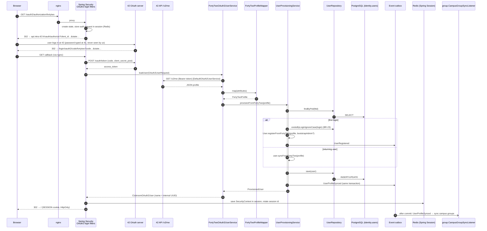
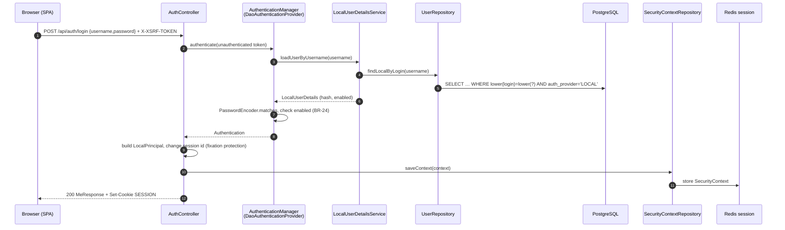

# Module `identity`

## 1. Responsibility

- Owns **users**: 42 users (auto-provisioned on first login) and local users (admin-created, D-09).
- **Authentication**: Login with 42 (OAuth2 authorization code) and local username/password login.
- **Platform roles** (`USER`, `ADMIN`) and account status (`ACTIVE`, `DISABLED`).
- Keeps a small **snapshot of 42 profile data** (pool, campus, cursus, alumni, staff) and announces it so other modules (campus groups) can react.
- Admin user management (create local accounts, change role/status, reset password) and **session revocation**.

**Not** responsible for: club roles (membership), groups (group), notification addresses beyond exposing a contact.

## 2. Dependencies

| Direction | Modules |
|-----------|---------|
| Depends on | `shared` |
| Used by (API) | membership, group, forum, chat, notification, history |
| Listened to (events) | group (`UserProfileSynced`) |

```java
@ApplicationModule(displayName = "Identity", allowedDependencies = {"shared"})
package pt.vclubroom.identity;

import org.springframework.modulith.ApplicationModule;
```

## 3. Packages

```text
identity/
├── api/            UserDirectory, UserSummary, UserContact, PlatformRole
├── events/         UserRegistered, UserProfileSynced
├── web/            MeController, AuthController, UserController, AdminUserController (+ dto/)
├── application/    UserProvisioningService, LocalAccountService, UserDirectoryService,
│                   AdminBootstrap, SessionRevocationService, IdentityProperties, ProvisionedUser
├── domain/         User, AuthProvider, UserStatus, FortyTwoProfile
├── persistence/    UserRepository
└── infrastructure/security/
                    SecurityConfig, SpaCsrfTokenRequestHandler (→ 07-security.md),
                    FortyTwoOAuth2UserService, FortyTwoProfileMapper, ClubroomOAuth2User,
                    LocalPrincipal, LocalUserDetails, LocalUserDetailsService
```

## 4. Domain model

| Field | Notes |
|-------|-------|
| `id` UUID | Internal ID used everywhere (session principal name, foreign references). |
| `provider` | `FORTY_TWO` or `LOCAL`. |
| `ftId` | 42 user id; unique; required for `FORTY_TWO`. |
| `login` | Unique case-insensitively across providers (BR-23). |
| `email`, `displayName`, `avatarUrl` | Refreshed from 42 at every login. |
| `passwordHash` | Only for `LOCAL` (BCrypt via `DelegatingPasswordEncoder`). |
| `platformRole` | `USER` / `ADMIN`. |
| `status` | `ACTIVE` / `DISABLED`. |
| `ftPoolYear`, `ftPoolMonth`, `ftAlumni`, `ftStaff` | 42 snapshot. Campus and cursus are passed in the event only (the group module owns their meaning). |

## 5. Public API

```java
package pt.vclubroom.identity.api;

public enum PlatformRole {
    USER,
    ADMIN
}
```

```java
package pt.vclubroom.identity.api;

import java.util.UUID;

/** Public, non-sensitive view of a user, safe to show to any logged-in user. */
public record UserSummary(UUID id, String login, String displayName, String avatarUrl) {
}
```

```java
package pt.vclubroom.identity.api;

import java.util.UUID;

/** Contact data for notifications. Only the notification module should need it. */
public record UserContact(UUID id, String email, String displayName, boolean active) {
}
```

```java
package pt.vclubroom.identity.api;

import java.util.Collection;
import java.util.List;
import java.util.Map;
import java.util.Optional;
import java.util.UUID;

public interface UserDirectory {

    Optional<UserSummary> findById(UUID userId);

    /** Batch lookup used to decorate lists (authors, members). Missing IDs are simply absent. */
    Map<UUID, UserSummary> findByIds(Collection<UUID> userIds);

    Optional<UserContact> contactOf(UUID userId);

    List<UUID> adminIds();
}
```

## 6. Events

```java
package pt.vclubroom.identity.events;

import java.time.Instant;
import java.util.UUID;

public record UserRegistered(UUID userId, String login, String provider, Instant occurredAt) {
}
```

```java
package pt.vclubroom.identity.events;

import java.time.Instant;
import java.util.List;
import java.util.UUID;

/** Published at every 42 login with the facts the group module needs to sync campus groups. */
public record UserProfileSynced(UUID userId,
                                String login,
                                Integer poolYear,
                                String poolMonth,
                                List<String> campusNames,
                                List<String> cursusSlugs,
                                boolean alumni,
                                Instant occurredAt) {
}
```

## 7. REST endpoints

| Method | Path | Auth | Description |
|--------|------|------|-------------|
| `GET` | `/oauth2/authorization/fortytwo` | public | Browser navigation: starts Login with 42 (Spring Security). |
| `GET` | `/login/oauth2/code/fortytwo` | public | OAuth2 callback (Spring Security). |
| `GET` | `/api/auth/csrf` | public | Returns 204 and guarantees the `XSRF-TOKEN` cookie exists. |
| `POST` | `/api/auth/login` | public | Local login `{username, password}` → 200 `MeResponse`, sets the `SESSION` cookie. |
| `POST` | `/api/auth/logout` | user | Invalidates the session → 204. |
| `GET` | `/api/me` | user | Current user. 401 if not logged in (the SPA uses this to detect the session). |
| `PUT` | `/api/me/password` | local user | Change own password `{currentPassword, newPassword}`. |
| `GET` | `/api/users?query=&limit=` | user | Search users by login or display name (invitations, groups). |
| `GET` | `/api/users/{id}` | user | `UserSummary`. |
| `GET` | `/api/admin/users?query=&page=&size=` | admin | List users. |
| `POST` | `/api/admin/users` | admin | Create local account `{username, displayName, email, temporaryPassword, admin}`. |
| `PATCH` | `/api/admin/users/{id}` | admin | Change `platformRole` and/or `status` (revokes sessions). |
| `POST` | `/api/admin/users/{id}/password` | admin | Set a new temporary password for a local account. |

## 8. Request flows

### 8.1 Login with 42 (first or subsequent login)



### 8.2 Local login



### 8.3 Admin disables a user

`PATCH /api/admin/users/{id} {status: DISABLED}` → `AdminUserController` → `LocalAccountService.updateUser` (`@Transactional`, `user.disable()`) → after the update, `SessionRevocationService.revokeAll(userId)` deletes every Redis session indexed by that principal name. The user's next request gets 401.

## 9. Key implementation

### 9.1 Domain

```java
package pt.vclubroom.identity.domain;

public enum AuthProvider {
    FORTY_TWO,
    LOCAL
}
```

```java
package pt.vclubroom.identity.domain;

public enum UserStatus {
    ACTIVE,
    DISABLED
}
```

```java
package pt.vclubroom.identity.domain;

import java.util.List;

/** Normalised subset of GET https://api.intra.42.fr/v2/me. */
public record FortyTwoProfile(long ftId,
                              String login,
                              String email,
                              String displayName,
                              String avatarUrl,
                              Integer poolYear,
                              String poolMonth,
                              boolean alumni,
                              boolean staff,
                              List<String> campusNames,
                              List<String> cursusSlugs) {
}
```

```java
package pt.vclubroom.identity.domain;

import jakarta.persistence.Column;
import jakarta.persistence.Entity;
import jakarta.persistence.EnumType;
import jakarta.persistence.Enumerated;
import jakarta.persistence.Id;
import jakarta.persistence.Table;
import jakarta.persistence.Version;
import java.time.Instant;
import java.time.temporal.ChronoUnit;
import java.util.UUID;
import pt.vclubroom.identity.api.PlatformRole;

@Entity
@Table(name = "users", schema = "identity")
public class User {

    @Id
    private UUID id;

    @Enumerated(EnumType.STRING)
    @Column(name = "auth_provider", nullable = false)
    private AuthProvider provider;

    @Column(name = "ft_id")
    private Long ftId;

    @Column(nullable = false)
    private String login;

    private String email;

    @Column(name = "display_name", nullable = false)
    private String displayName;

    @Column(name = "avatar_url")
    private String avatarUrl;

    @Column(name = "password_hash")
    private String passwordHash;

    @Enumerated(EnumType.STRING)
    @Column(name = "platform_role", nullable = false)
    private PlatformRole platformRole;

    @Enumerated(EnumType.STRING)
    @Column(nullable = false)
    private UserStatus status;

    @Column(name = "ft_pool_year")
    private Integer ftPoolYear;

    @Column(name = "ft_pool_month")
    private String ftPoolMonth;

    @Column(name = "ft_alumni", nullable = false)
    private boolean ftAlumni;

    @Column(name = "ft_staff", nullable = false)
    private boolean ftStaff;

    @Column(name = "created_at", nullable = false)
    private Instant createdAt;

    @Column(name = "updated_at", nullable = false)
    private Instant updatedAt;

    @Column(name = "last_login_at")
    private Instant lastLoginAt;

    @Version
    private Long version;

    protected User() {
        // JPA
    }

    public static User registerFromFortyTwo(FortyTwoProfile p, Instant now, boolean bootstrapAdmin) {
        User u = new User();
        u.id = UUID.randomUUID();
        u.provider = AuthProvider.FORTY_TWO;
        u.ftId = p.ftId();
        u.login = p.login();
        u.platformRole = bootstrapAdmin ? PlatformRole.ADMIN : PlatformRole.USER;
        u.status = UserStatus.ACTIVE;
        u.createdAt = now.truncatedTo(ChronoUnit.MICROS);
        u.syncFromFortyTwo(p, now);
        return u;
    }

    public static User createLocal(String login, String displayName, String email, String passwordHash,
                                   PlatformRole role, Instant now) {
        User u = new User();
        u.id = UUID.randomUUID();
        u.provider = AuthProvider.LOCAL;
        u.login = login;
        u.displayName = displayName;
        u.email = email;
        u.passwordHash = passwordHash;
        u.platformRole = role;
        u.status = UserStatus.ACTIVE;
        u.createdAt = now.truncatedTo(ChronoUnit.MICROS);
        u.updatedAt = u.createdAt;
        return u;
    }

    public void syncFromFortyTwo(FortyTwoProfile p, Instant now) {
        this.email = p.email();
        this.displayName = p.displayName();
        this.avatarUrl = p.avatarUrl();
        this.ftPoolYear = p.poolYear();
        this.ftPoolMonth = p.poolMonth();
        this.ftAlumni = p.alumni();
        this.ftStaff = p.staff();
        this.updatedAt = now.truncatedTo(ChronoUnit.MICROS);
    }

    public void recordLogin(Instant now) {
        this.lastLoginAt = now.truncatedTo(ChronoUnit.MICROS);
    }

    public void changeRole(PlatformRole role, Instant now) {
        this.platformRole = role;
        this.updatedAt = now.truncatedTo(ChronoUnit.MICROS);
    }

    public void disable(Instant now) {
        this.status = UserStatus.DISABLED;
        this.updatedAt = now.truncatedTo(ChronoUnit.MICROS);
    }

    public void enable(Instant now) {
        this.status = UserStatus.ACTIVE;
        this.updatedAt = now.truncatedTo(ChronoUnit.MICROS);
    }

    public void changePasswordHash(String newHash, Instant now) {
        if (provider != AuthProvider.LOCAL) {
            throw new IllegalStateException("Only local accounts have passwords");
        }
        this.passwordHash = newHash;
        this.updatedAt = now.truncatedTo(ChronoUnit.MICROS);
    }

    public boolean isAdmin() { return platformRole == PlatformRole.ADMIN; }
    public boolean isActive() { return status == UserStatus.ACTIVE; }
    public UUID id() { return id; }
    public String login() { return login; }
    public String email() { return email; }
    public String displayName() { return displayName; }
    public String avatarUrl() { return avatarUrl; }
    public String passwordHash() { return passwordHash; }
    public AuthProvider provider() { return provider; }
    public PlatformRole platformRole() { return platformRole; }
    public UserStatus status() { return status; }
}
```

### 9.2 Persistence

```java
package pt.vclubroom.identity.persistence;

import java.util.Collection;
import java.util.List;
import java.util.Optional;
import java.util.UUID;
import org.springframework.data.domain.Limit;
import org.springframework.data.jpa.repository.JpaRepository;
import org.springframework.data.jpa.repository.Query;
import org.springframework.data.repository.query.Param;
import pt.vclubroom.identity.api.PlatformRole;
import pt.vclubroom.identity.domain.User;

public interface UserRepository extends JpaRepository<User, UUID> {

    Optional<User> findByFtId(Long ftId);

    boolean existsByLoginIgnoreCase(String login);

    @Query("select u from User u where lower(u.login) = lower(:login) and u.provider = pt.vclubroom.identity.domain.AuthProvider.LOCAL")
    Optional<User> findLocalByLogin(@Param("login") String login);

    List<User> findByIdIn(Collection<UUID> ids);

    @Query("select u.id from User u where u.platformRole = :role and u.status = pt.vclubroom.identity.domain.UserStatus.ACTIVE")
    List<UUID> findIdsByRole(@Param("role") PlatformRole role);

    @Query("""
           select u from User u
           where u.status = pt.vclubroom.identity.domain.UserStatus.ACTIVE
             and (lower(u.login) like lower(concat(:q, '%')) or lower(u.displayName) like lower(concat('%', :q, '%')))
           order by u.login
           """)
    List<User> search(@Param("q") String query, Limit limit);
}
```

### 9.3 42 OAuth2 integration

```java
package pt.vclubroom.identity.infrastructure.security;

import java.util.Collection;
import java.util.List;
import java.util.Map;
import org.springframework.stereotype.Component;
import pt.vclubroom.identity.domain.FortyTwoProfile;

/**
 * Translates the raw /v2/me attribute map into our FortyTwoProfile.
 * Anti-corruption layer: 42's JSON shape never leaks past this class.
 */
@Component
class FortyTwoProfileMapper {

    FortyTwoProfile map(Map<String, Object> a) {
        long ftId = ((Number) a.get("id")).longValue();
        String login = (String) a.get("login");
        String displayName = a.get("displayname") instanceof String s && !s.isBlank() ? s : login;
        return new FortyTwoProfile(
                ftId,
                login,
                (String) a.get("email"),
                displayName,
                avatar(a.get("image")),
                parseInt(a.get("pool_year")),
                (String) a.get("pool_month"),
                Boolean.TRUE.equals(a.get("alumni?")),
                Boolean.TRUE.equals(a.get("staff?")),
                campusNames(a.get("campus")),
                cursusSlugs(a.get("cursus_users")));
    }

    private static String avatar(Object image) {
        if (image instanceof Map<?, ?> img) {
            if (img.get("versions") instanceof Map<?, ?> versions && versions.get("medium") instanceof String medium) {
                return medium;
            }
            if (img.get("link") instanceof String link) {
                return link;
            }
        }
        return null;
    }

    private static Integer parseInt(Object value) {
        if (value instanceof Number n) {
            return n.intValue();
        }
        if (value instanceof String s && !s.isBlank()) {
            return Integer.valueOf(s.trim());
        }
        return null;
    }

    private static List<String> campusNames(Object campus) {
        if (!(campus instanceof Collection<?> list)) {
            return List.of();
        }
        return list.stream()
                .filter(Map.class::isInstance)
                .map(m -> ((Map<?, ?>) m).get("name"))
                .filter(String.class::isInstance)
                .map(String.class::cast)
                .toList();
    }

    private static List<String> cursusSlugs(Object cursusUsers) {
        if (!(cursusUsers instanceof Collection<?> list)) {
            return List.of();
        }
        return list.stream()
                .filter(Map.class::isInstance)
                .map(cu -> ((Map<?, ?>) cu).get("cursus"))
                .filter(Map.class::isInstance)
                .map(c -> ((Map<?, ?>) c).get("slug"))
                .filter(String.class::isInstance)
                .map(String.class::cast)
                .toList();
    }
}
```

```java
package pt.vclubroom.identity.infrastructure.security;

import java.util.Collection;
import java.util.List;
import java.util.Map;
import java.util.UUID;
import org.springframework.security.core.GrantedAuthority;
import org.springframework.security.core.authority.SimpleGrantedAuthority;
import org.springframework.security.oauth2.core.user.OAuth2User;
import pt.vclubroom.shared.security.AuthenticatedUser;

/**
 * The principal stored in the session after Login with 42.
 * getName() returns our internal UUID, so Spring Session's principal index and STOMP user
 * destinations are keyed by user id. Only minimal attributes are kept (the session lives in Redis).
 */
public final class ClubroomOAuth2User implements OAuth2User, AuthenticatedUser {

    private static final long serialVersionUID = 1L;

    private final UUID userId;
    private final String login;
    private final boolean admin;

    public ClubroomOAuth2User(UUID userId, String login, boolean admin) {
        this.userId = userId;
        this.login = login;
        this.admin = admin;
    }

    @Override
    public UUID userId() { return userId; }

    @Override
    public boolean admin() { return admin; }

    @Override
    public String getName() { return userId.toString(); }

    @Override
    public Map<String, Object> getAttributes() {
        return Map.of("userId", userId.toString(), "login", login);
    }

    @Override
    public Collection<? extends GrantedAuthority> getAuthorities() {
        return admin
                ? List.of(new SimpleGrantedAuthority("ROLE_USER"), new SimpleGrantedAuthority("ROLE_ADMIN"))
                : List.of(new SimpleGrantedAuthority("ROLE_USER"));
    }
}
```

```java
package pt.vclubroom.identity.infrastructure.security;

import org.springframework.security.oauth2.client.userinfo.DefaultOAuth2UserService;
import org.springframework.security.oauth2.client.userinfo.OAuth2UserRequest;
import org.springframework.security.oauth2.client.userinfo.OAuth2UserService;
import org.springframework.security.oauth2.core.OAuth2AuthenticationException;
import org.springframework.security.oauth2.core.OAuth2Error;
import org.springframework.security.oauth2.core.user.OAuth2User;
import org.springframework.stereotype.Component;
import pt.vclubroom.identity.application.ProvisionedUser;
import pt.vclubroom.identity.application.UserProvisioningService;
import pt.vclubroom.identity.domain.FortyTwoProfile;
import pt.vclubroom.shared.error.ConflictException;

/**
 * Plugged into oauth2Login().userInfoEndpoint().userService(...) in SecurityConfig.
 * Calls 42's /v2/me (through the default service), then provisions our own user.
 */
@Component
public class FortyTwoOAuth2UserService implements OAuth2UserService<OAuth2UserRequest, OAuth2User> {

    private final DefaultOAuth2UserService delegate = new DefaultOAuth2UserService();
    private final FortyTwoProfileMapper mapper;
    private final UserProvisioningService provisioning;

    public FortyTwoOAuth2UserService(FortyTwoProfileMapper mapper, UserProvisioningService provisioning) {
        this.mapper = mapper;
        this.provisioning = provisioning;
    }

    @Override
    public OAuth2User loadUser(OAuth2UserRequest request) throws OAuth2AuthenticationException {
        OAuth2User raw = delegate.loadUser(request);
        FortyTwoProfile profile = mapper.map(raw.getAttributes());
        ProvisionedUser user;
        try {
            user = provisioning.provisionFromFortyTwo(profile);
        } catch (ConflictException e) {
            throw new OAuth2AuthenticationException(new OAuth2Error("login_conflict"), e.getMessage());
        }
        if (!user.active()) {
            throw new OAuth2AuthenticationException(new OAuth2Error("account_disabled"), "This account is disabled.");
        }
        return new ClubroomOAuth2User(user.id(), user.login(), user.admin());
    }
}
```

### 9.4 Provisioning service

```java
package pt.vclubroom.identity.application;

import java.util.UUID;

public record ProvisionedUser(UUID id, String login, boolean admin, boolean active) {
}
```

```java
package pt.vclubroom.identity.application;

import java.util.Arrays;
import java.util.Set;
import java.util.stream.Collectors;
import org.springframework.boot.context.properties.ConfigurationProperties;

@ConfigurationProperties("app.admin")
public record IdentityProperties(String bootstrapLogins,
                                 String bootstrapLocalUsername,
                                 String bootstrapLocalPassword) {

    public Set<String> bootstrapLoginSet() {
        if (bootstrapLogins == null || bootstrapLogins.isBlank()) {
            return Set.of();
        }
        return Arrays.stream(bootstrapLogins.split(","))
                .map(String::trim).map(String::toLowerCase).filter(s -> !s.isEmpty())
                .collect(Collectors.toUnmodifiableSet());
    }
}
```

```java
package pt.vclubroom.identity.application;

import java.time.Clock;
import java.time.Instant;
import org.springframework.context.ApplicationEventPublisher;
import org.springframework.stereotype.Service;
import org.springframework.transaction.annotation.Transactional;
import pt.vclubroom.identity.domain.FortyTwoProfile;
import pt.vclubroom.identity.domain.User;
import pt.vclubroom.identity.events.UserProfileSynced;
import pt.vclubroom.identity.events.UserRegistered;
import pt.vclubroom.identity.persistence.UserRepository;
import pt.vclubroom.shared.error.ConflictException;

@Service
public class UserProvisioningService {

    private final UserRepository users;
    private final ApplicationEventPublisher events;
    private final IdentityProperties properties;
    private final Clock clock;

    public UserProvisioningService(UserRepository users, ApplicationEventPublisher events,
                                   IdentityProperties properties, Clock clock) {
        this.users = users;
        this.events = events;
        this.properties = properties;
        this.clock = clock;
    }

    @Transactional
    public ProvisionedUser provisionFromFortyTwo(FortyTwoProfile profile) {
        Instant now = clock.instant();
        User user = users.findByFtId(profile.ftId()).orElse(null);

        if (user == null) {
            if (users.existsByLoginIgnoreCase(profile.login())) {           // BR-23
                throw new ConflictException("LOGIN_TAKEN",
                        "A local account already uses the login " + profile.login() + ". Contact an admin.");
            }
            boolean bootstrapAdmin = properties.bootstrapLoginSet().contains(profile.login().toLowerCase());
            user = User.registerFromFortyTwo(profile, now, bootstrapAdmin);
            events.publishEvent(new UserRegistered(user.id(), user.login(), user.provider().name(), now));
        } else {
            user.syncFromFortyTwo(profile, now);
        }
        user.recordLogin(now);
        users.save(user);

        events.publishEvent(new UserProfileSynced(user.id(), profile.login(), profile.poolYear(),
                profile.poolMonth(), profile.campusNames(), profile.cursusSlugs(), profile.alumni(), now));

        return new ProvisionedUser(user.id(), user.login(), user.isAdmin(), user.isActive());
    }
}
```

### 9.5 Local login

```java
package pt.vclubroom.identity.infrastructure.security;

import java.util.UUID;
import org.springframework.security.core.AuthenticatedPrincipal;
import pt.vclubroom.shared.security.AuthenticatedUser;

/** Principal stored in the session after a local login. getName() = internal UUID. */
public record LocalPrincipal(UUID userId, String login, boolean admin)
        implements AuthenticatedPrincipal, AuthenticatedUser {

    private static final long serialVersionUID = 1L;

    @Override
    public String getName() {
        return userId.toString();
    }
}
```

```java
package pt.vclubroom.identity.infrastructure.security;

import java.util.Collection;
import java.util.List;
import java.util.UUID;
import org.springframework.security.core.GrantedAuthority;
import org.springframework.security.core.authority.SimpleGrantedAuthority;
import org.springframework.security.core.userdetails.UserDetails;

/** Only used during authentication (password check); replaced by LocalPrincipal afterwards. */
record LocalUserDetails(UUID userId, String login, String passwordHash, boolean admin, boolean active)
        implements UserDetails {

    @Override
    public Collection<? extends GrantedAuthority> getAuthorities() {
        return admin
                ? List.of(new SimpleGrantedAuthority("ROLE_USER"), new SimpleGrantedAuthority("ROLE_ADMIN"))
                : List.of(new SimpleGrantedAuthority("ROLE_USER"));
    }

    @Override public String getPassword() { return passwordHash; }
    @Override public String getUsername() { return login; }
    @Override public boolean isEnabled() { return active; }
}
```

```java
package pt.vclubroom.identity.infrastructure.security;

import org.springframework.security.core.userdetails.UserDetails;
import org.springframework.security.core.userdetails.UserDetailsService;
import org.springframework.security.core.userdetails.UsernameNotFoundException;
import org.springframework.stereotype.Component;
import pt.vclubroom.identity.persistence.UserRepository;

@Component
class LocalUserDetailsService implements UserDetailsService {

    private final UserRepository users;

    LocalUserDetailsService(UserRepository users) {
        this.users = users;
    }

    @Override
    public UserDetails loadUserByUsername(String username) {
        return users.findLocalByLogin(username)
                .map(u -> new LocalUserDetails(u.id(), u.login(), u.passwordHash(), u.isAdmin(), u.isActive()))
                .orElseThrow(() -> new UsernameNotFoundException("Unknown local user"));
    }
}
```

```java
package pt.vclubroom.identity.web;

import jakarta.servlet.http.HttpServletRequest;
import jakarta.servlet.http.HttpServletResponse;
import jakarta.validation.Valid;
import jakarta.validation.constraints.NotBlank;
import org.springframework.beans.factory.annotation.Qualifier;
import org.springframework.http.HttpStatus;
import org.springframework.http.ProblemDetail;
import org.springframework.http.ResponseEntity;
import org.springframework.security.authentication.AuthenticationManager;
import org.springframework.security.authentication.UsernamePasswordAuthenticationToken;
import org.springframework.security.core.Authentication;
import org.springframework.security.core.AuthenticationException;
import org.springframework.security.core.context.SecurityContext;
import org.springframework.security.core.context.SecurityContextHolder;
import org.springframework.security.core.context.SecurityContextHolderStrategy;
import org.springframework.security.core.userdetails.UserDetails;
import org.springframework.security.web.authentication.session.ChangeSessionIdAuthenticationStrategy;
import org.springframework.security.web.authentication.session.SessionAuthenticationStrategy;
import org.springframework.security.web.context.SecurityContextRepository;
import org.springframework.web.bind.annotation.ExceptionHandler;
import org.springframework.web.bind.annotation.GetMapping;
import org.springframework.web.bind.annotation.PostMapping;
import org.springframework.web.bind.annotation.RequestBody;
import org.springframework.web.bind.annotation.RequestMapping;
import org.springframework.web.bind.annotation.RestController;
import pt.vclubroom.identity.application.UserDirectoryService;
import pt.vclubroom.identity.infrastructure.security.LocalPrincipal;
import pt.vclubroom.identity.web.dto.MeResponse;

@RestController
@RequestMapping("/api/auth")
class AuthController {

    record LoginRequest(@NotBlank String username, @NotBlank String password) { }

    private final AuthenticationManager localAuthenticationManager;
    private final SecurityContextRepository securityContextRepository;
    private final UserDirectoryService userDirectory;
    private final SessionAuthenticationStrategy sessionStrategy = new ChangeSessionIdAuthenticationStrategy();
    private final SecurityContextHolderStrategy contextHolder = SecurityContextHolder.getContextHolderStrategy();

    AuthController(@Qualifier("localAuthenticationManager") AuthenticationManager localAuthenticationManager,
                   SecurityContextRepository securityContextRepository,
                   UserDirectoryService userDirectory) {
        this.localAuthenticationManager = localAuthenticationManager;
        this.securityContextRepository = securityContextRepository;
        this.userDirectory = userDirectory;
    }

    @GetMapping("/csrf")
    ResponseEntity<Void> csrf() {
        return ResponseEntity.noContent().build(); // the CSRF handler writes the XSRF-TOKEN cookie
    }

    @PostMapping("/login")
    MeResponse login(@Valid @RequestBody LoginRequest body, HttpServletRequest request, HttpServletResponse response) {
        Authentication checked = localAuthenticationManager.authenticate(
                UsernamePasswordAuthenticationToken.unauthenticated(body.username(), body.password()));

        UserDetails details = (UserDetails) checked.getPrincipal();
        MeResponse me = userDirectory.requireMeByLogin(details.getUsername());
        LocalPrincipal principal = new LocalPrincipal(me.id(), me.login(), me.admin());
        Authentication authenticated =
                UsernamePasswordAuthenticationToken.authenticated(principal, null, checked.getAuthorities());

        sessionStrategy.onAuthentication(authenticated, request, response);   // session fixation protection
        SecurityContext context = contextHolder.createEmptyContext();
        context.setAuthentication(authenticated);
        contextHolder.setContext(context);
        securityContextRepository.saveContext(context, request, response);   // persisted to Redis session
        userDirectory.recordLogin(me.id());
        return me;
    }

    @ExceptionHandler(AuthenticationException.class)
    ProblemDetail badCredentials(AuthenticationException ex) {
        ProblemDetail pd = ProblemDetail.forStatusAndDetail(HttpStatus.UNAUTHORIZED, "Invalid username or password.");
        pd.setProperty("code", "INVALID_CREDENTIALS");
        return pd;
    }
}
```

```java
package pt.vclubroom.identity.web.dto;

import java.util.UUID;

public record MeResponse(UUID id, String login, String displayName, String email,
                         String avatarUrl, String provider, boolean admin) {
}
```

```java
package pt.vclubroom.identity.web;

import org.springframework.security.core.annotation.AuthenticationPrincipal;
import org.springframework.web.bind.annotation.GetMapping;
import org.springframework.web.bind.annotation.RequestMapping;
import org.springframework.web.bind.annotation.RestController;
import pt.vclubroom.identity.application.UserDirectoryService;
import pt.vclubroom.identity.web.dto.MeResponse;
import pt.vclubroom.shared.security.AuthenticatedUser;

@RestController
@RequestMapping("/api/me")
class MeController {

    private final UserDirectoryService userDirectory;

    MeController(UserDirectoryService userDirectory) {
        this.userDirectory = userDirectory;
    }

    @GetMapping
    MeResponse me(@AuthenticationPrincipal AuthenticatedUser me) {
        return userDirectory.requireMe(me.userId());
    }
}
```

### 9.6 `UserDirectory` implementation

```java
package pt.vclubroom.identity.application;

import java.time.Clock;
import java.util.Collection;
import java.util.List;
import java.util.Map;
import java.util.Optional;
import java.util.UUID;
import java.util.function.Function;
import java.util.stream.Collectors;
import org.springframework.stereotype.Service;
import org.springframework.transaction.annotation.Transactional;
import pt.vclubroom.identity.api.PlatformRole;
import pt.vclubroom.identity.api.UserContact;
import pt.vclubroom.identity.api.UserDirectory;
import pt.vclubroom.identity.api.UserSummary;
import pt.vclubroom.identity.domain.User;
import pt.vclubroom.identity.persistence.UserRepository;
import pt.vclubroom.identity.web.dto.MeResponse;
import pt.vclubroom.shared.error.NotFoundException;

@Service
@Transactional(readOnly = true)
public class UserDirectoryService implements UserDirectory {

    private final UserRepository users;
    private final Clock clock;

    public UserDirectoryService(UserRepository users, Clock clock) {
        this.users = users;
        this.clock = clock;
    }

    @Override
    public Optional<UserSummary> findById(UUID userId) {
        return users.findById(userId).map(UserDirectoryService::summary);
    }

    @Override
    public Map<UUID, UserSummary> findByIds(Collection<UUID> userIds) {
        if (userIds.isEmpty()) {
            return Map.of();
        }
        return users.findByIdIn(userIds).stream()
                .map(UserDirectoryService::summary)
                .collect(Collectors.toMap(UserSummary::id, Function.identity()));
    }

    @Override
    public Optional<UserContact> contactOf(UUID userId) {
        return users.findById(userId).map(u -> new UserContact(u.id(), u.email(), u.displayName(), u.isActive()));
    }

    @Override
    public List<UUID> adminIds() {
        return users.findIdsByRole(PlatformRole.ADMIN);
    }

    public MeResponse requireMe(UUID userId) {
        return users.findById(userId).map(UserDirectoryService::me)
                .orElseThrow(() -> new NotFoundException("USER_NOT_FOUND", "User not found"));
    }

    public MeResponse requireMeByLogin(String login) {
        return users.findLocalByLogin(login).map(UserDirectoryService::me)
                .orElseThrow(() -> new NotFoundException("USER_NOT_FOUND", "User not found"));
    }

    @Transactional
    public void recordLogin(UUID userId) {
        users.findById(userId).ifPresent(u -> u.recordLogin(clock.instant()));
    }

    private static UserSummary summary(User u) {
        return new UserSummary(u.id(), u.login(), u.displayName(), u.avatarUrl());
    }

    private static MeResponse me(User u) {
        return new MeResponse(u.id(), u.login(), u.displayName(), u.email(), u.avatarUrl(),
                u.provider().name(), u.isAdmin());
    }
}
```

> `MeResponse` lives in `web.dto` and is built by the application service only for the identity module's own controllers. Other modules never see it; they use `UserSummary` from `api`.

### 9.7 Session revocation

```java
package pt.vclubroom.identity.application;

import java.util.UUID;
import org.springframework.session.FindByIndexNameSessionRepository;
import org.springframework.session.Session;
import org.springframework.stereotype.Service;

/** Deletes every Redis session of a user (principal name = user UUID). Used on disable / role change. */
@Service
public class SessionRevocationService {

    private final FindByIndexNameSessionRepository<? extends Session> sessions;

    public SessionRevocationService(FindByIndexNameSessionRepository<? extends Session> sessions) {
        this.sessions = sessions;
    }

    public void revokeAll(UUID userId) {
        sessions.findByPrincipalName(userId.toString()).keySet().forEach(sessions::deleteById);
    }
}
```

### 9.8 Bootstrap local admin

```java
package pt.vclubroom.identity.application;

import java.time.Clock;
import org.springframework.boot.ApplicationArguments;
import org.springframework.boot.ApplicationRunner;
import org.springframework.security.crypto.password.PasswordEncoder;
import org.springframework.stereotype.Component;
import org.springframework.transaction.annotation.Transactional;
import pt.vclubroom.identity.api.PlatformRole;
import pt.vclubroom.identity.domain.User;
import pt.vclubroom.identity.persistence.UserRepository;

/** Creates the bootstrap local admin once, if APP_BOOTSTRAP_ADMIN_USERNAME/PASSWORD are set (R-09). */
@Component
class AdminBootstrap implements ApplicationRunner {

    private final UserRepository users;
    private final PasswordEncoder passwordEncoder;
    private final IdentityProperties properties;
    private final Clock clock;

    AdminBootstrap(UserRepository users, PasswordEncoder passwordEncoder, IdentityProperties properties, Clock clock) {
        this.users = users;
        this.passwordEncoder = passwordEncoder;
        this.properties = properties;
        this.clock = clock;
    }

    @Override
    @Transactional
    public void run(ApplicationArguments args) {
        String username = properties.bootstrapLocalUsername();
        String password = properties.bootstrapLocalPassword();
        if (username == null || username.isBlank() || password == null || password.isBlank()) {
            return;
        }
        if (users.existsByLoginIgnoreCase(username)) {
            return;
        }
        users.save(User.createLocal(username, "Administrator", null,
                passwordEncoder.encode(password), PlatformRole.ADMIN, clock.instant()));
    }
}
```

`LocalAccountService` (create local account, update role/status, reset password, change own password) follows the template: `@Transactional`, actor must be admin (already guaranteed by the `/api/admin/**` URL rule), `PasswordEncoder.encode`, then `SessionRevocationService.revokeAll` after status or role changes.

## 10. Data

Schema `identity`, table `users`. See [04-database.md § identity](../04-database.md#41-identity).

## 11. Extension points

- **Periodic 42 re-sync** (e.g. nightly) to refresh `alumni?` for users who stopped logging in: a job calling the 42 API with an app token (client credentials). It respects 42's rate limit (2 requests/second per application), so batch and throttle.
- **Admin from 42 staff flag**: map `ftStaff` to `ADMIN` in `User.registerFromFortyTwo` (currently not done, R-09).
- **Account linking** (a local account claiming a 42 identity) if partners later get 42 accounts.
