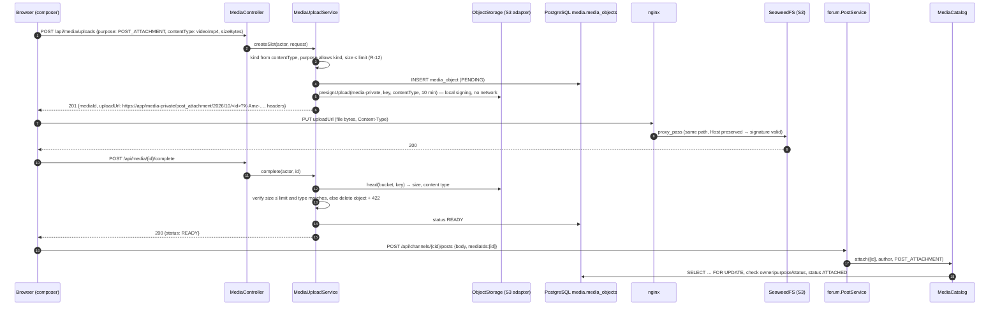

# Module `media`

## 1. Responsibility

- Issues **upload slots** (presigned S3 `PUT` URLs) so browsers upload **directly** to object storage (SeaweedFS, D-27). Media bytes never pass through the app.
- **Verifies** completed uploads (size and content type from the stored object's metadata).
- **Attach semantics** (BR-19): a media object is attached once, by its uploader, for its declared purpose.
- **Resolves media to URLs**: permanent public URLs for public purposes (avatars, banners, event covers) and **short-lived presigned GET URLs** for private ones (post and chat attachments) (R-13).
- **Cleanup** of uploads that were never completed or never attached.

This module knows nothing about posts, clubs or chats. Other modules reference media by ID.

## 2. Dependencies

| Direction | Modules |
|-----------|---------|
| Depends on | `shared` |
| Used by (API) | club, forum, chat, calendar, discovery |

```java
@ApplicationModule(displayName = "Media", allowedDependencies = {"shared"})
package pt.vclubroom.media;

import org.springframework.modulith.ApplicationModule;
```

## 3. Packages

```text
media/
├── api/              MediaCatalog, MediaView, MediaPurpose, MediaKind
├── web/              MediaController (+ dto/)
├── application/      MediaUploadService, MediaCatalogService, OrphanMediaCleanupJob,
│                     MediaProperties, ObjectStorage (port), PresignedUpload, StoredObject
├── domain/           MediaObject, MediaStatus
├── persistence/      MediaObjectRepository
└── infrastructure/   StorageProperties, S3Config, S3ObjectStorage (adapter), BucketInitializer
```

`ObjectStorage` is a **port** (interface in `application`) and `S3ObjectStorage` is its **adapter** (in `infrastructure`). Replacing SeaweedFS with AWS S3, R2 or a local volume means touching only the adapter or configuration.

## 4. Domain model

| Field | Notes |
|-------|-------|
| `id` | UUID, also the last segment of the storage key |
| `ownerId` | Uploader |
| `purpose` | `POST_ATTACHMENT`, `CHAT_ATTACHMENT`, `CLUB_AVATAR`, `CLUB_BANNER`, `EVENT_COVER` |
| `kind` | `IMAGE`, `VIDEO`, `AUDIO`, derived from the declared content type |
| `contentType`, `sizeBytes`, `originalFilename` | Declared at slot creation, verified at completion |
| `bucket`, `storageKey` | `media-public` or `media-private`; key = `{purpose}/{yyyy}/{MM}/{id}` |
| `status` | `PENDING → READY → ATTACHED`, or `DELETED` (lifecycle in [01-domain-model.md §6.6](../01-domain-model.md#66-media-object)) |

| Purpose | Bucket | Allowed kinds |
|---------|--------|---------------|
| `POST_ATTACHMENT` | private | image, video, audio |
| `CHAT_ATTACHMENT` | private | image, video, audio |
| `CLUB_AVATAR`, `CLUB_BANNER`, `EVENT_COVER` | public | image |

## 5. Public API

```java
package pt.vclubroom.media.api;

public enum MediaKind {
    IMAGE,
    VIDEO,
    AUDIO
}
```

```java
package pt.vclubroom.media.api;

import java.util.EnumSet;
import java.util.Set;

public enum MediaPurpose {
    POST_ATTACHMENT(false, EnumSet.allOf(MediaKind.class)),
    CHAT_ATTACHMENT(false, EnumSet.allOf(MediaKind.class)),
    CLUB_AVATAR(true, EnumSet.of(MediaKind.IMAGE)),
    CLUB_BANNER(true, EnumSet.of(MediaKind.IMAGE)),
    EVENT_COVER(true, EnumSet.of(MediaKind.IMAGE));

    private final boolean publicAccess;
    private final Set<MediaKind> allowedKinds;

    MediaPurpose(boolean publicAccess, Set<MediaKind> allowedKinds) {
        this.publicAccess = publicAccess;
        this.allowedKinds = allowedKinds;
    }

    public boolean isPublic() { return publicAccess; }
    public boolean allows(MediaKind kind) { return allowedKinds.contains(kind); }
}
```

```java
package pt.vclubroom.media.api;

import java.util.UUID;

/** url: public URL (public purposes) or presigned GET valid for app.media.download-url-ttl (private ones). */
public record MediaView(UUID id, MediaKind kind, String contentType, long sizeBytes, String url) {
}
```

```java
package pt.vclubroom.media.api;

import java.util.Collection;
import java.util.List;
import java.util.Map;
import java.util.UUID;

public interface MediaCatalog {

    /**
     * BR-19: validates that every object exists, belongs to ownerId, is READY (or already ATTACHED to the
     * same purpose, which makes retries idempotent) and matches the purpose; then marks them ATTACHED.
     * @throws pt.vclubroom.shared.error.BusinessRuleException MEDIA_NOT_ATTACHABLE
     */
    List<MediaView> attach(List<UUID> mediaIds, UUID ownerId, MediaPurpose purpose);

    /** Resolves IDs to displayable views (unknown or deleted IDs are absent from the map). */
    Map<UUID, MediaView> resolve(Collection<UUID> mediaIds);
}
```

## 6. Events

None. (Extension: `MediaUploaded` for thumbnail/transcoding workers.)

## 7. REST endpoints

| Method | Path | Authorization | Description |
|--------|------|---------------|-------------|
| `POST` | `/api/media/uploads` | user | `{purpose, fileName, contentType, sizeBytes}` → `201 {mediaId, uploadUrl, method: "PUT", headers, expiresAt}` |
| `POST` | `/api/media/{mediaId}/complete` | uploader | Verifies the object → `{id, kind, contentType, sizeBytes, status: READY, previewUrl}` |
| `PUT` | `/media-private/{key}?X-Amz-…` | presigned | **Served by SeaweedFS through nginx**, not by the app |
| `GET` | `/media-private/{key}?X-Amz-…` | presigned | Same |
| `GET` | `/media-public/{key}` | public | Same (anonymous read on the public bucket) |

## 8. Request flows

### 8.1 Upload and attach to a post



### 8.2 Display

When the forum returns a post, it calls `MediaCatalog.resolve(mediaIds)`, which returns presigned GET URLs valid for 15 minutes (pure local signing, no network call). The browser plays the `<video>`/`<audio>`/`` directly from SeaweedFS through nginx, with HTTP range requests (seeking) handled by SeaweedFS.

### 8.3 Cleanup

`OrphanMediaCleanupJob` (`@Scheduled(fixedDelay = 1h)`) claims up to 100 rows `PENDING`/`READY` older than `app.media.orphan-ttl` with `FOR UPDATE SKIP LOCKED` (safe with N instances), deletes the objects, and marks the rows `DELETED`.

## 9. Key implementation

### 9.1 Configuration and S3 clients

```java
package pt.vclubroom.media.infrastructure;

import org.springframework.boot.context.properties.ConfigurationProperties;

@ConfigurationProperties("app.storage")
public record StorageProperties(String endpoint, String publicEndpoint, String region,
                                String accessKey, String secretKey) {
}
```

```java
package pt.vclubroom.media.application;

import java.time.Duration;
import java.util.List;
import java.util.Map;
import org.springframework.boot.context.properties.ConfigurationProperties;
import pt.vclubroom.media.api.MediaKind;

@ConfigurationProperties("app.media")
public record MediaProperties(String publicBucket,
                              String privateBucket,
                              Duration uploadUrlTtl,
                              Duration downloadUrlTtl,
                              Duration orphanTtl,
                              Map<MediaKind, Limit> limits) {

    public record Limit(long maxBytes, List<String> contentTypes) { }
}
```

```java
package pt.vclubroom.media.infrastructure;

import java.net.URI;
import org.springframework.context.annotation.Bean;
import org.springframework.context.annotation.Configuration;
import software.amazon.awssdk.auth.credentials.AwsBasicCredentials;
import software.amazon.awssdk.auth.credentials.StaticCredentialsProvider;
import software.amazon.awssdk.core.checksums.RequestChecksumCalculation;
import software.amazon.awssdk.core.checksums.ResponseChecksumValidation;
import software.amazon.awssdk.regions.Region;
import software.amazon.awssdk.services.s3.S3Client;
import software.amazon.awssdk.services.s3.S3Configuration;
import software.amazon.awssdk.services.s3.presigner.S3Presigner;

@Configuration(proxyBeanMethods = false)
class S3Config {

    /** Backend → SeaweedFS (internal network address, e.g. http://seaweedfs:8333). */
    @Bean(destroyMethod = "close")
    S3Client s3Client(StorageProperties p) {
        return S3Client.builder()
                .endpointOverride(URI.create(p.endpoint()))
                .region(Region.of(p.region()))
                .credentialsProvider(credentials(p))
                .forcePathStyle(true)
                // SDK ≥ 2.30 sends CRC checksums by default; many S3-compatible servers reject them.
                .requestChecksumCalculation(RequestChecksumCalculation.WHEN_REQUIRED)
                .responseChecksumValidation(ResponseChecksumValidation.WHEN_REQUIRED)
                .build();
    }

    /** Signs URLs for the PUBLIC origin (what browsers reach through nginx), e.g. https://clubroom.example. */
    @Bean(destroyMethod = "close")
    S3Presigner s3Presigner(StorageProperties p) {
        return S3Presigner.builder()
                .endpointOverride(URI.create(p.publicEndpoint()))
                .region(Region.of(p.region()))
                .credentialsProvider(credentials(p))
                .serviceConfiguration(S3Configuration.builder().pathStyleAccessEnabled(true).build())
                .build();
    }

    private static StaticCredentialsProvider credentials(StorageProperties p) {
        return StaticCredentialsProvider.create(AwsBasicCredentials.create(p.accessKey(), p.secretKey()));
    }
}
```

> **Why one origin for media?** nginx proxies `/media-public/**` and `/media-private/**` to SeaweedFS **without rewriting the path and with the original `Host` header**. Path-style URLs signed for `https://<app-origin>/media-private/<key>` therefore validate on SeaweedFS. Media share the SPA's origin, so no CORS configuration is needed. See [09-deployment.md](../09-deployment.md#5-nginx).

### 9.2 Storage port and adapter

```java
package pt.vclubroom.media.application;

import java.time.Instant;
import java.util.List;
import java.util.Map;

public record PresignedUpload(String url, Map<String, List<String>> headers, Instant expiresAt) {
}
```

```java
package pt.vclubroom.media.application;

public record StoredObject(long sizeBytes, String contentType) {
}
```

```java
package pt.vclubroom.media.application;

import java.time.Duration;
import java.util.Optional;

/** Port: everything the media module needs from an object store. */
public interface ObjectStorage {

    PresignedUpload presignUpload(String bucket, String key, String contentType, Duration ttl);

    String presignDownload(String bucket, String key, Duration ttl);

    String publicUrl(String bucket, String key);

    Optional<StoredObject> head(String bucket, String key);

    void delete(String bucket, String key);

    void ensureBucket(String bucket);
}
```

```java
package pt.vclubroom.media.infrastructure;

import java.time.Duration;
import java.util.Optional;
import org.springframework.stereotype.Component;
import pt.vclubroom.media.application.ObjectStorage;
import pt.vclubroom.media.application.PresignedUpload;
import pt.vclubroom.media.application.StoredObject;
import software.amazon.awssdk.services.s3.S3Client;
import software.amazon.awssdk.services.s3.model.CreateBucketRequest;
import software.amazon.awssdk.services.s3.model.DeleteObjectRequest;
import software.amazon.awssdk.services.s3.model.GetObjectRequest;
import software.amazon.awssdk.services.s3.model.HeadBucketRequest;
import software.amazon.awssdk.services.s3.model.HeadObjectRequest;
import software.amazon.awssdk.services.s3.model.HeadObjectResponse;
import software.amazon.awssdk.services.s3.model.NoSuchBucketException;
import software.amazon.awssdk.services.s3.model.NoSuchKeyException;
import software.amazon.awssdk.services.s3.model.PutObjectRequest;
import software.amazon.awssdk.services.s3.model.S3Exception;
import software.amazon.awssdk.services.s3.presigner.S3Presigner;
import software.amazon.awssdk.services.s3.presigner.model.GetObjectPresignRequest;
import software.amazon.awssdk.services.s3.presigner.model.PresignedPutObjectRequest;
import software.amazon.awssdk.services.s3.presigner.model.PutObjectPresignRequest;

@Component
class S3ObjectStorage implements ObjectStorage {

    private final S3Client s3;
    private final S3Presigner presigner;
    private final StorageProperties properties;

    S3ObjectStorage(S3Client s3, S3Presigner presigner, StorageProperties properties) {
        this.s3 = s3;
        this.presigner = presigner;
        this.properties = properties;
    }

    @Override
    public PresignedUpload presignUpload(String bucket, String key, String contentType, Duration ttl) {
        PutObjectRequest put = PutObjectRequest.builder().bucket(bucket).key(key).contentType(contentType).build();
        PresignedPutObjectRequest presigned = presigner.presignPutObject(
                PutObjectPresignRequest.builder().signatureDuration(ttl).putObjectRequest(put).build());
        return new PresignedUpload(presigned.url().toString(), presigned.signedHeaders(), presigned.expiration());
    }

    @Override
    public String presignDownload(String bucket, String key, Duration ttl) {
        GetObjectRequest get = GetObjectRequest.builder().bucket(bucket).key(key).build();
        return presigner.presignGetObject(
                GetObjectPresignRequest.builder().signatureDuration(ttl).getObjectRequest(get).build())
                .url().toString();
    }

    @Override
    public String publicUrl(String bucket, String key) {
        return properties.publicEndpoint().replaceAll("/+$", "") + "/" + bucket + "/" + key;
    }

    @Override
    public Optional<StoredObject> head(String bucket, String key) {
        try {
            HeadObjectResponse r = s3.headObject(HeadObjectRequest.builder().bucket(bucket).key(key).build());
            return Optional.of(new StoredObject(r.contentLength(), r.contentType()));
        } catch (NoSuchKeyException e) {
            return Optional.empty();
        } catch (S3Exception e) {
            if (e.statusCode() == 404) {
                return Optional.empty();
            }
            throw e;
        }
    }

    @Override
    public void delete(String bucket, String key) {
        s3.deleteObject(DeleteObjectRequest.builder().bucket(bucket).key(key).build());
    }

    @Override
    public void ensureBucket(String bucket) {
        try {
            s3.headBucket(HeadBucketRequest.builder().bucket(bucket).build());
        } catch (NoSuchBucketException e) {
            s3.createBucket(CreateBucketRequest.builder().bucket(bucket).build());
        } catch (S3Exception e) {
            if (e.statusCode() != 404) {
                throw e;
            }
            s3.createBucket(CreateBucketRequest.builder().bucket(bucket).build());
        }
    }
}
```

```java
package pt.vclubroom.media.infrastructure;

import org.springframework.boot.ApplicationArguments;
import org.springframework.boot.ApplicationRunner;
import org.springframework.stereotype.Component;
import pt.vclubroom.media.application.MediaProperties;
import pt.vclubroom.media.application.ObjectStorage;

/** Creates the two buckets on startup if missing (idempotent, safe with N instances). */
@Component
class BucketInitializer implements ApplicationRunner {

    private final ObjectStorage storage;
    private final MediaProperties properties;

    BucketInitializer(ObjectStorage storage, MediaProperties properties) {
        this.storage = storage;
        this.properties = properties;
    }

    @Override
    public void run(ApplicationArguments args) {
        storage.ensureBucket(properties.publicBucket());
        storage.ensureBucket(properties.privateBucket());
    }
}
```

### 9.3 Domain and persistence

```java
package pt.vclubroom.media.domain;

public enum MediaStatus {
    PENDING,
    READY,
    ATTACHED,
    DELETED
}
```

```java
package pt.vclubroom.media.domain;

import jakarta.persistence.Column;
import jakarta.persistence.Entity;
import jakarta.persistence.EnumType;
import jakarta.persistence.Enumerated;
import jakarta.persistence.Id;
import jakarta.persistence.Table;
import jakarta.persistence.Version;
import java.time.Instant;
import java.time.ZoneOffset;
import java.time.temporal.ChronoUnit;
import java.util.Locale;
import java.util.UUID;
import pt.vclubroom.media.api.MediaKind;
import pt.vclubroom.media.api.MediaPurpose;
import pt.vclubroom.shared.error.BusinessRuleException;

@Entity
@Table(name = "media_objects", schema = "media")
public class MediaObject {

    @Id
    private UUID id;

    @Column(name = "owner_id", nullable = false)
    private UUID ownerId;

    @Enumerated(EnumType.STRING)
    @Column(nullable = false)
    private MediaPurpose purpose;

    @Enumerated(EnumType.STRING)
    @Column(nullable = false)
    private MediaKind kind;

    @Column(name = "content_type", nullable = false)
    private String contentType;

    @Column(name = "size_bytes", nullable = false)
    private long sizeBytes;

    @Column(name = "original_filename")
    private String originalFilename;

    @Column(nullable = false)
    private String bucket;

    @Column(name = "storage_key", nullable = false)
    private String storageKey;

    @Enumerated(EnumType.STRING)
    @Column(nullable = false)
    private MediaStatus status;

    @Column(name = "created_at", nullable = false)
    private Instant createdAt;

    @Column(name = "attached_at")
    private Instant attachedAt;

    @Version
    private Long version;

    protected MediaObject() {
        // JPA
    }

    public static MediaObject pending(UUID ownerId, MediaPurpose purpose, MediaKind kind, String contentType,
                                      long sizeBytes, String originalFilename, String bucket, Instant now) {
        MediaObject m = new MediaObject();
        m.id = UUID.randomUUID();
        m.ownerId = ownerId;
        m.purpose = purpose;
        m.kind = kind;
        m.contentType = contentType;
        m.sizeBytes = sizeBytes;
        m.originalFilename = originalFilename;
        m.bucket = bucket;
        m.createdAt = now.truncatedTo(ChronoUnit.MICROS);
        var date = m.createdAt.atOffset(ZoneOffset.UTC);
        m.storageKey = "%s/%d/%02d/%s".formatted(purpose.name().toLowerCase(Locale.ROOT),
                date.getYear(), date.getMonthValue(), m.id);
        m.status = MediaStatus.PENDING;
        return m;
    }

    public void markReady(long verifiedSize, String verifiedType) {
        if (status != MediaStatus.PENDING) {
            throw new BusinessRuleException("MEDIA_NOT_PENDING", "Upload already completed.");
        }
        this.sizeBytes = verifiedSize;
        this.contentType = verifiedType;
        this.status = MediaStatus.READY;
    }

    /** BR-19. Re-attaching an already ATTACHED object for the same owner and purpose is a no-op (idempotent retries). */
    public void attach(UUID requester, MediaPurpose requestedPurpose, Instant now) {
        boolean sameOwnerAndPurpose = ownerId.equals(requester) && purpose == requestedPurpose;
        if (!sameOwnerAndPurpose || !(status == MediaStatus.READY || status == MediaStatus.ATTACHED)) {
            throw new BusinessRuleException("MEDIA_NOT_ATTACHABLE", "Media " + id + " cannot be attached here.");
        }
        if (status == MediaStatus.READY) {
            this.status = MediaStatus.ATTACHED;
            this.attachedAt = now.truncatedTo(ChronoUnit.MICROS);
        }
    }

    public void markDeleted() {
        this.status = MediaStatus.DELETED;
    }

    public UUID id() { return id; }
    public UUID ownerId() { return ownerId; }
    public MediaPurpose purpose() { return purpose; }
    public MediaKind kind() { return kind; }
    public String contentType() { return contentType; }
    public long sizeBytes() { return sizeBytes; }
    public String bucket() { return bucket; }
    public String storageKey() { return storageKey; }
    public MediaStatus status() { return status; }
}
```

```java
package pt.vclubroom.media.persistence;

import jakarta.persistence.LockModeType;
import java.time.Instant;
import java.util.Collection;
import java.util.List;
import java.util.UUID;
import org.springframework.data.jpa.repository.JpaRepository;
import org.springframework.data.jpa.repository.Lock;
import org.springframework.data.jpa.repository.Query;
import org.springframework.data.repository.query.Param;
import pt.vclubroom.media.domain.MediaObject;

public interface MediaObjectRepository extends JpaRepository<MediaObject, UUID> {

    @Lock(LockModeType.PESSIMISTIC_WRITE)
    @Query("select m from MediaObject m where m.id in :ids")
    List<MediaObject> findAllForUpdate(@Param("ids") Collection<UUID> ids);

    @Query("select m from MediaObject m where m.id in :ids and m.status <> pt.vclubroom.media.domain.MediaStatus.DELETED")
    List<MediaObject> findLive(@Param("ids") Collection<UUID> ids);

    @Query(value = """
           select * from media.media_objects
           where status in ('PENDING', 'READY') and created_at < :cutoff
           order by created_at
           limit :batch
           for update skip locked
           """, nativeQuery = true)
    List<MediaObject> claimOrphans(@Param("cutoff") Instant cutoff, @Param("batch") int batch);
}
```

### 9.4 Application services

```java
package pt.vclubroom.media.application;

import java.time.Clock;
import java.util.Map;
import java.util.UUID;
import org.springframework.stereotype.Service;
import org.springframework.transaction.annotation.Transactional;
import pt.vclubroom.media.api.MediaKind;
import pt.vclubroom.media.api.MediaPurpose;
import pt.vclubroom.media.domain.MediaObject;
import pt.vclubroom.media.persistence.MediaObjectRepository;
import pt.vclubroom.shared.error.BusinessRuleException;
import pt.vclubroom.shared.error.NotFoundException;
import pt.vclubroom.shared.security.Actor;

@Service
public class MediaUploadService {

    public record UploadSlot(UUID mediaId, PresignedUpload upload) { }

    private final MediaObjectRepository media;
    private final ObjectStorage storage;
    private final MediaProperties properties;
    private final Clock clock;

    public MediaUploadService(MediaObjectRepository media, ObjectStorage storage, MediaProperties properties, Clock clock) {
        this.media = media;
        this.storage = storage;
        this.properties = properties;
        this.clock = clock;
    }

    @Transactional
    public UploadSlot createSlot(Actor actor, MediaPurpose purpose, String fileName, String contentType, long sizeBytes) {
        MediaKind kind = kindOf(contentType);
        if (!purpose.allows(kind)) {
            throw new BusinessRuleException("MEDIA_KIND_NOT_ALLOWED", kind + " is not allowed for " + purpose);
        }
        MediaProperties.Limit limit = properties.limits().get(kind);
        if (sizeBytes <= 0 || sizeBytes > limit.maxBytes()) {
            throw new BusinessRuleException("MEDIA_TOO_LARGE", "Maximum size for " + kind + " is " + limit.maxBytes() + " bytes.");
        }
        String bucket = purpose.isPublic() ? properties.publicBucket() : properties.privateBucket();
        MediaObject object = MediaObject.pending(actor.userId(), purpose, kind, contentType, sizeBytes, fileName,
                bucket, clock.instant());
        media.save(object);
        PresignedUpload upload = storage.presignUpload(bucket, object.storageKey(), contentType, properties.uploadUrlTtl());
        return new UploadSlot(object.id(), upload);
    }

    /** noRollbackFor: when the file is rejected, the DELETED status must still be committed. */
    @Transactional(noRollbackFor = BusinessRuleException.class)
    public MediaObject complete(Actor actor, UUID mediaId) {
        MediaObject object = media.findById(mediaId)
                .filter(m -> m.ownerId().equals(actor.userId()))
                .orElseThrow(() -> new NotFoundException("MEDIA_NOT_FOUND", "Media not found"));
        StoredObject stored = storage.head(object.bucket(), object.storageKey())
                .orElseThrow(() -> new BusinessRuleException("MEDIA_NOT_UPLOADED", "The file was not uploaded."));
        MediaProperties.Limit limit = properties.limits().get(object.kind());
        boolean typeOk = stored.contentType() != null && stored.contentType().equals(object.contentType());
        if (stored.sizeBytes() > limit.maxBytes() || !typeOk) {
            storage.delete(object.bucket(), object.storageKey());
            object.markDeleted();
            throw new BusinessRuleException("MEDIA_REJECTED", "The uploaded file does not match the declared type or size.");
        }
        object.markReady(stored.sizeBytes(), stored.contentType());
        return object;
    }

    private MediaKind kindOf(String contentType) {
        return properties.limits().entrySet().stream()
                .filter(e -> e.getValue().contentTypes().contains(contentType))
                .map(Map.Entry::getKey)
                .findFirst()
                .orElseThrow(() -> new BusinessRuleException("MEDIA_TYPE_NOT_ALLOWED", "Unsupported file type " + contentType));
    }
}
```

```java
package pt.vclubroom.media.application;

import java.time.Clock;
import java.time.Instant;
import java.util.Collection;
import java.util.List;
import java.util.Map;
import java.util.Set;
import java.util.UUID;
import java.util.function.Function;
import java.util.stream.Collectors;
import org.springframework.stereotype.Service;
import org.springframework.transaction.annotation.Transactional;
import pt.vclubroom.media.api.MediaCatalog;
import pt.vclubroom.media.api.MediaPurpose;
import pt.vclubroom.media.api.MediaView;
import pt.vclubroom.media.domain.MediaObject;
import pt.vclubroom.media.persistence.MediaObjectRepository;
import pt.vclubroom.shared.error.BusinessRuleException;

@Service
class MediaCatalogService implements MediaCatalog {

    private final MediaObjectRepository media;
    private final ObjectStorage storage;
    private final MediaProperties properties;
    private final Clock clock;

    MediaCatalogService(MediaObjectRepository media, ObjectStorage storage, MediaProperties properties, Clock clock) {
        this.media = media;
        this.storage = storage;
        this.properties = properties;
        this.clock = clock;
    }

    @Override
    @Transactional                                // joins the caller's transaction (e.g. PostService.createPost)
    public List<MediaView> attach(List<UUID> mediaIds, UUID ownerId, MediaPurpose purpose) {
        if (mediaIds.isEmpty()) {
            return List.of();
        }
        Map<UUID, MediaObject> byId = media.findAllForUpdate(mediaIds).stream()
                .collect(Collectors.toMap(MediaObject::id, Function.identity()));
        if (byId.size() != Set.copyOf(mediaIds).size()) {
            throw new BusinessRuleException("MEDIA_NOT_ATTACHABLE", "Some media do not exist.");
        }
        Instant now = clock.instant();
        return mediaIds.stream().map(id -> {
            MediaObject object = byId.get(id);
            object.attach(ownerId, purpose, now);
            return view(object);
        }).toList();
    }

    @Override
    @Transactional(readOnly = true)
    public Map<UUID, MediaView> resolve(Collection<UUID> mediaIds) {
        if (mediaIds.isEmpty()) {
            return Map.of();
        }
        return media.findLive(mediaIds).stream().collect(Collectors.toMap(MediaObject::id, this::view));
    }

    private MediaView view(MediaObject m) {
        String url = m.purpose().isPublic()
                ? storage.publicUrl(m.bucket(), m.storageKey())
                : storage.presignDownload(m.bucket(), m.storageKey(), properties.downloadUrlTtl());
        return new MediaView(m.id(), m.kind(), m.contentType(), m.sizeBytes(), url);
    }
}
```

### 9.5 Controller

```java
package pt.vclubroom.media.web;

import jakarta.validation.Valid;
import jakarta.validation.constraints.NotBlank;
import jakarta.validation.constraints.NotNull;
import jakarta.validation.constraints.Positive;
import jakarta.validation.constraints.Size;
import java.time.Instant;
import java.util.List;
import java.util.Map;
import java.util.UUID;
import org.springframework.http.HttpStatus;
import org.springframework.security.core.annotation.AuthenticationPrincipal;
import org.springframework.web.bind.annotation.PathVariable;
import org.springframework.web.bind.annotation.PostMapping;
import org.springframework.web.bind.annotation.RequestBody;
import org.springframework.web.bind.annotation.RequestMapping;
import org.springframework.web.bind.annotation.ResponseStatus;
import org.springframework.web.bind.annotation.RestController;
import pt.vclubroom.media.api.MediaPurpose;
import pt.vclubroom.media.application.MediaUploadService;
import pt.vclubroom.media.domain.MediaObject;
import pt.vclubroom.shared.security.AuthenticatedUser;

@RestController
@RequestMapping("/api/media")
class MediaController {

    record CreateUploadRequest(@NotNull MediaPurpose purpose,
                               @NotBlank @Size(max = 255) String fileName,
                               @NotBlank String contentType,
                               @Positive long sizeBytes) { }

    record UploadSlotResponse(UUID mediaId, String uploadUrl, String method,
                              Map<String, List<String>> headers, Instant expiresAt) { }

    record MediaResponse(UUID id, String kind, String contentType, long sizeBytes, String status) {
        static MediaResponse from(MediaObject m) {
            return new MediaResponse(m.id(), m.kind().name(), m.contentType(), m.sizeBytes(), m.status().name());
        }
    }

    private final MediaUploadService uploads;

    MediaController(MediaUploadService uploads) {
        this.uploads = uploads;
    }

    @PostMapping("/uploads")
    @ResponseStatus(HttpStatus.CREATED)
    UploadSlotResponse createUpload(@AuthenticationPrincipal AuthenticatedUser me,
                                    @Valid @RequestBody CreateUploadRequest request) {
        MediaUploadService.UploadSlot slot = uploads.createSlot(me.actor(), request.purpose(), request.fileName(),
                request.contentType(), request.sizeBytes());
        return new UploadSlotResponse(slot.mediaId(), slot.upload().url(), "PUT",
                slot.upload().headers(), slot.upload().expiresAt());
    }

    @PostMapping("/{mediaId}/complete")
    MediaResponse complete(@AuthenticationPrincipal AuthenticatedUser me, @PathVariable UUID mediaId) {
        return MediaResponse.from(uploads.complete(me.actor(), mediaId));
    }
}
```

## 10. Data

Schema `media`: `media_objects`. See [04-database.md § media](../04-database.md#46-media).

## 11. Extension points

- **Thumbnails / transcoding**: publish `MediaUploaded` on completion; a worker (in-process listener or a separate container) produces derived renditions under `{key}/thumb.webp`. The API stays unchanged.
- **Virus scanning**: same hook, with the status gaining `QUARANTINED`.
- **CDN**: put a CDN in front of `/media-public/**`. Private URLs keep working because they are signed.
