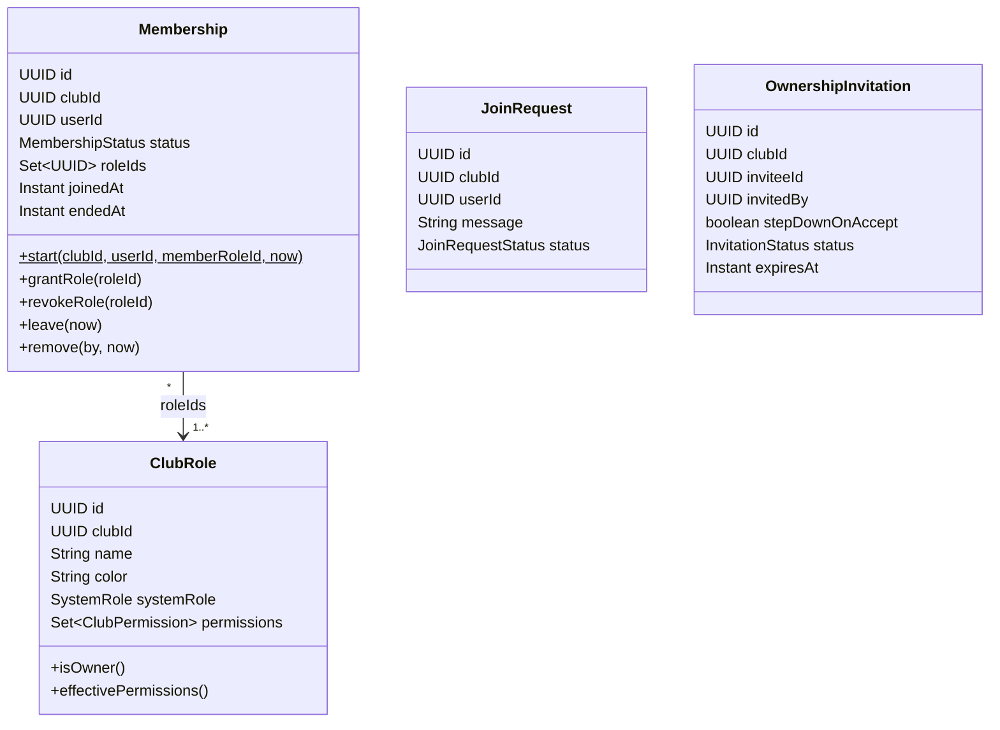
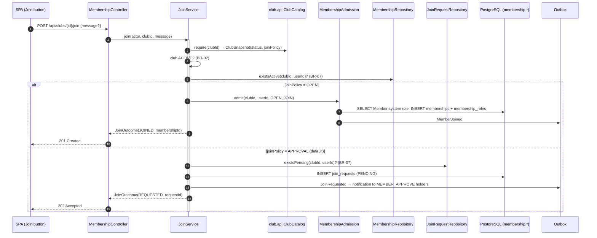
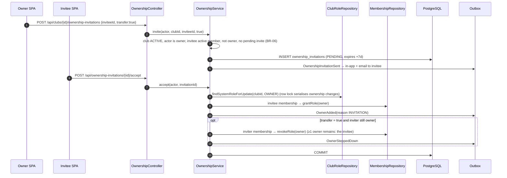
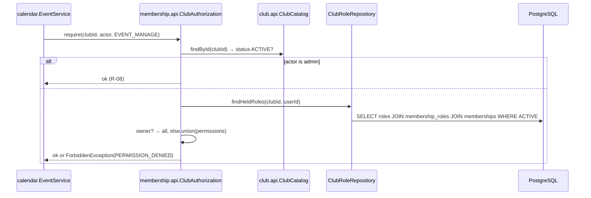

# Module `membership`

## 1. Responsibility

- **Memberships** (who belongs to which club, and when).
- **Join flow**: instant join for `OPEN` clubs, join requests for `APPROVAL` clubs (D-10).
- **Club roles and permissions**: built-in Owner/Member system roles plus **custom roles per club** made from the permission catalogue (D-18).
- **Co-ownership** (D-12, D-22): invitations, acceptance, stepping down, admin removal; ownership transfer.
- **The authorization API for club-level permissions** (`ClubAuthorization`) used by every other module, and the implementation of the club module's SPI (`ClubManagementGuard`).

**Not** responsible for: groups (group module), space access rules (space module, which *uses* this module).

## 2. Dependencies

| Direction | Modules |
|-----------|---------|
| Depends on | `shared`, `club::api`, `club::events`, `club::spi`, `identity::api` |
| Used by (API) | group, space, calendar, notification, discovery |
| Listened to (events) | group, notification, discovery, history |

```java
@ApplicationModule(
        displayName = "Membership",
        allowedDependencies = {"shared", "club::api", "club::events", "club::spi", "identity::api"}
)
package pt.vclubroom.membership;

import org.springframework.modulith.ApplicationModule;
```

## 3. Packages

```text
membership/
├── api/            ClubAuthorization, ClubPermission
├── events/         MemberJoined, MemberLeft, JoinRequested, JoinRequestDecided, OwnershipInvitationSent,
│                   OwnerAdded, OwnerSteppedDown, OwnerRemoved, MemberRolesChanged
├── web/            MembershipController, MemberController, JoinRequestController, RoleController,
│                   OwnershipController, AdminOwnershipController (+ dto/)
├── application/    ClubAuthorizationService, JoinService, MemberService, RoleService, OwnershipService,
│                   MembershipAdmission, ClubLifecycleListener, InvitationExpiryJob, JoinOutcome
├── domain/         Membership, MembershipStatus, ClubRole, SystemRole, JoinRequest, JoinRequestStatus,
│                   OwnershipInvitation, InvitationStatus, ClubOwnership
└── persistence/    MembershipRepository, ClubRoleRepository, JoinRequestRepository,
                    OwnershipInvitationRepository
```

## 4. Domain model



**Owner = holder of the role with `systemRole = OWNER`.** There is no "owner" column. That keeps one mechanism (roles) for everything, and "owners" is just a query.

**Concurrency rule for BR-04 (≥ 1 owner).** Every operation that may remove an owner first locks the club's Owner role row (`SELECT … FOR UPDATE`). Ownership changes in the same club are therefore serialised, so two owners stepping down at the same time cannot leave the club without an owner.

## 5. Public API

```java
package pt.vclubroom.membership.api;

/** Platform-defined capabilities that clubs combine into roles (01-domain-model.md §4). */
public enum ClubPermission {
    CLUB_SETTINGS_MANAGE,
    MEMBER_APPROVE,
    MEMBER_REMOVE,
    ROLE_MANAGE,
    GROUP_MANAGE,
    SPACE_MANAGE,
    SPACE_ACCESS_ALL,
    CONTENT_MODERATE,
    EVENT_MANAGE
}
```

```java
package pt.vclubroom.membership.api;

import java.util.Set;
import java.util.UUID;
import pt.vclubroom.shared.security.Actor;

/**
 * Single entry point for club-level authorization. Every module asks here; nobody reads
 * membership tables directly. This is also the one place where a permission cache can be added.
 */
public interface ClubAuthorization {

    boolean isActiveMember(UUID clubId, UUID userId);

    boolean isOwner(UUID clubId, UUID userId);

    /** Raw effective permissions (union of held roles; all for owners and admins), regardless of club status. */
    Set<ClubPermission> permissionsOf(UUID clubId, Actor actor);

    boolean hasPermission(UUID clubId, Actor actor, ClubPermission permission);

    /**
     * For management/write actions: the club must be ACTIVE (BR-02) and the actor must hold the permission.
     * @throws pt.vclubroom.shared.error.BusinessRuleException CLUB_NOT_ACTIVE
     * @throws pt.vclubroom.shared.error.ForbiddenException    PERMISSION_DENIED
     */
    void require(UUID clubId, Actor actor, ClubPermission permission);

    Set<UUID> activeMemberIds(UUID clubId);

    /** Users holding a permission (owners included) — e.g. who gets notified about a join request. */
    Set<UUID> holdersOf(UUID clubId, ClubPermission permission);

    Set<UUID> clubIdsOf(UUID userId);
}
```

## 6. Events

```java
package pt.vclubroom.membership.events;

import java.time.Instant;
import java.util.UUID;

/** via: FOUNDED | OPEN_JOIN | APPROVED_REQUEST | REVIVAL | ADMIN */
public record MemberJoined(UUID clubId, UUID userId, UUID membershipId, String via, Instant occurredAt) {
}
```

```java
package pt.vclubroom.membership.events;

import java.time.Instant;
import java.util.UUID;

/** reason: LEFT | REMOVED */
public record MemberLeft(UUID clubId, UUID userId, UUID membershipId, String reason, UUID by, Instant occurredAt) {
}
```

```java
package pt.vclubroom.membership.events;

import java.time.Instant;
import java.util.UUID;

public record JoinRequested(UUID requestId, UUID clubId, UUID userId, Instant occurredAt) {
}
```

```java
package pt.vclubroom.membership.events;

import java.time.Instant;
import java.util.UUID;

public record JoinRequestDecided(UUID requestId, UUID clubId, UUID userId, boolean approved, UUID decidedBy,
                                 Instant occurredAt) {
}
```

```java
package pt.vclubroom.membership.events;

import java.time.Instant;
import java.util.UUID;

public record OwnershipInvitationSent(UUID invitationId, UUID clubId, UUID inviteeId, UUID invitedBy,
                                      boolean transfer, Instant expiresAt, Instant occurredAt) {
}
```

```java
package pt.vclubroom.membership.events;

import java.time.Instant;
import java.util.UUID;

/** reason: FOUNDER | INVITATION | REVIVAL | ADMIN */
public record OwnerAdded(UUID clubId, UUID userId, String reason, UUID by, Instant occurredAt) {
}
```

```java
package pt.vclubroom.membership.events;

import java.time.Instant;
import java.util.UUID;

public record OwnerSteppedDown(UUID clubId, UUID userId, Instant occurredAt) {
}
```

```java
package pt.vclubroom.membership.events;

import java.time.Instant;
import java.util.UUID;

/** reason: ADMIN | REVIVAL */
public record OwnerRemoved(UUID clubId, UUID userId, String reason, UUID by, Instant occurredAt) {
}
```

```java
package pt.vclubroom.membership.events;

import java.time.Instant;
import java.util.Set;
import java.util.UUID;

public record MemberRolesChanged(UUID clubId, UUID userId, Set<UUID> roleIds, UUID by, Instant occurredAt) {
}
```

**Consumed:** `ClubApproved`, `ClubArchived`, `ClubRevived`, `ClubProfileUpdated` (see `ClubLifecycleListener`).

## 7. REST endpoints

| Method | Path | Authorization | Description |
|--------|------|---------------|-------------|
| `POST` | `/api/clubs/{clubId}/join` | user, non-member, club ACTIVE | `{message?}` → **201** `{status: JOINED, membershipId}` (OPEN) or **202** `{status: REQUESTED, requestId}` (APPROVAL) |
| `DELETE` | `/api/clubs/{clubId}/join-requests/mine` | requester | Cancel own pending request |
| `GET` | `/api/clubs/{clubId}/membership/me` | user | `{member, owner, roles[], permissions[], pendingRequest, pendingInvitation}`. The SPA uses this to show or hide controls. |
| `DELETE` | `/api/clubs/{clubId}/members/me` | member | Leave (blocked for the last owner, BR-04) |
| `GET` | `/api/me/memberships` | user | My clubs with my roles |
| `GET` | `/api/clubs/{clubId}/members?query=&roleId=&page=` | active member (or admin) | Members with roles and user summaries |
| `DELETE` | `/api/clubs/{clubId}/members/{userId}` | `MEMBER_REMOVE` (never owners, BR-05) | Remove a member |
| `GET` | `/api/clubs/{clubId}/join-requests?status=PENDING` | `MEMBER_APPROVE` | Pending requests |
| `POST` | `/api/clubs/{clubId}/join-requests/{requestId}/approve` | `MEMBER_APPROVE` | → membership |
| `POST` | `/api/clubs/{clubId}/join-requests/{requestId}/reject` | `MEMBER_APPROVE` | |
| `GET` | `/api/clubs/{clubId}/roles` | active member | Roles with permissions |
| `POST` | `/api/clubs/{clubId}/roles` | `ROLE_MANAGE` + anti-escalation | `{name, color, permissions[]}` |
| `PATCH` | `/api/clubs/{clubId}/roles/{roleId}` | `ROLE_MANAGE` + anti-escalation | Owner role immutable (BR-10) |
| `DELETE` | `/api/clubs/{clubId}/roles/{roleId}` | `ROLE_MANAGE` | System roles cannot be deleted |
| `PUT` | `/api/clubs/{clubId}/members/{userId}/roles` | `ROLE_MANAGE` + anti-escalation | `{roleIds[]}` (custom roles only; Member always kept; Owner not assignable here) |
| `GET` | `/api/permissions` | user | Permission catalogue with descriptions (for the role editor) |
| `POST` | `/api/clubs/{clubId}/ownership-invitations` | owner | `{inviteeId, transfer}` |
| `GET` | `/api/me/ownership-invitations` | user | My pending invitations |
| `POST` | `/api/ownership-invitations/{id}/accept` | invitee | Becomes owner (+ inviter steps down if `transfer`) |
| `POST` | `/api/ownership-invitations/{id}/decline` | invitee | |
| `DELETE` | `/api/ownership-invitations/{id}` | any owner of the club | Revoke |
| `POST` | `/api/clubs/{clubId}/owners/me/step-down` | owner (not last) | |
| `POST` | `/api/admin/clubs/{clubId}/owners` | admin | `{userId}`: make a user owner (admits them if needed), to rescue a club |
| `DELETE` | `/api/admin/clubs/{clubId}/owners/{userId}` | admin (not the last owner) | Forcibly remove an owner (D-22) |

## 8. Request flows

### 8.1 Join a club (both policies)



Approval: `POST /api/clubs/{id}/join-requests/{rid}/approve` → `JoinService.approve` → `authorization.require(clubId, actor, MEMBER_APPROVE)` → `request.approve(...)` → `MembershipAdmission.admit(..., APPROVED_REQUEST)` → `JoinRequestDecided` + `MemberJoined`.

### 8.2 Ownership transfer (invite with `transfer = true`)



### 8.3 Club lifecycle reactions (event listener)

| Event | Reaction (idempotent) |
|-------|----------------------|
| `ClubApproved` | Create system roles Owner + Member (if missing); create founder membership with both roles (if missing); emit `MemberJoined(FOUNDED)`, `OwnerAdded(FOUNDER)`. |
| `ClubArchived` | Bulk-cancel pending join requests; bulk-expire pending invitations (R-10). |
| `ClubRevived` | Demote current owners except the new owner (`OwnerRemoved(REVIVAL)`); admit the requester if not a member; grant Owner (`OwnerAdded(REVIVAL)`) (R-05). |
| `ClubProfileUpdated` with `joinPolicy = OPEN` | Auto-approve pending requests (the club opted for open membership). |

### 8.4 How another module checks a permission



## 9. Key implementation

### 9.1 Domain

```java
package pt.vclubroom.membership.domain;

public enum SystemRole {
    OWNER,
    MEMBER
}
```

```java
package pt.vclubroom.membership.domain;

public enum MembershipStatus {
    ACTIVE,
    LEFT,
    REMOVED
}
```

```java
package pt.vclubroom.membership.domain;

import jakarta.persistence.Column;
import jakarta.persistence.Entity;
import jakarta.persistence.EnumType;
import jakarta.persistence.Enumerated;
import jakarta.persistence.Id;
import jakarta.persistence.Table;
import jakarta.persistence.Version;
import java.time.Instant;
import java.time.temporal.ChronoUnit;
import java.util.ArrayList;
import java.util.EnumSet;
import java.util.List;
import java.util.Set;
import java.util.UUID;
import org.hibernate.annotations.JdbcTypeCode;
import org.hibernate.type.SqlTypes;
import pt.vclubroom.membership.api.ClubPermission;
import pt.vclubroom.shared.error.BusinessRuleException;

@Entity
@Table(name = "club_roles", schema = "membership")
public class ClubRole {

    @Id
    private UUID id;

    @Column(name = "club_id", nullable = false)
    private UUID clubId;

    @Column(nullable = false)
    private String name;

    private String color;

    @Enumerated(EnumType.STRING)
    @Column(name = "system_role")
    private SystemRole systemRole;                 // null for custom roles

    @JdbcTypeCode(SqlTypes.ARRAY)
    @Column(name = "permissions", nullable = false, columnDefinition = "text[]")
    private List<String> permissions = new ArrayList<>();

    @Column(nullable = false)
    private int position;

    @Column(name = "created_at", nullable = false)
    private Instant createdAt;

    @Version
    private Long version;

    protected ClubRole() {
        // JPA
    }

    public static ClubRole systemOwner(UUID clubId, Instant now) {
        return create(clubId, "Owner", "#f59e0b", SystemRole.OWNER, EnumSet.allOf(ClubPermission.class), 0, now);
    }

    public static ClubRole systemMember(UUID clubId, Instant now) {
        return create(clubId, "Member", "#64748b", SystemRole.MEMBER, EnumSet.noneOf(ClubPermission.class), 1000, now);
    }

    public static ClubRole custom(UUID clubId, String name, String color, Set<ClubPermission> permissions,
                                  int position, Instant now) {
        return create(clubId, name, color, null, permissions, position, now);
    }

    private static ClubRole create(UUID clubId, String name, String color, SystemRole systemRole,
                                   Set<ClubPermission> permissions, int position, Instant now) {
        ClubRole r = new ClubRole();
        r.id = UUID.randomUUID();
        r.clubId = clubId;
        r.name = name;
        r.color = color;
        r.systemRole = systemRole;
        r.permissions = new ArrayList<>(permissions.stream().map(Enum::name).sorted().toList());
        r.position = position;
        r.createdAt = now.truncatedTo(ChronoUnit.MICROS);
        return r;
    }

    /** BR-10: Owner always has every permission, whatever is stored. */
    public Set<ClubPermission> effectivePermissions() {
        if (isOwner()) {
            return EnumSet.allOf(ClubPermission.class);
        }
        EnumSet<ClubPermission> set = EnumSet.noneOf(ClubPermission.class);
        permissions.forEach(p -> set.add(ClubPermission.valueOf(p)));
        return set;
    }

    public void rename(String newName, String newColor) {
        if (systemRole != null) {
            throw new BusinessRuleException("SYSTEM_ROLE_IMMUTABLE", "System roles cannot be renamed.");
        }
        this.name = newName;
        this.color = newColor;
    }

    public void changePermissions(Set<ClubPermission> newPermissions) {
        if (isOwner()) {
            throw new BusinessRuleException("SYSTEM_ROLE_IMMUTABLE", "The Owner role always has every permission.");
        }
        this.permissions = new ArrayList<>(newPermissions.stream().map(Enum::name).sorted().toList());
    }

    public void ensureDeletable() {
        if (systemRole != null) {
            throw new BusinessRuleException("SYSTEM_ROLE_IMMUTABLE", "System roles cannot be deleted.");
        }
    }

    public boolean isOwner() { return systemRole == SystemRole.OWNER; }
    public boolean isMember() { return systemRole == SystemRole.MEMBER; }
    public boolean isSystem() { return systemRole != null; }
    public UUID id() { return id; }
    public UUID clubId() { return clubId; }
    public String name() { return name; }
    public String color() { return color; }
    public SystemRole systemRole() { return systemRole; }
    public int position() { return position; }
}
```

```java
package pt.vclubroom.membership.domain;

import jakarta.persistence.CollectionTable;
import jakarta.persistence.Column;
import jakarta.persistence.ElementCollection;
import jakarta.persistence.Entity;
import jakarta.persistence.EnumType;
import jakarta.persistence.Enumerated;
import jakarta.persistence.FetchType;
import jakarta.persistence.Id;
import jakarta.persistence.JoinColumn;
import jakarta.persistence.Table;
import jakarta.persistence.Version;
import java.time.Instant;
import java.time.temporal.ChronoUnit;
import java.util.Collections;
import java.util.HashSet;
import java.util.Set;
import java.util.UUID;
import pt.vclubroom.shared.error.BusinessRuleException;

@Entity
@Table(name = "memberships", schema = "membership")
public class Membership {

    @Id
    private UUID id;

    @Column(name = "club_id", nullable = false)
    private UUID clubId;

    @Column(name = "user_id", nullable = false)
    private UUID userId;

    @Enumerated(EnumType.STRING)
    @Column(nullable = false)
    private MembershipStatus status;

    @ElementCollection(fetch = FetchType.EAGER)
    @CollectionTable(name = "membership_roles", schema = "membership", joinColumns = @JoinColumn(name = "membership_id"))
    @Column(name = "role_id", nullable = false)
    private Set<UUID> roleIds = new HashSet<>();

    @Column(name = "joined_at", nullable = false)
    private Instant joinedAt;

    @Column(name = "ended_at")
    private Instant endedAt;

    @Column(name = "ended_by")
    private UUID endedBy;

    @Version
    private Long version;

    protected Membership() {
        // JPA
    }

    /** BR-09: every membership holds the Member system role. */
    public static Membership start(UUID clubId, UUID userId, UUID memberRoleId, Instant now) {
        Membership m = new Membership();
        m.id = UUID.randomUUID();
        m.clubId = clubId;
        m.userId = userId;
        m.status = MembershipStatus.ACTIVE;
        m.roleIds.add(memberRoleId);
        m.joinedAt = now.truncatedTo(ChronoUnit.MICROS);
        return m;
    }

    public void grantRole(UUID roleId) {
        requireActive();
        roleIds.add(roleId);
    }

    public void revokeRole(UUID roleId) {
        requireActive();
        roleIds.remove(roleId);
    }

    public void replaceCustomRoles(Set<UUID> systemRoleIdsToKeep, Set<UUID> newCustomRoleIds) {
        requireActive();
        Set<UUID> kept = new HashSet<>(roleIds);
        kept.retainAll(systemRoleIdsToKeep);
        kept.addAll(newCustomRoleIds);
        roleIds = kept;
    }

    public void leave(Instant now) {
        end(MembershipStatus.LEFT, userId, now);
    }

    public void remove(UUID by, Instant now) {
        end(MembershipStatus.REMOVED, by, now);
    }

    private void end(MembershipStatus endStatus, UUID by, Instant now) {
        requireActive();
        this.status = endStatus;
        this.endedBy = by;
        this.endedAt = now.truncatedTo(ChronoUnit.MICROS);
    }

    private void requireActive() {
        if (status != MembershipStatus.ACTIVE) {
            throw new BusinessRuleException("MEMBERSHIP_NOT_ACTIVE", "This membership has ended.");
        }
    }

    public boolean holds(UUID roleId) { return roleIds.contains(roleId); }
    public UUID id() { return id; }
    public UUID clubId() { return clubId; }
    public UUID userId() { return userId; }
    public MembershipStatus status() { return status; }
    public Set<UUID> roleIds() { return Collections.unmodifiableSet(roleIds); }
    public Instant joinedAt() { return joinedAt; }
}
```

```java
package pt.vclubroom.membership.domain;

import pt.vclubroom.shared.error.BusinessRuleException;

/** Domain service guarding BR-04. Callers must hold the Owner-role row lock when evaluating it. */
public final class ClubOwnership {

    private ClubOwnership() {
    }

    public static void ensureAnotherOwnerRemains(long currentOwnerCount) {
        if (currentOwnerCount <= 1) {
            throw new BusinessRuleException("LAST_OWNER",
                    "A club must keep at least one owner. Invite a co-owner first.");
        }
    }
}
```

`JoinRequest` (`PENDING → APPROVED | REJECTED | CANCELLED`) and `OwnershipInvitation` (`PENDING → ACCEPTED | DECLINED | REVOKED | EXPIRED`, `expiresAt = createdAt + 7 days`, `stepDownOnAccept`) follow the same entity pattern as `RevivalRequest` in the club module: a static factory, guarded transition methods throwing `BusinessRuleException` on an invalid state, and `@Version`.

### 9.2 Persistence

```java
package pt.vclubroom.membership.persistence;

import java.util.List;
import java.util.Optional;
import java.util.Set;
import java.util.UUID;
import org.springframework.data.domain.Page;
import org.springframework.data.domain.Pageable;
import org.springframework.data.jpa.repository.JpaRepository;
import org.springframework.data.jpa.repository.Query;
import org.springframework.data.repository.query.Param;
import pt.vclubroom.membership.domain.Membership;

public interface MembershipRepository extends JpaRepository<Membership, UUID> {

    @Query("""
           select m from Membership m
           where m.clubId = :clubId and m.userId = :userId
             and m.status = pt.vclubroom.membership.domain.MembershipStatus.ACTIVE
           """)
    Optional<Membership> findActive(@Param("clubId") UUID clubId, @Param("userId") UUID userId);

    @Query("""
           select count(m) > 0 from Membership m
           where m.clubId = :clubId and m.userId = :userId
             and m.status = pt.vclubroom.membership.domain.MembershipStatus.ACTIVE
           """)
    boolean existsActive(@Param("clubId") UUID clubId, @Param("userId") UUID userId);

    @Query("""
           select m from Membership m join m.roleIds r
           where m.clubId = :clubId and r = :roleId
             and m.status = pt.vclubroom.membership.domain.MembershipStatus.ACTIVE
           """)
    List<Membership> findActiveWithRole(@Param("clubId") UUID clubId, @Param("roleId") UUID roleId);

    @Query("""
           select count(m) from Membership m join m.roleIds r
           where m.clubId = :clubId and r = :roleId
             and m.status = pt.vclubroom.membership.domain.MembershipStatus.ACTIVE
           """)
    long countActiveWithRole(@Param("clubId") UUID clubId, @Param("roleId") UUID roleId);

    @Query("""
           select m.userId from Membership m
           where m.clubId = :clubId and m.status = pt.vclubroom.membership.domain.MembershipStatus.ACTIVE
           """)
    Set<UUID> findActiveUserIds(@Param("clubId") UUID clubId);

    @Query("""
           select m.clubId from Membership m
           where m.userId = :userId and m.status = pt.vclubroom.membership.domain.MembershipStatus.ACTIVE
           """)
    Set<UUID> findActiveClubIds(@Param("userId") UUID userId);

    @Query("""
           select m from Membership m
           where m.clubId = :clubId and m.status = pt.vclubroom.membership.domain.MembershipStatus.ACTIVE
           order by m.joinedAt
           """)
    Page<Membership> findActiveByClub(@Param("clubId") UUID clubId, Pageable pageable);
}
```

```java
package pt.vclubroom.membership.persistence;

import jakarta.persistence.LockModeType;
import java.util.List;
import java.util.Optional;
import java.util.Set;
import java.util.UUID;
import org.springframework.data.jpa.repository.JpaRepository;
import org.springframework.data.jpa.repository.Lock;
import org.springframework.data.jpa.repository.Query;
import org.springframework.data.repository.query.Param;
import pt.vclubroom.membership.domain.ClubRole;
import pt.vclubroom.membership.domain.SystemRole;

public interface ClubRoleRepository extends JpaRepository<ClubRole, UUID> {

    @Query("select r from ClubRole r where r.clubId = :clubId and r.systemRole = :systemRole")
    Optional<ClubRole> findSystemRole(@Param("clubId") UUID clubId, @Param("systemRole") SystemRole systemRole);

    /** Row lock that serialises ownership changes per club (BR-04). */
    @Lock(LockModeType.PESSIMISTIC_WRITE)
    @Query("select r from ClubRole r where r.clubId = :clubId and r.systemRole = :systemRole")
    Optional<ClubRole> findSystemRoleForUpdate(@Param("clubId") UUID clubId, @Param("systemRole") SystemRole systemRole);

    List<ClubRole> findByClubIdOrderByPositionAsc(UUID clubId);

    /** Roles currently held by a user in a club (via an active membership). */
    @Query("""
           select r from Membership m join m.roleIds rid, ClubRole r
           where r.id = rid and m.clubId = :clubId and m.userId = :userId
             and m.status = pt.vclubroom.membership.domain.MembershipStatus.ACTIVE
           """)
    List<ClubRole> findHeldRoles(@Param("clubId") UUID clubId, @Param("userId") UUID userId);

    @Query(value = """
           select distinct m.user_id
           from membership.memberships m
           join membership.membership_roles mr on mr.membership_id = m.id
           join membership.club_roles r on r.id = mr.role_id
           where m.club_id = :clubId and m.status = 'ACTIVE'
             and (r.system_role = 'OWNER' or :permission = any(r.permissions))
           """, nativeQuery = true)
    Set<UUID> findHolderIds(@Param("clubId") UUID clubId, @Param("permission") String permission);
}
```

### 9.3 Authorization service (API + SPI implementation)

```java
package pt.vclubroom.membership.application;

import java.util.EnumSet;
import java.util.List;
import java.util.Set;
import java.util.UUID;
import org.springframework.stereotype.Service;
import org.springframework.transaction.annotation.Transactional;
import pt.vclubroom.club.api.ClubCatalog;
import pt.vclubroom.club.api.ClubSnapshot;
import pt.vclubroom.club.spi.ClubManagementGuard;
import pt.vclubroom.membership.api.ClubAuthorization;
import pt.vclubroom.membership.api.ClubPermission;
import pt.vclubroom.membership.domain.ClubRole;
import pt.vclubroom.membership.domain.SystemRole;
import pt.vclubroom.membership.persistence.ClubRoleRepository;
import pt.vclubroom.membership.persistence.MembershipRepository;
import pt.vclubroom.shared.error.BusinessRuleException;
import pt.vclubroom.shared.error.ForbiddenException;
import pt.vclubroom.shared.security.Actor;

@Service
@Transactional(readOnly = true)
class ClubAuthorizationService implements ClubAuthorization, ClubManagementGuard {

    private final MembershipRepository memberships;
    private final ClubRoleRepository roles;
    private final ClubCatalog clubs;

    ClubAuthorizationService(MembershipRepository memberships, ClubRoleRepository roles, ClubCatalog clubs) {
        this.memberships = memberships;
        this.roles = roles;
        this.clubs = clubs;
    }

    @Override
    public boolean isActiveMember(UUID clubId, UUID userId) {
        return memberships.existsActive(clubId, userId);
    }

    @Override
    public boolean isOwner(UUID clubId, UUID userId) {
        return roles.findHeldRoles(clubId, userId).stream().anyMatch(ClubRole::isOwner);
    }

    @Override
    public Set<ClubPermission> permissionsOf(UUID clubId, Actor actor) {
        if (actor.admin()) {
            return EnumSet.allOf(ClubPermission.class);                 // R-08 break-glass
        }
        List<ClubRole> held = roles.findHeldRoles(clubId, actor.userId());
        EnumSet<ClubPermission> result = EnumSet.noneOf(ClubPermission.class);
        held.forEach(role -> result.addAll(role.effectivePermissions()));
        return result;
    }

    @Override
    public boolean hasPermission(UUID clubId, Actor actor, ClubPermission permission) {
        return permissionsOf(clubId, actor).contains(permission);
    }

    @Override
    public void require(UUID clubId, Actor actor, ClubPermission permission) {
        ClubSnapshot club = clubs.require(clubId);
        if (!club.isActive()) {
            throw new BusinessRuleException("CLUB_NOT_ACTIVE", "This club is " + club.status() + " and is read-only.");
        }
        if (!hasPermission(clubId, actor, permission)) {
            throw new ForbiddenException("PERMISSION_DENIED", "Missing club permission " + permission + ".");
        }
    }

    @Override
    public Set<UUID> activeMemberIds(UUID clubId) {
        return memberships.findActiveUserIds(clubId);
    }

    @Override
    public Set<UUID> holdersOf(UUID clubId, ClubPermission permission) {
        return roles.findHolderIds(clubId, permission.name());
    }

    @Override
    public Set<UUID> clubIdsOf(UUID userId) {
        return memberships.findActiveClubIds(userId);
    }

    /** SPI for the club module (dependency inversion). */
    @Override
    public boolean canManageSettings(UUID clubId, Actor actor) {
        return hasPermission(clubId, actor, ClubPermission.CLUB_SETTINGS_MANAGE);
    }

    UUID ownerRoleId(UUID clubId) {
        return roles.findSystemRole(clubId, SystemRole.OWNER).map(ClubRole::id)
                .orElseThrow(() -> new IllegalStateException("Club " + clubId + " has no Owner role"));
    }
}
```

### 9.4 Join flow

```java
package pt.vclubroom.membership.application;

import java.time.Instant;
import java.util.UUID;
import org.springframework.context.ApplicationEventPublisher;
import org.springframework.stereotype.Component;
import pt.vclubroom.membership.domain.ClubRole;
import pt.vclubroom.membership.domain.Membership;
import pt.vclubroom.membership.domain.SystemRole;
import pt.vclubroom.membership.events.MemberJoined;
import pt.vclubroom.membership.persistence.ClubRoleRepository;
import pt.vclubroom.membership.persistence.MembershipRepository;

/** The one place where memberships are created (join, approval, founding, revival, admin rescue). */
@Component
class MembershipAdmission {

    private final MembershipRepository memberships;
    private final ClubRoleRepository roles;
    private final ApplicationEventPublisher events;

    MembershipAdmission(MembershipRepository memberships, ClubRoleRepository roles, ApplicationEventPublisher events) {
        this.memberships = memberships;
        this.roles = roles;
        this.events = events;
    }

    Membership admit(UUID clubId, UUID userId, String via, Instant now) {
        ClubRole memberRole = roles.findSystemRole(clubId, SystemRole.MEMBER)
                .orElseThrow(() -> new IllegalStateException("Club " + clubId + " has no Member role"));
        Membership membership = Membership.start(clubId, userId, memberRole.id(), now);
        memberships.save(membership);
        events.publishEvent(new MemberJoined(clubId, userId, membership.id(), via, now));
        return membership;
    }
}
```

```java
package pt.vclubroom.membership.application;

import java.util.UUID;

public record JoinOutcome(Status status, UUID membershipId, UUID requestId) {

    public enum Status { JOINED, REQUESTED }

    static JoinOutcome joined(UUID membershipId) {
        return new JoinOutcome(Status.JOINED, membershipId, null);
    }

    static JoinOutcome requested(UUID requestId) {
        return new JoinOutcome(Status.REQUESTED, null, requestId);
    }
}
```

```java
package pt.vclubroom.membership.application;

import java.time.Clock;
import java.time.Instant;
import java.util.UUID;
import org.springframework.context.ApplicationEventPublisher;
import org.springframework.stereotype.Service;
import org.springframework.transaction.annotation.Transactional;
import pt.vclubroom.club.api.ClubCatalog;
import pt.vclubroom.club.api.ClubSnapshot;
import pt.vclubroom.club.api.JoinPolicy;
import pt.vclubroom.membership.api.ClubAuthorization;
import pt.vclubroom.membership.api.ClubPermission;
import pt.vclubroom.membership.domain.JoinRequest;
import pt.vclubroom.membership.domain.Membership;
import pt.vclubroom.membership.events.JoinRequestDecided;
import pt.vclubroom.membership.events.JoinRequested;
import pt.vclubroom.membership.persistence.JoinRequestRepository;
import pt.vclubroom.membership.persistence.MembershipRepository;
import pt.vclubroom.shared.error.BusinessRuleException;
import pt.vclubroom.shared.error.ConflictException;
import pt.vclubroom.shared.error.NotFoundException;
import pt.vclubroom.shared.security.Actor;

@Service
public class JoinService {

    private final ClubCatalog clubs;
    private final MembershipRepository memberships;
    private final JoinRequestRepository joinRequests;
    private final MembershipAdmission admission;
    private final ClubAuthorization authorization;
    private final ApplicationEventPublisher events;
    private final Clock clock;

    public JoinService(ClubCatalog clubs, MembershipRepository memberships, JoinRequestRepository joinRequests,
                       MembershipAdmission admission, ClubAuthorization authorization,
                       ApplicationEventPublisher events, Clock clock) {
        this.clubs = clubs;
        this.memberships = memberships;
        this.joinRequests = joinRequests;
        this.admission = admission;
        this.authorization = authorization;
        this.events = events;
        this.clock = clock;
    }

    @Transactional
    public JoinOutcome join(Actor actor, UUID clubId, String message) {
        ClubSnapshot club = clubs.require(clubId);
        if (!club.isActive()) {
            throw new BusinessRuleException("CLUB_NOT_ACTIVE", "This club is not accepting members.");
        }
        if (memberships.existsActive(clubId, actor.userId())) {
            throw new ConflictException("ALREADY_MEMBER", "You are already a member of this club.");
        }
        Instant now = clock.instant();

        if (club.joinPolicy() == JoinPolicy.OPEN) {                              // BR-08
            Membership membership = admission.admit(clubId, actor.userId(), "OPEN_JOIN", now);
            return JoinOutcome.joined(membership.id());
        }
        if (joinRequests.existsPending(clubId, actor.userId())) {               // BR-07
            throw new ConflictException("JOIN_ALREADY_REQUESTED", "Your request is waiting for approval.");
        }
        JoinRequest request = JoinRequest.submit(clubId, actor.userId(), message, now);
        joinRequests.save(request);
        events.publishEvent(new JoinRequested(request.id(), clubId, actor.userId(), now));
        return JoinOutcome.requested(request.id());
    }

    @Transactional
    public void approve(Actor actor, UUID clubId, UUID requestId) {
        authorization.require(clubId, actor, ClubPermission.MEMBER_APPROVE);
        JoinRequest request = loadPending(clubId, requestId);
        Instant now = clock.instant();
        request.approve(actor.userId(), now);
        if (!memberships.existsActive(clubId, request.userId())) {
            admission.admit(clubId, request.userId(), "APPROVED_REQUEST", now);
        }
        events.publishEvent(new JoinRequestDecided(request.id(), clubId, request.userId(), true, actor.userId(), now));
    }

    @Transactional
    public void reject(Actor actor, UUID clubId, UUID requestId) {
        authorization.require(clubId, actor, ClubPermission.MEMBER_APPROVE);
        JoinRequest request = loadPending(clubId, requestId);
        Instant now = clock.instant();
        request.reject(actor.userId(), now);
        events.publishEvent(new JoinRequestDecided(request.id(), clubId, request.userId(), false, actor.userId(), now));
    }

    private JoinRequest loadPending(UUID clubId, UUID requestId) {
        return joinRequests.findById(requestId)
                .filter(r -> r.clubId().equals(clubId))
                .orElseThrow(() -> new NotFoundException("JOIN_REQUEST_NOT_FOUND", "Join request not found"));
    }
}
```

```java
package pt.vclubroom.membership.web;

import jakarta.validation.Valid;
import jakarta.validation.constraints.Size;
import java.util.UUID;
import org.springframework.http.HttpStatus;
import org.springframework.http.ResponseEntity;
import org.springframework.security.core.annotation.AuthenticationPrincipal;
import org.springframework.web.bind.annotation.PathVariable;
import org.springframework.web.bind.annotation.PostMapping;
import org.springframework.web.bind.annotation.RequestBody;
import org.springframework.web.bind.annotation.RestController;
import pt.vclubroom.membership.application.JoinOutcome;
import pt.vclubroom.membership.application.JoinService;
import pt.vclubroom.shared.security.AuthenticatedUser;

@RestController
class MembershipController {

    record JoinBody(@Size(max = 500) String message) { }

    record JoinResponse(String status, UUID membershipId, UUID requestId) {
        static JoinResponse from(JoinOutcome o) {
            return new JoinResponse(o.status().name(), o.membershipId(), o.requestId());
        }
    }

    private final JoinService joins;

    MembershipController(JoinService joins) {
        this.joins = joins;
    }

    @PostMapping("/api/clubs/{clubId}/join")
    ResponseEntity<JoinResponse> join(@AuthenticationPrincipal AuthenticatedUser me,
                                      @PathVariable UUID clubId,
                                      @Valid @RequestBody(required = false) JoinBody body) {
        JoinOutcome outcome = joins.join(me.actor(), clubId, body == null ? null : body.message());
        HttpStatus status = outcome.status() == JoinOutcome.Status.JOINED ? HttpStatus.CREATED : HttpStatus.ACCEPTED;
        return ResponseEntity.status(status).body(JoinResponse.from(outcome));
    }
}
```

### 9.5 Ownership

```java
package pt.vclubroom.membership.application;

import java.time.Clock;
import java.time.Instant;
import java.util.UUID;
import org.springframework.context.ApplicationEventPublisher;
import org.springframework.stereotype.Service;
import org.springframework.transaction.annotation.Transactional;
import pt.vclubroom.club.api.ClubCatalog;
import pt.vclubroom.membership.domain.ClubOwnership;
import pt.vclubroom.membership.domain.ClubRole;
import pt.vclubroom.membership.domain.Membership;
import pt.vclubroom.membership.domain.OwnershipInvitation;
import pt.vclubroom.membership.domain.SystemRole;
import pt.vclubroom.membership.events.OwnerAdded;
import pt.vclubroom.membership.events.OwnerSteppedDown;
import pt.vclubroom.membership.events.OwnershipInvitationSent;
import pt.vclubroom.membership.persistence.ClubRoleRepository;
import pt.vclubroom.membership.persistence.MembershipRepository;
import pt.vclubroom.membership.persistence.OwnershipInvitationRepository;
import pt.vclubroom.shared.error.BusinessRuleException;
import pt.vclubroom.shared.error.ConflictException;
import pt.vclubroom.shared.error.ForbiddenException;
import pt.vclubroom.shared.error.NotFoundException;
import pt.vclubroom.shared.security.Actor;

@Service
public class OwnershipService {

    private final ClubCatalog clubs;
    private final MembershipRepository memberships;
    private final ClubRoleRepository roles;
    private final OwnershipInvitationRepository invitations;
    private final ApplicationEventPublisher events;
    private final Clock clock;

    public OwnershipService(ClubCatalog clubs, MembershipRepository memberships, ClubRoleRepository roles,
                            OwnershipInvitationRepository invitations, ApplicationEventPublisher events, Clock clock) {
        this.clubs = clubs;
        this.memberships = memberships;
        this.roles = roles;
        this.invitations = invitations;
        this.events = events;
        this.clock = clock;
    }

    @Transactional
    public UUID invite(Actor actor, UUID clubId, UUID inviteeId, boolean transfer) {
        requireActiveClub(clubId);
        ClubRole owner = ownerRole(clubId, false);
        requireOwner(clubId, actor.userId(), owner);
        Membership invitee = memberships.findActive(clubId, inviteeId)
                .orElseThrow(() -> new BusinessRuleException("INVITEE_NOT_MEMBER", "Only members can become owners."));
        if (invitee.holds(owner.id())) {
            throw new ConflictException("ALREADY_OWNER", "This member is already an owner.");
        }
        if (invitations.existsPending(clubId, inviteeId)) {                                  // BR-06
            throw new ConflictException("INVITATION_PENDING", "An invitation is already pending.");
        }
        Instant now = clock.instant();
        OwnershipInvitation invitation = OwnershipInvitation.create(clubId, inviteeId, actor.userId(), transfer, now);
        invitations.save(invitation);
        events.publishEvent(new OwnershipInvitationSent(invitation.id(), clubId, inviteeId, actor.userId(),
                transfer, invitation.expiresAt(), now));
        return invitation.id();
    }

    @Transactional
    public void accept(Actor actor, UUID invitationId) {
        OwnershipInvitation invitation = invitations.findById(invitationId)
                .filter(i -> i.inviteeId().equals(actor.userId()))
                .orElseThrow(() -> new NotFoundException("INVITATION_NOT_FOUND", "Invitation not found"));
        UUID clubId = invitation.clubId();
        requireActiveClub(clubId);
        ClubRole owner = ownerRole(clubId, true);                                        // lock (BR-04)
        Instant now = clock.instant();

        invitation.accept(now);                                                          // checks PENDING + expiry
        Membership invitee = memberships.findActive(clubId, actor.userId())
                .orElseThrow(() -> new BusinessRuleException("INVITEE_NOT_MEMBER", "You are no longer a member."));
        invitee.grantRole(owner.id());
        events.publishEvent(new OwnerAdded(clubId, actor.userId(), "INVITATION", invitation.invitedBy(), now));

        if (invitation.stepDownOnAccept()) {                                             // transfer (R-11)
            memberships.findActive(clubId, invitation.invitedBy())
                    .filter(inviter -> inviter.holds(owner.id()))
                    .ifPresent(inviter -> {
                        inviter.revokeRole(owner.id());
                        events.publishEvent(new OwnerSteppedDown(clubId, inviter.userId(), now));
                    });
        }
    }

    @Transactional
    public void stepDown(Actor actor, UUID clubId) {
        requireActiveClub(clubId);
        ClubRole owner = ownerRole(clubId, true);                                        // lock (BR-04)
        Membership me = memberships.findActive(clubId, actor.userId())
                .filter(m -> m.holds(owner.id()))
                .orElseThrow(() -> new ForbiddenException("NOT_OWNER", "You are not an owner of this club."));
        ClubOwnership.ensureAnotherOwnerRemains(memberships.countActiveWithRole(clubId, owner.id()));
        me.revokeRole(owner.id());
        events.publishEvent(new OwnerSteppedDown(clubId, actor.userId(), clock.instant()));
    }

    private ClubRole ownerRole(UUID clubId, boolean forUpdate) {
        return (forUpdate ? roles.findSystemRoleForUpdate(clubId, SystemRole.OWNER)
                          : roles.findSystemRole(clubId, SystemRole.OWNER))
                .orElseThrow(() -> new IllegalStateException("Club " + clubId + " has no Owner role"));
    }

    private void requireOwner(UUID clubId, UUID userId, ClubRole owner) {
        boolean isOwner = memberships.findActive(clubId, userId).map(m -> m.holds(owner.id())).orElse(false);
        if (!isOwner) {
            throw new ForbiddenException("NOT_OWNER", "Only owners can do this.");
        }
    }

    private void requireActiveClub(UUID clubId) {
        if (!clubs.require(clubId).isActive()) {
            throw new BusinessRuleException("CLUB_NOT_ACTIVE", "This club is read-only.");
        }
    }
}
```

### 9.6 Role management: anti-escalation (BR-14)

```java
package pt.vclubroom.membership.application;

import java.time.Clock;
import java.util.Set;
import java.util.UUID;
import org.springframework.stereotype.Service;
import org.springframework.transaction.annotation.Transactional;
import pt.vclubroom.membership.api.ClubAuthorization;
import pt.vclubroom.membership.api.ClubPermission;
import pt.vclubroom.membership.domain.ClubRole;
import pt.vclubroom.membership.persistence.ClubRoleRepository;
import pt.vclubroom.shared.error.ConflictException;
import pt.vclubroom.shared.error.ForbiddenException;
import pt.vclubroom.shared.security.Actor;

@Service
public class RoleService {

    private final ClubRoleRepository roles;
    private final ClubAuthorization authorization;
    private final Clock clock;

    public RoleService(ClubRoleRepository roles, ClubAuthorization authorization, Clock clock) {
        this.roles = roles;
        this.authorization = authorization;
        this.clock = clock;
    }

    @Transactional
    public ClubRole create(Actor actor, UUID clubId, String name, String color, Set<ClubPermission> permissions) {
        authorization.require(clubId, actor, ClubPermission.ROLE_MANAGE);
        ensureNoEscalation(actor, clubId, permissions);
        boolean nameTaken = roles.findByClubIdOrderByPositionAsc(clubId).stream()
                .anyMatch(r -> r.name().equalsIgnoreCase(name));
        if (nameTaken) {
            throw new ConflictException("ROLE_NAME_TAKEN", "A role with this name already exists.");
        }
        int position = roles.findByClubIdOrderByPositionAsc(clubId).size();
        return roles.save(ClubRole.custom(clubId, name, color, permissions, position, clock.instant()));
    }

    /** An actor can only hand out permissions they hold themselves (owners/admins hold all). */
    void ensureNoEscalation(Actor actor, UUID clubId, Set<ClubPermission> requested) {
        Set<ClubPermission> held = authorization.permissionsOf(clubId, actor);
        if (!held.containsAll(requested)) {
            throw new ForbiddenException("PERMISSION_ESCALATION",
                    "You cannot grant permissions you do not have.");
        }
    }
}
```

### 9.7 Club lifecycle listener

```java
package pt.vclubroom.membership.application;

import java.time.Clock;
import java.time.Instant;
import org.springframework.context.ApplicationEventPublisher;
import org.springframework.modulith.events.ApplicationModuleListener;
import org.springframework.stereotype.Component;
import pt.vclubroom.club.api.ClubStatus;
import pt.vclubroom.club.api.JoinPolicy;
import pt.vclubroom.club.events.ClubApproved;
import pt.vclubroom.club.events.ClubArchived;
import pt.vclubroom.club.events.ClubProfileUpdated;
import pt.vclubroom.club.events.ClubRevived;
import pt.vclubroom.membership.domain.ClubRole;
import pt.vclubroom.membership.domain.Membership;
import pt.vclubroom.membership.domain.SystemRole;
import pt.vclubroom.membership.events.JoinRequestDecided;
import pt.vclubroom.membership.events.OwnerAdded;
import pt.vclubroom.membership.events.OwnerRemoved;
import pt.vclubroom.membership.persistence.ClubRoleRepository;
import pt.vclubroom.membership.persistence.JoinRequestRepository;
import pt.vclubroom.membership.persistence.MembershipRepository;
import pt.vclubroom.membership.persistence.OwnershipInvitationRepository;

/**
 * Reacts to the club lifecycle. Each handler runs asynchronously after the club transaction committed,
 * in its own transaction, and is IDEMPOTENT (events are delivered at least once).
 */
@Component
class ClubLifecycleListener {

    private final ClubRoleRepository roles;
    private final MembershipRepository memberships;
    private final JoinRequestRepository joinRequests;
    private final OwnershipInvitationRepository invitations;
    private final MembershipAdmission admission;
    private final ApplicationEventPublisher events;
    private final Clock clock;

    ClubLifecycleListener(ClubRoleRepository roles, MembershipRepository memberships,
                          JoinRequestRepository joinRequests, OwnershipInvitationRepository invitations,
                          MembershipAdmission admission, ApplicationEventPublisher events, Clock clock) {
        this.roles = roles;
        this.memberships = memberships;
        this.joinRequests = joinRequests;
        this.invitations = invitations;
        this.admission = admission;
        this.events = events;
        this.clock = clock;
    }

    @ApplicationModuleListener
    void on(ClubApproved event) {
        Instant now = clock.instant();
        ClubRole owner = roles.findSystemRole(event.clubId(), SystemRole.OWNER)
                .orElseGet(() -> roles.save(ClubRole.systemOwner(event.clubId(), now)));
        roles.findSystemRole(event.clubId(), SystemRole.MEMBER)
                .orElseGet(() -> roles.save(ClubRole.systemMember(event.clubId(), now)));

        if (memberships.existsActive(event.clubId(), event.founderId())) {
            return;                                                        // already processed (idempotency)
        }
        Membership founder = admission.admit(event.clubId(), event.founderId(), "FOUNDED", now);
        founder.grantRole(owner.id());
        events.publishEvent(new OwnerAdded(event.clubId(), event.founderId(), "FOUNDER", event.approvedBy(), now));
    }

    @ApplicationModuleListener
    void on(ClubArchived event) {
        Instant now = clock.instant();
        joinRequests.cancelAllPending(event.clubId(), now);               // R-10 (bulk @Modifying update)
        invitations.expireAllPending(event.clubId(), now);
    }

    @ApplicationModuleListener
    void on(ClubRevived event) {
        Instant now = clock.instant();
        ClubRole owner = roles.findSystemRoleForUpdate(event.clubId(), SystemRole.OWNER)
                .orElseThrow(() -> new IllegalStateException("Owner role missing for " + event.clubId()));

        // R-05: previous owners become regular members (they keep history access).
        memberships.findActiveWithRole(event.clubId(), owner.id()).stream()
                .filter(m -> !m.userId().equals(event.newOwnerId()))
                .forEach(m -> {
                    m.revokeRole(owner.id());
                    events.publishEvent(new OwnerRemoved(event.clubId(), m.userId(), "REVIVAL", event.approvedBy(), now));
                });

        Membership requester = memberships.findActive(event.clubId(), event.newOwnerId())
                .orElseGet(() -> admission.admit(event.clubId(), event.newOwnerId(), "REVIVAL", now));
        if (!requester.holds(owner.id())) {
            requester.grantRole(owner.id());
            events.publishEvent(new OwnerAdded(event.clubId(), event.newOwnerId(), "REVIVAL", event.approvedBy(), now));
        }
    }

    @ApplicationModuleListener
    void on(ClubProfileUpdated event) {
        if (event.status() != ClubStatus.ACTIVE || event.joinPolicy() != JoinPolicy.OPEN) {
            return;
        }
        Instant now = clock.instant();
        joinRequests.findAllPending(event.clubId()).forEach(request -> {
            request.approve(null, now);                                    // system decision
            if (!memberships.existsActive(event.clubId(), request.userId())) {
                admission.admit(event.clubId(), request.userId(), "APPROVED_REQUEST", now);
            }
            events.publishEvent(new JoinRequestDecided(request.id(), event.clubId(), request.userId(), true, null, now));
        });
    }
}
```

## 10. Data

Schema `membership`: `club_roles`, `memberships`, `membership_roles`, `join_requests`, `ownership_invitations`. See [04-database.md § membership](../04-database.md#43-membership).

## 11. Extension points

- **Permission cache**: wrap `permissionsOf` with `@Cacheable("club-permissions")` keyed by `(clubId, userId)` and evict in a listener on `MemberJoined`, `MemberLeft`, `MemberRolesChanged`, `OwnerAdded`, `OwnerSteppedDown`, `OwnerRemoved` and role edits. No caller changes.
- **New permission**: add an enum constant, enforce it in the owning module, and it appears in the role editor automatically (`GET /api/permissions`).
- **Membership questions / onboarding forms** for `APPROVAL` clubs: extend `JoinRequest` with answers (JSON), no impact elsewhere.
- **Invitation expiry**: `InvitationExpiryJob` (`@Scheduled`, hourly) bulk-expires invitations past `expires_at`.
