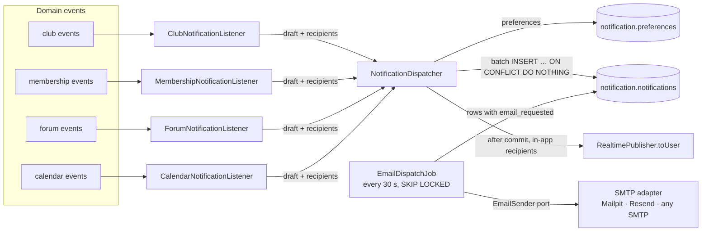
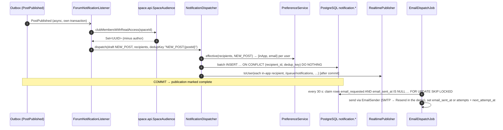

# Module `notification`

## 1. Responsibility

- **Turns domain events into notifications** for the right recipients (D-03).
- **In-app notifications**: inbox, unread count, real-time push to `/user/queue/notifications`.
- **Email notifications** via any SMTP provider (Mailpit in dev, **Resend** in the demo, D-35), according to **per-user, per-type preferences** with defaults (D-30, R-15).
- Reliability: **idempotent** creation (dedup key), and an **email outbox**, so SMTP failures never block or duplicate event processing.

This is a pure **downstream** module. Nothing depends on it, and it depends on the events and read APIs of the others.

## 2. Dependencies

| Direction | Modules |
|-----------|---------|
| Depends on | `shared`, `identity::api`, `club::events`, `membership::api`, `membership::events`, `space::api`, `forum::events`, `calendar::api`, `calendar::events`, `realtime::api` |
| Used by | — |

```java
@ApplicationModule(
        displayName = "Notification",
        allowedDependencies = {"shared", "identity::api", "club::events", "membership::api", "membership::events",
                "space::api", "forum::events", "calendar::api", "calendar::events", "realtime::api"}
)
package pt.vclubroom.notification;

import org.springframework.modulith.ApplicationModule;
```

## 3. Packages

```text
notification/
├── web/              NotificationController, PreferenceController (+ dto/)
├── application/      NotificationDispatcher, PreferenceService, NotificationQueryService, EmailDispatchJob,
│                     ClubNotificationListener, MembershipNotificationListener,
│                     ForumNotificationListener, CalendarNotificationListener, NotificationDraft,
│                     EmailSender (port), OutgoingEmail, EmailDeliveryException
├── domain/           Notification, NotificationType, NotificationPreference
├── persistence/      NotificationRepository, NotificationPreferenceRepository
└── infrastructure/   SmtpEmailSender, LoggingEmailSender (adapters), AppMailProperties
```

## 4. Design



- **Listeners** (one per source module) know *who* should be told and *what* to say. They build a `NotificationDraft` and a recipient set using read APIs (`ClubAuthorization.holdersOf`, `SpaceAudience`, `RsvpQuery`, `UserDirectory.adminIds`).
- **The dispatcher** knows *how*: it applies preferences, inserts rows idempotently (`dedup_key`) and pushes in-app notifications after commit.
- **Email is an outbox.** Rows needing email are flagged, and `EmailDispatchJob` sends them through the provider-neutral `EmailSender` port with retries (max 5 attempts, exponential backoff, R-27) and records the outcome. An SMTP outage delays emails but never fails event listeners or duplicates notifications.

### Notification types and defaults (R-15)

| Type | Trigger | Recipients | In-app | Email |
|------|---------|-----------|:------:|:-----:|
| `CLUB_CREATION_SUBMITTED` | `ClubCreationRequested` | admins | ✓ | |
| `CLUB_APPROVED` | `ClubApproved` | founder | ✓ | ✓ |
| `CLUB_REJECTED` | `ClubRejected` | founder | ✓ | ✓ |
| `CLUB_ARCHIVED` | `ClubArchived` | active members | ✓ | ✓ |
| `CLUB_REVIVAL_REQUESTED` | `ClubRevivalRequested` | admins | ✓ | |
| `CLUB_REVIVED` | `ClubRevived` | members + new owner | ✓ | ✓ |
| `JOIN_REQUEST_RECEIVED` | `JoinRequested` | holders of `MEMBER_APPROVE` | ✓ | |
| `JOIN_REQUEST_DECIDED` | `JoinRequestDecided` | requester | ✓ | ✓ |
| `OWNERSHIP_INVITATION_RECEIVED` | `OwnershipInvitationSent` | invitee | ✓ | ✓ |
| `OWNERSHIP_CHANGED` | `OwnerAdded`, `OwnerSteppedDown`, `OwnerRemoved` | owners + affected user | ✓ | |
| `NEW_POST` | `PostPublished` | members who can read the space (not the author) | ✓ | |
| `NEW_COMMENT` | `CommentAdded` | post author (not the commenter) | ✓ | |
| `NEW_REPLY` | `CommentAdded` with parent | parent comment author | ✓ | |
| `EVENT_SCHEDULED` | `EventScheduled` | members who can read the space | ✓ | |
| `EVENT_UPDATED` | `EventUpdated` | RSVP `GOING`/`INTERESTED` | ✓ | |
| `EVENT_CANCELLED` | `EventCancelled` | RSVP `GOING`/`INTERESTED` | ✓ | ✓ |
| `EVENT_REMINDER` | `EventReminderDue` | RSVP `GOING`/`INTERESTED` | ✓ | ✓ |

## 5. Public API / events

None (pure consumer).

## 6. REST endpoints

| Method | Path | Description |
|--------|------|-------------|
| `GET` | `/api/notifications?unreadOnly=&cursor=&limit=20` | Inbox (newest first, keyset) |
| `GET` | `/api/notifications/unread-count` | `{count}` (badge) |
| `POST` | `/api/notifications/{id}/read` | Mark one read |
| `POST` | `/api/notifications/read-all` | Mark all read |
| `GET` | `/api/me/notification-preferences` | `[{type, inApp, email, defaultInApp, defaultEmail}]` |
| `PUT` | `/api/me/notification-preferences` | `[{type, inApp, email}]` (stores overrides only) |

Real-time: `/user/queue/notifications`, type `notification.created`, payload `NotificationResponse`.

## 7. Request flow: a new post notifies readers



If the listener fails halfway (e.g. DB hiccup), its transaction rolls back and the publication stays incomplete. On retry, the `dedup_key` makes inserts idempotent and no in-app push was sent for the rolled-back attempt (pushes happen after commit only).

## 8. Key implementation

```java
package pt.vclubroom.notification.domain;

public enum NotificationType {
    CLUB_CREATION_SUBMITTED(true, false),
    CLUB_APPROVED(true, true),
    CLUB_REJECTED(true, true),
    CLUB_ARCHIVED(true, true),
    CLUB_REVIVAL_REQUESTED(true, false),
    CLUB_REVIVED(true, true),
    JOIN_REQUEST_RECEIVED(true, false),
    JOIN_REQUEST_DECIDED(true, true),
    OWNERSHIP_INVITATION_RECEIVED(true, true),
    OWNERSHIP_CHANGED(true, false),
    NEW_POST(true, false),
    NEW_COMMENT(true, false),
    NEW_REPLY(true, false),
    EVENT_SCHEDULED(true, false),
    EVENT_UPDATED(true, false),
    EVENT_CANCELLED(true, true),
    EVENT_REMINDER(true, true);

    private final boolean defaultInApp;
    private final boolean defaultEmail;

    NotificationType(boolean defaultInApp, boolean defaultEmail) {
        this.defaultInApp = defaultInApp;
        this.defaultEmail = defaultEmail;
    }

    public boolean defaultInApp() { return defaultInApp; }
    public boolean defaultEmail() { return defaultEmail; }
}
```

```java
package pt.vclubroom.notification.application;

import java.util.Map;
import pt.vclubroom.notification.domain.NotificationType;

/**
 * What to say. link is a SPA route (e.g. "/c/chess/s/general/posts?post=…").
 * dedupKey makes delivery idempotent per recipient (e.g. "NEW_POST:<postId>").
 */
public record NotificationDraft(NotificationType type, String title, String body, String link,
                                Map<String, Object> data, String dedupKey) {
}
```

```java
package pt.vclubroom.notification.application;

import java.util.Collection;
import java.util.EnumMap;
import java.util.HashMap;
import java.util.List;
import java.util.Map;
import java.util.UUID;
import org.springframework.stereotype.Service;
import org.springframework.transaction.annotation.Transactional;
import pt.vclubroom.notification.domain.NotificationPreference;
import pt.vclubroom.notification.domain.NotificationType;
import pt.vclubroom.notification.persistence.NotificationPreferenceRepository;

@Service
public class PreferenceService {

    public record Effective(boolean inApp, boolean email) { }

    private final NotificationPreferenceRepository preferences;

    public PreferenceService(NotificationPreferenceRepository preferences) {
        this.preferences = preferences;
    }

    /** Stored overrides win; otherwise the type's defaults apply. */
    @Transactional(readOnly = true)
    public Map<UUID, Effective> effective(Collection<UUID> userIds, NotificationType type) {
        Map<UUID, Effective> result = new HashMap<>();
        userIds.forEach(id -> result.put(id, new Effective(type.defaultInApp(), type.defaultEmail())));
        List<NotificationPreference> overrides = preferences.findByUserIdInAndType(userIds, type);
        overrides.forEach(p -> result.put(p.userId(), new Effective(p.inApp(), p.email())));
        return result;
    }

    @Transactional(readOnly = true)
    public Map<NotificationType, Effective> allFor(UUID userId) {
        Map<NotificationType, Effective> result = new EnumMap<>(NotificationType.class);
        for (NotificationType t : NotificationType.values()) {
            result.put(t, new Effective(t.defaultInApp(), t.defaultEmail()));
        }
        preferences.findByUserId(userId).forEach(p -> result.put(p.type(), new Effective(p.inApp(), p.email())));
        return result;
    }
}
```

```java
package pt.vclubroom.notification.application;

import com.fasterxml.jackson.core.JsonProcessingException;
import com.fasterxml.jackson.databind.ObjectMapper;
import java.sql.Timestamp;
import java.time.Clock;
import java.time.Instant;
import java.util.ArrayList;
import java.util.Collection;
import java.util.List;
import java.util.Map;
import java.util.UUID;
import org.springframework.jdbc.core.JdbcTemplate;
import org.springframework.stereotype.Service;
import org.springframework.transaction.annotation.Transactional;
import pt.vclubroom.realtime.api.RealtimePublisher;

@Service
public class NotificationDispatcher {

    private static final String INSERT = """
            insert into notification.notifications
                (id, recipient_id, type, title, body, link, data, dedup_key, in_app, email_requested, created_at)
            values (?, ?, ?, ?, ?, ?, cast(? as jsonb), ?, ?, ?, ?)
            on conflict (recipient_id, dedup_key) do nothing
            """;

    private final JdbcTemplate jdbc;
    private final PreferenceService preferences;
    private final RealtimePublisher realtime;
    private final ObjectMapper objectMapper;
    private final Clock clock;

    public NotificationDispatcher(JdbcTemplate jdbc, PreferenceService preferences, RealtimePublisher realtime,
                                  ObjectMapper objectMapper, Clock clock) {
        this.jdbc = jdbc;
        this.preferences = preferences;
        this.realtime = realtime;
        this.objectMapper = objectMapper;
        this.clock = clock;
    }

    /** Joins the listener's transaction; pushes happen after commit (RealtimePublisher contract). */
    @Transactional
    public void dispatch(NotificationDraft draft, Collection<UUID> recipients) {
        if (recipients.isEmpty()) {
            return;
        }
        Map<UUID, PreferenceService.Effective> prefs = preferences.effective(recipients, draft.type());
        Instant now = clock.instant();
        String dataJson = toJson(draft.data());

        List<Object[]> rows = new ArrayList<>();
        List<UUID> inAppRecipients = new ArrayList<>();
        prefs.forEach((userId, p) -> {
            if (!p.inApp() && !p.email()) {
                return;                                                   // user muted this type
            }
            rows.add(new Object[] {UUID.randomUUID(), userId, draft.type().name(), draft.title(), draft.body(),
                    draft.link(), dataJson, draft.dedupKey(), p.inApp(), p.email(), Timestamp.from(now)});
            if (p.inApp()) {
                inAppRecipients.add(userId);
            }
        });
        jdbc.batchUpdate(INSERT, rows);

        Map<String, Object> payload = Map.of("type", draft.type().name(), "title", draft.title(),
                "body", draft.body() == null ? "" : draft.body(), "link", draft.link(), "createdAt", now.toString());
        inAppRecipients.forEach(userId ->
                realtime.toUser(userId, "/queue/notifications", "notification.created", payload));
    }

    private String toJson(Map<String, Object> data) {
        try {
            return objectMapper.writeValueAsString(data == null ? Map.of() : data);
        } catch (JsonProcessingException e) {
            throw new IllegalArgumentException("Notification data not serializable", e);
        }
    }
}
```

```java
package pt.vclubroom.notification.application;

import java.util.HashSet;
import java.util.Map;
import java.util.Set;
import java.util.UUID;
import org.springframework.modulith.events.ApplicationModuleListener;
import org.springframework.stereotype.Component;
import pt.vclubroom.forum.events.CommentAdded;
import pt.vclubroom.forum.events.PostPublished;
import pt.vclubroom.notification.domain.NotificationType;
import pt.vclubroom.space.api.SpaceAudience;

@Component
class ForumNotificationListener {

    private final SpaceAudience audience;
    private final NotificationDispatcher dispatcher;

    ForumNotificationListener(SpaceAudience audience, NotificationDispatcher dispatcher) {
        this.audience = audience;
        this.dispatcher = dispatcher;
    }

    @ApplicationModuleListener
    void on(PostPublished event) {
        Set<UUID> recipients = new HashSet<>(audience.clubMembersWithReadAccess(event.spaceId()));
        recipients.remove(event.authorId());
        String title = event.title() != null ? event.title() : "New post";
        dispatcher.dispatch(new NotificationDraft(NotificationType.NEW_POST, title, event.excerpt(),
                "/posts/" + event.postId(), Map.of("clubId", event.clubId(), "postId", event.postId()),
                "NEW_POST:" + event.postId()), recipients);
    }

    @ApplicationModuleListener
    void on(CommentAdded event) {
        if (event.postAuthorId() != null && !event.postAuthorId().equals(event.authorId())) {
            dispatcher.dispatch(new NotificationDraft(NotificationType.NEW_COMMENT, "New comment on your post",
                    event.excerpt(), "/posts/" + event.postId() + "#c-" + event.commentId(),
                    Map.of("postId", event.postId()), "NEW_COMMENT:" + event.commentId()),
                    Set.of(event.postAuthorId()));
        }
        if (event.parentAuthorId() != null && !event.parentAuthorId().equals(event.authorId())) {
            dispatcher.dispatch(new NotificationDraft(NotificationType.NEW_REPLY, "New reply to your comment",
                    event.excerpt(), "/posts/" + event.postId() + "#c-" + event.commentId(),
                    Map.of("postId", event.postId()), "NEW_REPLY:" + event.commentId()),
                    Set.of(event.parentAuthorId()));
        }
    }
}
```

```java
package pt.vclubroom.notification.application;

import java.util.EnumSet;
import java.util.Map;
import org.springframework.modulith.events.ApplicationModuleListener;
import org.springframework.stereotype.Component;
import pt.vclubroom.calendar.api.RsvpQuery;
import pt.vclubroom.calendar.api.RsvpStatus;
import pt.vclubroom.calendar.events.EventReminderDue;
import pt.vclubroom.notification.domain.NotificationType;

@Component
class CalendarNotificationListener {

    private final RsvpQuery rsvps;
    private final NotificationDispatcher dispatcher;

    CalendarNotificationListener(RsvpQuery rsvps, NotificationDispatcher dispatcher) {
        this.rsvps = rsvps;
        this.dispatcher = dispatcher;
    }

    @ApplicationModuleListener
    void on(EventReminderDue event) {
        String when = "DAY_BEFORE".equals(event.kind()) ? "tomorrow" : "in one hour";
        dispatcher.dispatch(new NotificationDraft(NotificationType.EVENT_REMINDER,
                        event.title() + " starts " + when, null, "/events/" + event.eventId(),
                        Map.of("eventId", event.eventId(), "startsAt", event.startsAt().toString()),
                        "EVENT_REMINDER:" + event.eventId() + ":" + event.kind()),
                rsvps.attendees(event.eventId(), EnumSet.of(RsvpStatus.GOING, RsvpStatus.INTERESTED)));
    }
}
```

### 8.1 Email: a provider-neutral port (D-35)

The module depends on its own `EmailSender` interface, never on a provider. The SMTP adapter works with **any** SMTP service:

| Environment | Provider | What changes |
|-------------|----------|--------------|
| dev | Mailpit (`localhost:1025`, web UI `:8025`) | — |
| demo | **Resend** (`smtp.resend.com:587`, user `resend`, password = API key) | env vars only |
| later | Brevo / Amazon SES / bocal's SMTP relay | env vars only |
| offline | none (`MAIL_TRANSPORT=log` prints emails to the log) | env var only |

A provider with no SMTP, or a need for provider features such as webhooks and tags, means one new adapter class implementing `EmailSender`. Callers don't change.

```java
package pt.vclubroom.notification.application;

/** Provider-neutral email. Plain text keeps every provider and spam filter happy (HTML is an extension). */
public record OutgoingEmail(String to, String subject, String textBody) {
}
```

```java
package pt.vclubroom.notification.application;

/** Port: the notification module never knows which provider delivers its emails. */
public interface EmailSender {

    /** @throws EmailDeliveryException when the provider rejects the email or is unreachable (the job retries). */
    void send(OutgoingEmail email);
}
```

```java
package pt.vclubroom.notification.application;

public class EmailDeliveryException extends RuntimeException {

    public EmailDeliveryException(String message, Throwable cause) {
        super(message, cause);
    }
}
```

```java
package pt.vclubroom.notification.infrastructure;

import org.springframework.boot.context.properties.ConfigurationProperties;
import org.springframework.boot.context.properties.bind.DefaultValue;

/** app.mail.*: named AppMailProperties to avoid confusion with Spring Boot's own spring.mail properties. */
@ConfigurationProperties("app.mail")
public record AppMailProperties(@DefaultValue("smtp") String transport, String from, String replyTo) {
}
```

```java
package pt.vclubroom.notification.infrastructure;

import jakarta.mail.MessagingException;
import jakarta.mail.internet.MimeMessage;
import java.nio.charset.StandardCharsets;
import org.springframework.boot.autoconfigure.condition.ConditionalOnProperty;
import org.springframework.mail.MailException;
import org.springframework.mail.javamail.JavaMailSender;
import org.springframework.mail.javamail.MimeMessageHelper;
import org.springframework.stereotype.Component;
import pt.vclubroom.notification.application.EmailDeliveryException;
import pt.vclubroom.notification.application.EmailSender;
import pt.vclubroom.notification.application.OutgoingEmail;

/** Adapter for any SMTP provider (Mailpit, Resend, Brevo, SES, bocal…), selected purely by spring.mail.* config. */
@Component
@ConditionalOnProperty(name = "app.mail.transport", havingValue = "smtp", matchIfMissing = true)
class SmtpEmailSender implements EmailSender {

    private final JavaMailSender mailSender;
    private final AppMailProperties properties;

    SmtpEmailSender(JavaMailSender mailSender, AppMailProperties properties) {
        this.mailSender = mailSender;
        this.properties = properties;
    }

    @Override
    public void send(OutgoingEmail email) {
        try {
            MimeMessage message = mailSender.createMimeMessage();
            MimeMessageHelper helper = new MimeMessageHelper(message, false, StandardCharsets.UTF_8.name());
            helper.setFrom(properties.from());            // must be on the provider's verified domain (R-25)
            if (properties.replyTo() != null && !properties.replyTo().isBlank()) {
                helper.setReplyTo(properties.replyTo());
            }
            helper.setTo(email.to());
            helper.setSubject(email.subject());
            helper.setText(email.textBody(), false);
            mailSender.send(message);
        } catch (MessagingException | MailException e) {
            throw new EmailDeliveryException("SMTP delivery failed: " + e.getMessage(), e);
        }
    }
}
```

```java
package pt.vclubroom.notification.infrastructure;

import org.slf4j.Logger;
import org.slf4j.LoggerFactory;
import org.springframework.boot.autoconfigure.condition.ConditionalOnProperty;
import org.springframework.stereotype.Component;
import pt.vclubroom.notification.application.EmailSender;
import pt.vclubroom.notification.application.OutgoingEmail;

/** MAIL_TRANSPORT=log: no SMTP at all (offline development, CI). */
@Component
@ConditionalOnProperty(name = "app.mail.transport", havingValue = "log")
class LoggingEmailSender implements EmailSender {

    private static final Logger log = LoggerFactory.getLogger(LoggingEmailSender.class);

    @Override
    public void send(OutgoingEmail email) {
        log.info("[mail] to={} subject={}\n{}", email.to(), email.subject(), email.textBody());
    }
}
```

### 8.2 Email outbox worker

```java
package pt.vclubroom.notification.application;

import java.time.Clock;
import java.time.Instant;
import org.slf4j.Logger;
import org.slf4j.LoggerFactory;
import org.springframework.beans.factory.annotation.Value;
import org.springframework.scheduling.annotation.Scheduled;
import org.springframework.stereotype.Component;
import org.springframework.transaction.annotation.Transactional;
import pt.vclubroom.identity.api.UserContact;
import pt.vclubroom.identity.api.UserDirectory;
import pt.vclubroom.notification.domain.Notification;
import pt.vclubroom.notification.persistence.NotificationRepository;

/**
 * Email outbox worker. Safe with N instances (FOR UPDATE SKIP LOCKED); at most 5 attempts with
 * exponential backoff (R-27), so a provider limit (e.g. Resend's 100/day) or outage doesn't burn all retries at once.
 */
@Component
class EmailDispatchJob {

    private static final Logger log = LoggerFactory.getLogger(EmailDispatchJob.class);
    private static final int BATCH = 50;
    private static final int MAX_ATTEMPTS = 5;

    private final NotificationRepository notifications;
    private final UserDirectory users;
    private final EmailSender emailSender;
    private final Clock clock;
    private final String publicUrl;

    EmailDispatchJob(NotificationRepository notifications, UserDirectory users, EmailSender emailSender, Clock clock,
                     @Value("${app.public-url}") String publicUrl) {
        this.notifications = notifications;
        this.users = users;
        this.emailSender = emailSender;
        this.clock = clock;
        this.publicUrl = publicUrl.replaceAll("/+$", "");
    }

    @Scheduled(fixedDelayString = "PT30S", initialDelayString = "PT20S")
    @Transactional
    public void sendPendingEmails() {
        Instant now = clock.instant();
        for (Notification n : notifications.claimPendingEmails(MAX_ATTEMPTS, now, BATCH)) {
            UserContact contact = users.contactOf(n.recipientId()).orElse(null);
            if (contact == null || !contact.active() || contact.email() == null) {
                n.emailSkipped();
                continue;
            }
            try {
                String text = (n.body() == null ? "" : n.body() + "\n\n") + "Open: " + publicUrl + n.link();
                emailSender.send(new OutgoingEmail(contact.email(), "[Virtual Clubroom] " + n.title(), text));
                n.emailSent(now);
            } catch (EmailDeliveryException e) {
                log.warn("Email for notification {} failed (attempt {})", n.id(), n.emailAttempts() + 1, e);
                n.emailFailed(e.getMessage(), now);   // attempts++, next try in 1, 2, 4, 8, 16 min
            }
        }
    }
}
```

```java
package pt.vclubroom.notification.persistence;

import java.time.Instant;
import java.util.List;
import java.util.UUID;
import org.springframework.data.domain.Limit;
import org.springframework.data.jpa.repository.JpaRepository;
import org.springframework.data.jpa.repository.Modifying;
import org.springframework.data.jpa.repository.Query;
import org.springframework.data.repository.query.Param;
import pt.vclubroom.notification.domain.Notification;

public interface NotificationRepository extends JpaRepository<Notification, UUID> {

    @Query(value = """
           select * from notification.notifications
           where email_requested and email_sent_at is null and email_attempts < :maxAttempts
             and (email_next_attempt_at is null or email_next_attempt_at <= :now)
           order by created_at
           limit :batch
           for update skip locked
           """, nativeQuery = true)
    List<Notification> claimPendingEmails(@Param("maxAttempts") int maxAttempts, @Param("now") Instant now,
                                          @Param("batch") int batch);

    @Query("""
           select n from Notification n
           where n.recipientId = :userId and n.inApp = true
             and (n.createdAt < :cursorAt or (n.createdAt = :cursorAt and n.id < :cursorId))
           order by n.createdAt desc, n.id desc
           """)
    List<Notification> findInbox(@Param("userId") UUID userId, @Param("cursorAt") Instant cursorAt,
                                 @Param("cursorId") UUID cursorId, Limit limit);

    @Query("select count(n) from Notification n where n.recipientId = :userId and n.inApp = true and n.readAt is null")
    long countUnread(@Param("userId") UUID userId);

    @Modifying
    @Query("update Notification n set n.readAt = :now where n.recipientId = :userId and n.readAt is null")
    int markAllRead(@Param("userId") UUID userId, @Param("now") Instant now);
}
```

`Notification` (entity on `notification.notifications`) exposes:

- `emailSent(now)`;
- `emailFailed(error, now)`, which increments `email_attempts`, stores `email_last_error` and sets `email_next_attempt_at = now + 2^(attempts−1) minutes`;
- `emailSkipped()`, which clears `email_requested` for inactive users or users without an email;
- `markRead(now)`;
- `link()`, a SPA route. The job prefixes it with `app.public-url`.

`NotificationPreference` maps `notification.preferences (user_id, type, in_app, email)`.

## 9. Data

Schema `notification`: `notifications` (with `dedup_key`, `in_app`, `email_requested`, `email_sent_at`, `email_attempts`, `email_next_attempt_at`, `email_last_error`), `preferences`. See [04-database.md § notification](../04-database.md#410-notification).

## 10. Extension points

- **New channel** (web push, Discord webhook per club): add a flag column (`push_requested`) and another outbox worker, or a `DeliveryChannel` strategy bean. Listeners don't change.
- **Digest emails** (daily summary instead of per-event): a job that groups unsent low-priority rows per user.
- **HTML templates**: add an `htmlBody` to `OutgoingEmail` and render it with Thymeleaf in `infrastructure/EmailTemplates`; `SmtpEmailSender` switches to a multipart `MimeMessageHelper`.
- **Provider-specific adapter** (e.g. Resend's HTTP API for tags, webhooks and delivery events): a new `EmailSender` implementation selected with `MAIL_TRANSPORT=resend-api`. The job and listeners stay unchanged.
- **Idempotency at the provider**: Resend accepts a `Resend-Idempotency-Key` header on SMTP sends. Setting it to the notification ID would rule out duplicates if a send succeeds but the DB commit fails. It's provider-specific, so it's left out of the neutral adapter.
