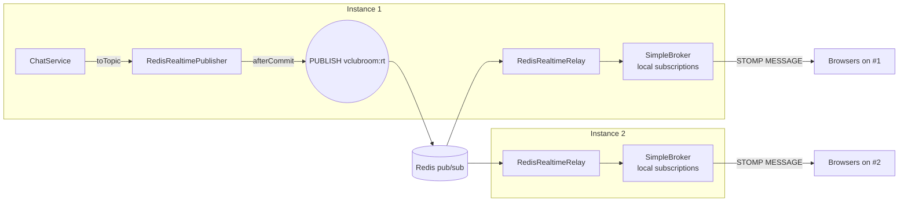
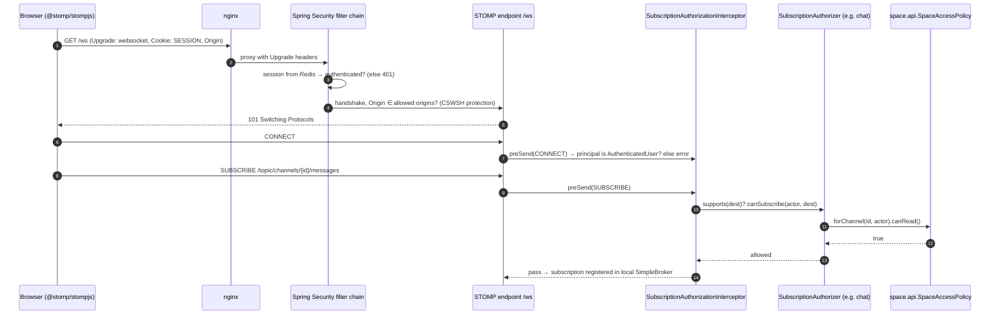

# Module `realtime`

## 1. Responsibility

- The **WebSocket/STOMP gateway** (`/ws`): accepts connections authenticated by the existing HTTP session.
- **Push-only** (R-03): browsers subscribe; all commands go through REST. Client `SEND` frames are rejected.
- **Subscription authorization** through an SPI that content modules implement. The realtime module itself knows nothing about clubs, channels or posts.
- **Cross-instance fan-out through Redis pub/sub** (D-16), so any instance can publish and every subscribed browser, on any instance, receives it.
- **After-commit publishing**: a push is only sent if the business transaction committed.

Guarantee: **best effort.** A push can be lost (instance crash, network blip). Clients reconcile by refetching when they reconnect. Durable facts travel as domain events (outbox), never as pushes alone.

## 2. Dependencies

| Direction | Modules |
|-----------|---------|
| Depends on | `shared` |
| Used by (API) | forum, chat, notification |
| SPI implemented by | forum (`/topic/channels/{id}/posts`, `/topic/posts/{id}`), chat (`/topic/channels/{id}/messages`) |

```java
@ApplicationModule(displayName = "Realtime", allowedDependencies = {"shared"})
package pt.vclubroom.realtime;

import org.springframework.modulith.ApplicationModule;
```

## 3. Packages

```text
realtime/
├── api/              RealtimePublisher
├── spi/              SubscriptionAuthorizer
└── infrastructure/   WebSocketConfig, SubscriptionAuthorizationInterceptor, RedisRealtimePublisher,
                      RedisRealtimeRelay, RealtimeRedisConfig, RealtimeEnvelope, RealtimeProperties
```

## 4. Architecture



- Each instance runs Spring's **in-memory simple broker** for its own connections.
- Publishing never writes to the local broker directly. It always goes **through Redis**, and every instance (including the publisher) relays the message into its local broker. One code path, no duplicates.
- **User destinations** (`/user/queue/notifications`): the message goes to Redis with the target user ID. Every instance calls `convertAndSendToUser`, and only the instance(s) holding that user's sessions actually deliver. Others no-op because the user registry is local.
- **No sticky sessions** are required at the load balancer.

### Destinations

| Destination | Owner (authorizer) | Who may subscribe |
|-------------|-------------------|-------------------|
| `/topic/channels/{channelId}/messages` | chat | Readers of the channel |
| `/topic/channels/{channelId}/posts` | forum | Readers of the channel |
| `/topic/posts/{postId}` | forum | Readers of the post's channel |
| `/user/queue/notifications` | — | The connected user only (private by construction) |
| anything else | — | **Denied** (fail closed) |

### Message envelope

```json
{ "type": "message.created", "payload": { "...": "..." }, "sentAt": "2026-10-18T14:03:12.123Z" }
```

## 5. Public API and SPI

```java
package pt.vclubroom.realtime.api;

import java.util.UUID;

/**
 * Best-effort push to browsers. If called inside a transaction, the push is deferred until after commit
 * (and dropped on rollback). Payloads must be viewer-neutral (they are broadcast to every subscriber).
 */
public interface RealtimePublisher {

    void toTopic(String destination, String type, Object payload);

    /** destination is relative to the user prefix, e.g. "/queue/notifications". */
    void toUser(UUID userId, String destination, String type, Object payload);
}
```

```java
package pt.vclubroom.realtime.spi;

import pt.vclubroom.shared.security.Actor;

/** Implemented by modules that own topics. The first authorizer whose supports() matches decides. */
public interface SubscriptionAuthorizer {

    boolean supports(String destination);

    boolean canSubscribe(Actor actor, String destination);
}
```

## 6. Request flows

### 6.1 Connect and subscribe



### 6.2 Publish

`ChatService.send(...)` (inside `@Transactional`) → `RealtimePublisher.toTopic(dest, "message.created", view)` → `RedisRealtimePublisher` registers a `TransactionSynchronization` → **after commit**: `PUBLISH vclubroom:rt {kind: TOPIC, destination, envelope}` → each instance's `RedisRealtimeRelay.onMessage` → `SimpMessagingTemplate.convertAndSend(destination, envelope)` → subscribed browsers.

## 7. Key implementation

```java
package pt.vclubroom.realtime.infrastructure;

import java.util.List;
import org.springframework.boot.context.properties.ConfigurationProperties;

@ConfigurationProperties("app.realtime")
public record RealtimeProperties(List<String> allowedOrigins, String redisChannel) {
}
```

```java
package pt.vclubroom.realtime.infrastructure;

import java.time.Instant;

public record RealtimeEnvelope(String type, Object payload, Instant sentAt) {
}
```

```java
package pt.vclubroom.realtime.infrastructure;

import org.springframework.context.annotation.Bean;
import org.springframework.context.annotation.Configuration;
import org.springframework.messaging.simp.config.ChannelRegistration;
import org.springframework.messaging.simp.config.MessageBrokerRegistry;
import org.springframework.scheduling.concurrent.ThreadPoolTaskScheduler;
import org.springframework.web.socket.config.annotation.EnableWebSocketMessageBroker;
import org.springframework.web.socket.config.annotation.StompEndpointRegistry;
import org.springframework.web.socket.config.annotation.WebSocketMessageBrokerConfigurer;

@Configuration
@EnableWebSocketMessageBroker
class WebSocketConfig implements WebSocketMessageBrokerConfigurer {

    private final RealtimeProperties properties;
    private final SubscriptionAuthorizationInterceptor authorizationInterceptor;

    WebSocketConfig(RealtimeProperties properties, SubscriptionAuthorizationInterceptor authorizationInterceptor) {
        this.properties = properties;
        this.authorizationInterceptor = authorizationInterceptor;
    }

    @Override
    public void registerStompEndpoints(StompEndpointRegistry registry) {
        registry.addEndpoint("/ws")
                .setAllowedOrigins(properties.allowedOrigins().toArray(String[]::new));   // CSWSH protection
    }

    @Override
    public void configureMessageBroker(MessageBrokerRegistry registry) {
        registry.enableSimpleBroker("/topic", "/queue")
                .setHeartbeatValue(new long[] {10_000, 10_000})
                .setTaskScheduler(heartbeatScheduler());
        registry.setApplicationDestinationPrefixes("/app");   // unused: SEND is rejected (push-only)
        registry.setUserDestinationPrefix("/user");
    }

    @Override
    public void configureClientInboundChannel(ChannelRegistration registration) {
        registration.interceptors(authorizationInterceptor);
    }

    @Bean
    ThreadPoolTaskScheduler heartbeatScheduler() {
        ThreadPoolTaskScheduler scheduler = new ThreadPoolTaskScheduler();
        scheduler.setPoolSize(1);
        scheduler.setThreadNamePrefix("ws-heartbeat-");
        scheduler.initialize();
        return scheduler;
    }
}
```

```java
package pt.vclubroom.realtime.infrastructure;

import java.security.Principal;
import java.util.List;
import org.springframework.messaging.Message;
import org.springframework.messaging.MessageChannel;
import org.springframework.messaging.MessageDeliveryException;
import org.springframework.messaging.simp.stomp.StompCommand;
import org.springframework.messaging.simp.stomp.StompHeaderAccessor;
import org.springframework.messaging.support.ChannelInterceptor;
import org.springframework.messaging.support.MessageHeaderAccessor;
import org.springframework.security.core.Authentication;
import org.springframework.stereotype.Component;
import pt.vclubroom.realtime.spi.SubscriptionAuthorizer;
import pt.vclubroom.shared.security.AuthenticatedUser;

@Component
class SubscriptionAuthorizationInterceptor implements ChannelInterceptor {

    private final List<SubscriptionAuthorizer> authorizers;

    SubscriptionAuthorizationInterceptor(List<SubscriptionAuthorizer> authorizers) {
        this.authorizers = authorizers;
    }

    @Override
    public Message<?> preSend(Message<?> message, MessageChannel channel) {
        StompHeaderAccessor accessor = MessageHeaderAccessor.getAccessor(message, StompHeaderAccessor.class);
        if (accessor == null || accessor.getCommand() == null) {
            return message;
        }
        StompCommand command = accessor.getCommand();
        AuthenticatedUser user = authenticatedUser(accessor.getUser());

        if (command == StompCommand.CONNECT && user == null) {
            throw new MessageDeliveryException("Unauthenticated");
        }
        if (command == StompCommand.SEND) {
            throw new MessageDeliveryException("Client SEND is not supported; use the REST API");   // R-03
        }
        if (command == StompCommand.SUBSCRIBE) {
            String destination = accessor.getDestination();
            if (user == null || destination == null) {
                throw new MessageDeliveryException("Forbidden");
            }
            if (destination.startsWith("/user/queue/")) {
                return message;                         // resolved per session by Spring: private by construction
            }
            boolean allowed = authorizers.stream()
                    .filter(a -> a.supports(destination))
                    .findFirst()
                    .map(a -> a.canSubscribe(user.actor(), destination))
                    .orElse(false);                     // unknown destination → deny (fail closed)
            if (!allowed) {
                throw new MessageDeliveryException("Forbidden");
            }
        }
        return message;
    }

    private static AuthenticatedUser authenticatedUser(Principal principal) {
        if (principal instanceof Authentication auth && auth.getPrincipal() instanceof AuthenticatedUser user) {
            return user;
        }
        return null;
    }
}
```

```java
package pt.vclubroom.realtime.infrastructure;

import com.fasterxml.jackson.core.JsonProcessingException;
import com.fasterxml.jackson.databind.ObjectMapper;
import java.time.Clock;
import java.util.LinkedHashMap;
import java.util.Map;
import java.util.UUID;
import org.springframework.data.redis.core.StringRedisTemplate;
import org.springframework.stereotype.Component;
import org.springframework.transaction.support.TransactionSynchronization;
import org.springframework.transaction.support.TransactionSynchronizationManager;
import pt.vclubroom.realtime.api.RealtimePublisher;

@Component
class RedisRealtimePublisher implements RealtimePublisher {

    private final StringRedisTemplate redis;
    private final ObjectMapper objectMapper;
    private final RealtimeProperties properties;
    private final Clock clock;

    RedisRealtimePublisher(StringRedisTemplate redis, ObjectMapper objectMapper, RealtimeProperties properties,
                           Clock clock) {
        this.redis = redis;
        this.objectMapper = objectMapper;
        this.properties = properties;
        this.clock = clock;
    }

    @Override
    public void toTopic(String destination, String type, Object payload) {
        Map<String, Object> wire = new LinkedHashMap<>();
        wire.put("kind", "TOPIC");
        wire.put("destination", destination);
        wire.put("envelope", new RealtimeEnvelope(type, payload, clock.instant()));
        publishAfterCommit(wire);
    }

    @Override
    public void toUser(UUID userId, String destination, String type, Object payload) {
        Map<String, Object> wire = new LinkedHashMap<>();
        wire.put("kind", "USER");
        wire.put("userId", userId.toString());
        wire.put("destination", destination);
        wire.put("envelope", new RealtimeEnvelope(type, payload, clock.instant()));
        publishAfterCommit(wire);
    }

    private void publishAfterCommit(Map<String, Object> wire) {
        String json = serialize(wire);   // serialize now: entities may be detached after commit
        if (TransactionSynchronizationManager.isSynchronizationActive()) {
            TransactionSynchronizationManager.registerSynchronization(new TransactionSynchronization() {
                @Override
                public void afterCommit() {
                    redis.convertAndSend(properties.redisChannel(), json);
                }
            });
        } else {
            redis.convertAndSend(properties.redisChannel(), json);
        }
    }

    private String serialize(Object value) {
        try {
            return objectMapper.writeValueAsString(value);
        } catch (JsonProcessingException e) {
            throw new IllegalArgumentException("Realtime payload is not serializable", e);
        }
    }
}
```

```java
package pt.vclubroom.realtime.infrastructure;

import com.fasterxml.jackson.databind.JsonNode;
import com.fasterxml.jackson.databind.ObjectMapper;
import java.io.IOException;
import java.nio.charset.StandardCharsets;
import org.slf4j.Logger;
import org.slf4j.LoggerFactory;
import org.springframework.data.redis.connection.Message;
import org.springframework.data.redis.connection.MessageListener;
import org.springframework.messaging.simp.SimpMessagingTemplate;
import org.springframework.stereotype.Component;

/** Runs on EVERY instance: forwards Redis messages into the local STOMP broker. */
@Component
class RedisRealtimeRelay implements MessageListener {

    private static final Logger log = LoggerFactory.getLogger(RedisRealtimeRelay.class);

    private final SimpMessagingTemplate messagingTemplate;
    private final ObjectMapper objectMapper;

    RedisRealtimeRelay(SimpMessagingTemplate messagingTemplate, ObjectMapper objectMapper) {
        this.messagingTemplate = messagingTemplate;
        this.objectMapper = objectMapper;
    }

    @Override
    public void onMessage(Message message, byte[] pattern) {
        try {
            JsonNode wire = objectMapper.readTree(new String(message.getBody(), StandardCharsets.UTF_8));
            String destination = wire.get("destination").asText();
            JsonNode envelope = wire.get("envelope");
            if ("USER".equals(wire.get("kind").asText())) {
                messagingTemplate.convertAndSendToUser(wire.get("userId").asText(), destination, envelope);
            } else {
                messagingTemplate.convertAndSend(destination, envelope);
            }
        } catch (IOException | RuntimeException e) {
            log.warn("Dropping malformed realtime message", e);   // best effort by design
        }
    }
}
```

```java
package pt.vclubroom.realtime.infrastructure;

import org.springframework.context.annotation.Bean;
import org.springframework.context.annotation.Configuration;
import org.springframework.data.redis.connection.RedisConnectionFactory;
import org.springframework.data.redis.listener.ChannelTopic;
import org.springframework.data.redis.listener.RedisMessageListenerContainer;

@Configuration(proxyBeanMethods = false)
class RealtimeRedisConfig {

    @Bean
    RedisMessageListenerContainer realtimeListenerContainer(RedisConnectionFactory connectionFactory,
                                                            RedisRealtimeRelay relay,
                                                            RealtimeProperties properties) {
        RedisMessageListenerContainer container = new RedisMessageListenerContainer();
        container.setConnectionFactory(connectionFactory);
        container.addMessageListener(relay, new ChannelTopic(properties.redisChannel()));
        return container;
    }
}
```

## 8. Operational notes

| Topic | Note |
|-------|------|
| nginx | `/ws` needs `proxy_http_version 1.1`, `Upgrade`/`Connection` headers and a long `proxy_read_timeout` (see [09-deployment.md](../09-deployment.md#5-nginx)). |
| Heartbeats | 10 s both ways; idle proxies won't cut connections, and dead clients are detected. |
| Access revocation | A user removed from a club stays subscribed until they reconnect. Pushes contain only data the user could recently read. **Mitigation (extension):** on `MemberLeft`, push a `subscriptions.revalidate` control message to `/user/queue/notifications`; the client then re-subscribes and is re-authorized. |
| Capacity | The simple broker comfortably handles thousands of connections per instance. Redis pub/sub handles well over 100k msg/s. Add instances to scale out. |
| Upgrade path | Replace the simple broker + Redis relay with `enableStompBrokerRelay` (RabbitMQ STOMP) if you ever need broker-side features (durable subscriptions, ACKs). Callers of `RealtimePublisher` don't change. |
