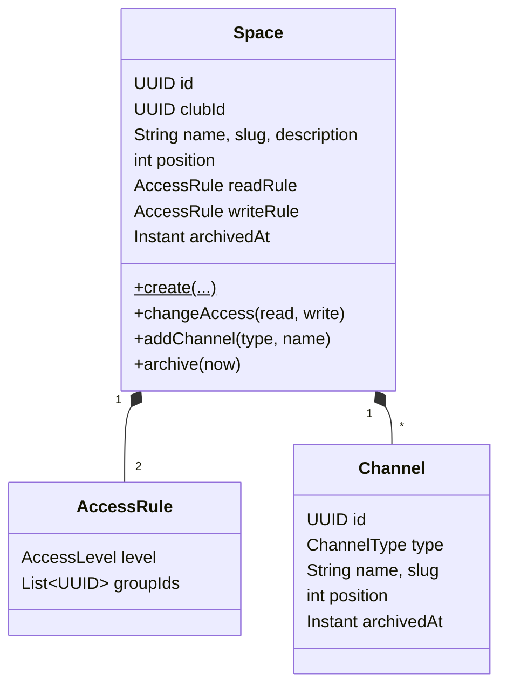
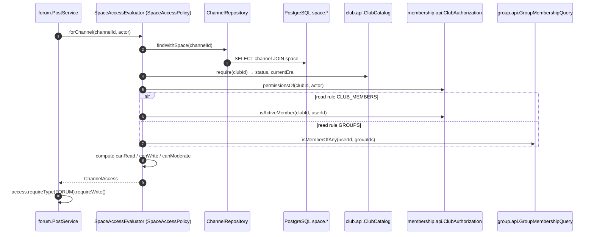

# Module `space`

## 1. Responsibility

- **Community spaces** (D-04) and their **channels** (`FORUM` / `CHAT`, D-28).
- **Access rules**: each space has a **read rule** and a **write rule** (D-07), each `PUBLIC`, `CLUB_MEMBERS` or `GROUPS(groupIds)`.
- **The single source of truth for content access.** Forum, chat and calendar never evaluate rules themselves. They call `SpaceAccessPolicy` and get a `ChannelAccess` / `SpaceAccess` answer.
- **Default space provisioning** when a club is approved (R-07).
- **Audience queries** ("which club members can read this space?") for notifications.

Spaces and channels are never hard-deleted, only **archived** (read-only, hidden from the sidebar by default), consistent with R-17.

## 2. Dependencies

| Direction | Modules |
|-----------|---------|
| Depends on | `shared`, `club::api`, `club::events`, `membership::api`, `group::api`, `group::events` |
| Used by (API) | forum, chat, calendar, notification |

```java
@ApplicationModule(
        displayName = "Space",
        allowedDependencies = {"shared", "club::api", "club::events", "membership::api", "group::api", "group::events"}
)
package pt.vclubroom.space;

import org.springframework.modulith.ApplicationModule;
```

## 3. Packages

```text
space/
├── api/            SpaceAccessPolicy, SpaceAudience, ChannelAccess, SpaceAccess, ChannelType
├── web/            SpaceController, ChannelController (+ dto/: SpaceRequest, AccessRuleDto, SpaceResponse, ChannelRequest, ChannelResponse)
├── application/    SpaceService, SpaceQueryService, SpaceAccessEvaluator, DefaultSpaceProvisioner, GroupDeletedListener
├── domain/         Space, Channel, AccessRule, AccessLevel
└── persistence/    SpaceRepository, ChannelRepository
```

## 4. Domain model



### 4.1 Access evaluation (the core algorithm)

```text
evaluate(space, actor):
    club          = ClubCatalog.require(space.clubId)
    permissions   = ClubAuthorization.permissionsOf(club, actor)        # admins → all permissions
    bypass        = SPACE_ACCESS_ALL ∈ permissions                      # D-29
    canRead       = bypass OR passes(space.readRule, actor)
    writable      = club.status == ACTIVE AND space not archived        # BR-02
    canWrite      = writable AND (bypass OR (canRead AND passes(space.writeRule, actor)))   # BR-11
    canModerate   = writable AND canRead AND CONTENT_MODERATE ∈ permissions

passes(rule, actor):
    PUBLIC        → true                                                # any logged-in user
    CLUB_MEMBERS  → ClubAuthorization.isActiveMember(club, actor)
    GROUPS        → GroupMembershipQuery.isMemberOfAny(actor, rule.groupIds)   # empty → false (fail closed)
```

Channel-level: `channel archived ⇒ canWrite = canModerate = false`. The result also carries `currentEra`, so forum and chat can apply BR-15 (older eras are read-only).

| Example space | Read rule | Write rule | Effect |
|---------------|-----------|-----------|--------|
| General (default) | `PUBLIC` | `CLUB_MEMBERS` | Everyone reads; members post and chat. |
| Announcements | `PUBLIC` | `GROUPS[Board]` | Everyone reads; only the Board posts. |
| Members lounge | `CLUB_MEMBERS` | `CLUB_MEMBERS` | Private to the club. |
| Board room | `GROUPS[Board]` | `GROUPS[Board]` | Private to a club group; owners still see it via `SPACE_ACCESS_ALL`. |
| Pool 2026 help | `GROUPS[campus: pool-2026-september]` | same | Open to a campus cohort, even non-members. |

## 5. Public API

```java
package pt.vclubroom.space.api;

public enum ChannelType {
    FORUM,
    CHAT
}
```

```java
package pt.vclubroom.space.api;

import java.util.UUID;
import pt.vclubroom.shared.error.ForbiddenException;

/** Answer to "what may this actor do in this space?". */
public record SpaceAccess(UUID spaceId, UUID clubId, int currentEra,
                          boolean canRead, boolean canWrite, boolean canModerate) {

    public SpaceAccess requireRead() {
        if (!canRead) throw new ForbiddenException("SPACE_READ_DENIED", "You cannot read this space.");
        return this;
    }

    public SpaceAccess requireWrite() {
        if (!canWrite) throw new ForbiddenException("SPACE_WRITE_DENIED", "You cannot post in this space.");
        return this;
    }
}
```

```java
package pt.vclubroom.space.api;

import java.util.UUID;
import pt.vclubroom.shared.error.BusinessRuleException;
import pt.vclubroom.shared.error.ForbiddenException;

/** Answer to "what may this actor do in this channel?", with routing info for content modules. */
public record ChannelAccess(UUID channelId, ChannelType type, UUID spaceId, UUID clubId, int currentEra,
                            boolean canRead, boolean canWrite, boolean canModerate) {

    public ChannelAccess requireType(ChannelType expected) {
        if (type != expected) {
            throw new BusinessRuleException("WRONG_CHANNEL_TYPE", "This channel is a " + type + " channel.");
        }
        return this;
    }

    public ChannelAccess requireRead() {
        if (!canRead) throw new ForbiddenException("CHANNEL_READ_DENIED", "You cannot read this channel.");
        return this;
    }

    public ChannelAccess requireWrite() {
        if (!canWrite) throw new ForbiddenException("CHANNEL_WRITE_DENIED", "You cannot write in this channel.");
        return this;
    }

    /** BR-15: content from previous eras is read-only. */
    public boolean isCurrentEra(int contentEra) {
        return contentEra == currentEra;
    }
}
```

```java
package pt.vclubroom.space.api;

import java.util.Collection;
import java.util.Set;
import java.util.UUID;
import pt.vclubroom.shared.security.Actor;

public interface SpaceAccessPolicy {

    /** @throws pt.vclubroom.shared.error.NotFoundException CHANNEL_NOT_FOUND */
    ChannelAccess forChannel(UUID channelId, Actor actor);

    /** @throws pt.vclubroom.shared.error.NotFoundException SPACE_NOT_FOUND */
    SpaceAccess forSpace(UUID spaceId, Actor actor);

    /** Batch read filter (campus calendar, club feed): returns the subset the actor can read. */
    Set<UUID> filterReadableSpaces(Actor actor, Collection<UUID> spaceIds);

    /** Forum channels of a club the actor can read (club feed). */
    Set<UUID> readableForumChannels(UUID clubId, Actor actor);
}
```

```java
package pt.vclubroom.space.api;

import java.util.Set;
import java.util.UUID;

public interface SpaceAudience {

    /** Active club members who can read the space (notification fan-out; never the whole campus). */
    Set<UUID> clubMembersWithReadAccess(UUID spaceId);
}
```

## 6. Events

Publishes none. **Consumes:** `ClubApproved` (default space) and `GroupDeleted` (remove the group from rules; a `GROUPS` rule left empty fails closed).

## 7. REST endpoints

| Method | Path | Authorization | Description |
|--------|------|---------------|-------------|
| `GET` | `/api/clubs/{clubId}/spaces?includeArchived=false` | user | Spaces the caller can read, with channels and `{canWrite, canModerate}` flags. Drives the club sidebar. |
| `POST` | `/api/clubs/{clubId}/spaces` | `SPACE_MANAGE` | `{name, description, readRule, writeRule}` (rule = `{level, groupIds[]}`) |
| `GET` | `/api/spaces/{spaceId}` | read access | Space + channels + flags |
| `PATCH` | `/api/spaces/{spaceId}` | `SPACE_MANAGE` | Name, description, position, rules |
| `POST` | `/api/spaces/{spaceId}/archive` | `SPACE_MANAGE` | Read-only and hidden by default |
| `POST` | `/api/spaces/{spaceId}/channels` | `SPACE_MANAGE` | `{type: FORUM\|CHAT, name, description}` |
| `GET` | `/api/channels/{channelId}` | read access | Channel + flags (`canWrite`, `canModerate`, `currentEra`) |
| `PATCH` | `/api/channels/{channelId}` | `SPACE_MANAGE` | Rename / reorder |
| `POST` | `/api/channels/{channelId}/archive` | `SPACE_MANAGE` | Read-only |

## 8. Request flows

### 8.1 Access check made by a content module



### 8.2 Default space on club approval

`ClubApproved` → `DefaultSpaceProvisioner.on(...)` (async, own transaction, idempotent: skip if the club already has spaces) → `Space.create(clubId, "General", read PUBLIC, write CLUB_MEMBERS)` + channels `Posts` (FORUM) and `Lounge` (CHAT) → `SpaceRepository.save` → `INSERT space.spaces`, `INSERT space.channels`.

### 8.3 Create a restricted space

`POST /api/clubs/{c}/spaces` → `SpaceController.create` → `SpaceService.create`:

1. `ClubAuthorization.require(c, actor, SPACE_MANAGE)`.
2. Collect `readRule.groupIds ∪ writeRule.groupIds` → `GroupCatalog.assertUsableInClub(c, ids)` (BR-12).
3. `Space.create(...)`, which normalises a too-broad write rule (R-23).
4. `SpaceRepository.save`.

## 9. Key implementation

```java
package pt.vclubroom.space.domain;

public enum AccessLevel {
    PUBLIC,
    CLUB_MEMBERS,
    GROUPS
}
```

```java
package pt.vclubroom.space.domain;

import jakarta.persistence.Column;
import jakarta.persistence.Embeddable;
import jakarta.persistence.EnumType;
import jakarta.persistence.Enumerated;
import java.util.ArrayList;
import java.util.List;
import java.util.UUID;
import org.hibernate.annotations.JdbcTypeCode;
import org.hibernate.type.SqlTypes;

/** Value object. Column names are overridden per use (read_* / write_*) in Space. */
@Embeddable
public class AccessRule {

    @Enumerated(EnumType.STRING)
    @Column(name = "level", nullable = false)
    private AccessLevel level;

    @JdbcTypeCode(SqlTypes.ARRAY)
    @Column(name = "group_ids", nullable = false, columnDefinition = "uuid[]")
    private List<UUID> groupIds = new ArrayList<>();

    protected AccessRule() {
        // JPA
    }

    private AccessRule(AccessLevel level, List<UUID> groupIds) {
        this.level = level;
        this.groupIds = level == AccessLevel.GROUPS ? new ArrayList<>(groupIds) : new ArrayList<>();
    }

    public static AccessRule publicRule() { return new AccessRule(AccessLevel.PUBLIC, List.of()); }
    public static AccessRule clubMembers() { return new AccessRule(AccessLevel.CLUB_MEMBERS, List.of()); }
    public static AccessRule groups(List<UUID> groupIds) { return new AccessRule(AccessLevel.GROUPS, groupIds); }

    public static AccessRule of(AccessLevel level, List<UUID> groupIds) {
        return new AccessRule(level, groupIds == null ? List.of() : groupIds);
    }

    public AccessRule withoutGroup(UUID groupId) {
        List<UUID> remaining = new ArrayList<>(groupIds);
        remaining.remove(groupId);
        return new AccessRule(level, remaining);
    }

    public AccessLevel level() { return level; }
    public List<UUID> groupIds() { return List.copyOf(groupIds); }
}
```

```java
package pt.vclubroom.space.domain;

import jakarta.persistence.Column;
import jakarta.persistence.Entity;
import jakarta.persistence.EnumType;
import jakarta.persistence.Enumerated;
import jakarta.persistence.Id;
import jakarta.persistence.Table;
import java.time.Instant;
import java.time.temporal.ChronoUnit;
import java.util.UUID;
import pt.vclubroom.space.api.ChannelType;

@Entity
@Table(name = "channels", schema = "space")
public class Channel {

    @Id
    private UUID id;

    @Column(name = "space_id", nullable = false)
    private UUID spaceId;

    @Enumerated(EnumType.STRING)
    @Column(nullable = false)
    private ChannelType type;

    @Column(nullable = false)
    private String name;

    @Column(nullable = false)
    private String slug;

    private String description;

    @Column(nullable = false)
    private int position;

    @Column(name = "created_at", nullable = false)
    private Instant createdAt;

    @Column(name = "archived_at")
    private Instant archivedAt;

    protected Channel() {
        // JPA
    }

    static Channel create(UUID spaceId, ChannelType type, String name, String slug, int position, Instant now) {
        Channel c = new Channel();
        c.id = UUID.randomUUID();
        c.spaceId = spaceId;
        c.type = type;
        c.name = name;
        c.slug = slug;
        c.position = position;
        c.createdAt = now.truncatedTo(ChronoUnit.MICROS);
        return c;
    }

    public void archive(Instant now) {
        this.archivedAt = now.truncatedTo(ChronoUnit.MICROS);
    }

    public boolean isArchived() { return archivedAt != null; }
    public UUID id() { return id; }
    public UUID spaceId() { return spaceId; }
    public ChannelType type() { return type; }
    public String name() { return name; }
    public String slug() { return slug; }
    public int position() { return position; }
}
```

```java
package pt.vclubroom.space.domain;

import jakarta.persistence.AttributeOverride;
import jakarta.persistence.AttributeOverrides;
import jakarta.persistence.CascadeType;
import jakarta.persistence.Column;
import jakarta.persistence.Embedded;
import jakarta.persistence.Entity;
import jakarta.persistence.Id;
import jakarta.persistence.JoinColumn;
import jakarta.persistence.OneToMany;
import jakarta.persistence.OrderBy;
import jakarta.persistence.Table;
import jakarta.persistence.Version;
import java.time.Instant;
import java.time.temporal.ChronoUnit;
import java.util.ArrayList;
import java.util.Collections;
import java.util.List;
import java.util.Locale;
import java.util.UUID;
import pt.vclubroom.space.api.ChannelType;

@Entity
@Table(name = "spaces", schema = "space")
public class Space {

    @Id
    private UUID id;

    @Column(name = "club_id", nullable = false)
    private UUID clubId;

    @Column(nullable = false)
    private String name;

    @Column(nullable = false)
    private String slug;

    private String description;

    @Column(nullable = false)
    private int position;

    @Embedded
    @AttributeOverrides({
            @AttributeOverride(name = "level", column = @Column(name = "read_level", nullable = false)),
            @AttributeOverride(name = "groupIds", column = @Column(name = "read_group_ids", nullable = false, columnDefinition = "uuid[]"))
    })
    private AccessRule readRule;

    @Embedded
    @AttributeOverrides({
            @AttributeOverride(name = "level", column = @Column(name = "write_level", nullable = false)),
            @AttributeOverride(name = "groupIds", column = @Column(name = "write_group_ids", nullable = false, columnDefinition = "uuid[]"))
    })
    private AccessRule writeRule;

    @OneToMany(cascade = CascadeType.ALL, orphanRemoval = false)
    @JoinColumn(name = "space_id", insertable = false, updatable = false)
    @OrderBy("position ASC")
    private List<Channel> channels = new ArrayList<>();

    @Column(name = "created_at", nullable = false)
    private Instant createdAt;

    @Column(name = "archived_at")
    private Instant archivedAt;

    @Version
    private Long version;

    protected Space() {
        // JPA
    }

    public static Space create(UUID clubId, String name, String description, int position,
                               AccessRule read, AccessRule write, Instant now) {
        Space s = new Space();
        s.id = UUID.randomUUID();
        s.clubId = clubId;
        s.name = name;
        s.slug = slugify(name);
        s.description = description;
        s.position = position;
        s.createdAt = now.truncatedTo(ChronoUnit.MICROS);
        s.changeAccess(read, write);
        return s;
    }

    /** R-23: a PUBLIC write rule under a non-public read rule is normalised to the read rule. */
    public void changeAccess(AccessRule read, AccessRule write) {
        this.readRule = read;
        this.writeRule = (write.level() == AccessLevel.PUBLIC && read.level() != AccessLevel.PUBLIC) ? read : write;
    }

    public Channel addChannel(ChannelType type, String channelName, Instant now) {
        Channel channel = Channel.create(id, type, channelName, slugify(channelName), channels.size(), now);
        channels.add(channel);
        return channel;
    }

    public void removeGroupFromRules(UUID groupId) {
        this.readRule = readRule.withoutGroup(groupId);
        this.writeRule = writeRule.withoutGroup(groupId);
    }

    public void archive(Instant now) {
        this.archivedAt = now.truncatedTo(ChronoUnit.MICROS);
    }

    private static String slugify(String value) {
        return value.toLowerCase(Locale.ROOT).replaceAll("[^a-z0-9]+", "-").replaceAll("(^-|-$)", "");
    }

    public boolean isArchived() { return archivedAt != null; }
    public UUID id() { return id; }
    public UUID clubId() { return clubId; }
    public String name() { return name; }
    public String slug() { return slug; }
    public String description() { return description; }
    public int position() { return position; }
    public AccessRule readRule() { return readRule; }
    public AccessRule writeRule() { return writeRule; }
    public List<Channel> channels() { return Collections.unmodifiableList(channels); }
}
```

> `Channel.space_id` is written by `Channel` itself (it has its own `spaceId` column), so the `@OneToMany` join column is read-only (`insertable = false, updatable = false`). Persisting the space cascades the insert of new channels.

```java
package pt.vclubroom.space.persistence;

import java.util.Collection;
import java.util.List;
import java.util.UUID;
import org.springframework.data.jpa.repository.JpaRepository;
import org.springframework.data.jpa.repository.Query;
import org.springframework.data.repository.query.Param;
import pt.vclubroom.space.domain.Space;

public interface SpaceRepository extends JpaRepository<Space, UUID> {

    List<Space> findByClubIdOrderByPositionAsc(UUID clubId);

    boolean existsByClubId(UUID clubId);

    List<Space> findByIdIn(Collection<UUID> ids);

    @Query(value = """
           select * from space.spaces
           where :groupId = any(read_group_ids) or :groupId = any(write_group_ids)
           """, nativeQuery = true)
    List<Space> findReferencingGroup(@Param("groupId") UUID groupId);
}
```

```java
package pt.vclubroom.space.persistence;

import java.util.UUID;
import org.springframework.data.jpa.repository.JpaRepository;
import pt.vclubroom.space.domain.Channel;

/** findById is inherited; channels are created through the Space aggregate (cascade). */
public interface ChannelRepository extends JpaRepository<Channel, UUID> {
}
```

```java
package pt.vclubroom.space.application;

import java.util.Collection;
import java.util.HashSet;
import java.util.List;
import java.util.Map;
import java.util.Set;
import java.util.UUID;
import java.util.stream.Collectors;
import org.springframework.stereotype.Service;
import org.springframework.transaction.annotation.Transactional;
import pt.vclubroom.club.api.ClubCatalog;
import pt.vclubroom.club.api.ClubSnapshot;
import pt.vclubroom.group.api.GroupMembershipQuery;
import pt.vclubroom.membership.api.ClubAuthorization;
import pt.vclubroom.membership.api.ClubPermission;
import pt.vclubroom.shared.error.NotFoundException;
import pt.vclubroom.shared.security.Actor;
import pt.vclubroom.space.api.ChannelAccess;
import pt.vclubroom.space.api.ChannelType;
import pt.vclubroom.space.api.SpaceAccess;
import pt.vclubroom.space.api.SpaceAccessPolicy;
import pt.vclubroom.space.api.SpaceAudience;
import pt.vclubroom.space.domain.AccessLevel;
import pt.vclubroom.space.domain.AccessRule;
import pt.vclubroom.space.domain.Channel;
import pt.vclubroom.space.domain.Space;
import pt.vclubroom.space.persistence.ChannelRepository;
import pt.vclubroom.space.persistence.SpaceRepository;

/** The one implementation of content access rules for the whole platform. */
@Service
@Transactional(readOnly = true)
class SpaceAccessEvaluator implements SpaceAccessPolicy, SpaceAudience {

    private final SpaceRepository spaces;
    private final ChannelRepository channels;
    private final ClubCatalog clubs;
    private final ClubAuthorization clubAuthorization;
    private final GroupMembershipQuery groupMembership;

    SpaceAccessEvaluator(SpaceRepository spaces, ChannelRepository channels, ClubCatalog clubs,
                         ClubAuthorization clubAuthorization, GroupMembershipQuery groupMembership) {
        this.spaces = spaces;
        this.channels = channels;
        this.clubs = clubs;
        this.clubAuthorization = clubAuthorization;
        this.groupMembership = groupMembership;
    }

    @Override
    public ChannelAccess forChannel(UUID channelId, Actor actor) {
        Channel channel = channels.findById(channelId)
                .orElseThrow(() -> new NotFoundException("CHANNEL_NOT_FOUND", "Channel not found"));
        Space space = spaces.findById(channel.spaceId())
                .orElseThrow(() -> new NotFoundException("SPACE_NOT_FOUND", "Space not found"));
        SpaceAccess s = evaluate(space, actor, clubs.require(space.clubId()));
        boolean writable = !channel.isArchived();
        return new ChannelAccess(channel.id(), channel.type(), space.id(), space.clubId(), s.currentEra(),
                s.canRead(), s.canWrite() && writable, s.canModerate() && writable);
    }

    @Override
    public SpaceAccess forSpace(UUID spaceId, Actor actor) {
        Space space = spaces.findById(spaceId)
                .orElseThrow(() -> new NotFoundException("SPACE_NOT_FOUND", "Space not found"));
        return evaluate(space, actor, clubs.require(space.clubId()));
    }

    @Override
    public Set<UUID> filterReadableSpaces(Actor actor, Collection<UUID> spaceIds) {
        if (spaceIds.isEmpty()) {
            return Set.of();
        }
        List<Space> found = spaces.findByIdIn(spaceIds);
        Map<UUID, ClubSnapshot> clubById = clubs.findByIds(found.stream().map(Space::clubId).collect(Collectors.toSet()));
        Set<UUID> readable = new HashSet<>();
        for (Space space : found) {
            ClubSnapshot club = clubById.get(space.clubId());
            if (club != null && evaluate(space, actor, club).canRead()) {
                readable.add(space.id());
            }
        }
        return readable;
    }

    @Override
    public Set<UUID> readableForumChannels(UUID clubId, Actor actor) {
        ClubSnapshot club = clubs.require(clubId);
        Set<UUID> result = new HashSet<>();
        for (Space space : spaces.findByClubIdOrderByPositionAsc(clubId)) {
            if (evaluate(space, actor, club).canRead()) {
                space.channels().stream()
                        .filter(c -> c.type() == ChannelType.FORUM)
                        .forEach(c -> result.add(c.id()));
            }
        }
        return result;
    }

    @Override
    public Set<UUID> clubMembersWithReadAccess(UUID spaceId) {
        Space space = spaces.findById(spaceId)
                .orElseThrow(() -> new NotFoundException("SPACE_NOT_FOUND", "Space not found"));
        Set<UUID> members = clubAuthorization.activeMemberIds(space.clubId());
        if (space.readRule().level() != AccessLevel.GROUPS) {
            return members;                                            // PUBLIC or CLUB_MEMBERS → all members
        }
        Set<UUID> audience = new HashSet<>(groupMembership.memberIdsOf(space.readRule().groupIds()));
        audience.retainAll(members);
        audience.addAll(clubAuthorization.holdersOf(space.clubId(), ClubPermission.SPACE_ACCESS_ALL));
        return audience;
    }

    private SpaceAccess evaluate(Space space, Actor actor, ClubSnapshot club) {
        Set<ClubPermission> permissions = clubAuthorization.permissionsOf(club.id(), actor);
        boolean bypass = permissions.contains(ClubPermission.SPACE_ACCESS_ALL);
        boolean canRead = bypass || passes(space.readRule(), actor, club);
        boolean writable = club.isActive() && !space.isArchived();
        boolean canWrite = writable && (bypass || (canRead && passes(space.writeRule(), actor, club)));
        boolean canModerate = writable && canRead && permissions.contains(ClubPermission.CONTENT_MODERATE);
        return new SpaceAccess(space.id(), club.id(), club.currentEra(), canRead, canWrite, canModerate);
    }

    private boolean passes(AccessRule rule, Actor actor, ClubSnapshot club) {
        return switch (rule.level()) {
            case PUBLIC -> true;
            case CLUB_MEMBERS -> clubAuthorization.isActiveMember(club.id(), actor.userId());
            case GROUPS -> groupMembership.isMemberOfAny(actor.userId(), rule.groupIds());
        };
    }
}
```

```java
package pt.vclubroom.space.application;

import java.time.Clock;
import java.time.Instant;
import org.springframework.modulith.events.ApplicationModuleListener;
import org.springframework.stereotype.Component;
import pt.vclubroom.club.events.ClubApproved;
import pt.vclubroom.space.api.ChannelType;
import pt.vclubroom.space.domain.AccessRule;
import pt.vclubroom.space.domain.Space;
import pt.vclubroom.space.persistence.SpaceRepository;

/** R-07: every approved club starts with a usable space. Idempotent. */
@Component
class DefaultSpaceProvisioner {

    private final SpaceRepository spaces;
    private final Clock clock;

    DefaultSpaceProvisioner(SpaceRepository spaces, Clock clock) {
        this.spaces = spaces;
        this.clock = clock;
    }

    @ApplicationModuleListener
    void on(ClubApproved event) {
        if (spaces.existsByClubId(event.clubId())) {
            return;
        }
        Instant now = clock.instant();
        Space general = Space.create(event.clubId(), "General", "Everything about " + event.name(), 0,
                AccessRule.publicRule(), AccessRule.clubMembers(), now);
        general.addChannel(ChannelType.FORUM, "Posts", now);
        general.addChannel(ChannelType.CHAT, "Lounge", now);
        spaces.save(general);
    }
}
```

```java
package pt.vclubroom.space.application;

import org.springframework.modulith.events.ApplicationModuleListener;
import org.springframework.stereotype.Component;
import pt.vclubroom.group.events.GroupDeleted;
import pt.vclubroom.space.persistence.SpaceRepository;

@Component
class GroupDeletedListener {

    private final SpaceRepository spaces;

    GroupDeletedListener(SpaceRepository spaces) {
        this.spaces = spaces;
    }

    @ApplicationModuleListener
    void on(GroupDeleted event) {
        spaces.findReferencingGroup(event.groupId()).forEach(space -> space.removeGroupFromRules(event.groupId()));
    }
}
```

## 10. Data

Schema `space`: `spaces` (rules stored as `read_level`, `read_group_ids uuid[]`, `write_level`, `write_group_ids uuid[]`), `channels`. See [04-database.md § space](../04-database.md#45-space).

## 11. Extension points

- **Request-scoped memoisation** of `permissionsOf` / `isActiveMember` (a `@RequestScope` cache bean) if a page triggers many evaluations.
- **New channel types** (e.g. `RESOURCES` for files, `POLL`): add an enum value and a module that handles it. Access control comes for free.
- **Per-channel overrides**: deliberately *not* supported (D-28: channels inherit space rules). Create another space instead.
