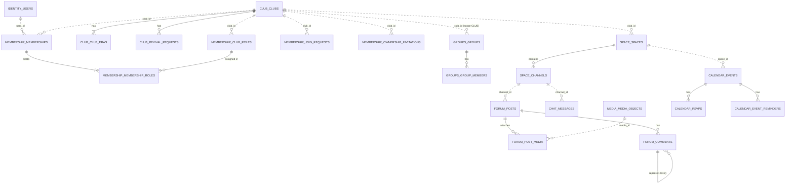

# 04 — Database (PostgreSQL 17)

## 1. Principles

| Principle | Rule |
|-----------|------|
| **One database, one schema per module** (R-04) | `identity`, `club`, `membership`, `groups`, `space`, `media`, `forum`, `chat`, `calendar`, `notification`, `discovery`, `history`. A module's entities map **only** to its own schema. |
| **No cross-schema foreign keys** | References to another module's data are plain `uuid` columns (e.g. `forum.posts.author_id`). Integrity across modules is handled by events and by never hard-deleting referenced rows (users are disabled, clubs archived, content soft-deleted). Foreign keys *inside* a schema are used normally. |
| **IDs** | `uuid` generated in Java (v4). `chat.messages.id` is `bigint generated always as identity` (cheap, ordered keyset). |
| **Time** | `timestamptz`, always UTC (`hibernate.jdbc.time_zone=UTC`). Java truncates to microseconds before persisting, so keyset cursors are exact. |
| **Enums** | `varchar` + `CHECK` constraint (readable, easy to extend with a migration). |
| **Soft deletes** | `deleted_at` / `deleted_by` / `archived_at` columns; no `DELETE` on user content. |
| **Optimistic locking** | `version bigint` on aggregates edited concurrently. |
| **Business invariants in the DB too** | Partial unique indexes for "one active membership", "one pending request", "one reaction per emoji", and so on. They are the last line of defence against races. |
| **Arrays where they fit** | `text[]` for tags and permissions, `uuid[]` for access-rule groups and chat attachments (small, always read with the row). |

## 2. Overview (logical references)



Solid lines are foreign keys inside a schema. Dotted lines are logical references across schemas (UUID only).

## 3. Migrations (Flyway)

- Location: `backend/src/main/resources/db/migration/`, **one sub-folder per module** (Flyway scans recursively).
- **Version = timestamp** (`V202610171030__…`), so three developers never collide on version numbers.
- Never edit an applied migration. Add a new one.
- `spring.jpa.hibernate.ddl-auto=validate` makes the app refuse to start if entities and schema disagree.

```text
db/migration/
├── shared/V202610171200__modulith_event_publication.sql
├── shared/V202610172111__module_schemas_and_extensions.sql
├── identity/V202610170910__identity_init.sql
├── club/V202610170920__club_init.sql
├── membership/V202610170930__membership_init.sql
├── groups/V202610170940__groups_init.sql
├── space/V202610170950__space_init.sql
├── media/V202610171000__media_init.sql
├── forum/V202610171010__forum_init.sql
├── chat/V202610171020__chat_init.sql
├── calendar/V202610171030__calendar_init.sql
├── notification/V202610171040__notification_init.sql
├── discovery/V202610171050__discovery_init.sql
└── history/V202610171100__history_init.sql
```

### 3.1 Base migrations (`shared/`)

In the repository this SQL is split in two files: `shared/V202610171200__modulith_event_publication.sql` (the outbox table) and `shared/V202610172111__module_schemas_and_extensions.sql` (schemas and `pg_trgm`).

```sql
-- Schemas are also created by Flyway (spring.flyway.create-schemas=true); repeated for clarity and idempotence.
create schema if not exists identity;
create schema if not exists club;
create schema if not exists membership;
create schema if not exists groups;
create schema if not exists space;
create schema if not exists media;
create schema if not exists forum;
create schema if not exists chat;
create schema if not exists calendar;
create schema if not exists notification;
create schema if not exists discovery;
create schema if not exists history;

create extension if not exists pg_trgm;   -- fuzzy name search (directory, user search)

-- Spring Modulith event publication registry (transactional outbox), JDBC flavour, PostgreSQL.
create table if not exists public.event_publication
(
    id               uuid                     not null primary key,
    listener_id      text                     not null,
    event_type       text                     not null,
    serialized_event text                     not null,
    publication_date timestamp with time zone not null,
    completion_date  timestamp with time zone
);
create index if not exists event_publication_serialized_event_hash_idx
    on public.event_publication using hash (serialized_event);
create index if not exists event_publication_by_completion_date_idx
    on public.event_publication (completion_date);
```

## 4. Schemas (complete DDL)

### 4.1 identity

```sql
create table identity.users
(
    id            uuid primary key,
    auth_provider varchar(16)  not null check (auth_provider in ('FORTY_TWO', 'LOCAL')),
    ft_id         bigint unique,
    login         varchar(64)  not null,
    email         varchar(320),
    display_name  varchar(128) not null,
    avatar_url    text,
    password_hash varchar(255),
    platform_role varchar(16)  not null default 'USER' check (platform_role in ('USER', 'ADMIN')),
    status        varchar(16)  not null default 'ACTIVE' check (status in ('ACTIVE', 'DISABLED')),
    ft_pool_year  integer,
    ft_pool_month varchar(16),
    ft_alumni     boolean      not null default false,
    ft_staff      boolean      not null default false,
    created_at    timestamptz  not null,
    updated_at    timestamptz  not null,
    last_login_at timestamptz,
    version       bigint       not null default 0,
    constraint ck_users_provider_fields check (
        (auth_provider = 'FORTY_TWO' and ft_id is not null and password_hash is null) or
        (auth_provider = 'LOCAL' and ft_id is null and password_hash is not null))
);
create unique index ux_users_login on identity.users (lower(login));                       -- BR-23
create index ix_users_admins on identity.users (platform_role) where platform_role = 'ADMIN';
create index ix_users_display_name_trgm on identity.users using gin (lower(display_name) gin_trgm_ops);
```

### 4.2 club

```sql
create table club.clubs
(
    id              uuid primary key,
    slug            varchar(40) not null unique,                                          -- BR-01
    name            varchar(60) not null,
    tagline         varchar(140),
    description     text,
    category        varchar(32) not null,
    tags            text[]      not null default '{}',
    avatar_media_id uuid,
    banner_media_id uuid,
    status          varchar(20) not null check (status in ('PENDING_APPROVAL', 'ACTIVE', 'REJECTED', 'ARCHIVED')),
    join_policy     varchar(16) not null default 'APPROVAL' check (join_policy in ('OPEN', 'APPROVAL')),
    founder_id      uuid        not null,
    current_era     integer     not null default 0,
    review_note     text,
    reviewed_by     uuid,
    reviewed_at     timestamptz,
    created_at      timestamptz not null,
    updated_at      timestamptz not null,
    version         bigint      not null default 0
);
create index ix_clubs_status_created on club.clubs (status, created_at);
create index ix_clubs_founder_status on club.clubs (founder_id, status);

create table club.club_eras
(
    club_id      uuid        not null references club.clubs (id),
    era_number   integer     not null,
    started_at   timestamptz not null,
    start_reason varchar(16) not null check (start_reason in ('FOUNDED', 'REVIVED')),
    ended_at     timestamptz,
    end_reason   text,
    primary key (club_id, era_number)
);

create table club.revival_requests
(
    id           uuid primary key,
    club_id      uuid        not null references club.clubs (id),
    requester_id uuid        not null,
    motivation   text        not null,
    status       varchar(16) not null check (status in ('PENDING', 'APPROVED', 'REJECTED')),
    reviewed_by  uuid,
    review_note  text,
    reviewed_at  timestamptz,
    created_at   timestamptz not null,
    version      bigint      not null default 0
);
create unique index ux_revival_pending_per_requester
    on club.revival_requests (club_id, requester_id) where status = 'PENDING';
create index ix_revival_status_created on club.revival_requests (status, created_at);
```

### 4.3 membership

```sql
create table membership.club_roles
(
    id          uuid primary key,
    club_id     uuid        not null,
    name        varchar(40) not null,
    color       varchar(16),
    system_role varchar(16) check (system_role in ('OWNER', 'MEMBER')),
    permissions text[]      not null default '{}',
    position    integer     not null default 0,
    created_at  timestamptz not null,
    version     bigint      not null default 0
);
create unique index ux_club_roles_name on membership.club_roles (club_id, lower(name));
create unique index ux_club_roles_system on membership.club_roles (club_id, system_role) where system_role is not null;

create table membership.memberships
(
    id        uuid primary key,
    club_id   uuid        not null,
    user_id   uuid        not null,
    status    varchar(16) not null check (status in ('ACTIVE', 'LEFT', 'REMOVED')),
    joined_at timestamptz not null,
    ended_at  timestamptz,
    ended_by  uuid,
    version   bigint      not null default 0
);
create unique index ux_memberships_active on membership.memberships (club_id, user_id) where status = 'ACTIVE'; -- BR-07
create index ix_memberships_user_active on membership.memberships (user_id) where status = 'ACTIVE';
create index ix_memberships_club_active on membership.memberships (club_id, joined_at) where status = 'ACTIVE';

create table membership.membership_roles
(
    membership_id uuid not null references membership.memberships (id) on delete cascade,
    role_id       uuid not null references membership.club_roles (id) on delete cascade,
    primary key (membership_id, role_id)
);
create index ix_membership_roles_role on membership.membership_roles (role_id);

create table membership.join_requests
(
    id         uuid primary key,
    club_id    uuid        not null,
    user_id    uuid        not null,
    message    varchar(500),
    status     varchar(16) not null check (status in ('PENDING', 'APPROVED', 'REJECTED', 'CANCELLED')),
    decided_by uuid,
    decided_at timestamptz,
    created_at timestamptz not null,
    version    bigint      not null default 0
);
create unique index ux_join_requests_pending on membership.join_requests (club_id, user_id) where status = 'PENDING'; -- BR-07
create index ix_join_requests_club_status on membership.join_requests (club_id, status, created_at);

create table membership.ownership_invitations
(
    id                  uuid primary key,
    club_id             uuid        not null,
    invitee_id          uuid        not null,
    invited_by          uuid        not null,
    step_down_on_accept boolean     not null default false,
    status              varchar(16) not null check (status in ('PENDING', 'ACCEPTED', 'DECLINED', 'REVOKED', 'EXPIRED')),
    created_at          timestamptz not null,
    expires_at          timestamptz not null,
    responded_at        timestamptz,
    version             bigint      not null default 0
);
create unique index ux_invitations_pending on membership.ownership_invitations (club_id, invitee_id) where status = 'PENDING'; -- BR-06
create index ix_invitations_expiry on membership.ownership_invitations (expires_at) where status = 'PENDING';
```

### 4.4 groups

```sql
create table groups.groups
(
    id          uuid primary key,
    scope       varchar(8)  not null check (scope in ('CLUB', 'CAMPUS')),
    club_id     uuid,
    name        varchar(80) not null,
    slug        varchar(80) not null,
    description text,
    source      varchar(8)  not null check (source in ('MANUAL', 'SYNCED')),
    created_by  uuid,
    created_at  timestamptz not null,
    version     bigint      not null default 0,
    constraint ck_groups_scope check (
        (scope = 'CLUB' and club_id is not null and source = 'MANUAL') or
        (scope = 'CAMPUS' and club_id is null))
);
create unique index ux_groups_campus_slug on groups.groups (slug) where scope = 'CAMPUS';
create unique index ux_groups_club_slug on groups.groups (club_id, slug) where scope = 'CLUB';

create table groups.group_members
(
    group_id uuid        not null references groups.groups (id) on delete cascade,
    user_id  uuid        not null,
    added_by uuid,
    added_at timestamptz not null,
    primary key (group_id, user_id)
);
create index ix_group_members_user on groups.group_members (user_id);
```

### 4.5 space

```sql
create table space.spaces
(
    id              uuid primary key,
    club_id         uuid        not null,
    name            varchar(60) not null,
    slug            varchar(60) not null,
    description     text,
    position        integer     not null default 0,
    read_level      varchar(16) not null check (read_level in ('PUBLIC', 'CLUB_MEMBERS', 'GROUPS')),
    read_group_ids  uuid[]      not null default '{}',
    write_level     varchar(16) not null check (write_level in ('PUBLIC', 'CLUB_MEMBERS', 'GROUPS')),
    write_group_ids uuid[]      not null default '{}',
    created_at      timestamptz not null,
    archived_at     timestamptz,
    version         bigint      not null default 0
);
create unique index ux_spaces_club_slug on space.spaces (club_id, slug);
create index ix_spaces_club_position on space.spaces (club_id, position);

create table space.channels
(
    id          uuid primary key,
    space_id    uuid        not null references space.spaces (id),
    type        varchar(8)  not null check (type in ('FORUM', 'CHAT')),
    name        varchar(60) not null,
    slug        varchar(60) not null,
    description text,
    position    integer     not null default 0,
    created_at  timestamptz not null,
    archived_at timestamptz
);
create unique index ux_channels_space_slug on space.channels (space_id, slug);
```

### 4.6 media

```sql
create table media.media_objects
(
    id                uuid primary key,
    owner_id          uuid         not null,
    purpose           varchar(24)  not null check (purpose in
        ('POST_ATTACHMENT', 'CHAT_ATTACHMENT', 'CLUB_AVATAR', 'CLUB_BANNER', 'EVENT_COVER')),
    kind              varchar(8)   not null check (kind in ('IMAGE', 'VIDEO', 'AUDIO')),
    content_type      varchar(100) not null,
    size_bytes        bigint       not null check (size_bytes > 0),
    original_filename varchar(255),
    bucket            varchar(63)  not null,
    storage_key       text         not null unique,
    status            varchar(16)  not null check (status in ('PENDING', 'READY', 'ATTACHED', 'DELETED')),
    created_at        timestamptz  not null,
    attached_at       timestamptz,
    version           bigint       not null default 0
);
create index ix_media_orphans on media.media_objects (created_at) where status in ('PENDING', 'READY');
```

### 4.7 forum

```sql
create table forum.posts
(
    id               uuid primary key,
    channel_id       uuid        not null,
    space_id         uuid        not null,
    club_id          uuid        not null,
    author_id        uuid        not null,
    era              integer     not null,
    title            varchar(140),
    body             text        not null,
    pinned           boolean     not null default false,
    status           varchar(16) not null check (status in ('PUBLISHED', 'DELETED')),
    comment_count    integer     not null default 0,
    created_at       timestamptz not null,
    last_activity_at timestamptz not null,
    edited_at        timestamptz,
    deleted_at       timestamptz,
    deleted_by       uuid,
    version          bigint      not null default 0
);
create index ix_posts_channel_created on forum.posts (channel_id, created_at desc, id desc);
create index ix_posts_channel_era_created on forum.posts (channel_id, era, created_at desc, id desc);
create index ix_posts_channel_pinned on forum.posts (channel_id) where pinned;
create index ix_posts_club_created on forum.posts (club_id, created_at desc);

create table forum.post_media
(
    post_id  uuid    not null references forum.posts (id),
    position integer not null,
    media_id uuid    not null,
    primary key (post_id, position)
);

create table forum.comments
(
    id         uuid primary key,
    post_id    uuid        not null references forum.posts (id),
    parent_id  uuid references forum.comments (id),
    author_id  uuid        not null,
    body       text        not null,
    created_at timestamptz not null,
    edited_at  timestamptz,
    deleted_at timestamptz,
    deleted_by uuid
);
create index ix_comments_post_created on forum.comments (post_id, created_at, id);

create table forum.reactions
(
    id          uuid primary key,
    target_type varchar(8)  not null check (target_type in ('POST', 'COMMENT')),
    target_id   uuid        not null,
    user_id     uuid        not null,
    emoji       varchar(32) not null,
    created_at  timestamptz not null
);
create unique index ux_reactions_unique on forum.reactions (target_type, target_id, user_id, emoji); -- BR-18
```

### 4.8 chat

```sql
create table chat.messages
(
    id           bigint generated always as identity primary key,
    channel_id   uuid        not null,
    space_id     uuid        not null,
    club_id      uuid        not null,
    author_id    uuid        not null,
    era          integer     not null,
    body         text        not null,
    media_ids    uuid[]      not null default '{}',
    client_nonce uuid        not null,
    created_at   timestamptz not null,
    edited_at    timestamptz,
    deleted_at   timestamptz,
    deleted_by   uuid
);
create index ix_messages_channel_id on chat.messages (channel_id, id desc);
create index ix_messages_channel_era_id on chat.messages (channel_id, era, id desc);
create unique index ux_messages_nonce on chat.messages (channel_id, author_id, client_nonce);
```

### 4.9 calendar

```sql
create table calendar.events
(
    id             uuid primary key,
    club_id        uuid         not null,
    space_id       uuid         not null,
    era            integer      not null,
    created_by     uuid         not null,
    title          varchar(140) not null,
    description    text,
    location       varchar(200),
    online_url     text,
    starts_at      timestamptz  not null,
    ends_at        timestamptz  not null,
    status         varchar(16)  not null check (status in ('SCHEDULED', 'CANCELLED')),
    cover_media_id uuid,
    cancel_reason  text,
    created_at     timestamptz  not null,
    updated_at     timestamptz  not null,
    version        bigint       not null default 0,
    constraint ck_events_times check (ends_at > starts_at)                                      -- BR-21
);
create index ix_events_starts on calendar.events (starts_at);
create index ix_events_club_starts on calendar.events (club_id, starts_at);

create table calendar.rsvps
(
    event_id   uuid        not null references calendar.events (id),
    user_id    uuid        not null,
    status     varchar(16) not null check (status in ('GOING', 'INTERESTED', 'NOT_GOING')),
    updated_at timestamptz not null,
    primary key (event_id, user_id)
);
create index ix_rsvps_user on calendar.rsvps (user_id);

create table calendar.event_reminders
(
    id        uuid primary key,
    event_id  uuid        not null references calendar.events (id),
    kind      varchar(16) not null check (kind in ('DAY_BEFORE', 'HOUR_BEFORE')),
    remind_at timestamptz not null,
    sent_at   timestamptz
);
create index ix_reminders_due on calendar.event_reminders (remind_at) where sent_at is null;

create table calendar.feed_tokens
(
    user_id    uuid primary key,
    token_hash char(64)    not null unique,                                                     -- hex SHA-256
    created_at timestamptz not null
);
```

### 4.10 notification

```sql
create table notification.notifications
(
    id               uuid primary key,
    recipient_id     uuid         not null,
    type             varchar(40)  not null,
    title            varchar(200) not null,
    body             text,
    link             text,
    data             jsonb        not null default '{}',
    dedup_key        varchar(200) not null,
    in_app           boolean      not null,
    email_requested  boolean      not null,
    email_sent_at    timestamptz,
    email_attempts   integer      not null default 0,
    email_next_attempt_at timestamptz,                                                 -- backoff (R-27)
    email_last_error text,
    read_at          timestamptz,
    created_at       timestamptz  not null
);
create unique index ux_notifications_dedup on notification.notifications (recipient_id, dedup_key);
create index ix_notifications_inbox on notification.notifications (recipient_id, created_at desc, id desc) where in_app;
create index ix_notifications_unread on notification.notifications (recipient_id) where in_app and read_at is null;
create index ix_notifications_email_pending on notification.notifications (email_next_attempt_at, created_at)
    where email_requested and email_sent_at is null;

create table notification.preferences
(
    user_id uuid        not null,
    type    varchar(40) not null,
    in_app  boolean     not null,
    email   boolean     not null,
    primary key (user_id, type)
);
```

### 4.11 discovery

```sql
create table discovery.club_cards
(
    club_id          uuid primary key,
    slug             varchar(40) not null,
    name             varchar(60) not null,
    tagline          varchar(140),
    description      text,
    category         varchar(32),
    tags             text[]      not null default '{}',
    avatar_url       text,
    banner_url       text,
    status           varchar(20) not null,
    join_policy      varchar(16),
    current_era      integer     not null default 1,
    member_count     integer     not null default 0,
    founded_at       timestamptz,
    last_activity_at timestamptz,
    search_document  text,
    search           tsvector generated always as (to_tsvector('simple', coalesce(search_document, ''))) stored,
    updated_at       timestamptz not null
);
create unique index ux_club_cards_slug on discovery.club_cards (slug);
create index ix_club_cards_search on discovery.club_cards using gin (search);
create index ix_club_cards_name_trgm on discovery.club_cards using gin (name gin_trgm_ops);
create index ix_club_cards_tags on discovery.club_cards using gin (tags);
create index ix_club_cards_status_activity on discovery.club_cards (status, last_activity_at desc);
create index ix_club_cards_category on discovery.club_cards (category, status);
```

### 4.12 history

```sql
create table history.timeline_entries
(
    id          uuid primary key,
    club_id     uuid         not null,
    era         integer      not null,
    type        varchar(32)  not null,
    actor_id    uuid,
    subject_id  uuid,
    data        jsonb        not null default '{}',
    occurred_at timestamptz  not null,
    dedup_key   varchar(200) not null
);
create unique index ux_timeline_dedup on history.timeline_entries (club_id, dedup_key);
create index ix_timeline_club_occurred on history.timeline_entries (club_id, occurred_at desc, id desc);
```

## 5. Key query patterns

### 5.1 Keyset pagination (feeds, inbox, timeline)

```sql
-- Page n+1 of a channel, newest first; (:cursor_at, :cursor_id) from the last row of page n.
select *
from forum.posts
where channel_id = :channel_id
  and (created_at, id) < (:cursor_at, :cursor_id)
order by created_at desc, id desc
limit 21;                                  -- 20 + 1 to know whether a next page exists
```

Served by `ix_posts_channel_created`. The cost is the same at page 1 and page 10 000. (The JPQL in the forum module expresses the same row comparison with `<` / `=` / `<`.)

### 5.2 Effective permissions (hot path)

```sql
select r.system_role, r.permissions
from membership.memberships m
join membership.membership_roles mr on mr.membership_id = m.id
join membership.club_roles r on r.id = mr.role_id
where m.club_id = :club_id and m.user_id = :user_id and m.status = 'ACTIVE';
```

Uses `ux_memberships_active` → PK of `membership_roles` → PK of `club_roles`: three index lookups.

### 5.3 Claiming work across N instances

```sql
select * from calendar.event_reminders
where sent_at is null and remind_at <= now()
order by remind_at
limit 100
for update skip locked;
```

Same pattern for `media.media_objects` (orphans) and `notification.notifications` (email outbox).

### 5.4 Directory search

```sql
select club_id, slug, name, tagline, category, avatar_url, status, member_count, last_activity_at
from discovery.club_cards
where status in ('ACTIVE')
  and (search @@ plainto_tsquery('simple', :q) or name ilike '%' || :q || '%')
  and category = :category
  and tags @> array[:tag]::text[]
order by last_activity_at desc nulls last
limit 20 offset 0;
```

GIN (`search`), trigram (`name`) and GIN (`tags`) indexes. The `DirectorySearchRepository` only appends the filters that are present. Use `tags @> array[:tag]` (indexable) rather than `:tag = any(tags)`.

## 6. Data lifecycle

| Data | Policy |
|------|--------|
| Users | Never deleted; `DISABLED`. (GDPR erasure, if needed: anonymise `login`, `email`, `display_name`, `avatar_url` while keeping the UUID.) |
| Clubs | Never deleted; `ARCHIVED` / `REJECTED`. |
| Posts, comments, chat | Soft delete only (BR-16); bodies kept for history and moderation audit. |
| Media | Orphans deleted after 24 h; attached media kept with their content. |
| `event_publication` | Completed publications deleted after 7 days by a scheduled job ([06-messaging-and-realtime.md](06-messaging-and-realtime.md#3-reliable-domain-events-the-outbox)). |
| Notifications | Keep 180 days (job deletes older, read rows). |

## 7. Operations

- **Backups**: nightly `pg_dump -Fc` of the `vclubroom` database to a mounted volume (see [09-deployment.md](09-deployment.md#12-operations)), plus the SeaweedFS data volume.
- **Connection pool**: Hikari `maximum-pool-size` 20 per instance; with N instances keep `N × 20 < max_connections` (Postgres default 100), or add PgBouncer.
- **Growth path**: read replicas for `discovery` and the inbox (route read-only transactions); declarative partitioning of `chat.messages` and `notification.notifications` by month; moving a module's schema to its own database when extracting it as a service. There are no cross-schema FKs to untangle.
