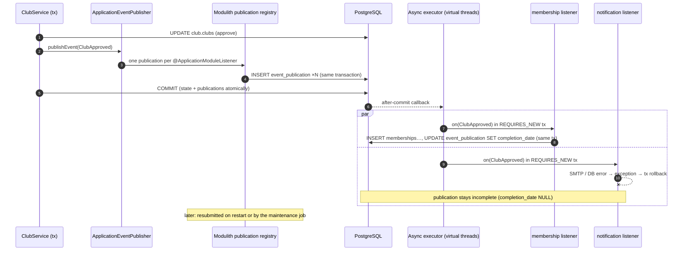
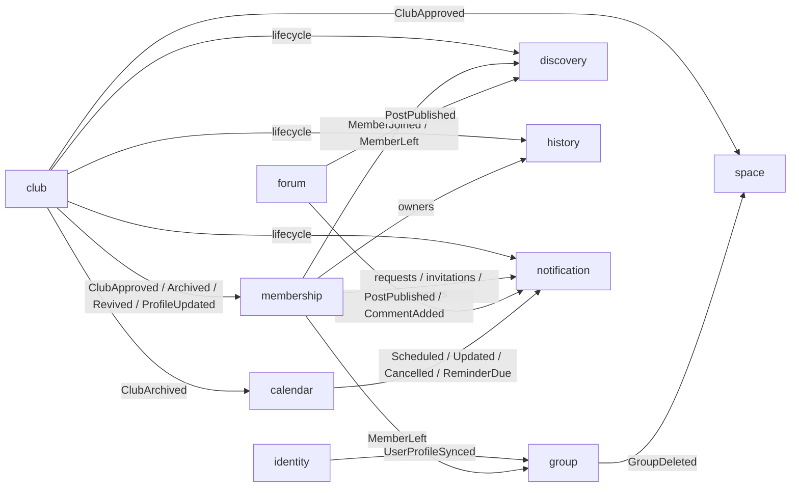
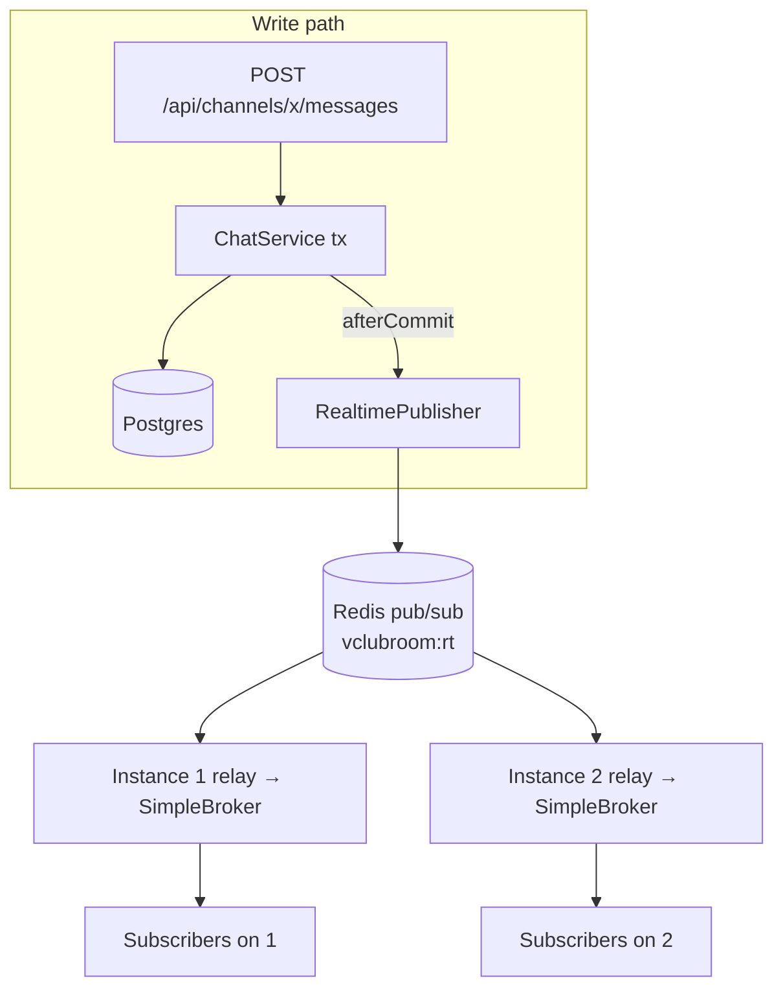

# 06 — Messaging and Real-time

## 1. Should we use Kafka?

**Short answer: not now, but the design is Kafka-ready (D-02).** Asynchronous, event-driven communication between features is the right idea for loose coupling. Kafka is one *transport* for it, and for this project it costs more than it gives today.

### 1.1 What we actually need

| Need | Why |
|------|-----|
| Features react to each other without knowing each other | Club approval must trigger owner creation, a default space, a directory card, a timeline entry and a notification, without `ClubService` knowing any of those modules. |
| **No lost side effects** | If SMTP or a listener fails, the reaction must happen later, not silently vanish. |
| No "dual write" bug | The state change and the "event happened" record must commit together. |
| Real-time UI | Chat and live updates across several app instances. |
| Volume | Campus scale: hundreds to a few thousand users, peaks of tens of messages per second. |

### 1.2 Options compared

| Option | Reliability | Ops cost (2 days, 3 people) | Fit |
|--------|-------------|-----------------------------|-----|
| Plain Spring `@EventListener` | ❌ lost on crash, runs in caller's transaction | none | Too weak |
| **Spring Modulith events + JDBC event publication registry (outbox)** ✅ | ✅ stored in the **same transaction** as the state change; at-least-once; resubmitted after failure or restart | **none** (uses existing Postgres) | **Chosen** |
| RabbitMQ | ✅ (still needs an outbox to avoid dual writes) | +1 broker | Good for work queues; not needed |
| Kafka | ✅ durable log, replay, partitions (still needs an outbox to avoid dual writes) | +1 broker (KRaft), topics, consumer groups, offsets, serialization, harder local debugging | Shines with **many independent services/consumers** and high throughput, neither of which we have |
| Redis Streams | ⚠️ acceptable | Redis already present | Possible, but less tooling than the outbox |

Key point: **even with Kafka you would need a transactional outbox.** Otherwise "save club" can succeed while "send to Kafka" fails, or the reverse. Spring Modulith gives us the outbox for free, and with one dependency and one annotation it can forward the same events to Kafka later.

### 1.3 When to introduce Kafka

Introduce it when one or more of these become true:

1. A module is extracted into its own deployable (e.g. a notification service, analytics) and needs to consume events across processes.
2. Several independent consumers (data/analytics, other campuses, bots) want the event stream with **replay**.
3. Event throughput outgrows what a Postgres outbox comfortably handles (thousands per second, sustained).

How to do it without touching business code is in [§9](#9-migration-path-to-kafka).

---

## 2. Messaging taxonomy

| Kind | Guarantee | Mechanism | Examples |
|------|-----------|-----------|----------|
| **Domain events** | At-least-once, after commit, survives crashes | `ApplicationEventPublisher` + Spring Modulith event publication registry (`public.event_publication`) + `@ApplicationModuleListener` | `ClubApproved`, `MemberJoined`, `PostPublished`, `EventReminderDue` |
| **Real-time pushes** | Best effort, after commit | `RealtimePublisher` → Redis pub/sub → STOMP | New chat message, new comment, notification badge |
| **Work queues in the DB** | Exactly-once claim per row, retried | `SELECT … FOR UPDATE SKIP LOCKED` jobs | Event reminders, email outbox, orphan media cleanup |

Rule: **anything that must eventually happen is a domain event or a DB work item. A push is only a UX accelerator.**

---

## 3. Reliable domain events: the outbox



### 3.1 Configuration

```yaml
spring:
  modulith:
    events:
      republish-outstanding-events-on-restart: true   # resubmit incomplete publications at startup
      jdbc:
        schema-initialization:
          enabled: false                              # table created by Flyway (04-database.md §3.1)
```

`@ApplicationModuleListener` = `@Async` + `@Transactional(propagation = REQUIRES_NEW)` + `@TransactionalEventListener(AFTER_COMMIT)`. It requires `@EnableAsync` (on `ClubroomApplication`). With `spring.threads.virtual.enabled=true` the async executor uses virtual threads.

### 3.2 Maintenance job (resubmission + cleanup)

```java
package pt.vclubroom.shared.config;

import java.time.Duration;
import org.springframework.modulith.events.CompletedEventPublications;
import org.springframework.modulith.events.IncompleteEventPublications;
import org.springframework.scheduling.annotation.Scheduled;
import org.springframework.stereotype.Component;

/**
 * Retries publications whose listener failed (e.g. transient DB/SMTP errors) and purges old completed ones.
 * With N instances, a publication can occasionally be retried twice; listeners are idempotent by design.
 */
@Component
class EventPublicationMaintenance {

    private final IncompleteEventPublications incomplete;
    private final CompletedEventPublications completed;

    EventPublicationMaintenance(IncompleteEventPublications incomplete, CompletedEventPublications completed) {
        this.incomplete = incomplete;
        this.completed = completed;
    }

    @Scheduled(fixedDelayString = "PT1M", initialDelayString = "PT1M")
    void resubmitStuckPublications() {
        incomplete.resubmitIncompletePublicationsOlderThan(Duration.ofMinutes(2));
    }

    @Scheduled(cron = "0 30 3 * * *")
    void purgeCompletedPublications() {
        completed.deletePublicationsOlderThan(Duration.ofDays(7));
    }
}
```

### 3.3 Listener rules (all modules)

| Rule | How it's applied in this design |
|------|----------------------------------|
| **Idempotent** (at-least-once delivery) | Existence checks (`existsActive` before admitting the founder), `INSERT … ON CONFLICT DO NOTHING` with dedup keys (notifications, timeline), upserts with `updated_at` guards (discovery), recompute instead of increment (member counts). |
| **Order-independent** | No global ordering between listeners or events. Projections converge regardless of order (discovery placeholder card, `updated_at` guard). |
| **Own transaction, own module** | A listener writes only to its own module's schema. |
| **Small and fast** | Heavy or external work (emails) goes to a DB work queue (email outbox) instead of running inside the listener. |
| **Observable** | Failures are logged with the event type. `/actuator/modulith` shows the module graph; a simple admin query on `event_publication where completion_date is null` shows the backlog. |

### 3.4 Eventual consistency in the UI

Reactions happen milliseconds after the triggering commit. The SPA handles the short window explicitly:

- After **approval**, the admin UI just shows "approved". The founder's club page invalidates queries on the `CLUB_APPROVED` notification push.
- After **joining an OPEN club**, the membership is created synchronously (same transaction), so it is immediately consistent. Only the directory member count (a projection) lags.
- After **creating a post**, the author gets the post in the HTTP response, and other viewers get the push.

---

## 4. Event design conventions

1. **Past-tense facts**, named after the domain (`ClubArchived`, not `ArchiveClubCommand`).
2. **Immutable Java records** in the publishing module's `events` package (a Spring Modulith named interface).
3. **IDs plus the minimal facts consumers need** (e.g. `ClubProfileUpdated` carries the public profile so the directory never calls back). Never entities, never secrets.
4. Always an `occurredAt` (`Instant`), taken from the injected `Clock`.
5. **Additive evolution only.** Add fields; never rename or remove fields of an event that may still sit unprocessed in `event_publication`. For breaking changes, create a new event type and dual-publish during the transition.
6. Serialized as JSON by Spring Modulith (Jackson). Records must be Jackson-friendly (public accessors, simple types).

---

## 5. Event catalogue

| Event | Publisher | Payload (besides `occurredAt`) | Consumers |
|-------|-----------|--------------------------------|-----------|
| `UserRegistered` | identity | `userId, login, provider` | — (available for future onboarding) |
| `UserProfileSynced` | identity | `userId, login, poolYear, poolMonth, campusNames[], cursusSlugs[], alumni` | group |
| `ClubCreationRequested` | club | `clubId, slug, name, founderId` | notification, history |
| `ClubApproved` | club | `clubId, slug, name, founderId, approvedBy, era` | membership, space, discovery, history, notification |
| `ClubRejected` | club | `clubId, name, founderId, rejectedBy, reason` | notification |
| `ClubProfileUpdated` | club | `clubId, slug, name, tagline, description, category, tags[], avatarMediaId, bannerMediaId, joinPolicy, status, currentEra` | discovery, membership (OPEN → auto-approve) |
| `ClubArchived` | club | `clubId, name, endedEra, archivedBy, reason` | membership, calendar, history, notification |
| `ClubRevivalRequested` | club | `requestId, clubId, clubName, requesterId` | notification |
| `ClubRevived` | club | `clubId, name, newEra, newOwnerId, approvedBy, requestId` | membership, history, notification |
| `MemberJoined` | membership | `clubId, userId, membershipId, via` | discovery |
| `MemberLeft` | membership | `clubId, userId, membershipId, reason, by` | group, discovery |
| `JoinRequested` | membership | `requestId, clubId, userId` | notification |
| `JoinRequestDecided` | membership | `requestId, clubId, userId, approved, decidedBy` | notification |
| `OwnershipInvitationSent` | membership | `invitationId, clubId, inviteeId, invitedBy, transfer, expiresAt` | notification |
| `OwnerAdded` | membership | `clubId, userId, reason, by` | history, notification |
| `OwnerSteppedDown` | membership | `clubId, userId` | history, notification |
| `OwnerRemoved` | membership | `clubId, userId, reason, by` | history, notification |
| `MemberRolesChanged` | membership | `clubId, userId, roleIds[], by` | — (future permission-cache eviction) |
| `GroupDeleted` | group | `groupId, scope, clubId` | space |
| `PostPublished` | forum | `postId, channelId, spaceId, clubId, authorId, era, title, excerpt` | notification, discovery |
| `CommentAdded` | forum | `commentId, postId, parentId, clubId, spaceId, authorId, postAuthorId, parentAuthorId, excerpt` | notification |
| `EventScheduled` | calendar | `eventId, clubId, spaceId, title, startsAt, endsAt, createdBy` | notification |
| `EventUpdated` | calendar | `eventId, clubId, spaceId, title, startsAt, endsAt` | notification |
| `EventCancelled` | calendar | `eventId, clubId, title, startsAt, reason` | notification |
| `EventReminderDue` | calendar | `eventId, clubId, spaceId, title, startsAt, kind` | notification |



---

## 6. Real-time architecture (summary)

The full design and code are in [03-backend/realtime.md](03-backend/realtime.md). In short:

- **STOMP over WebSocket** at `/ws`, authenticated by the HTTP session cookie, origin-checked.
- **Push-only** (R-03): writes go through REST (one validation, CSRF, error path; even load balancing).
- **Fan-out via Redis pub/sub**: every instance publishes to the `vclubroom:rt` channel and every instance relays into its local simple broker. No sticky sessions.
- **After-commit**: `RealtimePublisher` defers pushes with a `TransactionSynchronization`.
- **Authorization at subscribe time** via `SubscriptionAuthorizer` implementations in chat and forum (`SpaceAccessPolicy.canRead`). Unknown destinations are denied.
- **Client reconciliation**: on reconnect, invalidate queries; dedupe chat by `clientNonce`/`id`.



---

## 7. Failure scenarios

| Scenario | What happens |
|----------|--------------|
| SMTP down | Email outbox rows stay pending, retried every 30 s (≤ 5 attempts). In-app notifications are unaffected. |
| Notification listener throws | Its publication stays incomplete and is resubmitted after 2 min (maintenance job) or at restart. Other listeners are unaffected. |
| App instance crashes after commit, before listeners ran | Publications are incomplete and get resubmitted at the next startup of any instance (`republish-outstanding-events-on-restart`) or by the maintenance job. |
| Redis down | Real-time pushes are lost (logged). Sessions are unavailable, so users get 401 until Redis returns (Redis is critical infrastructure, so give it a restart policy). Domain events are unaffected (Postgres). |
| Postgres down | The app is down (system of record). Health checks fail and the orchestrator restarts it. |
| Duplicate delivery | Idempotent listeners make it a no-op (§3.3). |

---

## 8. Observability

- `/actuator/modulith`: module structure.
- `select listener_id, event_type, count(*) from public.event_publication where completion_date is null group by 1, 2;` gives the backlog per listener (worth an admin dashboard card).
- Structured logs include the event type in listener failure logs.
- Micrometer metrics: `executor.*` (async pool), `hikaricp.*`, `spring.data.repository.invocations`, WebSocket session counts (`WebSocketMessageBrokerStats` logs every 30 min by default).

---

## 9. Migration path to Kafka

No module code changes. Only configuration and annotations.

**Step 1.** Add the dependencies (versions managed by the Spring Modulith BOM and Spring Boot):

```xml
<dependency>
    <groupId>org.springframework.modulith</groupId>
    <artifactId>spring-modulith-events-kafka</artifactId>
</dependency>
<dependency>
    <groupId>org.springframework.kafka</groupId>
    <artifactId>spring-kafka</artifactId>
</dependency>
```

**Step 2.** Mark the events that should leave the process. The key expression decides the partition, so all events of one club stay ordered:

```java
package pt.vclubroom.club.events;

import java.time.Instant;
import java.util.UUID;
import org.springframework.modulith.events.Externalized;

@Externalized("vclubroom.club-events::#{clubId()}")
public record ClubApproved(UUID clubId, String slug, String name, UUID founderId, UUID approvedBy,
                           int era, Instant occurredAt) {
}
```

**Step 3.** Configure the broker:

```yaml
spring:
  kafka:
    bootstrap-servers: ${KAFKA_BOOTSTRAP:kafka:9092}
    producer:
      value-serializer: org.springframework.kafka.support.serializer.JsonSerializer
  modulith:
    events:
      externalization:
        enabled: true
```

**Step 4.** Add the broker to compose (single-node KRaft):

```yaml
services:
  kafka:
    image: apache/kafka:4.3.1
    environment:
      KAFKA_NODE_ID: 1
      KAFKA_PROCESS_ROLES: broker,controller
      KAFKA_LISTENERS: PLAINTEXT://:9092,CONTROLLER://:9093
      KAFKA_ADVERTISED_LISTENERS: PLAINTEXT://kafka:9092
      KAFKA_CONTROLLER_LISTENER_NAMES: CONTROLLER
      KAFKA_LISTENER_SECURITY_PROTOCOL_MAP: CONTROLLER:PLAINTEXT,PLAINTEXT:PLAINTEXT
      KAFKA_CONTROLLER_QUORUM_VOTERS: 1@kafka:9093
      KAFKA_OFFSETS_TOPIC_REPLICATION_FACTOR: 1
```

**What changes.** Externalized events are still delivered to in-process listeners **and** published to Kafka. Publication happens through the same registry, so the outbox guarantees still hold. When a module (say `notification`) is extracted into its own service, its listeners move there and become `@KafkaListener`s on `vclubroom.club-events`, `vclubroom.forum-events`, and so on. The publishing modules don't change.
