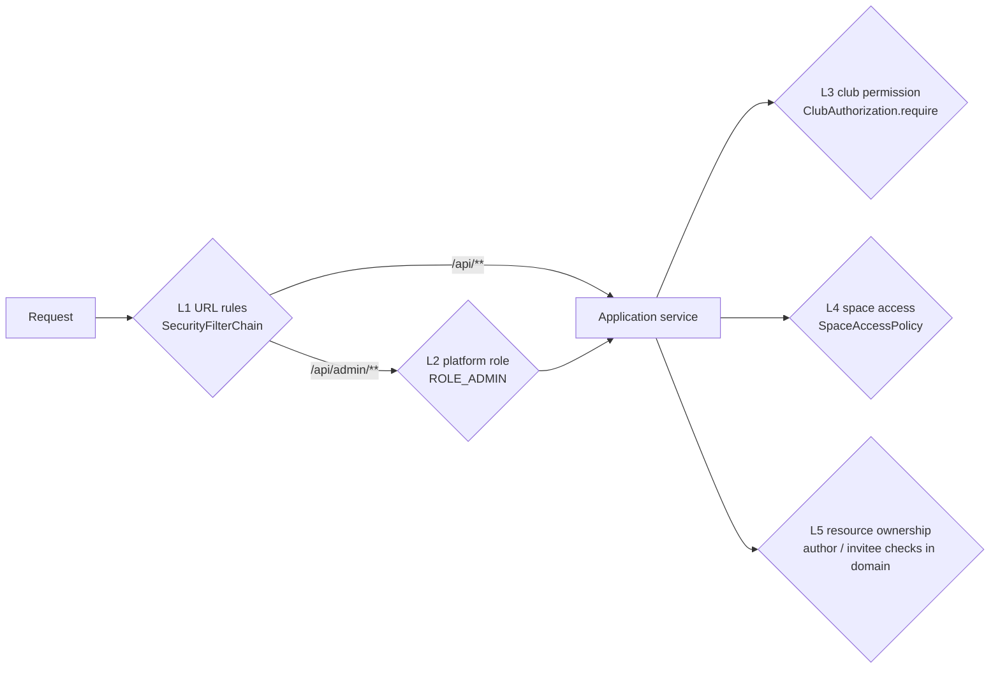

# 07 — Security

## 1. Threat model (summary)

| Threat | Mitigation |
|--------|------------|
| Session theft via XSS | Session in an **HttpOnly** cookie (R-02), React auto-escaping, Markdown rendered through `rehype-sanitize`, strict **CSP** from nginx. |
| CSRF (cookie-based auth) | Spring Security CSRF tokens (`XSRF-TOKEN` cookie → `X-XSRF-TOKEN` header) + `SameSite=Lax` session cookie. |
| Cross-site WebSocket hijacking | STOMP endpoint restricted to the app origin; CONNECT requires an authenticated session. |
| Session fixation | Session ID rotated on login (OAuth2 login and local login). |
| IDOR (guessing IDs) | Every read and write goes through module authorization (`ClubAuthorization`, `SpaceAccessPolicy`). Invisible resources return 404. |
| Privilege escalation in clubs | Anti-escalation rule for roles (BR-14); Owner not assignable through roles; only admins remove owners. |
| Malicious uploads | Content-type and size allowlist, server-side verification of the stored object, presigned URLs that expire in minutes, private bucket for attachments, `Content-Type` fixed at upload. |
| Brute force on local login | nginx `limit_req` on `/api/auth/login` keyed by the real client IP (`CF-Connecting-IP` behind Cloudflare); BCrypt; generic error message. |
| SQL injection | JPA/JDBC parameters everywhere; dynamic SQL appends only fixed fragments (directory search). |
| Open redirect after login | Fixed `defaultSuccessUrl("/")`; the SPA's `returnTo` is kept in `sessionStorage` and only accepted if it is a relative path. |
| Leaked iCal URL | Token only maps to "events this user can read"; stored hashed; rotatable. |
| Secrets in Git | All secrets via environment variables (`.env`, never committed); `.env.example` documents the keys. |

---

## 2. Authentication

### 2.1 Login with 42 (OAuth2 authorization code)

Full sequence in [identity.md §8.1](03-backend/identity.md#81-login-with-42-first-or-subsequent-login). Key points:

- **Register an application at** `https://profile.intra.42.fr/oauth/applications` (O-02). Redirect URIs:
  - dev: `http://localhost:5173/login/oauth2/code/fortytwo` (through the Vite proxy)
  - demo: `https://42clubroom.ensui.dev/login/oauth2/code/fortytwo` (D-33)
  - production with bocal: to be defined (O-02)
- Scope `public`; `client_secret_post`; endpoints `https://api.intra.42.fr/oauth/authorize`, `/oauth/token`, `/v2/me`.
- The password is typed on **42's** page. We receive an access token, call `/v2/me` once, provision or refresh our user, and **discard the token** (we don't call 42 later). Rate limits (2 req/s per app) are irrelevant at one call per login.
- `server.forward-headers-strategy=framework` makes `{baseUrl}` in the redirect URI correct behind nginx and Cloudflare. nginx forwards Cloudflare's `X-Forwarded-Proto: https` and the original `Host` (R-26).

### 2.2 Local accounts (D-09)

- Created by admins only (`POST /api/admin/users`) with a temporary password; the user changes it via `PUT /api/me/password`.
- `POST /api/auth/login` (JSON) → `DaoAuthenticationProvider` → **BCrypt** (`DelegatingPasswordEncoder`, `{bcrypt}` prefix allows future algorithm upgrades).
- Bootstrap admin from environment variables (R-09).

### 2.3 Sessions (R-02)

| Property | Value |
|----------|-------|
| Store | Redis via Spring Session (`vclubroom:session:*`), **indexed by principal name** (= user UUID) |
| Cookie | `SESSION`, `HttpOnly`, `Secure` (prod), `SameSite=Lax`, path `/` |
| Lifetime | 14 days idle timeout |
| Revocation | `SessionRevocationService.revokeAll(userId)` on disable or role change (BR-24) |
| Principal | `ClubroomOAuth2User` or `LocalPrincipal`, both implement `shared.security.AuthenticatedUser` (`userId()`, `admin()`) and are `Serializable` |
| Scaling | Any instance can serve any request: no sticky sessions |

`SameSite=Lax` still sends the cookie on the top-level GET redirect back from 42, so the OAuth callback works.

---

## 3. Security configuration

```java
package pt.vclubroom.identity.infrastructure.security;

import org.springframework.context.annotation.Bean;
import org.springframework.context.annotation.Configuration;
import org.springframework.http.HttpStatus;
import org.springframework.security.authentication.AuthenticationManager;
import org.springframework.security.authentication.ProviderManager;
import org.springframework.security.authentication.dao.DaoAuthenticationProvider;
import org.springframework.security.config.annotation.method.configuration.EnableMethodSecurity;
import org.springframework.security.config.annotation.web.builders.HttpSecurity;
import org.springframework.security.config.annotation.web.configuration.EnableWebSecurity;
import org.springframework.security.config.annotation.web.configurers.AbstractHttpConfigurer;
import org.springframework.security.crypto.factory.PasswordEncoderFactories;
import org.springframework.security.crypto.password.PasswordEncoder;
import org.springframework.security.web.SecurityFilterChain;
import org.springframework.security.web.authentication.HttpStatusEntryPoint;
import org.springframework.security.web.authentication.logout.HttpStatusReturningLogoutSuccessHandler;
import org.springframework.security.web.context.HttpSessionSecurityContextRepository;
import org.springframework.security.web.context.SecurityContextRepository;
import org.springframework.security.web.csrf.CookieCsrfTokenRepository;
import org.springframework.security.web.util.matcher.RequestMatcher;

@Configuration
@EnableWebSecurity
@EnableMethodSecurity
class SecurityConfig {

    /** API and WebSocket calls get a 401 instead of a redirect to the 42 login page. */
    private static final RequestMatcher API_OR_WS = request -> {
        String uri = request.getRequestURI();
        return uri.startsWith("/api/") || uri.equals("/ws") || uri.startsWith("/ws/");
    };

    @Bean
    SecurityFilterChain securityFilterChain(HttpSecurity http,
                                            FortyTwoOAuth2UserService fortyTwoUserService,
                                            SecurityContextRepository securityContextRepository) throws Exception {
        http
            .authorizeHttpRequests(auth -> auth
                .requestMatchers("/api/public/**", "/api/auth/login", "/api/auth/csrf").permitAll()
                .requestMatchers("/oauth2/**", "/login/oauth2/**").permitAll()
                .requestMatchers("/ical/**").permitAll()                         // token is the credential
                .requestMatchers("/error", "/actuator/health/**", "/actuator/info").permitAll()
                .requestMatchers("/v3/api-docs/**", "/swagger-ui/**", "/swagger-ui.html").permitAll() // disabled in prod
                .requestMatchers("/api/admin/**").hasRole("ADMIN")
                .requestMatchers("/api/**", "/ws", "/ws/**").authenticated()
                .anyRequest().denyAll())
            .securityContext(ctx -> ctx.securityContextRepository(securityContextRepository))
            // SPA-friendly CSRF: the XSRF-TOKEN cookie is readable by the frontend and echoed in X-XSRF-TOKEN.
            .csrf(csrf -> csrf
                .csrfTokenRepository(CookieCsrfTokenRepository.withHttpOnlyFalse())
                .csrfTokenRequestHandler(new SpaCsrfTokenRequestHandler()))
            .oauth2Login(oauth -> oauth
                .userInfoEndpoint(userInfo -> userInfo.userService(fortyTwoUserService))
                .defaultSuccessUrl("/", true)
                .failureUrl("/login?error"))
            .logout(logout -> logout
                .logoutUrl("/api/auth/logout")                                   // POST + CSRF
                .logoutSuccessHandler(new HttpStatusReturningLogoutSuccessHandler(HttpStatus.NO_CONTENT))
                .deleteCookies("SESSION"))
            .exceptionHandling(ex -> ex
                .defaultAuthenticationEntryPointFor(new HttpStatusEntryPoint(HttpStatus.UNAUTHORIZED), API_OR_WS))
            .formLogin(AbstractHttpConfigurer::disable)
            .httpBasic(AbstractHttpConfigurer::disable);
        return http.build();
    }

    @Bean
    SecurityContextRepository securityContextRepository() {
        return new HttpSessionSecurityContextRepository();     // backed by Spring Session → Redis
    }

    @Bean
    PasswordEncoder passwordEncoder() {
        return PasswordEncoderFactories.createDelegatingPasswordEncoder();   // {bcrypt} by default
    }

    /** Checks local username/password logins (AuthController). 42 logins go through oauth2Login above. */
    @Bean
    AuthenticationManager localAuthenticationManager(LocalUserDetailsService userDetailsService,
                                                     PasswordEncoder passwordEncoder) {
        DaoAuthenticationProvider provider = new DaoAuthenticationProvider(userDetailsService);
        provider.setPasswordEncoder(passwordEncoder);
        return new ProviderManager(provider);
    }
}
```

Compared with Spring Security's defaults: `/error` stays public so error responses keep their status under `denyAll`, and the local `DaoAuthenticationProvider` uses the Spring Security 6.5 API (`new DaoAuthenticationProvider(userDetailsService)` + `setPasswordEncoder`; the other constructor and `setUserDetailsService` are deprecated).

### 3.1 CSRF for a single-page app

The SPA reads the `XSRF-TOKEN` cookie (not HttpOnly by design; it is not a secret from the page itself) and echoes it in `X-XSRF-TOKEN`. Spring Security 6 uses BREACH-safe XOR-masked tokens for server-rendered pages. For an SPA, the raw cookie value must be accepted from the header. This is the handler recommended by the Spring Security reference for SPAs:

```java
package pt.vclubroom.identity.infrastructure.security;

import jakarta.servlet.http.HttpServletRequest;
import jakarta.servlet.http.HttpServletResponse;
import java.util.function.Supplier;
import org.springframework.security.web.csrf.CsrfToken;
import org.springframework.security.web.csrf.CsrfTokenRequestAttributeHandler;
import org.springframework.security.web.csrf.CsrfTokenRequestHandler;
import org.springframework.security.web.csrf.XorCsrfTokenRequestAttributeHandler;
import org.springframework.util.StringUtils;

final class SpaCsrfTokenRequestHandler implements CsrfTokenRequestHandler {

    private final CsrfTokenRequestHandler plain = new CsrfTokenRequestAttributeHandler();
    private final CsrfTokenRequestHandler xor = new XorCsrfTokenRequestAttributeHandler();

    @Override
    public void handle(HttpServletRequest request, HttpServletResponse response, Supplier<CsrfToken> csrfToken) {
        // BREACH protection for server-rendered responses that embed the token.
        this.xor.handle(request, response, csrfToken);
        // Load the deferred token so CookieCsrfTokenRepository writes the XSRF-TOKEN cookie on every response.
        csrfToken.get();
    }

    @Override
    public String resolveCsrfTokenValue(HttpServletRequest request, CsrfToken csrfToken) {
        String headerValue = request.getHeader(csrfToken.getHeaderName());
        // SPA sends the raw cookie value in the header → plain; form posts would send the masked value → xor.
        return (StringUtils.hasText(headerValue) ? this.plain : this.xor).resolveCsrfTokenValue(request, csrfToken);
    }
}
```

### 3.2 CORS

Not needed. The SPA, API, WebSocket and media share **one origin** (nginx in prod, the Vite proxy in dev). Leave CORS disabled: fewer moving parts and no misconfiguration risk.

---

## 4. Authorization: four layers



| Layer | Where | Example |
|-------|-------|---------|
| L1 URL | `SecurityConfig` | `/api/**` requires login; `/api/public/**` is open |
| L2 Platform role | URL rule + `Actor.admin()` checks in admin services | Approve club, archive, revival, local accounts, campus groups |
| L3 Club permission | `membership.api.ClubAuthorization` (always checks club `ACTIVE` for management actions) | `EVENT_MANAGE`, `MEMBER_APPROVE`, `ROLE_MANAGE` + anti-escalation |
| L4 Space access | `space.api.SpaceAccessPolicy` | Read/post in a channel, RSVP, subscribe to a topic |
| L5 Resource | Domain methods / services | Only the author edits a post; only the invitee accepts an invitation |

**Why checks live in services, not in `@PreAuthorize` SpEL:** they are plain Java (refactor-safe, unit-testable), visible to Spring Modulith's dependency verification, and reused by REST, WebSocket subscription authorization and scheduled jobs alike.

**Admin break-glass (R-08):** admins pass L3 and L4, but archived clubs stay read-only even for admins. The one exception is moderation deletions (abuse removal), which admins may perform on history.

---

## 5. WebSocket security

- The handshake is a normal HTTP request through the filter chain: no session means 401.
- `setAllowedOrigins(app.public-url)` rejects foreign origins (CSWSH).
- `SubscriptionAuthorizationInterceptor`:
  - CONNECT requires an `AuthenticatedUser`.
  - SUBSCRIBE is checked by the owning module's `SubscriptionAuthorizer` (fail closed).
  - SEND is rejected.
- `/user/queue/**` is resolved per session by Spring (a user cannot subscribe to another user's queue).

## 6. Media security

- **Upload**: allowlisted content types and size limits per kind (R-12); the presigned PUT is bound to the bucket, key and `Content-Type`, valid 10 minutes; nginx `client_max_body_size` caps the body; the `complete` step verifies the stored size and type and deletes on mismatch.
- **Download**: private attachments only via presigned GET URLs (15 minutes), issued to users who just passed the read check of the post or message. Public bucket only for avatars, banners and event covers.
- **Serving**: SeaweedFS returns the stored `Content-Type`. nginx adds `X-Content-Type-Options: nosniff` and `Content-Disposition: inline` stays safe for image/audio/video types (no HTML/SVG allowed in the allowlist).

## 7. Input handling and XSS

| Input | Handling |
|-------|----------|
| JSON bodies | Bean Validation on DTOs (`@NotBlank`, `@Size`, `@Pattern`), domain invariants |
| Markdown (posts, comments, chat, descriptions) | Stored raw; rendered with `react-markdown` + `rehype-sanitize` (no raw HTML), links get `rel="noopener noreferrer nofollow"` |
| Slugs, tags | Regex-validated |
| Search terms | Bound parameters; `plainto_tsquery` (no tsquery syntax injection) |

## 8. HTTP security headers (nginx)

```nginx
add_header Content-Security-Policy "default-src 'self'; script-src 'self'; style-src 'self' 'unsafe-inline'; img-src 'self' data: blob: https://cdn.intra.42.fr; media-src 'self' blob:; connect-src 'self'; font-src 'self'; frame-ancestors 'none'; base-uri 'self'; form-action 'self'" always;
add_header X-Content-Type-Options "nosniff" always;
add_header Referrer-Policy "strict-origin-when-cross-origin" always;
add_header Permissions-Policy "camera=(), microphone=(), geolocation=()" always;
add_header Strict-Transport-Security "max-age=31536000; includeSubDomains" always;   # prod (HTTPS) only
# (demo: .dev is HSTS-preloaded in browsers and Cloudflare terminates TLS, so this header is optional there)
```

`connect-src 'self'` covers both `https:` and same-origin `wss:` in modern browsers. `img-src` allows 42's CDN for avatars.

## 9. Rate limiting (nginx)

```nginx
limit_req_zone $binary_remote_addr zone=login:10m rate=5r/m;
limit_req_zone $binary_remote_addr zone=api_write:10m rate=20r/s;

location = /api/auth/login { limit_req zone=login burst=5 nodelay; proxy_pass http://backend; }
```

Behind Cloudflare Tunnel every request arrives from the `cloudflared` connector. nginx therefore restores the real client IP from `CF-Connecting-IP` (`real_ip_header`, trusted only from private networks; the proxy port is bound to a private interface, R-26). Without this, all visitors would share one rate-limit bucket.

(Application-level per-user limits, e.g. chat flood control, can be added later with Bucket4j + Redis in the chat module.)

## 10. Secrets and configuration

| Secret | Variable |
|--------|----------|
| 42 OAuth client secret | `FT_CLIENT_SECRET` |
| Database password | `DB_PASSWORD` |
| S3 secret key | `S3_SECRET_KEY` (must match `deploy/seaweedfs/s3.json`) |
| SMTP password | `SMTP_PASSWORD` |
| Bootstrap admin password | `APP_BOOTSTRAP_ADMIN_PASSWORD` (remove after first start) |

Never log secrets. `management.endpoints` exposes only `health`, `info`, `metrics` and `modulith`, and only `health`/`info` are public.
