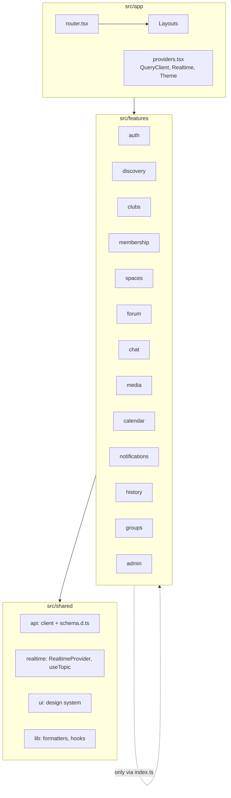
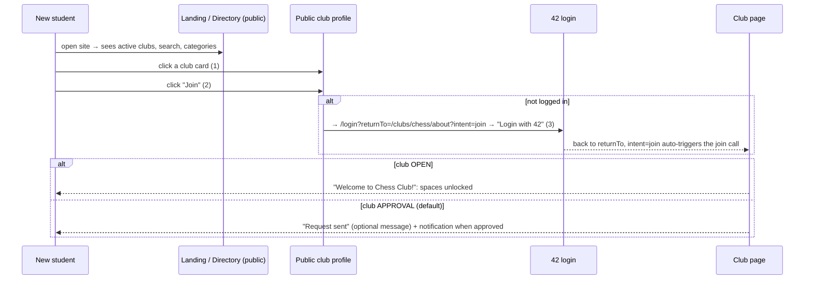

# 08 — Frontend (React + TypeScript)

## 1. Stack

| Concern | Choice | Version |
|---------|--------|---------|
| UI library | React | 19.3 |
| Build / dev server | Vite (+ `@vitejs/plugin-react`) | 8.x (plugin 6.x) |
| Language | TypeScript (the version scaffolded by `create-vite@9`) | 6.0 |
| Routing | React Router (data router), **pinned to 7.x** (R-14) | 7.20 |
| Server state | TanStack Query | 5.x |
| Client/UI state | Zustand (only for UI state: sidebar, drafts) | 5.x |
| Forms and validation | React Hook Form + Zod + `@hookform/resolvers` | 7.x / 4.x / 5.x |
| API types and client | `openapi-typescript` (codegen, run via `npx` because it still requires TypeScript 5) + `openapi-fetch` | 7.13 / 0.17 |
| Real-time | `@stomp/stompjs` | 7.5 |
| Calendar | FullCalendar, **pinned to 6.x** (R-14) | 6.1.22 |
| Styling | Tailwind CSS v4 (`@tailwindcss/vite`) + shadcn/ui components (Radix primitives, copied into the repo) + `lucide-react` icons | 4.3 |
| Markdown | `react-markdown` + `rehype-sanitize` | 10.x / 6.x |
| Tests | Vitest + Testing Library (+ MSW for API mocks, Playwright for the e2e "join a club" flow) | Vitest 5.x |
| Lint | ESLint (flat config) + typescript-eslint + react-hooks rules | ESLint 10 |

---

## 2. Architecture principles

The frontend **mirrors the backend modules**, so one developer can own a feature end-to-end.

1. **Feature modules** (`src/features/<feature>`) own their pages, components, API hooks and types. Each exposes a **public `index.ts`**. Other features import only from that index. ESLint enforces it (§12.4), the frontend equivalent of Spring Modulith's verification.
2. **`src/shared`** holds the cross-cutting kernel: the API client, real-time client, UI kit (design system) and helpers. Shared never imports features.
3. **Server state lives in TanStack Query only.** No copy of server data in Zustand. Real-time pushes update the Query cache.
4. **One generated API contract.** Types come from the backend's OpenAPI document, so a backend DTO change breaks the frontend build, not production.
5. **Permissions drive the UI, the server enforces them.** `GET /api/clubs/{id}/membership/me` returns effective permissions; components hide what the user can't do. The backend re-checks everything anyway.
6. **Route-level code splitting.** Each feature's pages are lazy-loaded.



---

## 3. Project structure

```text
frontend/
├── Dockerfile
├── nginx/default.conf                 # production web server + reverse proxy (09-deployment.md)
├── index.html
├── package.json
├── tsconfig.json
├── vite.config.ts
├── eslint.config.js
├── components.json                    # shadcn/ui config
└── src/
    ├── main.tsx
    ├── app/
    │   ├── App.tsx
    │   ├── providers.tsx              # QueryClientProvider, RealtimeProvider, ThemeProvider
    │   ├── queryClient.ts
    │   ├── router.tsx
    │   ├── layouts/                   # AppLayout (top bar), ClubLayout (sidebar), AdminLayout
    │   └── theme.css                  # Tailwind v4 + design tokens
    ├── shared/
    │   ├── api/
    │   │   ├── schema.d.ts            # GENERATED from /v3/api-docs (never edit)
    │   │   ├── client.ts              # openapi-fetch client + CSRF + error middleware
    │   │   └── errors.ts              # ApiError (RFC 9457)
    │   ├── realtime/RealtimeProvider.tsx
    │   ├── ui/                        # shadcn/ui components (button, card, dialog, …) + app primitives
    │   └── lib/                       # dates (Europe/Lisbon), markdown renderer, useDebounce, safeReturnTo
    └── features/
        ├── auth/          index.ts, useMe.ts, RequireAuth.tsx, RequireAdmin.tsx, LoginPage.tsx, PostLoginRedirect.tsx
        ├── discovery/     index.ts, LandingPage.tsx, ClubDirectoryPage.tsx, PublicClubProfilePage.tsx, ClubCard.tsx
        ├── clubs/         index.ts, api.ts, CreateClubWizard.tsx, ClubHome.tsx, ClubSettingsProfile.tsx, ArchivedBanner.tsx, RevivalDialog.tsx
        ├── membership/    index.ts, api.ts, JoinButton.tsx, MembersPage.tsx, JoinRequestsPanel.tsx, RolesEditor.tsx, OwnershipPanel.tsx
        ├── groups/        index.ts, api.ts, GroupsSettings.tsx
        ├── spaces/        index.ts, api.ts, SpaceSidebar.tsx, SpaceSettings.tsx, AccessRuleEditor.tsx, ChannelPage.tsx
        ├── forum/         index.ts, api.ts, ChannelFeed.tsx, PostCard.tsx, PostComposer.tsx, Comments.tsx, Reactions.tsx, PostRedirectPage.tsx
        ├── chat/          index.ts, api.ts, useChatMessages.ts, ChatRoom.tsx, MessageList.tsx, MessageComposer.tsx
        ├── media/         index.ts, uploadMedia.ts, MediaPicker.tsx, MediaView.tsx (img/video/audio players)
        ├── calendar/      index.ts, api.ts, CampusCalendarPage.tsx, ClubCalendarPage.tsx, EventDialog.tsx, EventPage.tsx, RsvpButtons.tsx, FeedSubscribeDialog.tsx
        ├── notifications/ index.ts, api.ts, NotificationBell.tsx, NotificationsPage.tsx, PreferencesForm.tsx
        ├── history/       index.ts, api.ts, ClubHistoryPage.tsx, EraSwitcher.tsx, Timeline.tsx
        └── admin/         index.ts, api.ts, ApprovalQueuePage.tsx, RevivalQueuePage.tsx, AdminClubsPage.tsx, UsersPage.tsx, CampusGroupsPage.tsx
```

---

## 4. Routing

| Path | Page | Access |
|------|------|--------|
| `/` | `LandingPage` | public |
| `/clubs` | `ClubDirectoryPage` | public |
| `/clubs/:slug/about` | `PublicClubProfilePage` (R-24), with a **Join** CTA | public |
| `/login` | `LoginPage` (Login with 42 + local form) | public |
| `/clubs/new` | `CreateClubWizard` | user |
| `/c/:slug` | `ClubLayout` → `ClubHome` (feed, about, upcoming events) | user |
| `/c/:slug/s/:spaceSlug/:channelSlug` | `ChannelPage` → `ChannelFeed` (FORUM) or `ChatRoom` (CHAT) | user (read access) |
| `/c/:slug/events` | `ClubCalendarPage` | user |
| `/c/:slug/members` | `MembersPage` | member |
| `/c/:slug/history` | `ClubHistoryPage` | user |
| `/c/:slug/settings/(profile\|roles\|groups\|spaces\|requests\|ownership)` | Club settings tabs (each tab shown only with the matching permission) | permission-based |
| `/posts/:postId` | `PostRedirectPage` (resolves channel → navigates; used by notification links) | user |
| `/events/:eventId` | `EventPage` | user |
| `/calendar` | `CampusCalendarPage` | user |
| `/notifications` | `NotificationsPage` | user |
| `/settings` | User settings: notification preferences, iCal feed, password (local accounts) | user |
| `/admin/(approvals\|revivals\|clubs\|users\|campus-groups)` | Admin console | admin |

---

## 5. State management

### 5.1 Query keys (one convention for the whole app)

| Data | Key |
|------|-----|
| Me | `["me"]` |
| Club | `["club", slugOrId]` |
| My membership in club | `["club", clubId, "membership", "me"]` |
| Spaces of club | `["club", clubId, "spaces"]` |
| Channel posts | `["channel", channelId, "posts", { era }]` |
| Post comments | `["post", postId, "comments"]` |
| Chat messages | `["channel", channelId, "messages"]` |
| Calendar range | `["calendar", scope, { from, to }]` |
| Notifications | `["notifications"]`, `["notifications", "unread-count"]` |
| Directory | `["public", "clubs", filters]` |

Defaults: `staleTime` 30 s, `retry` up to 2 times only for 5xx/network errors, `refetchOnWindowFocus` true for inbox-like data.

### 5.2 Mutations

- **Invalidate** related keys on success (e.g. join → `["club", id, "membership", "me"]`, `["club", id, "spaces"]`).
- **Optimistic updates** where latency is visible: reactions (toggle immediately, roll back on error) and chat (render "sending" bubbles from `useMutationState`, reconcile by `clientNonce`).

### 5.3 Client-only state (Zustand)

Sidebar collapsed, composer drafts per channel, theme. Nothing that comes from the server.

---

## 6. API layer

**Type generation** (backend running locally):

```bash
npm run api:types   # npx openapi-typescript@7.13.0 http://localhost:8080/v3/api-docs -o src/shared/api/schema.d.ts
```

```ts
// src/shared/api/errors.ts
export interface ProblemDetail {
  type?: string;
  title?: string;
  status: number;
  detail?: string;
  instance?: string;
  code?: string;
  errors?: { field: string; message: string }[];
}

export class ApiError extends Error {
  readonly status: number;
  readonly problem: ProblemDetail | null;

  constructor(status: number, problem: ProblemDetail | null) {
    super(problem?.detail ?? `HTTP ${status}`);
    this.status = status;
    this.problem = problem;
  }

  get code(): string | undefined {
    return this.problem?.code;
  }
}
```

```ts
// src/shared/api/client.ts
import createClient, { type Middleware } from "openapi-fetch";
import type { paths } from "./schema";
import { ApiError, type ProblemDetail } from "./errors";

const UNSAFE_METHODS = new Set(["POST", "PUT", "PATCH", "DELETE"]);

function readCookie(name: string): string | undefined {
  const entry = document.cookie.split("; ").find((c) => c.startsWith(`${name}=`));
  return entry ? decodeURIComponent(entry.slice(name.length + 1)) : undefined;
}

/** Spring Security CSRF: echo the XSRF-TOKEN cookie in the X-XSRF-TOKEN header (07-security.md §3.1). */
const csrfMiddleware: Middleware = {
  async onRequest({ request }) {
    if (UNSAFE_METHODS.has(request.method)) {
      const token = readCookie("XSRF-TOKEN");
      if (token) request.headers.set("X-XSRF-TOKEN", token);
    }
    return request;
  },
};

/** Turns RFC 9457 problem details into typed exceptions (TanStack Query surfaces them as `error`). */
const errorMiddleware: Middleware = {
  async onResponse({ response }) {
    if (response.ok) return response;
    const problem = (await response.clone().json().catch(() => null)) as ProblemDetail | null;
    throw new ApiError(response.status, problem);
  },
};

export const api = createClient<paths>({ baseUrl: "" });   // same origin: nginx (prod) / Vite proxy (dev)
api.use(csrfMiddleware, errorMiddleware);

/** Call once at startup so the XSRF-TOKEN cookie exists before the first unsafe request. */
export async function bootstrapCsrf(): Promise<void> {
  await fetch("/api/auth/csrf", { credentials: "same-origin" });
}
```

```ts
// src/app/queryClient.ts
import { QueryClient } from "@tanstack/react-query";
import { ApiError } from "@/shared/api/errors";

export const queryClient = new QueryClient({
  defaultOptions: {
    queries: {
      staleTime: 30_000,
      retry: (failureCount, error) =>
        !(error instanceof ApiError && error.status < 500) && failureCount < 2,
    },
  },
});
```

---

## 7. Real-time layer

```tsx
// src/shared/realtime/RealtimeProvider.tsx
import { Client, type IMessage, type StompSubscription } from "@stomp/stompjs";
import { useQueryClient } from "@tanstack/react-query";
import { createContext, useContext, useEffect, useRef, useState, type ReactNode } from "react";

export interface RealtimeEnvelope<T = unknown> {
  type: string;
  payload: T;
  sentAt: string;
}

interface RealtimeState {
  client: Client | null;
  connected: boolean;
}

const RealtimeContext = createContext<RealtimeState>({ client: null, connected: false });

/** One STOMP connection per tab, opened only for logged-in users. */
export function RealtimeProvider({ enabled, children }: { enabled: boolean; children: ReactNode }) {
  const queryClient = useQueryClient();
  const [state, setState] = useState<RealtimeState>({ client: null, connected: false });
  const hasConnectedBefore = useRef(false);

  useEffect(() => {
    if (!enabled) return;
    const scheme = window.location.protocol === "https:" ? "wss" : "ws";
    const client = new Client({
      brokerURL: `${scheme}://${window.location.host}/ws`,   // same origin → SESSION cookie is sent
      reconnectDelay: 3_000,
      heartbeatIncoming: 10_000,
      heartbeatOutgoing: 10_000,
    });
    client.onConnect = () => {
      setState({ client, connected: true });
      if (hasConnectedBefore.current) {
        void queryClient.invalidateQueries();                // pushes are best effort: catch up after a gap
      }
      hasConnectedBefore.current = true;
    };
    client.onWebSocketClose = () => setState({ client, connected: false });
    client.activate();
    return () => {
      void client.deactivate();
    };
  }, [enabled, queryClient]);

  return <RealtimeContext.Provider value={state}>{children}</RealtimeContext.Provider>;
}

/** Subscribes while mounted; re-subscribes automatically after reconnects. */
export function useTopic<T>(destination: string | null, onMessage: (envelope: RealtimeEnvelope<T>) => void): void {
  const { client, connected } = useContext(RealtimeContext);
  const handler = useRef(onMessage);

  useEffect(() => {
    handler.current = onMessage;
  });

  useEffect(() => {
    if (!client || !connected || !destination) return;
    const subscription: StompSubscription = client.subscribe(destination, (message: IMessage) => {
      handler.current(JSON.parse(message.body) as RealtimeEnvelope<T>);
    });
    return () => subscription.unsubscribe();
  }, [client, connected, destination]);
}
```

```ts
// src/features/chat/useChatMessages.ts
import { useInfiniteQuery, useQueryClient, type InfiniteData } from "@tanstack/react-query";
import { api } from "@/shared/api/client";
import type { components } from "@/shared/api/schema";
import { useTopic } from "@/shared/realtime/RealtimeProvider";

export type ChatMessage = components["schemas"]["ChatMessageResponse"];
type MessagePage = { items: ChatMessage[]; nextBefore: number | null };

export const chatKey = (channelId: string) => ["channel", channelId, "messages"] as const;

export function useChatMessages(channelId: string) {
  const queryClient = useQueryClient();

  const query = useInfiniteQuery({
    queryKey: chatKey(channelId),
    initialPageParam: undefined as number | undefined,
    queryFn: async ({ pageParam }): Promise<MessagePage> => {
      const { data } = await api.GET("/api/channels/{channelId}/messages", {
        params: { path: { channelId }, query: { before: pageParam, limit: 50 } },
      });
      return data as MessagePage;
    },
    getNextPageParam: (lastPage) => lastPage.nextBefore ?? undefined,
  });

  useTopic<ChatMessage>(`/topic/channels/${channelId}/messages`, (envelope) => {
    if (envelope.type !== "message.created") {
      void queryClient.invalidateQueries({ queryKey: chatKey(channelId) });   // edits / deletes: refetch
      return;
    }
    const incoming = envelope.payload;
    queryClient.setQueryData<InfiniteData<MessagePage, number | undefined>>(chatKey(channelId), (data) => {
      if (!data) return data;
      const duplicate = data.pages.some((page) =>
        page.items.some((m) => m.id === incoming.id || m.clientNonce === incoming.clientNonce));
      if (duplicate) return data;                                              // own message or retry
      const [newest, ...older] = data.pages;
      return { ...data, pages: [{ ...newest, items: [...newest.items, incoming] }, ...older] };
    });
  });

  return query;
}
```

---

## 8. Authentication in the SPA

```ts
// src/features/auth/useMe.ts
import { useQuery } from "@tanstack/react-query";
import { api } from "@/shared/api/client";
import { ApiError } from "@/shared/api/errors";
import type { components } from "@/shared/api/schema";

export type Me = components["schemas"]["MeResponse"];

/** null = anonymous visitor (401), never an error. */
export function useMe() {
  return useQuery({
    queryKey: ["me"],
    queryFn: async (): Promise<Me | null> => {
      try {
        const { data } = await api.GET("/api/me");
        return data ?? null;
      } catch (error) {
        if (error instanceof ApiError && error.status === 401) return null;
        throw error;
      }
    },
    staleTime: 5 * 60_000,
  });
}
```

```tsx
// src/features/auth/RequireAuth.tsx
import type { ReactNode } from "react";
import { Navigate, useLocation } from "react-router";
import { FullPageSpinner } from "@/shared/ui/FullPageSpinner";
import { useMe } from "./useMe";

export function RequireAuth({ children }: { children: ReactNode }) {
  const { data: me, isPending } = useMe();
  const location = useLocation();
  if (isPending) return <FullPageSpinner />;
  if (!me) {
    const returnTo = encodeURIComponent(location.pathname + location.search);
    return <Navigate to={`/login?returnTo=${returnTo}`} replace />;
  }
  return <>{children}</>;
}
```

```tsx
// src/features/auth/LoginPage.tsx (excerpt: Login with 42)
import { useSearchParams } from "react-router";
import { safeReturnTo } from "@/shared/lib/safeReturnTo";
import { Button } from "@/shared/ui/button";

export function LoginWith42Button() {
  const [params] = useSearchParams();
  return (
    <Button
      size="lg"
      onClick={() => {
        // OAuth success always lands on "/" (fixed server-side); PostLoginRedirect resumes from here.
        sessionStorage.setItem("returnTo", safeReturnTo(params.get("returnTo")));
        window.location.assign("/oauth2/authorization/fortytwo");   // full-page navigation (not fetch)
      }}
    >
      Login with 42
    </Button>
  );
}
```

```ts
// src/shared/lib/safeReturnTo.ts
/** Only same-app relative paths are accepted (prevents open redirects). */
export function safeReturnTo(value: string | null): string {
  if (!value || !value.startsWith("/") || value.startsWith("//") || value.startsWith("/\\")) return "/";
  return value;
}
```

`PostLoginRedirect` (mounted in `AppLayout`) reads `sessionStorage.returnTo` once `useMe()` returns a user, clears it, and navigates there. The local login form calls `POST /api/auth/login`, then `queryClient.setQueryData(["me"], me)` and navigates to `returnTo`. Logout = `POST /api/auth/logout`, then `queryClient.clear()`.

---

## 9. Key UX flows

### 9.1 "A new student can join a club in a few clicks" (UI/UX criterion)



**3 clicks** from landing to membership for an `OPEN` club, even for a first-time visitor (if their 42 session is active, the 42 step is a single click).

### 9.2 Club page layout (Discord-inspired, community spaces)

```text
┌───────────────────────────────────────────────────────────────────────────────┐
│ ◎ Virtual Clubroom   Clubs  Calendar                         🔔3   (avatar ▾)  │
├──────────────┬──────────────────────────────────────────────┬─────────────────┤
│ [banner]     │  # posts · General                     era 2 ▾│ About           │
│ Chess Club   │  ┌────────────────────────────────────────┐  │ 42 members      │
│ [Member ✓]   │  │ ✎ Share something… [📎][🎤][🎬]  Post │  │ Owners: …       │
│              │  └────────────────────────────────────────┘  │                 │
│ ▾ General    │  ┌────────────────────────────────────────┐  │ Upcoming        │
│   # posts    │  │ jdoe · 2h   📌                          │  │ • Blitz night   │
│   💬 lounge  │  │ Tournament on Friday! [image]           │  │   Fri 18:00     │
│ ▾ Board room🔒│  │ 👍 12 🎉 4    💬 7 comments              │  │   [Going ✓]     │
│   # minutes  │  └────────────────────────────────────────┘  │                 │
│ Events       │                  …                            │ History →       │
│ Members      │                                               │                 │
│ History      │                                               │                 │
│ ⚙ Settings   │                                               │                 │
└──────────────┴──────────────────────────────────────────────┴─────────────────┘
```

- The sidebar lists only **readable** spaces (from `GET /api/clubs/{id}/spaces`). 🔒 marks restricted ones.
- The composer appears only if `channel.canWrite`. On previous eras, the feed shows a "read-only history" banner (BR-15).
- **Archived clubs** show an `ArchivedBanner` ("This club is archived. Everything stays readable.") with a **Request revival** button (D-14).

### 9.3 Other flows

| Flow | Notes |
|------|-------|
| **Create a club** | 3-step wizard (basics → description and tags → preview) → "Submitted for review" screen; status visible in "My requests". |
| **Post with media** | `MediaPicker` → `uploadMedia` per file with a progress bar → post submitted with `mediaIds`. `MediaView` renders ``, `<video controls>`, `<audio controls>`. |
| **Chat** | `ChatRoom`: infinite scroll upward (`useChatMessages`), auto-scroll on new messages if at bottom, an `aria-live="polite"` region for screen readers. |
| **Calendar** | `CampusCalendarPage` (FullCalendar month/week/list, "All / My clubs" toggle), `EventDialog` (space selector shows the effective audience), `RsvpButtons`, "Subscribe in my calendar" dialog (iCal URL). |
| **Roles editor** | Permission checkboxes with descriptions; permissions the editor lacks are disabled with a tooltip (anti-escalation, BR-14). |
| **Access rule editor** | Read/write level selectors + group picker (club groups and campus groups) + a computed sentence: "Everyone can read · Board can post". |
| **Ownership** | Owners list, "Invite co-owner", "Transfer ownership" (invite with auto step-down), "Step down" (disabled if last owner, with explanation). |
| **History tab** | `EraSwitcher` (from `/eras`) + `Timeline` + feed filtered by `?era=`. |
| **Notifications** | Bell with unread count (realtime increments), dropdown list, full page, preferences matrix (type × in-app/email). |
| **Admin console** | Approval queue (approve/reject with reason), revival queue, clubs (archive), users (create local account, role/status), campus groups. |

---

## 10. Design system and theme

Goal (Presentation criterion): **one consistent theme**, so every page is built from the same tokens and components.

- **shadcn/ui** components copied into `src/shared/ui` (Button, Card, Dialog, DropdownMenu, Tabs, Tooltip, Badge, Avatar, Input, Textarea, Select, Switch, Toast). Every feature uses these, never ad-hoc styles.
- **Tokens** as CSS variables (light and dark), consumed by Tailwind utilities.
- **Layout primitives**: `PageHeader`, `Section`, `EmptyState`, `StatusBadge` (ACTIVE / ARCHIVED / PENDING), `ClubAvatar`.
- **Accessibility**: WCAG AA contrast, visible focus rings (`ring` token), keyboard-navigable menus (Radix), `prefers-reduced-motion` respected.
- **Dates** formatted with `Intl.DateTimeFormat("pt-PT" | "en-GB", { timeZone: "Europe/Lisbon" })` in `shared/lib/dates.ts`.

```css
/* src/app/theme.css: Tailwind v4 + shadcn token pattern */
@import "tailwindcss";

@custom-variant dark (&:is(.dark *));

:root {
  --radius: 0.75rem;
  --background: oklch(0.99 0 0);
  --foreground: oklch(0.21 0.01 260);
  --card: oklch(1 0 0);
  --card-foreground: oklch(0.21 0.01 260);
  --primary: oklch(0.62 0.14 182);            /* teal accent */
  --primary-foreground: oklch(0.99 0 0);
  --secondary: oklch(0.96 0.005 260);
  --secondary-foreground: oklch(0.25 0.01 260);
  --muted: oklch(0.96 0.005 260);
  --muted-foreground: oklch(0.55 0.01 260);
  --accent: oklch(0.95 0.03 182);
  --accent-foreground: oklch(0.25 0.05 182);
  --destructive: oklch(0.58 0.22 27);
  --border: oklch(0.91 0.005 260);
  --input: oklch(0.91 0.005 260);
  --ring: oklch(0.62 0.14 182);
  --archived: oklch(0.7 0.02 260);
}

.dark {
  --background: oklch(0.17 0.01 260);
  --foreground: oklch(0.96 0.005 260);
  --card: oklch(0.21 0.01 260);
  --card-foreground: oklch(0.96 0.005 260);
  --primary: oklch(0.72 0.13 182);
  --primary-foreground: oklch(0.17 0.01 260);
  --secondary: oklch(0.27 0.01 260);
  --secondary-foreground: oklch(0.96 0.005 260);
  --muted: oklch(0.27 0.01 260);
  --muted-foreground: oklch(0.7 0.01 260);
  --accent: oklch(0.3 0.04 182);
  --accent-foreground: oklch(0.96 0.005 260);
  --destructive: oklch(0.65 0.2 27);
  --border: oklch(0.3 0.01 260);
  --input: oklch(0.3 0.01 260);
  --ring: oklch(0.72 0.13 182);
  --archived: oklch(0.5 0.02 260);
}

@theme inline {
  --color-background: var(--background);
  --color-foreground: var(--foreground);
  --color-card: var(--card);
  --color-card-foreground: var(--card-foreground);
  --color-primary: var(--primary);
  --color-primary-foreground: var(--primary-foreground);
  --color-secondary: var(--secondary);
  --color-secondary-foreground: var(--secondary-foreground);
  --color-muted: var(--muted);
  --color-muted-foreground: var(--muted-foreground);
  --color-accent: var(--accent);
  --color-accent-foreground: var(--accent-foreground);
  --color-destructive: var(--destructive);
  --color-border: var(--border);
  --color-input: var(--input);
  --color-ring: var(--ring);
  --color-archived: var(--archived);
  --radius-sm: calc(var(--radius) - 4px);
  --radius-md: calc(var(--radius) - 2px);
  --radius-lg: var(--radius);
  --radius-xl: calc(var(--radius) + 4px);
}

body {
  @apply bg-background text-foreground antialiased;
}
```

---

## 11. Selected components

### 11.1 Join button (with logged-out intent)

```tsx
// src/features/membership/JoinButton.tsx
import { useMutation, useQueryClient } from "@tanstack/react-query";
import { useEffect, useRef } from "react";
import { useLocation, useNavigate, useSearchParams } from "react-router";
import { useMe } from "@/features/auth";
import { api } from "@/shared/api/client";
import { Button } from "@/shared/ui/button";

type JoinPolicy = "OPEN" | "APPROVAL";

export function JoinButton({ clubId, joinPolicy }: { clubId: string; joinPolicy: JoinPolicy }) {
  const { data: me } = useMe();
  const navigate = useNavigate();
  const location = useLocation();
  const [params, setParams] = useSearchParams();
  const queryClient = useQueryClient();
  const autoJoined = useRef(false);

  const join = useMutation({
    mutationFn: async () => {
      const { data } = await api.POST("/api/clubs/{clubId}/join", { params: { path: { clubId } }, body: {} });
      return data;
    },
    onSuccess: async () => {
      await queryClient.invalidateQueries({ queryKey: ["club", clubId] });   // membership, spaces, counts
    },
  });

  // Resume a join started before logging in (?intent=join).
  useEffect(() => {
    if (me && params.get("intent") === "join" && !autoJoined.current) {
      autoJoined.current = true;
      params.delete("intent");
      setParams(params, { replace: true });
      join.mutate();
    }
  }, [me, params, setParams, join]);

  if (!me) {
    const returnTo = encodeURIComponent(`${location.pathname}?intent=join`);
    return <Button onClick={() => navigate(`/login?returnTo=${returnTo}`)}>Log in to join</Button>;
  }
  if (join.data?.status === "REQUESTED") {
    return <Button variant="secondary" disabled>Request sent</Button>;
  }
  return (
    <Button onClick={() => join.mutate()} disabled={join.isPending}>
      {joinPolicy === "OPEN" ? "Join club" : "Request to join"}
    </Button>
  );
}
```

### 11.2 Media upload (direct to object storage, with progress)

```ts
// src/features/media/uploadMedia.ts
import { api } from "@/shared/api/client";
import type { components } from "@/shared/api/schema";

export type MediaPurpose = components["schemas"]["CreateUploadRequest"]["purpose"];

/** 1) ask for a slot  2) PUT the bytes to SeaweedFS (presigned)  3) confirm. Returns the mediaId. */
export async function uploadMedia(file: File, purpose: MediaPurpose,
                                  onProgress?: (percent: number) => void): Promise<string> {
  const { data: slot } = await api.POST("/api/media/uploads", {
    body: { purpose, fileName: file.name, contentType: file.type, sizeBytes: file.size },
  });
  if (!slot) throw new Error("No upload slot");
  await putWithProgress(slot.uploadUrl, file, slot.headers ?? {}, onProgress);
  await api.POST("/api/media/{mediaId}/complete", { params: { path: { mediaId: slot.mediaId } } });
  return slot.mediaId;
}

function putWithProgress(url: string, file: File, signedHeaders: Record<string, string[]>,
                         onProgress?: (percent: number) => void): Promise<void> {
  return new Promise((resolve, reject) => {
    const xhr = new XMLHttpRequest();               // fetch() has no upload progress events
    xhr.open("PUT", url);
    Object.entries(signedHeaders).forEach(([name, values]) => {
      if (name.toLowerCase() !== "host") xhr.setRequestHeader(name, values.join(","));   // Host is set by the browser
    });
    xhr.upload.onprogress = (e) => {
      if (e.lengthComputable) onProgress?.(Math.round((e.loaded / e.total) * 100));
    };
    xhr.onload = () => (xhr.status >= 200 && xhr.status < 300 ? resolve() : reject(new Error(`Upload failed (${xhr.status})`)));
    xhr.onerror = () => reject(new Error("Upload failed"));
    xhr.send(file);
  });
}
```

### 11.3 Campus calendar

```tsx
// src/features/calendar/CampusCalendarPage.tsx (core)
import type { DatesSetArg, EventClickArg, EventInput } from "@fullcalendar/core";
import dayGridPlugin from "@fullcalendar/daygrid";
import interactionPlugin from "@fullcalendar/interaction";
import listPlugin from "@fullcalendar/list";
import FullCalendar from "@fullcalendar/react";
import timeGridPlugin from "@fullcalendar/timegrid";
import { useQuery } from "@tanstack/react-query";
import { useState } from "react";
import { useNavigate } from "react-router";
import { api } from "@/shared/api/client";

export function CampusCalendar({ scope }: { scope: "all" | "mine" }) {
  const [range, setRange] = useState<{ from: string; to: string } | null>(null);
  const navigate = useNavigate();

  const { data = [] } = useQuery({
    queryKey: ["calendar", scope, range],
    enabled: range !== null,
    queryFn: async () => {
      const { data } = await api.GET("/api/calendar", {
        params: { query: { from: range!.from, to: range!.to, scope } },
      });
      return data ?? [];
    },
  });

  const events: EventInput[] = data.map((item) => ({
    id: item.id,
    title: `${item.clubName} · ${item.title}`,
    start: item.start,
    end: item.end,
    classNames: item.status === "CANCELLED" ? ["line-through", "opacity-60"] : [],
  }));

  return (
    <FullCalendar
      plugins={[dayGridPlugin, timeGridPlugin, listPlugin, interactionPlugin]}
      initialView="dayGridMonth"
      headerToolbar={{ left: "prev,next today", center: "title", right: "dayGridMonth,timeGridWeek,listWeek" }}
      timeZone="local"
      firstDay={1}
      height="auto"
      events={events}
      datesSet={(arg: DatesSetArg) => setRange({ from: arg.startStr, to: arg.endStr })}
      eventClick={(arg: EventClickArg) => navigate(`/events/${arg.event.id}`)}
    />
  );
}
```

> Backend note: bind `from`/`to` as `@DateTimeFormat(iso = DateTimeFormat.ISO.DATE_TIME) OffsetDateTime`, because FullCalendar sends offsets (e.g. `2026-10-01T00:00:00+01:00`).

---

## 12. Configuration files

### 12.1 `package.json`

```json
{
  "name": "vclubroom-frontend",
  "private": true,
  "version": "0.1.0",
  "type": "module",
  "scripts": {
    "dev": "vite",
    "build": "tsc -b && vite build",
    "preview": "vite preview",
    "lint": "eslint .",
    "test": "vitest",
    "api:types": "npx --yes openapi-typescript@7.13.0 http://localhost:8080/v3/api-docs -o src/shared/api/schema.d.ts"
  },
  "dependencies": {
    "@fullcalendar/core": "6.1.22",
    "@fullcalendar/daygrid": "6.1.22",
    "@fullcalendar/interaction": "6.1.22",
    "@fullcalendar/list": "6.1.22",
    "@fullcalendar/react": "6.1.22",
    "@fullcalendar/timegrid": "6.1.22",
    "@hookform/resolvers": "^5.9.2",
    "@stomp/stompjs": "^7.5.0",
    "@tanstack/react-query": "^5.104.3",
    "lucide-react": "^1.59.0",
    "openapi-fetch": "^0.17.0",
    "react": "^19.3.1",
    "react-dom": "^19.3.1",
    "react-hook-form": "^7.90.0",
    "react-markdown": "^10.1.0",
    "react-router": "^7.18.4",
    "rehype-sanitize": "^6.0.0",
    "zod": "^4.6.7",
    "zustand": "^5.0.15"
  },
  "devDependencies": {
    "@eslint/js": "^10.0.1",
    "@tailwindcss/vite": "^4.3.3",
    "@testing-library/react": "^16.3.3",
    "@types/react": "^19.3.0",
    "@types/react-dom": "^19.3.0",
    "@vitejs/plugin-react": "^6.1.2",
    "eslint": "^10.13.0",
    "eslint-plugin-react-hooks": "^7.1.1",
    "globals": "^17.13.0",
    "jsdom": "^30.1.3",
    "tailwindcss": "^4.3.3",
    "typescript": "~6.0.2",
    "typescript-eslint": "^8.71.2",
    "vite": "^8.3.4",
    "vitest": "^5.0.5"
  }
}
```

### 12.2 `vite.config.ts` (dev proxy = same-origin, like production)

```ts
import tailwindcss from "@tailwindcss/vite";
import react from "@vitejs/plugin-react";
import { fileURLToPath, URL } from "node:url";
import { defineConfig } from "vite";

const backend = "http://localhost:8080";
const storage = "http://localhost:8333";   // SeaweedFS S3 gateway

export default defineConfig({
  plugins: [react(), tailwindcss()],
  resolve: {
    alias: { "@": fileURLToPath(new URL("./src", import.meta.url)) },
  },
  server: {
    port: 5173,
    // changeOrigin stays false: the Host header (localhost:5173) must reach the backend (OAuth redirect URI)
    // and SeaweedFS (presigned URL signatures are computed for this host).
    proxy: {
      "/api": { target: backend },
      "/oauth2": { target: backend },
      "/login/oauth2": { target: backend },
      "/ical": { target: backend },
      "/ws": { target: backend, ws: true },
      "/media-public": { target: storage },
      "/media-private": { target: storage },
    },
  },
});
```

### 12.3 `tsconfig.json` (relevant part)

```json
{
  "compilerOptions": {
    "target": "ES2022",
    "lib": ["ES2022", "DOM", "DOM.Iterable"],
    "module": "ESNext",
    "moduleResolution": "bundler",
    "jsx": "react-jsx",
    "strict": true,
    "noUncheckedIndexedAccess": true,
    "verbatimModuleSyntax": true,
    "noEmit": true,
    "paths": { "@/*": ["./src/*"] }
  },
  "include": ["src"]
}
```

### 12.4 `eslint.config.js` (feature boundaries)

```js
import js from "@eslint/js";
import reactHooks from "eslint-plugin-react-hooks";
import globals from "globals";
import tseslint from "typescript-eslint";

const FEATURES = [
  "auth", "discovery", "clubs", "membership", "groups", "spaces", "forum",
  "chat", "media", "calendar", "notifications", "history", "admin",
];

export default [
  { ignores: ["dist", "src/shared/api/schema.d.ts"] },
  js.configs.recommended,
  ...tseslint.configs.recommended,
  {
    files: ["src/**/*.{ts,tsx}"],
    languageOptions: { globals: globals.browser },
    plugins: { "react-hooks": reactHooks },
    rules: {
      "react-hooks/rules-of-hooks": "error",
      "react-hooks/exhaustive-deps": "warn",
      // Features talk to each other only through their public index (mirror of Spring Modulith rules).
      // Inside a feature, use relative imports.
      "no-restricted-imports": ["error", {
        patterns: [{
          group: FEATURES.map((f) => `@/features/${f}/*`),
          message: "Import other features only via their public API: '@/features/<feature>'.",
        }],
      }],
    },
  },
  {
    // shared/ must never depend on features/
    files: ["src/shared/**/*.{ts,tsx}"],
    rules: {
      "no-restricted-imports": ["error", { patterns: [{ group: ["@/features/*"], message: "shared must not import features." }] }],
    },
  },
];
```

---

## 13. Testing

| Level | Tooling | Examples |
|-------|---------|----------|
| Unit | Vitest | `safeReturnTo`, permission helpers, cache merge in `useChatMessages` |
| Component | Testing Library + MSW (mock REST) | `JoinButton` renders "Request to join" for `APPROVAL`; roles editor disables unheld permissions |
| E2E (stretch) | Playwright against `docker compose` | Local user: login → join OPEN club → post → see it in the feed |

---

## 14. Build and runtime configuration

- **No `VITE_*` environment variables are needed.** Everything is same-origin and discovered at runtime (`/api`, `/ws`).
- Production build: `npm run build` → `dist/` served by nginx (see [09-deployment.md](09-deployment.md)), with SPA fallback `try_files $uri /index.html`.
- Long-term caching for hashed assets (`/assets/*`, 1 year, immutable); `index.html` not cached.
