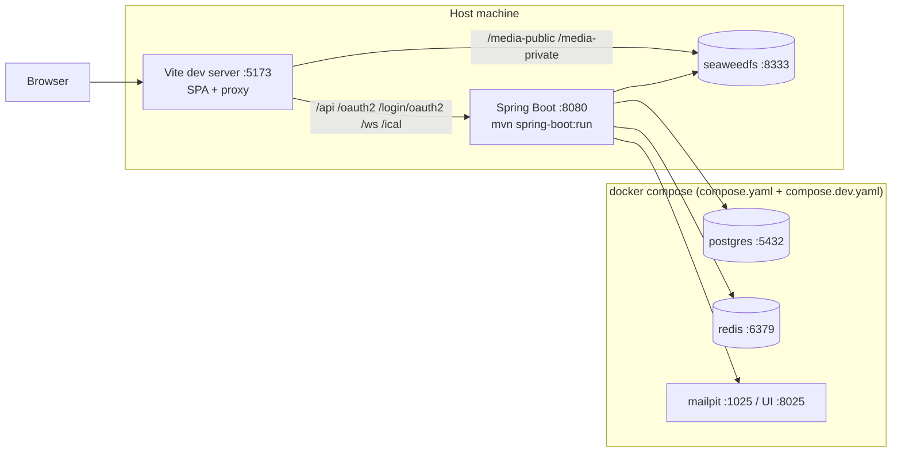
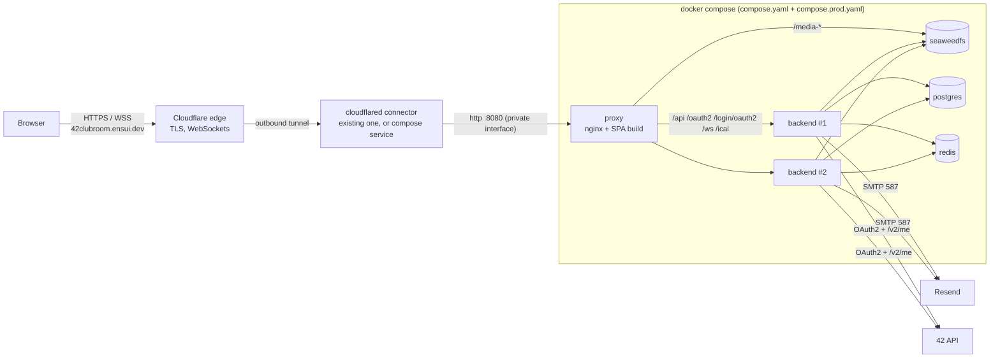

# 09 — Deployment (Docker, Docker Compose, Cloudflare Tunnel)

## 1. Topologies

### 1.1 Development



Hot reload on both sides. The browser only talks to `localhost:5173`, which is same-origin exactly like production.

### 1.2 Demo: `https://42clubroom.ensui.dev` through Cloudflare Tunnel (D-33, D-34)



- **No inbound ports are opened on the host.** `cloudflared` dials out to Cloudflare. The proxy listens only on a private interface (localhost or LAN).
- Cloudflare terminates TLS with its Universal SSL certificate, which covers `ensui.dev` and **first-level** subdomains like `42clubroom.ensui.dev`. A second-level name such as `api.42clubroom.ensui.dev` would need a paid certificate, one more reason for the single origin.
- One public hostname carries SPA, API, WebSocket, OAuth callback and media (same-origin design).

### 1.3 Production with bocal (later, O-02)

Same images and compose files. Only `.env` (domain, secrets, SMTP), DNS and the edge change. Without Cloudflare's 100 MB request cap, the video limit can be raised again (R-12).

## 2. Files

```text
UNIX_CLUB/                    # Hackathon_SA_2026/UNIX_CLUB
├── compose.yaml              # postgres, redis, seaweedfs (shared by dev and prod)
├── compose.dev.yaml          # dev: expose ports, mailpit
├── compose.prod.yaml         # prod/demo: backend (N replicas), proxy (nginx+SPA), optional cloudflared + mailpit (profiles)
├── .env.example              # copy to .env (never commit .env)
├── deploy/seaweedfs/s3.json  # S3 identities and bucket permissions
├── backend/Dockerfile
└── frontend/Dockerfile + frontend/nginx/default.conf
```

## 3. Dockerfiles

### 3.1 `backend/Dockerfile`

```dockerfile
# syntax=docker/dockerfile:1
FROM maven:3.9-eclipse-temurin-21 AS build
WORKDIR /workspace
COPY pom.xml .
RUN --mount=type=cache,target=/root/.m2 mvn -B -q dependency:go-offline
COPY src ./src
RUN --mount=type=cache,target=/root/.m2 mvn -B -q package -DskipTests \
 && cp target/*.jar application.jar \
 && java -Djarmode=tools -jar application.jar extract --layers --destination extracted

FROM eclipse-temurin:21-jre-alpine
RUN addgroup -S app && adduser -S app -G app
WORKDIR /app
# Layered copy: dependencies change rarely → cached image layers; only "application" changes per build.
COPY --from=build /workspace/extracted/dependencies/ ./
COPY --from=build /workspace/extracted/spring-boot-loader/ ./
COPY --from=build /workspace/extracted/snapshot-dependencies/ ./
COPY --from=build /workspace/extracted/application/ ./
USER app
EXPOSE 8080
ENV JAVA_TOOL_OPTIONS="-XX:MaxRAMPercentage=75 -XX:+ExitOnOutOfMemoryError"
HEALTHCHECK --interval=15s --timeout=3s --start-period=60s --retries=5 \
  CMD wget -qO- http://localhost:8080/actuator/health/readiness || exit 1
ENTRYPOINT ["java", "-jar", "application.jar"]
```

### 3.2 `frontend/Dockerfile`

```dockerfile
# syntax=docker/dockerfile:1
FROM node:24-alpine AS build
WORKDIR /app
COPY package.json package-lock.json ./
RUN npm ci
COPY . .
# src/shared/api/schema.d.ts is committed (generated from the backend's OpenAPI during development).
RUN npm run build

FROM nginx:1.30-alpine
COPY nginx/default.conf /etc/nginx/conf.d/default.conf
COPY --from=build /app/dist /usr/share/nginx/html
EXPOSE 80
```

## 4. Compose files

### 4.1 `compose.yaml` (base)

```yaml
name: vclubroom

services:
  postgres:
    image: postgres:17-alpine
    environment:
      POSTGRES_DB: ${DB_NAME:-vclubroom}
      POSTGRES_USER: ${DB_USER:-vclubroom}
      POSTGRES_PASSWORD: ${DB_PASSWORD:?Set DB_PASSWORD in .env}
    volumes:
      - pgdata:/var/lib/postgresql/data
    healthcheck:
      test: ["CMD-SHELL", "pg_isready -U $${POSTGRES_USER} -d $${POSTGRES_DB}"]
      interval: 5s
      timeout: 3s
      retries: 20
    restart: unless-stopped

  redis:
    image: redis:8.8-alpine
    command: ["redis-server", "--appendonly", "yes"]   # keep sessions across restarts
    volumes:
      - redisdata:/data
    healthcheck:
      test: ["CMD", "redis-cli", "ping"]
      interval: 5s
      timeout: 3s
      retries: 20
    restart: unless-stopped

  seaweedfs:
    image: chrislusf/seaweedfs:4.48
    command: "server -dir=/data -s3 -s3.port=8333 -s3.config=/etc/seaweedfs/s3.json"
    volumes:
      - seaweed:/data
      - ./deploy/seaweedfs/s3.json:/etc/seaweedfs/s3.json:ro
    healthcheck:
      # 127.0.0.1, not localhost: in Alpine "localhost" resolves to IPv6 ::1, where weed does not listen
      test: ["CMD-SHELL", "wget -q -O /dev/null http://127.0.0.1:9333/cluster/status || exit 1"]
      interval: 10s
      timeout: 3s
      retries: 20
    restart: unless-stopped

volumes:
  pgdata:
  redisdata:
  seaweed:
```

### 4.2 `compose.dev.yaml`

```yaml
services:
  postgres:
    ports: ["5432:5432"]
  redis:
    ports: ["6379:6379"]
  seaweedfs:
    ports: ["8333:8333"]
  mailpit:
    image: axllent/mailpit:v1.31
    ports:
      - "1025:1025"   # SMTP
      - "8025:8025"   # web UI → http://localhost:8025
    restart: unless-stopped
```

### 4.3 `compose.prod.yaml`

```yaml
services:
  backend:
    build: ./backend
    environment:
      SPRING_PROFILES_ACTIVE: prod
      DB_HOST: postgres
      DB_NAME: ${DB_NAME:-vclubroom}
      DB_USER: ${DB_USER:-vclubroom}
      DB_PASSWORD: ${DB_PASSWORD}
      REDIS_HOST: redis
      S3_ENDPOINT: http://seaweedfs:8333
      S3_PUBLIC_ENDPOINT: ${APP_PUBLIC_URL}
      S3_ACCESS_KEY: ${S3_ACCESS_KEY}
      S3_SECRET_KEY: ${S3_SECRET_KEY}
      APP_PUBLIC_URL: ${APP_PUBLIC_URL}
      COOKIE_SECURE: ${COOKIE_SECURE:-true}
      FT_CLIENT_ID: ${FT_CLIENT_ID}
      FT_CLIENT_SECRET: ${FT_CLIENT_SECRET}
      SMTP_HOST: ${SMTP_HOST:-mailpit}
      SMTP_PORT: ${SMTP_PORT:-1025}
      SMTP_USER: ${SMTP_USER:-}
      SMTP_PASSWORD: ${SMTP_PASSWORD:-}
      SMTP_AUTH: ${SMTP_AUTH:-false}
      SMTP_STARTTLS: ${SMTP_STARTTLS:-false}
      SMTP_SSL: ${SMTP_SSL:-false}
      MAIL_TRANSPORT: ${MAIL_TRANSPORT:-smtp}
      MAIL_FROM: ${MAIL_FROM:-Virtual Clubroom <no-reply@localhost>}
      APP_ADMIN_BOOTSTRAP_LOGINS: ${APP_ADMIN_BOOTSTRAP_LOGINS:-}
      APP_BOOTSTRAP_ADMIN_USERNAME: ${APP_BOOTSTRAP_ADMIN_USERNAME:-}
      APP_BOOTSTRAP_ADMIN_PASSWORD: ${APP_BOOTSTRAP_ADMIN_PASSWORD:-}
    depends_on:
      postgres: { condition: service_healthy }
      redis: { condition: service_healthy }
      seaweedfs: { condition: service_healthy }
    deploy:
      replicas: ${BACKEND_REPLICAS:-2}       # stateless: sessions in Redis, WS fan-out via Redis
    restart: unless-stopped

  proxy:
    build: ./frontend
    ports:
      # Private interface only (R-26): 127.0.0.1 if cloudflared runs on this host, the LAN IP if it runs on another machine.
      - "${HTTP_BIND:-127.0.0.1}:${HTTP_PORT:-8080}:80"
    depends_on:
      backend: { condition: service_healthy }
    restart: unless-stopped

  cloudflared:                               # option B (§8.2): dedicated connector next to the app
    image: cloudflare/cloudflared:2026.10.0
    command: tunnel --no-autoupdate run
    environment:
      TUNNEL_TOKEN: ${CLOUDFLARE_TUNNEL_TOKEN:-}
    depends_on:
      proxy: { condition: service_started }
    profiles: ["tunnel"]
    restart: unless-stopped

  mailpit:
    image: axllent/mailpit:v1.31
    profiles: ["demo"]                       # local demo without real email
    ports: ["127.0.0.1:8025:8025"]
    restart: unless-stopped
```

## 5. nginx

### 5.1 `frontend/nginx/default.conf`

```nginx
upstream backend {
    server backend:8080;          # Docker DNS resolves every replica at nginx start-up
    keepalive 32;
}

upstream storage {
    server seaweedfs:8333;
}

# WebSocket upgrades get "Connection: upgrade"; normal requests get an empty Connection header,
# which nginx omits → upstream keepalive works.
map $http_upgrade $connection_upgrade {
    default upgrade;
    ''      '';
}

# Behind Cloudflare the public scheme is https even though cloudflared talks plain http to us (R-26).
map $http_x_forwarded_proto $forwarded_proto {
    default $http_x_forwarded_proto;
    ''      $scheme;
}

limit_req_zone $binary_remote_addr zone=login:10m rate=5r/m;

server {
    listen 80;
    server_name _;
    root /usr/share/nginx/html;
    client_max_body_size 1m;

    # Real client IP from Cloudflare (R-26). Only private networks are trusted: cloudflared reaches us from
    # the Docker network, localhost or the LAN. The proxy port is never exposed publicly, so the header can't be spoofed.
    set_real_ip_from 127.0.0.1;
    set_real_ip_from 10.0.0.0/8;
    set_real_ip_from 172.16.0.0/12;
    set_real_ip_from 192.168.0.0/16;
    real_ip_header CF-Connecting-IP;

    # Security headers (07-security.md §8). add_header is NOT used in locations below, so these always apply.
    add_header Content-Security-Policy "default-src 'self'; script-src 'self'; style-src 'self' 'unsafe-inline'; img-src 'self' data: blob: https://cdn.intra.42.fr; media-src 'self' blob:; connect-src 'self'; font-src 'self'; frame-ancestors 'none'; base-uri 'self'; form-action 'self'" always;
    add_header X-Content-Type-Options "nosniff" always;
    add_header Referrer-Policy "strict-origin-when-cross-origin" always;
    add_header Permissions-Policy "camera=(), microphone=(), geolocation=()" always;

    # ---- Proxy headers: defined ONCE here. nginx only inherits proxy_set_header into a location
    # if that location defines none itself, so locations below must not add any. ----
    proxy_http_version 1.1;
    proxy_set_header Host              $http_host;          # OAuth redirect URIs + presigned S3 signatures
    proxy_set_header X-Forwarded-Host  $http_host;
    proxy_set_header X-Forwarded-Proto $forwarded_proto;
    proxy_set_header X-Forwarded-For   $proxy_add_x_forwarded_for;
    proxy_set_header Upgrade           $http_upgrade;
    proxy_set_header Connection        $connection_upgrade;

    # ---- Backend ---------------------------------------------------------------
    location /api/            { proxy_pass http://backend; }
    location = /api/auth/login {
        limit_req zone=login burst=5 nodelay;
        proxy_pass http://backend;
    }
    location /oauth2/         { proxy_pass http://backend; }
    location /login/oauth2/   { proxy_pass http://backend; }
    location /ical/           { proxy_pass http://backend; }

    location /ws {
        proxy_pass http://backend;
        proxy_read_timeout 1h;                 # STOMP heartbeats (10 s) keep Cloudflare's 100 s idle limit at bay
        proxy_send_timeout 1h;
    }

    # ---- Media: passthrough to SeaweedFS, path and Host untouched (presigned signatures stay valid) ----
    location /media-public/ {
        proxy_pass http://storage;
        expires 7d;
    }
    location /media-private/ {
        proxy_pass http://storage;
        client_max_body_size 100m;             # Cloudflare rejects bodies > 100 MB anyway (R-12: video ≤ 90 MiB)
        proxy_request_buffering off;           # stream uploads
        proxy_buffering off;                   # stream video playback / range requests
    }

    # ---- SPA ------------------------------------------------------------------------------
    location /assets/ {
        expires 1y;                            # hashed file names
        try_files $uri =404;
    }
    location / {
        expires -1;                            # index.html must never be cached
        try_files $uri /index.html;
    }
}
```

> **Without Cloudflare** (e.g. production with bocal): terminate TLS here (`listen 443 ssl;` + certificates) or in another edge proxy, and remove the `set_real_ip_from`/`real_ip_header` lines unless that edge also sets `CF-Connecting-IP`. Keep `COOKIE_SECURE=true` whenever HTTPS is used.

> **Scaling and nginx DNS.** nginx resolves `backend` once at start. After `--scale backend=N`, restart the proxy (`docker compose … restart proxy`), or switch to `resolver 127.0.0.11 valid=10s;` with a variable `proxy_pass`.

## 6. SeaweedFS configuration: `deploy/seaweedfs/s3.json`

```json
{
  "identities": [
    {
      "name": "vclubroom-backend",
      "credentials": [
        { "accessKey": "vclubroom", "secretKey": "change-me-s3-secret" }
      ],
      "actions": ["Admin", "Read", "Write", "List", "Tagging"]
    },
    {
      "name": "anonymous",
      "actions": ["Read:media-public"]
    }
  ]
}
```

- The `accessKey`/`secretKey` **must match** `S3_ACCESS_KEY`/`S3_SECRET_KEY` in `.env` (SeaweedFS doesn't expand environment variables in this file).
- `anonymous` can only read `media-public` (avatars, banners, event covers). `media-private` requires presigned URLs (R-13).
- Buckets are created by the backend at start-up (`BucketInitializer`).

## 7. Environment: `.env.example`

```dotenv
# ---------- Public URL: what the browser uses (OAuth redirects, presigned media URLs, WS origin, email links) ----------
# Demo: https://42clubroom.ensui.dev   |   local prod-like test without tunnel: http://localhost:8080
APP_PUBLIC_URL=https://42clubroom.ensui.dev
# Interface the proxy listens on: 127.0.0.1 if cloudflared runs on this host, this host's LAN IP otherwise (R-26)
HTTP_BIND=127.0.0.1
HTTP_PORT=8080
# true behind HTTPS (Cloudflare); false only for plain-http tests on a LAN IP
COOKIE_SECURE=true
BACKEND_REPLICAS=2

# ---------- 42 OAuth application (https://profile.intra.42.fr/oauth/applications) ----------
FT_CLIENT_ID=
FT_CLIENT_SECRET=

# ---------- PostgreSQL ----------
DB_NAME=vclubroom
DB_USER=vclubroom
DB_PASSWORD=change-me-db

# ---------- Object storage (must match deploy/seaweedfs/s3.json) ----------
S3_ACCESS_KEY=vclubroom
S3_SECRET_KEY=change-me-s3-secret

# ---------- Email (D-35): Resend over SMTP. Swap provider = change these values only ----------
# Local demo with Mailpit instead: SMTP_HOST=mailpit SMTP_PORT=1025 SMTP_AUTH=false SMTP_STARTTLS=false
SMTP_HOST=smtp.resend.com
SMTP_PORT=587
SMTP_USER=resend
# Resend API key (re_...), sending access restricted to the 42clubroom.ensui.dev domain
SMTP_PASSWORD=
SMTP_AUTH=true
SMTP_STARTTLS=true
SMTP_SSL=false
MAIL_TRANSPORT=smtp
MAIL_FROM="Virtual Clubroom <no-reply@42clubroom.ensui.dev>"

# ---------- Cloudflare Tunnel: only for the 'tunnel' compose profile (option B, §8.2) ----------
CLOUDFLARE_TUNNEL_TOKEN=

# ---------- Admin bootstrap (R-09) ----------
# comma-separated 42 logins that become ADMIN on first login
APP_ADMIN_BOOTSTRAP_LOGINS=
APP_BOOTSTRAP_ADMIN_USERNAME=admin
APP_BOOTSTRAP_ADMIN_PASSWORD=change-me-admin
```

| Variable | Used by | Notes |
|----------|---------|-------|
| `APP_PUBLIC_URL` | backend | Also `S3_PUBLIC_ENDPOINT` (presigned URLs), WebSocket allowed origin and links in emails |
| `HTTP_BIND`, `HTTP_PORT` | compose (proxy) | Never `0.0.0.0` on an internet-facing host (R-26) |
| `FT_CLIENT_ID/SECRET` | backend | Spring Security OAuth2 client registration `fortytwo` |
| `DB_*` | postgres, backend | |
| `S3_*` | backend, seaweedfs (`s3.json`) | |
| `SMTP_*`, `MAIL_*` | backend | Any SMTP provider; `MAIL_FROM` must be on the provider's verified domain |
| `CLOUDFLARE_TUNNEL_TOKEN` | cloudflared (profile `tunnel`) | Only for option B |
| `COOKIE_SECURE` | backend | Session cookie `Secure` flag |

## 8. Demo on `42clubroom.ensui.dev` with Cloudflare Tunnel

`ensui.dev` is already on Cloudflare and you already run tunnels (D-34), so **pick the option that matches where your existing connector runs**.

### 8.1 Option A: reuse an existing tunnel connector (recommended)

Use this when the machine running your existing `cloudflared` can reach the app host (same machine or same LAN).

1. On the app host, set `HTTP_BIND` in `.env`: `127.0.0.1` if `cloudflared` runs on the same machine, otherwise the app host's LAN IP (and firewall that port to the LAN).
2. **Remotely-managed tunnel** (Zero Trust dashboard): **Networks → Tunnels → your tunnel → Public hostnames → Add**:
   - Subdomain `42clubroom`, domain `ensui.dev`.
   - Service `HTTP` → `localhost:8080` (same machine) or `<app-host-LAN-IP>:8080`.
3. **Locally-managed tunnel** (`config.yml`): add an ingress rule **above** the catch-all, then route DNS:

   ```yaml
   ingress:
     - hostname: 42clubroom.ensui.dev
       service: http://192.168.1.50:8080      # app host LAN IP (or http://localhost:8080)
     # … your existing rules …
     - service: http_status:404
   ```

   ```bash
   cloudflared tunnel route dns <your-tunnel-name> 42clubroom.ensui.dev
   sudo systemctl restart cloudflared          # or however your connector is managed
   ```

### 8.2 Option B: dedicated connector in the compose stack

Use this when the app runs on a machine your existing connectors can't reach.

1. Zero Trust dashboard → **Networks → Tunnels → Create a tunnel** (Cloudflared) → name it `vclubroom-demo` → copy the **token** into `CLOUDFLARE_TUNNEL_TOKEN`.
2. Public hostname: `42clubroom.ensui.dev` → service `HTTP` → `proxy:80` (the compose service name).
3. Start the stack with the `tunnel` profile (§10.2). No host port needs to be published at all.

> Don't run a second connector of an *existing* tunnel on a different machine unless both machines can reach every service of that tunnel. Cloudflare load-balances between connectors of the same tunnel.

### 8.3 Cloudflare settings for this hostname

| Setting | Value | Why |
|---------|-------|-----|
| Network → WebSockets | **On** (default) | `/ws` (STOMP) |
| Speed → Rocket Loader | **Off** | It rewrites `<script>` tags and can break the SPA bundle |
| Caching → Cache Rules | **Bypass** for `/api/*`, `/ws*`, `/ical/*`, `/media-private/*` | Personalised or signed responses must never be cached at the edge |
| SSL/TLS → Edge certificates | Universal SSL (automatic) | Covers `42clubroom.ensui.dev`. `.dev` is HSTS-preloaded, so HTTPS is mandatory anyway |
| Security → WAF / Bot Fight Mode | Default | If Bot Fight Mode challenges API calls, add a skip rule for `/api/*` |

**Limits to remember:** request bodies ≤ 100 MB (Free/Pro), so video uploads are capped at 90 MiB (R-12). Idle WebSockets close after ~100 s, which the 10 s STOMP heartbeats prevent.

### 8.4 42 OAuth redirect URI

Add `https://42clubroom.ensui.dev/login/oauth2/code/fortytwo` to the 42 application (§9). nginx forwards `X-Forwarded-Proto: https` (from Cloudflare) and the original `Host`, so Spring builds exactly this URI.

## 9. 42 OAuth application setup

1. Go to `https://profile.intra.42.fr/oauth/applications` and choose **Register a new app**.
2. Redirect URIs (one per line):
   - `http://localhost:5173/login/oauth2/code/fortytwo` (dev, through Vite)
   - `http://localhost:8080/login/oauth2/code/fortytwo` (local prod-like test)
   - `https://42clubroom.ensui.dev/login/oauth2/code/fortytwo` (demo, D-33)
   - later: the production URL with bocal (O-02)
3. Scope: `public`.
4. Copy the UID → `FT_CLIENT_ID` and the secret → `FT_CLIENT_SECRET`.

## 10. Email with Resend (D-35)

1. Create a Resend account → **Domains → Add domain** → `42clubroom.ensui.dev` (R-25). The free plan allows **one** domain; if you already verified `ensui.dev` in Resend, use that and set `MAIL_FROM` accordingly.
2. Resend shows the DNS records to add: a DKIM `TXT` (`resend._domainkey…`), SPF `MX` + `TXT` on a `send.` subdomain, and optionally DMARC. Add them in **Cloudflare DNS** (or use Resend's automatic Cloudflare setup). Mail records are always "DNS only" (grey cloud).
3. Wait for **Verified**, then **API Keys → Create** with *Sending access* restricted to that domain.
4. Fill `.env`: `SMTP_HOST=smtp.resend.com`, `SMTP_PORT=587`, `SMTP_USER=resend`, `SMTP_PASSWORD=<API key>`, `SMTP_AUTH=true`, `SMTP_STARTTLS=true`, `MAIL_FROM="Virtual Clubroom <no-reply@42clubroom.ensui.dev>"`. (Port 465 works too: `SMTP_SSL=true`, `SMTP_STARTTLS=false`.)
5. Test: trigger an email-by-default notification (e.g. an ownership invitation) → check delivery in Resend's **Emails** log, or `select email_sent_at, email_last_error from notification.notifications order by created_at desc limit 5;`.

**Free tier:** about 3,000 emails/month and **100/day**. When the cap is hit, sends fail and the outbox retries with backoff (R-27).

**Switching provider later** (Brevo, Amazon SES, bocal's SMTP relay): change `SMTP_*` and `MAIL_FROM`, then restart the backend. No code changes (`EmailSender` port, [notification.md §8.1](03-backend/notification.md#81-email-a-provider-neutral-port-d-35)).

## 11. Workflows

### 11.1 Development

```bash
cp .env.example .env                                   # fill FT_CLIENT_ID / FT_CLIENT_SECRET
docker compose -f compose.yaml -f compose.dev.yaml up -d

# backend (terminal 1): load .env, override URLs and SMTP for local dev (Mailpit)
cd backend
set -a && . ../.env && set +a
APP_PUBLIC_URL=http://localhost:5173 S3_PUBLIC_ENDPOINT=http://localhost:5173 COOKIE_SECURE=false \
SMTP_HOST=localhost SMTP_PORT=1025 SMTP_AUTH=false SMTP_STARTTLS=false \
  mvn spring-boot:run -Dspring-boot.run.profiles=dev

# frontend (terminal 2)
cd frontend
npm ci
npm run api:types                                      # regenerate types whenever backend DTOs change
npm run dev                                            # → http://localhost:5173
```

Mailpit UI: <http://localhost:8025>. Swagger UI: <http://localhost:8080/swagger-ui.html>.

### 11.2 Demo on `42clubroom.ensui.dev`

```bash
cp .env.example .env                                   # secrets, Resend key, HTTP_BIND (§8.1)
# Option A (existing connector routes to HTTP_BIND:HTTP_PORT):
docker compose -f compose.yaml -f compose.prod.yaml up -d --build
# Option B (dedicated connector container):
docker compose -f compose.yaml -f compose.prod.yaml --profile tunnel up -d --build

docker compose -f compose.yaml -f compose.prod.yaml logs -f backend
# → https://42clubroom.ensui.dev
```

Local prod-like test without the tunnel: set `APP_PUBLIC_URL=http://localhost:8080`, `COOKIE_SECURE=false` and the Mailpit SMTP values, then add `--profile demo`.

### 11.3 Scaling demo (for the "Scalability" criterion)

```bash
docker compose -f compose.yaml -f compose.prod.yaml up -d --scale backend=3
docker compose -f compose.yaml -f compose.prod.yaml restart proxy
```

Open two browsers in the same chat channel. Requests and WebSocket connections land on different instances (check `logs backend`), and messages still appear instantly in both (Redis fan-out), with no sticky sessions.

## 12. Operations

| Task | Command / approach |
|------|--------------------|
| Health | `GET /actuator/health` (public), `/actuator/health/readiness` (Docker healthcheck) |
| Backup DB | `docker compose exec -T postgres pg_dump -U vclubroom -Fc vclubroom > backups/vclubroom-$(date +%F).dump` |
| Restore DB | `docker compose exec -T postgres pg_restore -U vclubroom -d vclubroom --clean < backups/<file>.dump` |
| Backup media | `docker run --rm -v vclubroom_seaweed:/data -v $PWD/backups:/b alpine tar czf /b/seaweed-$(date +%F).tgz /data` |
| Outbox backlog | `select listener_id, count(*) from public.event_publication where completion_date is null group by 1;` |
| Email backlog | `select count(*) from notification.notifications where email_requested and email_sent_at is null;` |
| Logs | JSON (ECS) in prod profile → `docker compose logs`; ship to Loki/ELK later |
| Upgrades | Rebuild images; Flyway migrates on start; with 2+ replicas, `docker compose up -d --no-deps --build backend` rolls containers |
