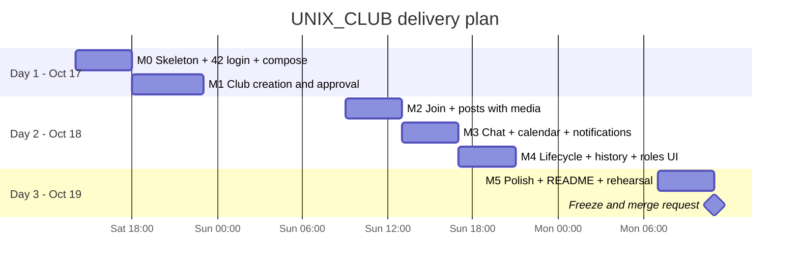

# 10 — Delivery Plan (2 days, 3 people)

> This plan is a **suggestion**. Adjust names, order and cut lines to your team. Deadline: **2026-10-19 12:00** (merge request to `megyant/Hackathon_SA_2026`, inside the `UNIX_CLUB/` directory, with a `README.md` showcasing the site, how to compile and the tech stack).

## 1. Ownership by module (mirrors the architecture)

Each person owns whole modules end-to-end, which minimises merge conflicts and keeps the boundaries real.

| Person | Area | Backend modules | Frontend features |
|--------|------|-----------------|-------------------|
| **A: Platform and governance** | Skeleton, security, club lifecycle | `shared`, `identity`, `club`, `membership`, `group`, `discovery`, `history` + compose, Flyway baseline, `ModularityTests` | `admin` (approval/revival queues), club settings: roles, ownership |
| **B: Community and communication** | Content, real-time, notifications | `space`, `media`, `forum`, `chat`, `realtime`, `notification`, `calendar` | Help C with `chat` and `calendar` from day 2 |
| **C: Frontend and UX** | Shell, design system, all main pages | — | `app` shell, theme, `auth`, `discovery`, `clubs`, `membership` (join), `spaces`, `forum`, `notifications`, `history` |

**Contract-first rule:** a backend owner publishes the controller and DTO stubs (returning fake data if needed) **before** implementing. C regenerates types (`npm run api:types`) and builds UI in parallel.

## 2. Timeline

| Milestone | Done when |
|-----------|-----------|
| **M0** | `docker compose … up` works; Spring Boot starts with Flyway + Modulith; **Login with 42** and local admin login work; SPA shell shows the logged-in user; **upload test to SeaweedFS through the proxy works** (de-risk early). |
| **M1** | Student requests a club → admin approves → club page with "General" space (Posts + Lounge); public landing and directory list it. |
| **M2** | Join `OPEN`/`APPROVAL` + approval queue; create a post with image/video/audio; comments with replies; reactions. |
| **M3** | Chat in real time across two browsers; club and campus calendar, create event, RSVP, iCal link; in-app notifications with live badge (email via Mailpit). |
| **M4** | Invite co-owner / transfer ownership / step down; admin archive → read-only view; revival request → approval → era 2; history tab (eras + timeline + feed by era); roles editor; space access rules editor. |
| **M5** | Visual polish (one theme), empty states, seed data, README with screenshots, demo script rehearsed, scaling demo. |

## 3. Scope: must / should / could

| Priority | Items |
|----------|-------|
| **Must** (mandatory + lifecycle, 40% of the grade) | Roles (Owner/Member/Non-member/Admin), 42 + password login, landing page, join, club pages, create club, posts with image/video/audio, comments/reactions, event calendar, ownership transfer, archival, history |
| **Should** | Custom roles editor, club groups and restricted spaces, chat, real-time updates, email notifications, campus calendar + RSVP, revival, discovery search |
| **Could** | iCal feed, campus groups from 42 sync, reminders, typing indicators, Playwright e2e, Kafka externalization demo (`@Externalized`), permission cache |

**Cut lines if late (in this order):** iCal → campus group sync → email (keep in-app) → reminders → custom role creation UI (keep the built-in Owner/Member roles + toggling `EVENT_MANAGE` on Member) → club groups UI. The backend models stay complete, so cuts only remove UI.

## 4. Seed data (demo profile)

A `@Profile("demo")` `ApplicationRunner` in each module's `application` package (or one `DemoSeeder` per module, so the boundaries are respected) creates:

- local users `alice` (admin), `bob`, `carol`, `dave`;
- 6 approved clubs across categories, one `OPEN` and the rest `APPROVAL`, with avatars;
- posts with images, a chat history, 3 upcoming events with RSVPs;
- one archived club with two eras of history (to demo revival and the history tab).

## 5. Demo script (5 minutes)

1. **Landing → directory** (anonymous): search "chess", filter by category. *Discovery read model.*
2. **Public profile → Join → Login with 42 → auto-joined.** *3 clicks.*
3. Post with an image and an audio clip; react; comment and reply. *Presigned uploads to SeaweedFS.*
4. Two browsers in **Lounge chat** with the backend scaled to 3 instances: instant messages. *Redis fan-out, no sticky sessions.*
5. Create an event in a members-only space → RSVP → show the campus calendar. *Access rules apply to events.*
6. Roles editor: create "Event lead" with `EVENT_MANAGE`; an access rule "Board room" for a club group. *Per-club structure.*
7. **Transfer ownership** to another member (invite → accept).
8. Admin **archives** the club → read-only banner; another student **requests revival** → admin approves → **era 2**; History tab shows eras, timeline and old posts. *Clubs outlive their members.*
9. Architecture slide: Spring Modulith **verification test** + generated component diagram; `event_publication` table (the outbox); Kafka migration in one annotation.

## 6. Risks and mitigations

| Risk | Mitigation |
|------|-----------|
| 42 OAuth app not ready / redirect mismatch | Local accounts work independently; register the app in the first hour with all redirect URIs, including `https://42clubroom.ensui.dev/login/oauth2/code/fortytwo`. |
| Resend domain not verified in time | Add the DNS records in Cloudflare on day 1 (verification can take a while); until verified, use Mailpit (`--profile demo`), since email is not demo-critical. |
| Tunnel/edge surprises (WebSockets, caching, upload size) | Publish `42clubroom.ensui.dev` early (end of M1) and test login, `/ws` and an upload through Cloudflare, not only on localhost. |
| Presigned URL signature mismatch (Host/path) | Test upload through Vite proxy and nginx in M0; keep `changeOrigin: false` and `Host $http_host`. |
| WebSocket blocked by proxy | Test `/ws` through nginx in M0 (Upgrade headers). |
| Merge conflicts | Module ownership; timestamp-based Flyway versions; small PRs; generated `schema.d.ts` regenerated, never hand-merged. |
| Scope creep | Cut lines (§3); every feature is a vertical slice that is demoable alone. |
| Async surprises in the UI | Invalidate queries on the relevant pushes; idempotent listeners; check the outbox backlog query when debugging. |
