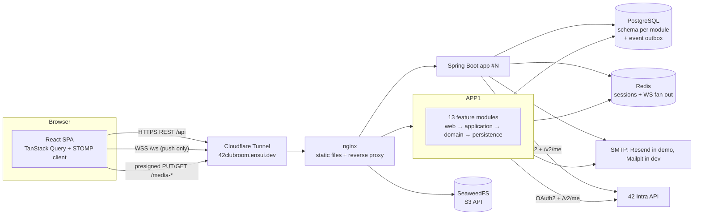

# Virtual Clubroom — Design Documentation

> 42 Portugal hackathon (deadline 2026-10-19, 12:00). A platform where every club has its own space to post and create, where students discover and join clubs, and where clubs outlive their members through ownership hand-over, archival and revival.

This folder is the **high-level design** of the whole application: domain, architecture, backend (module by module), database, API, messaging and real-time, security, frontend and deployment. It is a design, not an implementation. Every code snippet is complete (package, imports and references) so it can be copied as a starting point.

---

## Reading order

| # | Document | What you get |
|---|----------|--------------|
| 0 | [00-decision-log.md](00-decision-log.md) | Every confirmed decision, every designer choice to review, open items. **Read first.** |
| 1 | [01-domain-model.md](01-domain-model.md) | Glossary, roles and permissions, aggregates, lifecycles (state machines), business rules. |
| 2 | [02-architecture.md](02-architecture.md) | System context, containers, modular monolith, module map and dependency rules, layering, communication patterns, scalability. |
| 3 | [03-backend/README.md](03-backend/README.md) | Spring Boot project structure, `pom.xml`, configuration, shared kernel, module template, testing. |
| 3.x | [03-backend/*.md](03-backend/) | One document per module, each with its request flows through **controller → service → domain → repository → DB / external APIs**. |
| 4 | [04-database.md](04-database.md) | PostgreSQL schemas (one per module), ERDs, complete Flyway DDL, indexes, query patterns. |
| 5 | [05-api-reference.md](05-api-reference.md) | REST endpoint catalogue, WebSocket destinations, error format, pagination. |
| 6 | [06-messaging-and-realtime.md](06-messaging-and-realtime.md) | **Kafka analysis**, domain events catalogue, outbox mechanics, WebSocket + Redis fan-out, Kafka migration path. |
| 7 | [07-security.md](07-security.md) | Login with 42 (OAuth2), local accounts, sessions, CSRF, the 4 authorization layers, WebSocket/media/iCal security. |
| 8 | [08-frontend.md](08-frontend.md) | React architecture, feature modules, routing, state, API client, real-time client, UX flows, design system. |
| 9 | [09-deployment.md](09-deployment.md) | Dockerfiles, docker compose (dev and prod), nginx, SeaweedFS, environment variables, scaling. |
| 10 | [10-delivery-plan.md](10-delivery-plan.md) | Suggested 2-day build order and 3-person split, MVP versus stretch goals, demo script. |
| ★ | [implementation/](implementation/README.md) | **Implementation collection**: step-by-step guide, contribution rules (branches, Conventional Commits, PRs), and the full backlog of epics, stories and tasks with estimates and per-person queues. |

### Backend modules

| Module | Responsibility | Doc |
|--------|---------------|-----|
| `identity` | Users, Login with 42, local accounts, platform roles | [identity.md](03-backend/identity.md) |
| `club` | Club lifecycle: creation request → approval → archival → revival, eras, profile | [club.md](03-backend/club.md) |
| `membership` | Memberships, join requests, custom roles and permissions, co-ownership | [membership.md](03-backend/membership.md) |
| `group` | Club groups and campus groups (admin + 42 sync) | [group.md](03-backend/group.md) |
| `space` | Community spaces, channels, read/write access rules (single source of access truth) | [space.md](03-backend/space.md) |
| `forum` | Posts (= threads) with media, comments (1-level replies), reactions | [forum.md](03-backend/forum.md) |
| `media` | Upload slots, S3 (SeaweedFS) storage, presigned URLs | [media.md](03-backend/media.md) |
| `chat` | Chat messages in chat channels | [chat.md](03-backend/chat.md) |
| `calendar` | Club events, campus calendar, RSVP, reminders, iCal feeds | [calendar.md](03-backend/calendar.md) |
| `notification` | In-app and email notifications, user preferences | [notification.md](03-backend/notification.md) |
| `realtime` | WebSocket/STOMP gateway, Redis fan-out, subscription authorization | [realtime.md](03-backend/realtime.md) |
| `discovery` | Landing page and club directory (read model) | [discovery.md](03-backend/discovery.md) |
| `history` | Club timeline (eras, ownership changes, archival, revival) | [history.md](03-backend/history.md) |

---

## The design in one picture

**Key ideas**

1. **Modular monolith.** 13 cohesive modules talk to each other only through small public APIs (synchronous queries) or **domain events** (asynchronous, persisted in a Postgres outbox). Spring Modulith *verifies* those rules in a unit test.
2. **Spaces are the single unit of access.** Forums, chats and calendar events never implement access control themselves. They ask `SpaceAccessPolicy`.
3. **Clubs define their own structure.** Custom roles from a permission catalogue, club groups, per-club join policy, spaces with their own read/write levels.
4. **Clubs outlive their members.** Co-owners, invitation-based transfer, admin archival (read-only, nothing deleted), revival into a new **era** with history preserved.
5. **Stateless, horizontally scalable instances.** Sessions live in Redis, WebSocket messages fan out through Redis, media go straight to object storage, and directory reads come from a read model.

---

## How the design maps to the judging criteria

| Criterion | Weight | Where the design addresses it |
|-----------|--------|-------------------------------|
| Features (mandatory + lifecycle) | 40% | Requirements traceability table in [01-domain-model.md](01-domain-model.md#1-requirements-traceability). |
| Scalability (clean, modular, extensible) | 25% | [02-architecture.md](02-architecture.md): verified module boundaries, events, read models, stateless scaling, Kafka-ready; module docs show extension points. |
| UI/UX (join a club in a few clicks) | 25% | [08-frontend.md](08-frontend.md#9-key-ux-flows): landing → club → **Join** (1 click when `OPEN`, 2 when `APPROVAL`), login return-to intent. |
| Presentation (consistent theme) | 10% | [08-frontend.md](08-frontend.md#10-design-system-and-theme): design tokens, shadcn/ui, one layout system. |

---

## Conventions used in these documents

- **Diagrams** use Mermaid (rendered natively by GitHub and most Markdown viewers).
- **Code snippets** always show `package`, every `import` and every referenced type. Types from this codebase are imported with their full package so you can tell which module owns them.
- **Paths** are relative to the repository root of the application (`backend/`, `frontend/`, `deploy/`).
- **"Must"** marks a rule enforced by code or tests. **"Should"** marks a guideline.
