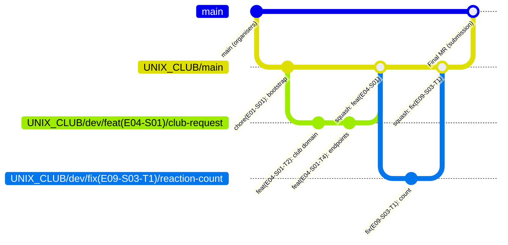
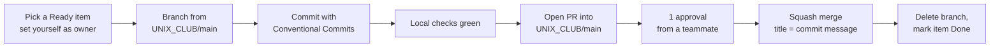

# Contributing to Virtual Clubroom (team UNIX_CLUB)

This guide is the team's working agreement. Copy it to `UNIX_CLUB/CONTRIBUTING.md` in the repository (task E01-S01-T3).

Decisions it implements: D-36 (repository and branches), D-37 (Conventional Commits), D-38 (squash merge), R-28 (commit scope = backlog ID), R-30 (local Git hooks).

---

## 1. Repository layout and golden rules

- **Repository:** the official hackathon repo `megyant/Hackathon_SA_2026`. Other teams work in the same repository.
- **Our territory:** everything we write lives in **`UNIX_CLUB/`**. Never modify files outside it (root `README.md`, other teams' folders, `.github/`). The `pre-commit` hook enforces this.
- **Integration branch:** **`UNIX_CLUB/main`**. It must always build and be demo-able.
- **Never push to `main`.** The only change that reaches `main` is the final submission merge request `UNIX_CLUB/main` → `main`, merged by the organisers.



---

## 2. Branches

### 2.1 Format

```text
UNIX_CLUB/dev/<type>(<ID>)/<short-desc>
```

| Part | Rule | Examples |
|------|------|----------|
| `<type>` | A Conventional Commits type: `feat`, `fix`, `docs`, `style`, `refactor`, `perf`, `test`, `build`, `ci`, `chore`, `revert` | `feat`, `fix` |
| `<ID>` | The backlog item the branch delivers: **task** `E04-S01-T3`, **story** `E04-S01` or **epic** `E04` (see [backlog/README.md](backlog/README.md#1-id-scheme)) | `E04-S01` |
| `<short-desc>` | kebab-case, lowercase `a-z0-9-`, ≤ 40 characters | `club-creation-request` |

**Examples**

```text
UNIX_CLUB/dev/feat(E04-S01)/club-creation-request
UNIX_CLUB/dev/feat(E10-S02-T4)/chat-room-ui
UNIX_CLUB/dev/fix(E09-S03-T1)/reaction-count
UNIX_CLUB/dev/docs(E16-S05)/readme-screenshots
UNIX_CLUB/dev/chore(E01-S01)/compose-files
```

**Granularity.** One branch per **story** by default, which gives PRs that are big enough to be useful and small enough to review. Use a **task** branch when a story is split between people (e.g. BE and FE). Use an **epic** branch only for docs or chores that span a whole epic.

### 2.2 Commands

Parentheses are special in shells, so **always quote branch names**:

```bash
git fetch origin
git switch -c 'UNIX_CLUB/dev/feat(E04-S01)/club-creation-request' origin/UNIX_CLUB/main
git push -u origin 'UNIX_CLUB/dev/feat(E04-S01)/club-creation-request'
```

### 2.3 Lifetime

- Branch from the **latest** `origin/UNIX_CLUB/main`.
- Keep branches short-lived (hours, not days). Rebase on `UNIX_CLUB/main` before opening or updating a PR:
  ```bash
  git fetch origin && git rebase origin/UNIX_CLUB/main
  git push --force-with-lease
  ```
- Delete the branch after the squash merge (GitHub button, or `git push origin --delete '<branch>'`).

---

## 3. Commits: Conventional Commits 1.0.0

Specification: <https://www.conventionalcommits.org/en/v1.0.0/>

```text
<type>(<ID>)[!]: <description>

[optional body: what and why, wrapped at ~72 chars]

[optional footer(s)]
```

- **Scope = backlog ID** (R-28). Rule of thumb: **copy `type(ID)` from your branch name**, or use the specific task ID you are working on (`E04-S01-T4`).
- **Description:** imperative mood, lowercase start, no trailing period, ≤ 100 characters ("add …", "fix …", not "added …").
- **Breaking change:** `!` after the scope and/or a `BREAKING CHANGE:` footer (e.g. renaming a REST field the frontend uses).
- **Footers:** `Refs: E04-S02` for related items, `Co-authored-by: Name <email>` when pairing.

| Type | Use for |
|------|---------|
| `feat` | A user-visible capability (endpoint, page, behaviour) |
| `fix` | A bug fix |
| `docs` | Documentation only (README, docs/, comments) |
| `style` | Formatting only, no logic change |
| `refactor` | Code change that neither fixes a bug nor adds a feature |
| `perf` | Performance improvement |
| `test` | Adding or fixing tests only |
| `build` | Build system or dependencies (`pom.xml`, `package.json`, Dockerfiles) |
| `ci` | CI configuration |
| `chore` | Maintenance that doesn't touch src or tests (compose, scripts, config) |
| `revert` | Reverting a previous commit |

**Good**

```text
feat(E04-S01-T4): add club creation request endpoint
fix(E09-S03-T1): count reactions per emoji instead of per user
feat(E07-S02)!: return 202 with request id for approval clubs

BREAKING CHANGE: POST /api/clubs/{id}/join now returns {status, membershipId, requestId}.
docs(E16-S05): add screenshots and run instructions to README
test(E05-S01-T4): cover archived-club write denial in access matrix
build(E01-S02-T1): add spring-modulith 1.4.13 BOM
```

**Bad**

```text
update stuff                       ← no type, no scope, vague
feat: club                         ← missing ID scope, not descriptive
Feat(E04-S01): Added endpoint.     ← capitalised type, past tense, trailing period
feat(club-module): add endpoint    ← scope must be a backlog ID (R-28)
```

---

## 4. Pull requests

### 4.1 Flow



1. **Target:** `UNIX_CLUB/main` (never `main`).
2. **Title** = the squash commit message, a valid Conventional Commit for the **story** (or task):
   `feat(E04-S01): request club creation`
3. **Description:** use the template below.
4. **Review:** at least **one** approval from another team member. Reviews have priority over new work; aim for under 30 minutes.
5. **Merge:** **Squash and merge** (D-38). Check that GitHub's proposed commit title is still your PR title.
6. **After merge:** delete the branch and update the item status ([backlog/README.md §6](backlog/README.md#6-tracking-status)). If backend DTOs changed, the merger regenerates frontend types in a follow-up `build(<ID>): regenerate api types` commit (§6.3).

> **Repository settings are owned by the organisers**, so branch protection and "squash only" may not be enforceable. The rules above are therefore conventions, backed by the local hooks (§5). If squash merging is disabled on the repository, squash locally:
> ```bash
> git switch UNIX_CLUB/main && git pull
> git merge --squash 'UNIX_CLUB/dev/feat(E04-S01)/club-creation-request'
> git commit -m "feat(E04-S01): request club creation"
> git push
> ```

### 4.2 PR description template (copy-paste)

```markdown
## What
<!-- One or two sentences. Link the backlog item(s). -->
Implements E04-S01 (tasks T1–T6): students can request the creation of a club.

## How
<!-- Key design points, module(s) touched, anything reviewers should look at first. -->

## How to test
<!-- Exact steps / curl / UI path. -->
1. Log in as a student → /clubs/new → submit
2. Log in as admin → /admin/approvals → request is listed

## Checklist (Definition of Done)
- [ ] Acceptance criteria of the story are met
- [ ] Backend: `mvn verify` green (includes ModularityTests)
- [ ] Frontend: `npm run lint && npm test && npm run build` green
- [ ] New/changed endpoints visible in Swagger; `schema.d.ts` regenerated if DTOs changed
- [ ] Flyway migration added (timestamp version) if the schema changed; no edits to applied migrations
- [ ] No secrets, no files outside `UNIX_CLUB/`
- [ ] Docs/decision log updated if a design decision changed
```

### 4.3 Size

- Aim for **< 400 changed lines** (generated `schema.d.ts` excluded).
- Split BE and FE into separate PRs when they are owned by different people. Merge the BE stub first (contract-first, §6.2).

---

## 5. Local Git hooks (R-30)

The hooks are dependency-free bash. They are committed in `UNIX_CLUB/.githooks/` and enabled **once per clone**:

```bash
git config core.hooksPath UNIX_CLUB/.githooks
chmod +x UNIX_CLUB/.githooks/*
```

### 5.1 `UNIX_CLUB/.githooks/commit-msg`

```bash
#!/usr/bin/env bash
# Conventional Commits with a backlog-ID scope (D-37, R-28).
set -euo pipefail
header="$(head -n1 "$1")"

# Allow Git-generated messages.
if [[ "$header" =~ ^(Merge\ |Revert\ \"|fixup!\ |squash!\ ) ]]; then
  exit 0
fi

types='feat|fix|docs|style|refactor|perf|test|build|ci|chore|revert'
id='E[0-9]{2}(-S[0-9]{2}(-T[0-9]+)?)?'
pattern="^(${types})\((${id})\)!?: [^A-Z].{0,99}$"

if [[ ! "$header" =~ $pattern ]]; then
  echo "✖ Invalid commit message header:"
  echo "    $header"
  echo "  Expected: <type>(<ID>)[!]: <description>   e.g.  feat(E04-S01): add club creation endpoint"
  echo "  Types: ${types//|/, }   ID: E04 | E04-S01 | E04-S01-T3"
  exit 1
fi
```

### 5.2 `UNIX_CLUB/.githooks/pre-commit`

```bash
#!/usr/bin/env bash
# Only files under UNIX_CLUB/ may be committed (shared repository); never commit .env files.
set -euo pipefail
outside="$(git diff --cached --name-only | grep -v '^UNIX_CLUB/' || true)"
if [[ -n "$outside" ]]; then
  echo "✖ These staged files are outside UNIX_CLUB/:"
  echo "$outside" | sed 's/^/    /'
  echo "  Unstage them with: git restore --staged <file>"
  exit 1
fi
if git diff --cached --name-only | grep -Eq '(^|/)\.env$'; then
  echo "✖ Refusing to commit a .env file (secrets). Use .env.example for documentation."
  exit 1
fi
```

### 5.3 `UNIX_CLUB/.githooks/pre-push`

```bash
#!/usr/bin/env bash
# Branch naming (D-36) and protection of main / UNIX_CLUB/main.
set -euo pipefail
zero='0000000000000000000000000000000000000000'
types='feat|fix|docs|style|refactor|perf|test|build|ci|chore|revert'
id='E[0-9]{2}(-S[0-9]{2}(-T[0-9]+)?)?'
feature="^UNIX_CLUB/dev/(${types})\((${id})\)/[a-z0-9]+(-[a-z0-9]+)*$"

while read -r local_ref local_sha remote_ref remote_sha; do
  [[ "$remote_ref" == refs/heads/* ]] || continue
  [[ "$local_sha" == "$zero" ]] && continue            # branch deletion
  branch="${remote_ref#refs/heads/}"

  if [[ "$branch" == "main" ]]; then
    echo "✖ Never push to main. The submission goes through a merge request UNIX_CLUB/main → main."
    exit 1
  fi
  if [[ "$branch" == "UNIX_CLUB/main" && "${ALLOW_INTEGRATION_PUSH:-0}" != "1" ]]; then
    echo "✖ UNIX_CLUB/main is updated through squash-merged PRs."
    echo "  (Bootstrap or local squash merge: ALLOW_INTEGRATION_PUSH=1 git push …)"
    exit 1
  fi
  if [[ "$branch" != "UNIX_CLUB/main" && ! "$branch" =~ $feature ]]; then
    echo "✖ Branch name '$branch' does not match UNIX_CLUB/dev/<type>(<ID>)/<short-desc>"
    echo "  e.g. UNIX_CLUB/dev/feat(E04-S01)/club-creation-request"
    exit 1
  fi
done
```

---

## 6. Working agreements

### 6.1 Definition of Ready (before picking an item)

- [ ] The item has an ID, an owner and acceptance criteria in the backlog.
- [ ] Its dependencies are merged, or a stub or contract exists (§6.2).
- [ ] The design reference (module doc section) is known.

### 6.2 Contract-first between backend and frontend

1. The backend owner merges the **controller and DTO stubs** first (fixed or fake data is fine), titled `feat(<ID>): add <endpoint> contract`.
2. The frontend regenerates types (`npm run api:types`) and builds against the stub.
3. The real implementation replaces the stub without changing the DTOs. If it must change them, mark the commit `!` and tell the frontend owner.

### 6.3 Generated files

- `frontend/src/shared/api/schema.d.ts` is **generated**. Never hand-edit it or hand-resolve conflicts in it: regenerate it from a running backend on the merged `UNIX_CLUB/main`.

### 6.4 Database migrations

- One folder per module (`db/migration/<module>/`), version = timestamp `V<yyyyMMddHHmm>__<description>.sql` (no collisions between three people).
- **Never edit a migration that is already merged.** Add a new one. During the hackathon, wipe your local DB if needed: `docker compose … down -v`.

### 6.5 Module ownership and boundaries

- Each module has a primary owner (see [backlog/README.md §5](backlog/README.md#5-suggested-assignment)). Others may contribute, but ping the owner.
- Never import another module's internal packages. Spring Modulith's `ModularityTests` fails the build if you do (frontend: ESLint feature boundaries).

### 6.6 Secrets

- `.env` is never committed (hook). Share secrets through a private channel or password manager.
- Rotate the Resend key and 42 secret if they ever leak.

### 6.7 Definition of Done (per story)

- [ ] Acceptance criteria demonstrably met (manual test steps in the PR).
- [ ] Tests from the story's test task pass; `mvn verify` and the frontend checks are green.
- [ ] Squash-merged into `UNIX_CLUB/main`; the integration branch still starts with `docker compose` and the app runs.
- [ ] Status updated in the backlog.

### 6.8 Communication rhythm (2-day hackathon)

| When | What |
|------|------|
| Start of each milestone (M0–M5) | 10-minute sync: pick items, check blockers, confirm contracts |
| Every merge to `UNIX_CLUB/main` | Short message in the team chat: "merged feat(E04-S01), regenerate types" |
| Blocked > 20 minutes | Ask immediately; pair if needed |
| End of each milestone | Merge freeze → everyone pulls `UNIX_CLUB/main` → 5-minute demo of the milestone checklist |

---

## 7. Final submission

1. Freeze `UNIX_CLUB/main` at **2026-10-19 11:00** (only `fix`/`docs` after that, by agreement).
2. Check that the diff contains only `UNIX_CLUB/`: `git diff --stat origin/main...origin/UNIX_CLUB/main`.
3. Open the merge request **`UNIX_CLUB/main` → `main`** titled `feat(E16): UNIX_CLUB virtual clubroom submission`, with a description linking the README, the demo URL `https://42clubroom.ensui.dev` and the docs.
4. Do **not** squash the final MR yourselves. The organisers merge it.
