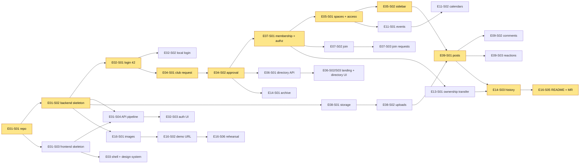

# Backlog — epics, stories and tasks

Everything needed to take Virtual Clubroom from an empty folder to the submitted, demoed product. Use this page to **divide and hand out work**: pick stories by priority, owner track and dependencies.

---

## 1. ID scheme

| Level | Format | Example | Meaning |
|-------|--------|---------|---------|
| Epic | `E<nn>` | `E04` | A feature area (usually one backend module + its UI) |
| Story | `E<nn>-S<nn>` | `E04-S01` | A user-visible increment, demoable on its own, normally **one branch and one PR** |
| Task | `E<nn>-S<nn>-T<n>` | `E04-S01-T3` | A unit of work for one person (≤ 2.5 h), tagged with a layer |

The IDs go into branch names and commit scopes ([CONTRIBUTING](../CONTRIBUTING.md)): `UNIX_CLUB/dev/feat(E04-S01)/club-creation-request`, `feat(E04-S01-T3): add club service`.

### Fields used in every story

| Field | Values |
|-------|--------|
| **Priority** (MoSCoW) | **Must**: subject requirement or prerequisite (40% of the grade). **Should**: strong demo value (team scope: chat, notifications, flexible roles). **Could**: only if ahead of schedule. |
| **Milestone** | M0 skeleton + login · M1 club creation/approval, spaces, directory · M2 join, media, posts, comments, reactions · M3 calendar (+ chat, notifications) · M4 lifecycle: ownership, archive, history · M5 polish, demo, submission ([10-delivery-plan](../../10-delivery-plan.md)) |
| **Track** | **A** Platform and governance · **B** Community and communication · **C** Frontend and UX ([§5](#5-suggested-assignment)) |
| **Layer** (tasks) | `BE` backend · `FE` frontend · `DB` migration · `TEST` tests · `OPS` infra/deployment · `DOC` documentation |
| **Estimate** | Ideal hours, assuming the code in the design docs is reused (R-29). Story estimate = sum of its tasks; epic estimate = sum of its stories (computed, not hand-typed). |
| **MVP cut** | What to drop from a Must story if behind schedule, and roughly how much time that saves. |

---

## 2. Epics

| Epic | Title | Primary track | Stories | Must | Should | Could | Total |
|------|-------|---------------|--------:|-----:|-------:|------:|------:|
| [E01](E01-project-foundation.md) | Project foundation | A (backend + ops), C (frontend) | 4 | 8.25 | 0 | 0 | **8.25** |
| [E02](E02-identity-authentication.md) | Identity and authentication | A (backend), C (frontend) | 4 | 8 | 0 | 0 | **8** |
| [E03](E03-frontend-shell-design-system.md) | Frontend shell and design system | C | 3 | 3.5 | 3 | 0 | **6.5** |
| [E04](E04-club-lifecycle.md) | Club lifecycle: creation, approval, club page | A (backend), C (frontend) | 4 | 9.5 | 2 | 0 | **11.5** |
| [E05](E05-spaces-access-control.md) | Community spaces and access control | B (backend), C (frontend) | 3 | 5 | 3 | 0 | **8** |
| [E06](E06-discovery-landing.md) | Discovery and landing page | A (backend), C (frontend) | 3 | 5.75 | 0 | 0 | **5.75** |
| [E07](E07-membership-joining.md) | Membership and joining | A (backend), C (frontend) | 4 | 7.25 | 2 | 0 | **9.25** |
| [E08](E08-media-uploads.md) | Media uploads | B (backend), C (frontend) | 3 | 4.5 | 0 | 0.5 | **5** |
| [E09](E09-forum-posts-comments-reactions.md) | Forum: posts, comments and reactions | B (backend), C (frontend) | 5 | 8.75 | 2.75 | 0 | **11.5** |
| [E10](E10-realtime-chat.md) | Real-time and chat | B (backend), C or B (frontend) | 3 | 0 | 6.5 | 1.25 | **7.75** |
| [E11](E11-calendar-events.md) | Calendar and events | B (backend), C (frontend) | 6 | 6.25 | 1.5 | 2.25 | **10** |
| [E12](E12-notifications-email.md) | Notifications and email | B (backend), C (frontend) | 3 | 0 | 7.75 | 0 | **7.75** |
| [E13](E13-governance-ownership-roles-groups.md) | Governance: ownership, roles and groups | A (backend), C (frontend) | 4 | 4 | 7 | 0.75 | **11.75** |
| [E14](E14-archival-revival-history.md) | Archival, revival and history | A (backend), C (frontend) | 3 | 6 | 2.5 | 0 | **8.5** |
| [E15](E15-admin-console.md) | Admin console and platform management | C (frontend), A (backend) | 4 | 0.75 | 3.5 | 3 | **7.25** |
| [E16](E16-deployment-demo-submission.md) | Deployment, demo and submission | A (ops), everyone for the demo | 7 | 7.75 | 2 | 2.5 | **12.25** |
| | **Total** | | **63** | **85.25** | **43.5** | **10.25** | **139** |

63 stories, 179 tasks. Estimates in ideal hours.

---

## 3. Capacity: read this before planning

| | Day 1 (Oct 17, 14:00–23:00) | Day 2 (Oct 18, 09:00–22:00) | Day 3 (Oct 19, 07:00–11:00) | Total |
|---|---:|---:|---:|---:|
| Hours per person | 9 | 13 | 4 | **26** |
| Team hours (×3) | 27 | 39 | 12 | **78** |

| Scope | Ideal hours | vs. 78 h raw team time | vs. ~66 h at 85% focus |
|-------|------------:|-----------------------:|-----------------------:|
| Must (full scope) | **85.25** | 109% | 129% |
| Must with all MVP cuts | **77** | 99% | 117% |
| Should | 43.5 | | |
| Could | 10.25 | | |
| Everything | 139 | 178% | |

**What this means**

1. **Mandatory scope uses all the time you have.** Must stories at full scope exceed the raw team time. With every MVP cut applied, they roughly *equal* it. There is no slack for Should items unless you are faster than the estimates (likely if you reuse the design code aggressively) or work longer days.
2. **Rule: no Should work until all of your Must queue is merged.** When your queue is empty, help the person who's furthest behind *before* picking a Should story.
3. **Apply MVP cuts proactively** in Must stories. You can always add the cut part back later.
4. **Should stories in order of demo value per hour** (pick top-down once Must is done):

   | # | Story | Why | Est |
   |---|-------|-----|----:|
   | 1 | E10-S01 + E10-S02 Real-time + chat | Team scope "communication"; strongest live-demo moment | 6.5 h |
   | 2 | E16-S03 Demo data | A populated app demos far better | 2 h |
   | 3 | E03-S03 UX polish | UI/UX 25% + Presentation 10% | 3 h |
   | 4 | E12-S01 In-app notifications | Visible "alive" feeling, live badge | 4.75 h |
   | 5 | E14-S02 Club revival | Completes the "archived or rebuilt" story | 2.5 h |
   | 6 | E04-S04 Club profile editing | Owners can customise their page | 2 h |
   | 7 | E07-S04 Members list | Expected by users; needed by roles UI | 2 h |
   | 8 | E11-S03 RSVP | Calendar feels complete | 1.5 h |
   | 9 | E09-S05 Club feed | Club home shows activity | 1 h |
   | 10 | E13-S02 Custom roles | Shows the flexible per-club structure | 3.75 h |
   | 11 | E05-S03 + E13-S03 Manage spaces + groups | Private spaces per group | 6.25 h |
   | 12 | E12-S03 + E12-S02 Email + preferences | Resend integration | 3 h |
   | 13 | E09-S04, E15-S02 Moderation, admin users | Platform hygiene | 5.25 h |

5. **Milestones are integration checkpoints, not a strict sequence.** Thanks to the module split, A can build lifecycle backends (M4) while B is still on posts (M2). What matters is each person's queue (§5).

---

## 4. Dependencies (critical path)

**Critical path** (highlighted): repo → backend skeleton → login → club request → approval → membership/authorization → spaces → posts → history → submission. A delay on any of these delays everything. Give them to your fastest person and review them first.

**Unblock tricks**
- **Contract-first:** merge controller and DTO stubs early so frontend work starts before the backend is done ([CONTRIBUTING §6.2](../CONTRIBUTING.md#62-contract-first-between-backend-and-frontend)).
- **Mocks across modules:** `SpaceAccessEvaluator` tests mock `ClubAuthorization`, so E05-S01 can start before E07-S01 is merged.
- **Temporary implementations** are planned in tasks: `ClubManagementGuard` (E04-S01-T5 → E07-S01-T4) and `group.api` (E05-S01-T5 → E13-S03-T1).

---

## 5. Suggested assignment

The split rebalances the first plan in [10-delivery-plan §1](../../10-delivery-plan.md): with a frontend-only person C, frontend work would be ~40 h of Must work for one person. So **B works full-stack on B's epics** (spaces sidebar, media, forum, calendar UIs) and also takes the discovery backend. The result:

| Person | Must (full scope) | MVP savings | Must after MVP cuts | Should available | Could |
|--------|------------------:|------------:|--------------------:|-----------------:|------:|
| **A**: Platform and governance (backend + ops) | 28.7 h | −2.1 h | **26.5 h** | 8.6 h | 2.5 h |
| **B**: Community and communication (full-stack) | 28.2 h | −3.5 h | **24.7 h** | 21.5 h | 4.0 h |
| **C**: Frontend and UX | 28.4 h | −2.6 h | **25.8 h** | 13.4 h | 3.8 h |

*(Shared DOC tasks in E16 split three ways.)*

### 5.1 Person A: Must queue (in order)

| # | Item | Est | Notes |
|---|------|----:|-------|
| 1 | E01-S01 Repository bootstrap | 2.0 | First hour; unblocks everyone |
| 2 | E01-S02 Backend skeleton | 2.75 | Critical path |
| 3 | E02-S01 Login with 42 | 3.5 | Critical path (B registers the 42 app in parallel) |
| 4 | E02-S02 Local login + bootstrap admin | 1.5 | |
| 5 | E01-S04-T4 Categories stub | 0.25 | Lets C test the API pipeline |
| 6 | E04-S01 T1–T5 Club request (BE) | 2.5 | Merge the contract first for C |
| 7 | E04-S02 T1–T3 Approval (BE) | 1.25 | |
| 8 | E07-S01 Membership + authorization | 3.0 | Critical path |
| 9 | E02-S04 User directory API | 0.75 | |
| 10 | E16-S01 Production images | 1.5 | Day 1 evening: surface deployment issues early |
| 11 | E16-S02 Publish `42clubroom.ensui.dev` | 1.5 | |
| 12 | E07-S02 T1–T2 Join (BE) | 1.25 | |
| 13 | E07-S03 T1–T2 Join requests (BE) | 0.75 | |
| 14 | E13-S01 T1–T3 Ownership transfer (BE) | 2.0 | |
| 15 | E14-S01 T1–T3 Archive (BE + test) | 1.25 | |
| 16 | E14-S03 T1–T2 History (BE) | 1.5 | |
| 17 | E16-S05/S06 share (README, rehearsal, slides) | ~1.6 | |

### 5.2 Person B: Must queue (in order)

| # | Item | Est | Notes |
|---|------|----:|-------|
| 0 | **First hour:** E02-S01-T1 register 42 app · E12-S03-T1 Resend domain DNS · E16-S02-T1 Cloudflare hostname prep | (1.25) | Ops tasks with external delays, started early |
| 1 | E05-S01 Spaces + access evaluator (+ `group.api` stub) | 2.75 | Start with mocks; critical path |
| 2 | E06-S01 Directory read model + public API | 2.0 | |
| 3 | E05-S02 Spaces API + sidebar (BE + FE) | 2.25 | |
| 4 | E08-S01 Object storage + presign spike | 1.5 | De-risk early |
| 5 | E08-S02 Upload and attach (BE + FE) | 3.0 | |
| 6 | E09-S01 Posts (BE + FE) | 5.0 | Critical path |
| 7 | E09-S02 Comments (BE + FE) | 2.25 | |
| 8 | E09-S03 Reactions (BE + FE) | 1.5 | |
| 9 | E11-S01 Events (BE + FE) | 3.25 | |
| 10 | E11-S02 Calendars (BE + FE) | 2.75 | |
| 11 | E11-S06 Archive cancels events | 0.25 | |
| 12 | E16-S05/S06 share | ~1.6 | |
| → | **Then Should:** E10-S01/S02 chat, E12-S01 notifications | | B has the most Should capacity |

### 5.3 Person C: Must queue (in order)

| # | Item | Est | Notes |
|---|------|----:|-------|
| 1 | E01-S03 Frontend skeleton | 2.25 | |
| 2 | E01-S04 T1–T3 API pipeline | 1.0 | |
| 3 | E03-S01 App shell + routing | 1.5 | |
| 4 | E03-S02 Design system + primitives | 2.0 | Everyone reuses these |
| 5 | E02-S03 Auth UI | 2.25 | |
| 6 | E15-S01 Admin layout | 0.75 | |
| 7 | E04-S01-T6 Create-club wizard | 2.0 | |
| 8 | E04-S02-T4 Approval queue | 1.25 | |
| 9 | E04-S03 Club page | 2.5 | |
| 10 | E06-S02 Landing page | 1.5 | |
| 11 | E06-S03 Directory + public profile | 2.25 | |
| 12 | E07-S02-T3 Join button (+ intent) | 1.25 | |
| 13 | E07-S03-T3 Join requests panel | 1.0 | |
| 14 | E13-S01-T4 Ownership panel | 2.0 | |
| 15 | E14-S01-T4 Archived states + archive dialog | 1.25 | |
| 16 | E14-S03-T3 History page | 2.0 | |
| 17 | E16-S05/S06 share | ~1.6 | |

---

## 6. Tracking status

Keep one source of truth for "who does what". Options, in order of simplicity:

1. **A GitHub Project (board) owned by one of you**, with *draft items* titled by story ID (`E04-S01 · Request club creation`). This needs no issues in the organisers' repository. Columns: `Backlog → Ready → In progress → In review → Done`. **Import everything automatically** with [github-project/](../github-project/README.md) (`python3 import_github_project.py --owner @me`).
2. **The table below**, copied into a shared document or `UNIX_CLUB/docs/STATUS.md`:

| Story | Owner | Status | PR | Notes |
|-------|-------|--------|----|-------|
| E01-S01 | A | Done | #12 | |
| E01-S02 | A | In review | #14 | |
| E05-S01 | B | In progress | | waiting for E07-S01 merge for real wiring |

Status values: `Backlog`, `Ready` (dependencies merged), `In progress`, `In review`, `Done` (squash-merged into `UNIX_CLUB/main`).

---

## 7. All stories

| Story | Title | Priority | Milestone | Track | Est (h) |
|-------|-------|----------|-----------|-------|--------:|
| [E01-S01](E01-project-foundation.md#e01-s01--repository-bootstrap) | Repository bootstrap | Must | M0 | A | 2 |
| [E01-S02](E01-project-foundation.md#e01-s02--backend-skeleton) | Backend skeleton | Must | M0 | A | 2.75 |
| [E01-S03](E01-project-foundation.md#e01-s03--frontend-skeleton) | Frontend skeleton | Must | M0 | C | 2.25 |
| [E01-S04](E01-project-foundation.md#e01-s04--api-contract-pipeline) | API contract pipeline | Must | M0 | A + C | 1.25 |
| [E02-S01](E02-identity-authentication.md#e02-s01--login-with-42) | Login with 42 | Must | M0 | A | 3.5 |
| [E02-S02](E02-identity-authentication.md#e02-s02--local-login-and-admin-bootstrap) | Local login and admin bootstrap | Must | M0 | A | 1.5 |
| [E02-S03](E02-identity-authentication.md#e02-s03--authentication-ui) | Authentication UI | Must | M0 | C | 2.25 |
| [E02-S04](E02-identity-authentication.md#e02-s04--user-directory-api) | User directory API | Must | M1 | A | 0.75 |
| [E03-S01](E03-frontend-shell-design-system.md#e03-s01--app-shell-and-routing) | App shell and routing | Must | M0 | C | 1.5 |
| [E03-S02](E03-frontend-shell-design-system.md#e03-s02--design-system-and-primitives) | Design system and primitives | Must | M0 | C | 2 |
| [E03-S03](E03-frontend-shell-design-system.md#e03-s03--ux-polish-pass) | UX polish pass | Should | M5 | C | 3 |
| [E04-S01](E04-club-lifecycle.md#e04-s01--request-the-creation-of-a-club) | Request the creation of a club | Must | M1 | A + C | 4.5 |
| [E04-S02](E04-club-lifecycle.md#e04-s02--admin-approves-or-rejects-club-requests) | Admin approves or rejects club requests | Must | M1 | A + C | 2.5 |
| [E04-S03](E04-club-lifecycle.md#e04-s03--club-page) | Club page | Must | M1 | C | 2.5 |
| [E04-S04](E04-club-lifecycle.md#e04-s04--edit-club-profile-and-join-policy) | Edit club profile and join policy | Should | M2 | A + C | 2 |
| [E05-S01](E05-spaces-access-control.md#e05-s01--space-model-access-evaluator-and-default-space) | Space model, access evaluator and default space | Must | M1 | B | 2.75 |
| [E05-S02](E05-spaces-access-control.md#e05-s02--spaces-api-and-club-sidebar) | Spaces API and club sidebar | Must | M1 | B + C | 2.25 |
| [E05-S03](E05-spaces-access-control.md#e05-s03--manage-spaces-channels-and-access-rules) | Manage spaces, channels and access rules | Should | M4 | B + C | 3 |
| [E06-S01](E06-discovery-landing.md#e06-s01--club-directory-read-model-and-public-api) | Club directory read model and public API | Must | M1 | A | 2 |
| [E06-S02](E06-discovery-landing.md#e06-s02--landing-page) | Landing page | Must | M1 | C | 1.5 |
| [E06-S03](E06-discovery-landing.md#e06-s03--club-directory-and-public-club-profile) | Club directory and public club profile | Must | M1 | C | 2.25 |
| [E07-S01](E07-membership-joining.md#e07-s01--membership-model-and-club-authorization-api) | Membership model and club authorization API | Must | M1 | A | 3 |
| [E07-S02](E07-membership-joining.md#e07-s02--join-a-club) | Join a club | Must | M2 | A + C | 2.5 |
| [E07-S03](E07-membership-joining.md#e07-s03--handle-join-requests) | Handle join requests | Must | M2 | A + C | 1.75 |
| [E07-S04](E07-membership-joining.md#e07-s04--members-list-and-removal) | Members list and removal | Should | M2 | A + C | 2 |
| [E08-S01](E08-media-uploads.md#e08-s01--object-storage-integration) | Object storage integration | Must | M2 | B | 1.5 |
| [E08-S02](E08-media-uploads.md#e08-s02--upload-and-attach-media) | Upload and attach media | Must | M2 | B + C | 3 |
| [E08-S03](E08-media-uploads.md#e08-s03--orphan-media-cleanup) | Orphan media cleanup | Could | M5 | B | 0.5 |
| [E09-S01](E09-forum-posts-comments-reactions.md#e09-s01--publish-and-read-posts-with-media) | Publish and read posts with media | Must | M2 | B + C | 5 |
| [E09-S02](E09-forum-posts-comments-reactions.md#e09-s02--comments-with-one-level-of-replies) | Comments with one level of replies | Must | M2 | B + C | 2.25 |
| [E09-S03](E09-forum-posts-comments-reactions.md#e09-s03--emoji-reactions) | Emoji reactions | Must | M2 | B + C | 1.5 |
| [E09-S04](E09-forum-posts-comments-reactions.md#e09-s04--edit-delete-pin-and-moderate) | Edit, delete, pin and moderate | Should | M4 | B + C | 1.75 |
| [E09-S05](E09-forum-posts-comments-reactions.md#e09-s05--club-feed) | Club feed | Should | M3 | B + C | 1 |
| [E10-S01](E10-realtime-chat.md#e10-s01--real-time-infrastructure) | Real-time infrastructure | Should | M3 | B + C | 2.25 |
| [E10-S02](E10-realtime-chat.md#e10-s02--chat-rooms) | Chat rooms | Should | M3 | B + C | 4.25 |
| [E10-S03](E10-realtime-chat.md#e10-s03--live-forum-updates) | Live forum updates | Could | M3 | B + C | 1.25 |
| [E11-S01](E11-calendar-events.md#e11-s01--create-and-manage-club-events) | Create and manage club events | Must | M3 | B + C | 3.25 |
| [E11-S02](E11-calendar-events.md#e11-s02--club-and-campus-calendars) | Club and campus calendars | Must | M3 | B + C | 2.75 |
| [E11-S03](E11-calendar-events.md#e11-s03--rsvp-and-attendance) | RSVP and attendance | Should | M3 | B + C | 1.5 |
| [E11-S04](E11-calendar-events.md#e11-s04--event-reminders) | Event reminders | Could | M5 | B | 0.75 |
| [E11-S05](E11-calendar-events.md#e11-s05--personal-ical-feed) | Personal iCal feed | Could | M5 | B + C | 1.5 |
| [E11-S06](E11-calendar-events.md#e11-s06--cancel-future-events-when-a-club-is-archived) | Cancel future events when a club is archived | Must | M4 | B | 0.25 |
| [E12-S01](E12-notifications-email.md#e12-s01--in-app-notifications) | In-app notifications | Should | M3 | B + C | 4.75 |
| [E12-S02](E12-notifications-email.md#e12-s02--notification-preferences) | Notification preferences | Should | M4 | B + C | 1.5 |
| [E12-S03](E12-notifications-email.md#e12-s03--email-notifications-via-resend) | Email notifications via Resend | Should | M4 | B | 1.5 |
| [E13-S01](E13-governance-ownership-roles-groups.md#e13-s01--co-ownership-and-ownership-transfer) | Co-ownership and ownership transfer | Must | M4 | A + C | 4 |
| [E13-S02](E13-governance-ownership-roles-groups.md#e13-s02--custom-club-roles) | Custom club roles | Should | M4 | A + C | 3.75 |
| [E13-S03](E13-governance-ownership-roles-groups.md#e13-s03--club-groups) | Club groups | Should | M4 | A + C | 3.25 |
| [E13-S04](E13-governance-ownership-roles-groups.md#e13-s04--campus-groups-synced-from-42) | Campus groups synced from 42 | Could | M5 | A | 0.75 |
| [E14-S01](E14-archival-revival-history.md#e14-s01--archive-a-club) | Archive a club | Must | M4 | A + C | 2.5 |
| [E14-S02](E14-archival-revival-history.md#e14-s02--revive-an-archived-club) | Revive an archived club | Should | M4 | A + C | 2.5 |
| [E14-S03](E14-archival-revival-history.md#e14-s03--club-history) | Club history | Must | M4 | A + C | 3.5 |
| [E15-S01](E15-admin-console.md#e15-s01--admin-layout) | Admin layout | Must | M1 | C | 0.75 |
| [E15-S02](E15-admin-console.md#e15-s02--users-and-local-accounts) | Users and local accounts | Should | M4 | A + C | 3.5 |
| [E15-S03](E15-admin-console.md#e15-s03--campus-groups-administration) | Campus groups administration | Could | M5 | A + C | 2 |
| [E15-S04](E15-admin-console.md#e15-s04--operations-card) | Operations card | Could | M5 | A + C | 1 |
| [E16-S01](E16-deployment-demo-submission.md#e16-s01--container-images-and-production-compose) | Container images and production compose | Must | M1 | A | 1.5 |
| [E16-S02](E16-deployment-demo-submission.md#e16-s02--publish-the-demo-on-42clubroomensuidev) | Publish the demo on `42clubroom.ensui.dev` | Must | M1 | A | 1.5 |
| [E16-S03](E16-deployment-demo-submission.md#e16-s03--demo-data) | Demo data | Should | M5 | A + B | 2 |
| [E16-S04](E16-deployment-demo-submission.md#e16-s04--scaling-demonstration) | Scaling demonstration | Could | M5 | A | 0.5 |
| [E16-S05](E16-deployment-demo-submission.md#e16-s05--readme-and-submission) | README and submission | Must | M5 | All | 2.25 |
| [E16-S06](E16-deployment-demo-submission.md#e16-s06--presentation-and-demo-rehearsal) | Presentation and demo rehearsal | Must | M5 | All | 2.5 |
| [E16-S07](E16-deployment-demo-submission.md#e16-s07--end-to-end-test-of-the-key-flow) | End-to-end test of the key flow | Could | M5 | C | 2 |
