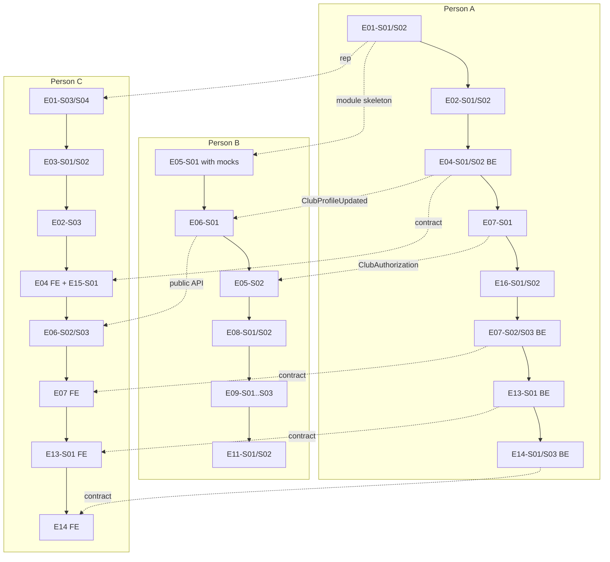

# Guide 05 — Build order and milestone checkpoints

**Goal:** turn the backlog into a day-by-day plan with clear integration checkpoints, so the team knows at any moment whether it is on track.

Read with: [backlog/README.md](../backlog/README.md) (capacity, per-person queues) and [10-delivery-plan.md](../../10-delivery-plan.md).

---

## 1. The first three hours (Day 1, from 14:00)

| Time | A: Platform | B: Community | C: Frontend |
|------|-------------|--------------|-------------|
| 14:00 | E01-S01 repository bootstrap → push `UNIX_CLUB/main` | 42 OAuth app, Resend domain + DNS, Cloudflare hostname prep (guide 00) | Tools check; read [08-frontend](../../08-frontend.md); sketch landing and club page |
| 14:45 | E01-S02 backend skeleton | Read [space.md](../../03-backend/space.md), [media.md](../../03-backend/media.md); start E05-S01 domain + evaluator tests with mocks (module skeleton from A) | E01-S03 frontend skeleton |
| 16:00 | E02-S01 Login with 42 | E05-S01 continued | E01-S04 API pipeline (with A's categories stub), E03-S01 shell |
| 17:00 | **Checkpoint M0** (below) | | |

## 2. Milestone checkpoints

At each checkpoint:

1. Everyone merges what is ready (finish the current task first).
2. Everyone pulls `UNIX_CLUB/main` and starts the stack.
3. One person drives the checklist below on the shared screen (5 minutes).
4. Re-plan if behind: apply MVP cuts and move Should items down.

### M0: skeleton and login (target: Day 1 ~18:00)

- [ ] `docker compose … up -d` healthy on all machines; `./mvnw verify` green; `npm run build` green.
- [ ] Login with 42 through `localhost:5173` returns to the SPA logged in; local admin login works.
- [ ] Routes and placeholders render; theme toggle works.

### M1: clubs exist (target: Day 2 ~13:00)

- [ ] A student requests a club; an admin approves it in the admin console.
- [ ] The approved club has a page with the "General" space (Posts + Lounge) in the sidebar; the founder is Owner.
- [ ] Landing page and directory list the club **without logging in**.
- [ ] Production images build; `https://42clubroom.ensui.dev` serves the app (E16-S01/S02).

### M2: community (target: Day 2 ~19:00)

- [ ] Join an OPEN club in one click; request and approve for an APPROVAL club; logged-out join resumes after login.
- [ ] Post with an image, a video and an audio clip; comment and reply; react.
- [ ] Non-members can read PUBLIC spaces but not post.

### M3: calendar (target: Day 2 ~22:00)

- [ ] Owner creates an event in a space; it shows on the club and campus calendars; members-only events are hidden from non-members.
- [ ] *(Should)* Chat across two browsers; notification badge increments.

### M4: lifecycle (target: Day 3 ~09:00)

- [ ] Ownership transfer: invite → accept → roles swap; the last owner can't step down.
- [ ] Admin archives the club → read-only everywhere, content still readable, future events cancelled.
- [ ] History tab: eras, timeline, posts of era 1.
- [ ] *(Should)* Revival request → admin approves → era 2.

### M5: ship (Day 3, freeze 11:00)

- [ ] UX polish pass on the demo path; demo data loaded.
- [ ] README complete; demo rehearsed twice on the live URL.
- [ ] Final MR opened before 12:00 ([guide 08](08-submission.md)).

## 3. Integration order (who waits for whom)

Dotted arrows are hand-offs: **merge the contract or stub first**, then keep going.

## 4. When you are behind

1. Apply the **MVP cut** of your current Must story (listed in each story).
2. Ask the person furthest ahead to take your next Must story (any story can be picked up thanks to the recipe, [guide 04](04-module-recipe.md)).
3. Drop Should items from the bottom of the priority list ([backlog §3](../backlog/README.md#3-capacity-read-this-before-planning)).
4. Never skip: the Must lifecycle stories (E13-S01, E14-S01, E14-S03), the README (E16-S05), the rehearsal (E16-S06).
